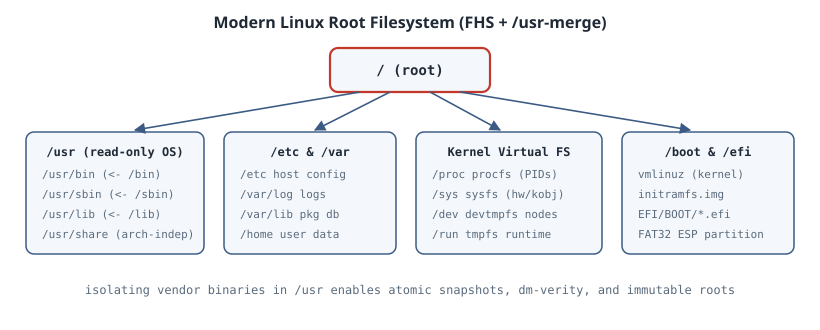

# The Filesystem Hierarchy Standard and Its Variants

Every Linux distribution organizes its files within a unified single-rooted hierarchical directory tree (`/`). The conventions governing where binaries, libraries, configuration files, and state directories reside are defined by the **Filesystem Hierarchy Standard (FHS)**, maintained by the Linux Foundation.

```text
/
├── bin -> usr/bin          # Essential binaries (symlinked in modern layouts)
├── sbin -> usr/bin         # System binaries (symlinked in modern layouts)
├── lib -> usr/lib          # Essential shared libraries
├── usr/                    # Primary read-only userland hierarchy
│   ├── bin/                # Non-essential and essential user binaries
│   ├── lib/                # Object files and internal libraries
│   ├── include/            # C/C++ header files for compilation
│   └── share/              # Architecture-independent data (man, icons, fonts)
├── etc/                    # Host-specific static configuration files
├── var/                    # Variable runtime data (logs, spool, caches)
│   ├── log/                # System log files
│   ├── cache/              # Package manager caches
│   └── lib/                # Persistent application state
├── dev/                    # Device nodes (populated dynamically by devtmpfs)
├── proc/                   # Kernel process and status pseudo-filesystem
├── sys/                    # Kernel device model and sysfs hierarchy
├── run/                    # Volatile runtime state (PID files, sockets)
├── boot/                   # Static files for the bootloader (vmlinuz, initramfs)
├── home/                   # User home directories
└── root/                   # Root user's home directory
```

## The Historical Origin of `/bin` vs. `/usr/bin`

Why did Unix-like systems historically have both `/bin` and `/usr/bin`, and `/lib` and `/usr/lib`?

In the early 1970s, Ken Thompson and Dennis Ritchie ran out of storage on their PDP-11's first RK05 disk pack (which held only 1.5 megabytes). They added a second disk pack and mounted it at `/usr`. Essential commands needed to boot the system into single-user mode and repair filesystems (`sh`, `mount`, `fsck`) stayed in `/bin` on the primary disk. Everything else (`cc`, `man`, `troff`) moved to `/usr`.

For decades, this split persisted under the assumption that `/usr` might be mounted over NFS (Network File System) after the root partition booted.

## The Modern "Usr-Merge"

In modern Linux distributions, the `/bin` vs. `/usr/bin` distinction is obsolete. Early boot tasks are handled by the **initramfs**, which mounts all required storage before root pivot occurs.

Consequently, modern distributions (Arch Linux, Fedora, Debian 12+, Ubuntu 20.04+) implement the **Usr-Merge**:

```bash
# On a modern Usr-Merged system:
$ ls -l /
lrwxrwxrwx 1 root root 7 bin -> usr/bin
lrwxrwxrwx 1 root root 7 sbin -> usr/bin
lrwxrwxrwx 1 root root 7 lib -> usr/lib
lrwxrwxrwx 1 root root 9 lib64 -> usr/lib64
```



### Advantages of the Usr-Merge

1. **Simplified `$PATH`:** Developers and scripts no longer have to worry whether a binary is located in `/bin`, `/sbin`, `/usr/bin`, or `/usr/sbin`.
2. **Snapshotting and Immutable System Roots:** The entire operating system binary state is contained within `/usr`. This allows `/usr` to be mounted strictly read-only, verified via `dm-verity`, or updated atomically as an OSTree or Btrfs subvolume.
3. **Clean Factory Resets:** Because `/usr` holds vendor-supplied defaults and `/etc` holds user overrides, resetting a machine to factory state can be as simple as wiping `/etc` and `/var`.

## Stateless Configuration: Vendor Defaults vs. Admin Overrides

Modern distributions take usr-merge one step further by separating **vendor defaults** in `/usr/lib` (or `/usr/share/factory`) from **local administrator overrides** in `/etc`. Tools like `systemd-tmpfiles` and `systemd-sysusers` reconstruct `/var`, `/run`, and `/etc/passwd` on boot from declarative drop-ins stored under `/usr/lib/tmpfiles.d/` and `/usr/lib/sysusers.d/`.

| Directory | Lifecycle | Ownership | Mount Policy in Immutable Distros |
| :--- | :--- | :--- | :--- |
| `/usr` | OS image release | Distribution vendor | Read-only (`ro`, optional `dm-verity`) |
| `/etc` | Persistent across updates | Local administrator | Read-write overlay or declarative symlinks |
| `/var` | Persistent runtime state | Services & logs | Read-write dedicated subvolume/partition |
| `/run` | Volatile per-boot | Init & daemons | `tmpfs` in RAM (`nosuid,nodev`) |

## Hands-On Lab: Audit Your Host's FHS and Usr-Merge Layout

Run this read-only audit on any Linux host or container to see how your current distribution maps top-level symlinks, mount points, and pseudo-filesystems:

```bash
# 1. Check whether top-level binary and library paths are usr-merged symlinks
for dir in /bin /sbin /lib /lib64; do
  if [ -e "$dir" ]; then
    ls -ld "$dir"
  fi
done

# 2. Inspect active virtual and physical mounts across /, /usr, /run, /proc, /sys
findmnt -o TARGET,SOURCE,FSTYPE,OPTIONS / /usr /run /dev /proc /sys 2>/dev/null

# 3. Compare vendor systemd units vs. administrator overrides
echo "Vendor units: $(find /usr/lib/systemd/system -maxdepth 1 -type f 2>/dev/null | wc -l)"
echo "Admin overrides: $(find /etc/systemd/system -maxdepth 1 -type f 2>/dev/null | wc -l)"
```

> [!TIP]
> When designing your own BYOL rootfs in [Chapter 13](../13-capstone-project/05-core-packages-into-target-rootfs.md), create `/usr/bin` and `/usr/lib` first and immediately symlink `/bin -> usr/bin`, `/sbin -> usr/bin`, and `/lib -> usr/lib` before installing a single package. Retrofitting usr-merge after packages are installed risks colliding files.
