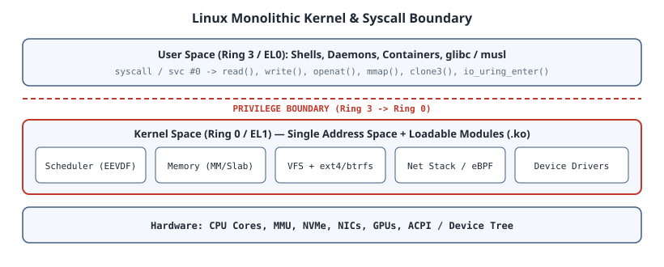

# Monolithic Architecture with Modular Extensions

Operating system kernels generally fall into two classic design philosophies: **microkernels** and **monolithic kernels**.

```text
+-----------------------------------------------------------+
|              Microkernel Architecture (e.g. seL4)         |
|  Userspace: [ File System ]  [ Network Stack ]  [ Drivers]|
|                   IPC Message Passing                     |
|  Kernel Space: [ Low-level Memory & Task Scheduling Only ]|
+-----------------------------------------------------------+

+-----------------------------------------------------------+
|             Monolithic Architecture (Linux Kernel)        |
|  Userspace: [ Application ]                               |
|                   POSIX System Calls (Ring 3 -> Ring 0)   |
|  Kernel Space:                                            |
|   [ VFS ] [ TCP/IP Stack ] [ Memory Management ]          |
|   [ Process Scheduler ] [ Device Drivers & Loadable Mod ] |
+-----------------------------------------------------------+
```

## Why Linux is Monolithic

In a pure microkernel, device drivers, filesystems, and network stacks run as isolated userspace server processes. While this isolates faults (a driver crash won't crash the entire kernel), passing data across user-kernel boundaries requires expensive context switches and inter-process communication (IPC) overhead.

Linux is a **monolithic kernel**:
- All core operating system services—process scheduling, memory allocation, virtual filesystems, network protocols, and hardware device drivers—execute within a single unified address space in supervisor mode (**Ring 0** on x86).
- System calls (`syscall`) transition the CPU from user mode (**Ring 3**) directly into kernel mode with minimal overhead.
- Direct pointer dereferencing within kernel space makes Linux extraordinarily fast and responsive.

## Loadable Kernel Modules (LKMs)

A purely static monolithic kernel would require recompiling and rebooting the entire operating system every time a new USB device, network card, or filesystem was attached.

To achieve flexibility without sacrificing bare-metal speed, Linux introduced **Loadable Kernel Modules (LKMs)**:
- Code compiled into `.ko` (Kernel Object) ELF binaries.
- Dynamically inserted into the running kernel using `init_module` or `finit_module` syscalls (`insmod` or `modprobe`).
- Linked into kernel memory at runtime, running with full Ring 0 privileges.

```bash
# Listing currently loaded modules in the running kernel:
$ lsmod | head -n 5
Module                  Size  Used by
overlay               151552  0
ext4                 1052672  1
crc32c_generic         16384  0
ahci                   45056  2
```



## Built-In (`=y`) vs. Modular (`=m`) Drivers

When configuring a custom kernel for your distribution, you will constantly choose between:
- **`=y` (Built-in):** The code is compiled directly into the executable kernel image (`vmlinuz`). It is permanently resident in RAM from boot time.
- **`=m` (Module):** The code is compiled into a standalone `/lib/modules/<version>/.../*.ko` file on disk. It is loaded on demand when the hardware is discovered by `udev`.

### The Golden Rule for Distribution Builders

If a driver is strictly necessary to mount the root filesystem (e.g., your SATA/NVMe controller driver, your root filesystem driver like `ext4` or `btrfs`), it **must** either be compiled as built-in (`=y`) or included inside the **initramfs**. If it is compiled as `=m` and left on the root disk, the kernel cannot read the disk to load the driver needed to read the disk!

## How Module Dependency Resolution Works (`depmod` and `modprobe`)

Unlike `insmod`, which inserts a single `.ko` file blindly and fails if a required symbol is missing, `modprobe` consults `/lib/modules/$(uname -r)/modules.dep`—a precomputed dependency graph generated by `depmod` when a kernel package is installed. When `udev` receives a hardware `uevent` containing a PCI or USB modalias (for example, `pci:v00008086d0000100E...`), it matches that alias against `modules.alias` and invokes `modprobe` to load the exact dependency chain in topological order.

## Hands-On Lab: Inspect Kernel Modules, Symbols, and Syscalls

Use these commands on a Linux host or VM to inspect how modular drivers wire into the monolithic kernel:

```bash
# 1. Inspect metadata, dependencies, and firmware requirements of the ext4 module
modinfo ext4 | grep -E '^(filename|depends|vermagic|alias):'

# 2. View the kernel's exported symbol table for VFS mount functions
grep -E ' (do_mount|vfs_read|vfs_write)$' /proc/kallsyms 2>/dev/null | head -n 5

# 3. Trace Ring 3 -> Ring 0 system calls made by a simple ls command
strace -c ls /tmp >/dev/null
```

> [!NOTE]
> `vermagic` in `modinfo` encodes the exact kernel release, SMP setting, and preemption model. A `.ko` module compiled for one kernel version will be rejected by `finit_module` on a different kernel unless `CONFIG_MODVERSIONS` matches every exported ABI checksum.
