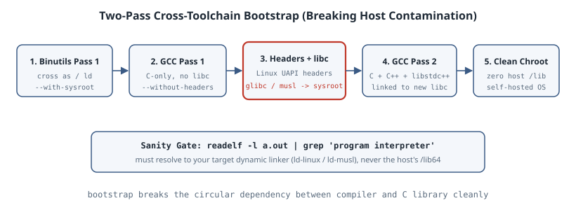

# The Bootstrap Process: Pass One and Pass Two

Bootstrapping a new distribution presents a circular dependency problem:
- To build the C library (`glibc`), you need a C compiler (`gcc`).
- To build a functional C compiler (`gcc`), you need the C library headers and startup objects (`libc.so`, `crt1.o`).

```text
                    The Circular Bootstrap Paradox
                     +---------------------------+
                     |  GCC needs libc headers   |
                     +-------------+-------------+
                                   |
                                   v
                     +---------------------------+
                     |  libc needs GCC compiler  |
                     +---------------------------+
```

To break this loop without poisoning the target distribution with host binaries, distro builders employ a **multi-pass bootstrap process**.

## Pass 1: The Bare-Metal Cross-Compiler

In Pass 1, we compile a stripped-down, static cross-compiler that runs on the host system:

1. **Install Linux API Headers:** Extract kernel headers directly into `$SYSROOT/usr/include`.
   ```bash
   $ make mrproper
   $ make headers_install INSTALL_HDR_PATH=$SYSROOT/usr
   ```
2. **Build Cross-Binutils (Pass 1):** Configured with `--target=$TARGET` and `--with-sysroot=$SYSROOT`.
   ```bash
   $ ../binutils/configure \
       --prefix=$TOOLS \
       --with-sysroot=$SYSROOT \
       --target=$TARGET \
       --disable-nls \
       --disable-werror
   $ make && make install
   ```
3. **Build GCC (Pass 1 - Static / Inhibit libc):** Configure GCC with `--without-headers`, `--with-newlib`, and `--disable-shared`. This builds a bare C-only compiler without thread support or dynamic linking capabilities:
   ```bash
   $ ../gcc/configure \
       --target=$TARGET \
       --prefix=$TOOLS \
       --with-glibc-version=2.39 \
       --with-sysroot=$SYSROOT \
       --without-headers \
       --disable-nls \
       --disable-shared \
       --disable-threads \
       --enable-languages=c
   $ make all-gcc all-target-libgcc && make install-gcc install-target-libgcc
   ```

## The Intermediate Bridge: Compiling the Target C Library

Now that we possess `$TOOLS/bin/$TARGET-gcc` (a compiler capable of emitting target machine code without needing a pre-existing target libc), we compile `glibc` or `musl`:

```bash
$ CC="$TARGET-gcc" ../glibc/configure \
    --prefix=/usr \
    --host=$TARGET \
    --build=$(../glibc/scripts/config.guess) \
    --enable-kernel=4.19 \
    --with-headers=$SYSROOT/usr/include \
    libc_cv_slibdir=/usr/lib
$ make && make DESTDIR=$SYSROOT install
```



## Pass 2: The Full Cross-Compiler and Native Chroot Tools

With the target C library now safely installed inside `$SYSROOT/usr/lib` and `$SYSROOT/usr/include`:

1. **Rebuild GCC (Pass 2):** Build a full compiler targeting `$TARGET` with C++ support, thread support (`pthreads`), and shared library support enabled.
2. **Compile Core Utilities for Target:** Using the Pass 2 cross-compiler, build Bash, Coreutils, Sed, Grep, Gawk, and Make, installing them into `$SYSROOT`.
3. **The Pivot (Entering Chroot):** Mount host `/dev`, `/proc`, and `/sys` into `$SYSROOT` and switch into the target rootfs using `chroot`:
   ```bash
   # chroot $SYSROOT /usr/bin/bash
   ```
From this point forward, every package is compiled natively from *inside* the clean environment. The host system's tools are severed.

## Understanding the GNU Triplet (`BUILD`, `HOST`, `TARGET`)

Cross-compilation flags frequently trip up first-time distribution builders because `configure` scripts distinguish three separate machines:

| Flag | Meaning | Example (x86_64 Laptop Building ARM64 Distro) |
| :--- | :--- | :--- |
| `--build` | Machine currently running `make` | `x86_64-pc-linux-gnu` |
| `--host` | Machine where the compiled binary will execute | `x86_64-pc-linux-gnu` (Pass 1) / `aarch64-byol-linux-gnu` (Target pkgs) |
| `--target` | Machine architecture that a compiler/assembler emits code for | `aarch64-byol-linux-gnu` (only meaningful for compilers & binutils) |

## Hands-On Lab: Verify Zero Host-Library Contamination

After completing Pass 1 and compiling your target C library, always run a sanity check binary through your cross-compiler and inspect its dynamic linker path with `readelf`:

```bash
# 1. Compile a trivial C program using the new cross-compiler
echo 'int main(void) { return 0; }' > /tmp/dummy.c
"$TARGET-gcc" /tmp/dummy.c -o /tmp/dummy

# 2. Verify the ELF interpreter points strictly to the target dynamic linker
readelf -l /tmp/dummy | grep 'Requesting program interpreter'
# Expected output on x86_64 glibc:
#   [Requesting program interpreter: /lib64/ld-linux-x86-64.so.2]

# 3. Verify no host /usr/include or host /lib paths leaked into linker search paths
"$TARGET-gcc" -v -Wl,--verbose /tmp/dummy.c -o /tmp/dummy 2>&1 \
  | grep -E 'attempt to open|SEARCH_DIR' | head -n 10

rm -f /tmp/dummy /tmp/dummy.c
```

> [!WARNING]
> If `readelf -l` shows a host-specific path or if `SEARCH_DIR` references `/usr/lib/x86_64-linux-gnu` outside `$SYSROOT`, stop immediately and inspect your `--with-sysroot` flag. Host leakage rarely fails during Pass 1—it surfaces hours later as cryptic `chroot` symbol crashes.
