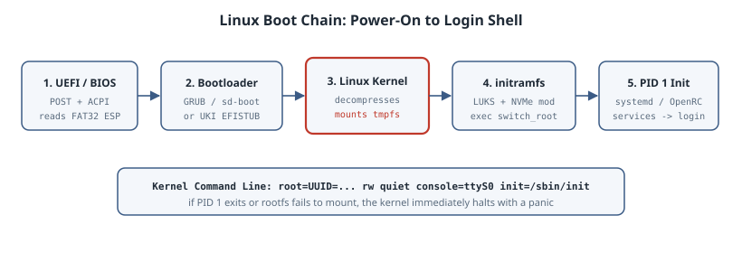

# From Power-On to Shell: The Full Boot Chain

The journey from pressing the physical power button on a computer to receiving an interactive shell prompt involves a relay race of hardware, firmware, bootloaders, kernel subsystems, and userspace processes.

```text
+-------------------------------------------------------------+
| 1. Firmware Initialization (UEFI / BIOS)                   |
|    - Power-On Self Test (POST)                              |
|    - Reads NVRAM boot entries; locates EFI System Partition |
+-------------------------------------------------------------+
                               |
                               v
+-------------------------------------------------------------+
| 2. Bootloader Stage (GRUB / systemd-boot)                   |
|    - Loads vmlinuz and initramfs into physical RAM          |
|    - Passes command line parameters (root=..., quiet)       |
+-------------------------------------------------------------+
                               |
                               v
+-------------------------------------------------------------+
| 3. Kernel Early Boot (Ring 0)                               |
|    - Unpacks self, sets up page tables and interrupt tables |
|    - Detects CPU cores, initializes memory and devices      |
|    - Unpacks initramfs into rootfs (tmpfs)                  |
|    - Executes /init in early userspace                      |
+-------------------------------------------------------------+
                               |
                               v
+-------------------------------------------------------------+
| 4. Early Userspace (Initramfs)                              |
|    - Loads storage drivers, mounts LUKS / LVM / ZFS / NFS   |
|    - Mounts real root filesystem to /newroot                |
|    - Executes pivot_root or switch_root to /newroot/sbin/init|
+-------------------------------------------------------------+
                               |
                               v
+-------------------------------------------------------------+
| 5. System Initialization (PID 1)                            |
|    - Remounts root read-write, mounts /proc, /sys, /dev     |
|    - Launches udev / mdev for device rules                  |
|    - Starts network, system daemons, display manager        |
|    - Spawns agetty on virtual consoles (tty1) -> Shell!     |
+-------------------------------------------------------------+
```



## The Baton Pass

Notice how every stage has a single purpose: **load the next, more capable stage, and get out of the way**:
1. UEFI initializes basic memory and PCI buses, then launches the bootloader.
2. The bootloader reads the filesystem of `/boot`, loads the compressed kernel and initramfs into memory, and jumps to the kernel's entry point.
3. The kernel initializes drivers and memory, then executes `/init` inside the temporary in-memory initramfs.
4. The initramfs script resolves complex storage (decryption, RAID assembly, network mounts), mounts the permanent root disk, and executes `switch_root`.
5. `switch_root` wipes the temporary initramfs from memory and replaces the running process with the real `/sbin/init` (PID 1).
6. PID 1 manages services, configures networking, and spawns login prompts.

## Kernel Command Line and Early Boot Handoff

The bootloader communicates boot intent to the kernel and initramfs via the **kernel command line** (`/proc/cmdline`). Parameters unknown to the kernel itself are forwarded straight into PID 1's environment or parsed by `/init` inside the initramfs:

```text
BOOT_IMAGE=/vmlinuz-6.12 root=UUID=a1b2c3d4-e5f6-4789-90ab-cdef12345678 ro rootflags=subvol=@root quiet splash
```

- `root=UUID=...` tells the initramfs which block device or filesystem UUID to mount at `/newroot`.
- `ro` mounts the root filesystem read-only initially so `fsck` can verify integrity before PID 1 remounts it read-write.
- `init=/bin/sh` overrides `/sbin/init`—the single most useful emergency rescue parameter when a broken init configuration prevents booting.

## Hands-On Lab: Measure Every Stage of Your Boot Chain

Inspect the exact handoff timings and parameters from your last boot on any UEFI Linux system:

```bash
# 1. Inspect the exact kernel command line passed by your bootloader
cat /proc/cmdline

# 2. Break down boot latency across firmware, loader, kernel, initrd, and userspace
systemd-analyze time
systemd-analyze critical-chain

# 3. Inspect UEFI NVRAM boot entries and the active EFI System Partition
efibootmgr -v 2>/dev/null | head -n 15
findmnt /boot /boot/efi /efi 2>/dev/null
```

> [!TIP]
> If `systemd-analyze time` shows a long `initrd` phase (> 3 seconds), inspect `journalctl -b -u initrd*`—the culprit is usually a stale swap/resume UUID in `/etc/fstab` causing `systemd-udevd` to wait for a 90-second device timeout.
