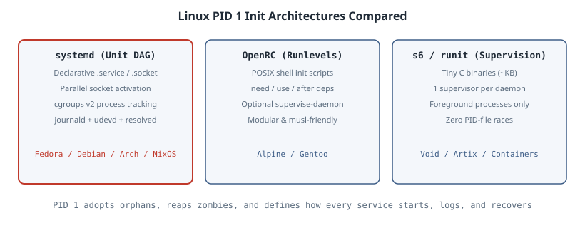

# Deep Dive: systemd Targets, Units, and Dependencies

Created by Lennart Poettering and Kay Sievers, `systemd` is the dominant init system and system configuration suite across enterprise Linux distributions.

```text
+-----------------------------------------------------------+
|                     systemd Architecture                  |
|                                                           |
|  [ Unit Files: .service, .socket, .target, .mount, .timer]|
|                               |                           |
|                               v                           |
|  [ Dependency Graph Engine (After=, Requires=, Wants=) ]  |
|                               |                           |
|                               v                           |
|  [ cgroups v2 Process Isolation (/sys/fs/cgroup/system.slice)]
|                               |                           |
|                               v                           |
|  [ Integrated Ecosystem: journald, logind, networkd, udev]|
+-----------------------------------------------------------+
```

## Units: Declarative State Configurations

Unlike SysVinit scripts, `systemd` uses declarative INI-style unit files placed in `/usr/lib/systemd/system/` (vendor defaults) and `/etc/systemd/system/` (admin overrides):

```ini
# /etc/systemd/system/sshd.service
[Unit]
Description=OpenSSH Server Daemon
Documentation=man:sshd(8)
After=network.target auditd.service
ConditionPathExists=!/etc/ssh/sshd_not_to_be_run

[Service]
Type=notify
ExecStart=/usr/sbin/sshd -D $SSHD_OPTS
ExecReload=/bin/kill -HUP $MAINPID
KillMode=process
Restart=on-failure
RestartSec=42s

[Install]
WantedBy=multi-user.target
```

## Understanding Dependency Directives

- `Requires=`: Hard dependency. If unit B is listed in unit A's `Requires=`, starting A will start B. If B fails to activate, A will not start.
- `Wants=`: Soft dependency. systemd attempts to start B when A starts, but failure of B does not prevent A from running.
- `After=` / `Before=`: **Ordering only, not dependency.** Declares the sequence of activation without implying whether the unit must be started.
- `BindsTo=`: Strongest dependency. If unit B stops or crashes, unit A is immediately shut down.

## Targets: Replacing Runlevels

`systemd` replaces numeric runlevels with **targets** (`.target` units), which group sets of services:
- `emergency.target`: Minimal single-process shell with root mounted read-only.
- `rescue.target`: Single-user mode with essential filesystems mounted.
- `multi-user.target`: Standard text-mode multi-user system (corresponds to SysV runlevel 3).
- `graphical.target`: Multi-user system with display manager and GUI (corresponds to SysV runlevel 5).



## Socket Activation

In socket activation, `systemd` creates and listens on a network port or UNIX socket (`.socket` unit) *before* the application starts. When the first client connects, systemd passes the open file descriptor to the newly spawned daemon (`.service` unit). This eliminates ordering dependencies: clients can connect to `dbus` or `sshd` while they are still loading into memory without experiencing dropped connections.

## Sandboxing Services with Unit Hardening Directives

Because `systemd` places every service inside its own `cgroups v2` slice, it can apply kernel namespaces, capability drops, and seccomp filters declaratively without modifying the daemon's source code:

```ini
# /etc/systemd/system/byol-metrics.service
[Unit]
Description=BYOL Local Metrics Exporter
After=network-online.target
Wants=network-online.target

[Service]
Type=simple
ExecStart=/usr/bin/byol-metrics --listen 127.0.0.1:9100
DynamicUser=yes
ProtectSystem=strict
ProtectHome=yes
PrivateTmp=yes
NoNewPrivileges=yes
MemoryMax=128M
CPUQuota=25%

[Install]
WantedBy=multi-user.target
```

## Hands-On Lab: Inspect Unit Dependencies and Security Exposure

Use `systemctl` and `systemd-analyze` on any systemd-based Linux host to inspect dependency graphs and hardening scores:

```bash
# 1. Print the full dependency tree for multi-user.target
systemctl list-dependencies multi-user.target | head -n 25

# 2. Audit kernel sandboxing exposure across active services
systemd-analyze security | head -n 15

# 3. Inspect the cgroup v2 hierarchy managed by PID 1
systemd-cgls --no-pager | head -n 25
```

> [!TIP]
> Never edit vendor unit files in `/usr/lib/systemd/system/` directly—package upgrades overwrite them. Always create drop-in overrides with `systemctl edit <unit>.service`, which writes a clean override snippet under `/etc/systemd/system/<unit>.service.d/override.conf`.
