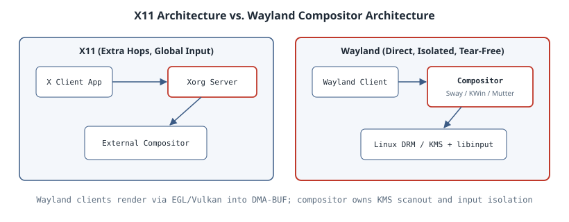

# X11 vs. Wayland: Architecture and Trade-offs

The graphical user interface (GUI) on Linux has undergone a historic architectural transition: moving away from the 40-year-old **X Window System (X11)** to the modern **Wayland** display protocol.

```text
+-----------------------------------------------------------+
|                   The X11 Architecture (Legacy)          |
|                                                           |
| [ Client App ] ---> (Render request via X11 protocol)     |
|         |                                                 |
|         v                                                 |
| [ Xorg Server (Root) ] <---> [ Compositor (Mutter/KWin) ] |
|         |                                                 |
|         v                                                 |
| [ Kernel DRM/KMS Driver ] ---> [ Screen Framebuffer ]     |
+-----------------------------------------------------------+

+-----------------------------------------------------------+
|                   The Wayland Architecture (Modern)       |
|                                                           |
| [ Client App ] ---+ (Direct GPU rendering via OpenGL/Vulkan)
|         |         |                                       |
|         |         v                                       |
|         +----> [ Wayland Compositor (KWin / Sway / Weston)]|
|                       |                                   |
|                       v                                   |
|             [ Kernel DRM/KMS Driver ] ---> [ Display ]    |
+-----------------------------------------------------------+
```

## The X11 Legacy: Why It Broke Down

Created in 1984 at MIT, X11 was engineered for a computing world where terminal screens were thin network clients connected to a central Unix mainframe:
1. **Network Transparency at the Cost of Local Speed:** The X server was responsible for drawing basic primitives (lines, text, rectangles). In modern computing, client applications (browsers, video editors) render complex pixel buffers locally using GPU shaders (Vulkan/OpenGL). Sending raw draw requests to Xorg creates massive indirection.
2. **Security Vulnerability by Design:** In X11, any client application connected to the X display can inspect, intercept, and inject keystrokes into any other window (`xdotool`, keyloggers) and capture screenshots of the entire desktop without user permission.
3. **Screen Tearing and Latency:** The split between the X server, the window manager, and the compositing manager introduces out-of-sync buffer swaps, causing visual tearing.

## The Wayland Philosophy: Every Frame is Perfect

Wayland is not a monolithic display server; **Wayland is an IPC protocol**.

Under Wayland:
- The **Compositor is the Display Server**.
- Client applications render their own UI buffers off-screen using hardware acceleration (EGL / GBM / Mesa).
- The client passes a handle to the rendered memory buffer (`wl_buffer`) directly to the compositor.
- The compositor schedules buffer presentation directly with the kernel's Direct Rendering Manager (**DRM**) and Kernel Mode Setting (**KMS**) subsystems.
- No client can read keystrokes or screen buffers belonging to another client without explicit protocol portals (`xdg-desktop-portal`).



## XWayland: Backward Compatibility

To maintain compatibility with legacy software that has not been ported to Wayland (e.g., older games, legacy X11 utilities), compositors launch **XWayland**—a headless X server that runs as a rootless Wayland client.

## Architectural Comparison for Distribution Builders

| Dimension | X11 (Xorg) | Wayland Compositor |
| :--- | :--- | :--- |
| Display server & compositor | Separate processes (Xorg + WM + compositor) | Unified single process (KWin, Mutter, Sway, Hyprland) |
| Buffer sharing | X11 protocol requests + MIT-SHM / DRI3 | Direct GPU DMA-BUF handles (`wl_buffer`) |
| Client isolation | Shared input/screen bus across all X clients | Strict per-client isolation; privileged actions via `xdg-desktop-portal` |
| HiDPI & fractional scaling | Global DPI hack; mixed-DPI monitors blur or tear | Native per-output scale factors and VRR support |
| Remote display | Built-in TCP/SSH X11 forwarding | Delegated to dedicated protocols (RDP, VNC, PipeWire/Waypipe) |

## Hands-On Lab: Inspect Your Active Display Protocol and DRM Devices

Run this inspection script inside a Linux desktop session to see which display server, GPU render nodes, and Wayland/XWayland sockets are active:

```bash
# 1. Identify whether the current session is Wayland or X11
echo "Session type: ${XDG_SESSION_TYPE:-unknown}"
echo "Wayland display: ${WAYLAND_DISPLAY:-none}"
echo "X11 display: ${DISPLAY:-none}"

# 2. List kernel DRM/KMS GPU devices exposed to the compositor
ls -l /dev/dri/

# 3. Inspect active Wayland protocol globals (requires wayland-utils)
if command -v wayland-info >/dev/null 2>&1 && [ -n "${WAYLAND_DISPLAY:-}" ]; then
  wayland-info | grep -E 'interface: (wl_compositor|xdg_wm_base|zwp_linux_dmabuf)'
fi
```

> [!NOTE]
> When assembling a minimal Wayland desktop in [Chapter 8.4](./04-building-minimal-desktop-from-source.md), remember to include `seatd` (or `systemd-logind`) so the compositor can open `/dev/dri/card0` and `/dev/input/event*` without running as `root`.
