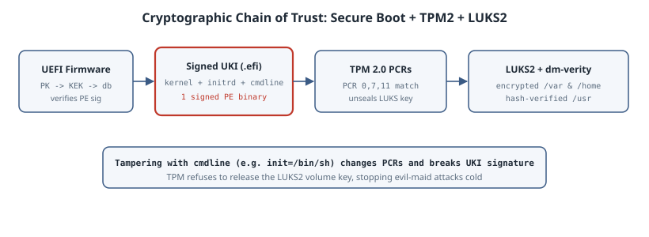

# Secure Boot and the Chain of Trust

**UEFI Secure Boot** establishes a hardware-rooted cryptographic chain of trust, ensuring that only cryptographically signed, untampered software can execute during the boot process.

```text
+-----------------------------------------------------------+
|                   The Secure Boot Chain                   |
|                                                           |
| 1. Motherboard Firmware ROM                               |
|    - Contains Platform Key (PK) & Key Exchange Key (KEK)  |
|    - Signature Database (db): Microsoft Corporation UEFI CA|
|         |                                                 |
|         v (Validates signature on shim)                   |
| 2. First-Stage Shim (shimx64.efi)                         |
|    - Signed by Microsoft 3rd Party UEFI CA                |
|    - Contains custom distribution certificate (Vendor CA) |
|         |                                                 |
|         v (Validates signature on GRUB)                   |
| 3. Second-Stage Bootloader (grubx64.efi)                  |
|    - Signed by distribution vendor key                    |
|         |                                                 |
|         v (Validates signature on Linux Kernel)           |
| 4. Linux Kernel Image (vmlinuz)                           |
|    - Signed by distribution vendor key                    |
|         |                                                 |
|         v (Enforces Kernel Lockdown Mode)                 |
| 5. Running Operating System                               |
+-----------------------------------------------------------+
```

## The "Shim" Architecture

Virtually all consumer PC motherboards ship with only one pre-installed certificate authority in their NVRAM `db`: **Microsoft Corporation UEFI CA 2011**.

Because having every custom Linux build independently certified by Microsoft is impractical, the Linux foundation engineered the **Shim** architecture:
- Red Hat / Canonical submit a tiny EFI binary called `shimx64.efi` to Microsoft once for signing.
- `shimx64.efi` embeds the distribution's own public certificate.
- When the motherboard boots, the firmware verifies `shimx64.efi` using Microsoft's key.
- `shimx64.efi` launches, then verifies `grubx64.efi` and the Linux kernel using the distribution's embedded key!
- It also supports **MOK (Machine Owner Key)**: users can enroll their own custom private keys into NVRAM via an interactive blue screen at boot time.



## Signing Kernel and Bootloader Binaries

To sign your custom BYOL kernel for Secure Boot:

```bash
# 1. Generate an X.509 code-signing key and certificate:
$ openssl req -new -x509 -newkey rsa:2048 -keyout byol-sb.key \
    -out byol-sb.crt -nodes -days 3650 -subj "/CN=BYOL Secure Boot Key/"

# 2. Convert to DER format:
$ openssl x509 -in byol-sb.crt -outform DER -out byol-sb.der

# 3. Sign the kernel binary using sbsigntool:
$ sbsign --key byol-sb.key --cert byol-sb.crt \
    --output /boot/vmlinuz-signed arch/x86/boot/bzImage

# 4. Verify the signature:
$ sbverify --cert byol-sb.crt /boot/vmlinuz-signed
Signature verification OK
```

## Unified Kernel Images (UKIs) and TPM2 Measured Boot

Signing `vmlinuz` alone leaves a critical gap: an attacker with physical access to an unencrypted `/boot` partition can still tamper with the `initramfs` image or append `init=/bin/sh` to the kernel command line. **Unified Kernel Images (UKIs)** close this gap by bundling the EFI stub, `vmlinuz`, `initramfs`, and `/proc/cmdline` into a single PE/COFF `.efi` binary signed with one signature:

```bash
# Assemble and sign a Unified Kernel Image with systemd-ukify
ukify build \
  --linux=/boot/vmlinuz-6.12 \
  --initrd=/boot/initramfs-6.12.img \
  --cmdline="root=UUID=a1b2c3d4-e5f6-4789-90ab-cdef12345678 ro quiet" \
  --secureboot-private-key=byol-sb.key \
  --secureboot-certificate=byol-sb.crt \
  --output=/boot/efi/EFI/Linux/byol-6.12.efi
```

When paired with a **TPM 2.0** chip, firmware and the bootloader extend cryptographic hashes of each boot stage into Platform Configuration Registers (PCR 0–7). `systemd-cryptenroll` can then bind your LUKS2 root volume key to PCR 7 (Secure Boot policy state), automatically unlocking the disk only when the exact verified boot chain executes.

## Hands-On Lab: Inspect Secure Boot State and EFI Signatures

Run these read-only checks on any UEFI Linux system to inspect Secure Boot enforcement and enrolled certificate databases:

```bash
# 1. Check whether UEFI Secure Boot is currently enabled
mokutil --sb-state 2>/dev/null || bootctl status | grep -E 'Secure Boot|Firmware'

# 2. List enrolled Secure Boot signature databases (PK, KEK, db)
efi-readvar -v PK 2>/dev/null | head -n 10
efi-readvar -v db 2>/dev/null | grep -E 'Subject:|CN=' | head -n 10

# 3. Inspect PE/COFF signatures on installed EFI binaries
sbverify --list /boot/efi/EFI/BOOT/BOOTX64.EFI 2>/dev/null || true
```

> [!IMPORTANT]
> Never store your Secure Boot private signing key (`byol-sb.key`) on an unencrypted `/boot` partition. Keep signing keys offline or in a hardware security module (HSM) and sign UKIs in a dedicated release build step.
