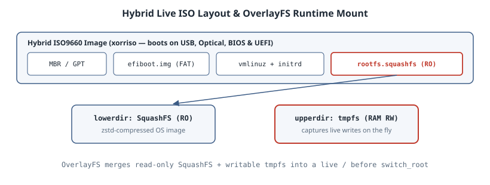

# Embedding the Bootloader, Kernel, and SquashFS Filesystem

A Live installation ISO must compress a multi-gigabyte operating system into an image that can run entirely in system RAM without touching the user's hard drive. The core technology that enables this is **SquashFS** combined with **OverlayFS**.

```text
+-----------------------------------------------------------+
|               The Live System Filesystem Stack            |
|                                                           |
| [ Unified / View (Writable Root Filesystem) ]             |
|                               |                           |
|       +-----------------------+-----------------------+   |
|       |                                               |   |
|       v                                               v   |
| [ Upper Layer: tmpfs ] (RAM)              [ Lower Layer ] |
| (Writes, new files, modified /etc)        (Read-Only)     |
|                                                       |   |
|                                                       v   |
|                                          [ SquashFS Loopback ]
|                                          (/byol/rootfs.squashfs)
+-----------------------------------------------------------+
```

## Step 1: Compressing the RootFS with SquashFS

**SquashFS** is a highly compressed, read-only filesystem built directly into the Linux kernel (`CONFIG_SQUASHFS=y`). It achieves extreme compression ratios (often exceeding 60-70% reduction in size) using Zstandard (`zstd`) or XZ compression:

```bash
# Compressing the clean rootfs directory tree:
$ mksquashfs /mnt/target/ iso-staging/byol/rootfs.squashfs \
    -comp zstd \
    -Xcompression-level 19 \
    -b 1048576 \
    -noappend \
    -wildcards \
    -e "proc/*" -e "sys/*" -e "dev/*" -e "tmp/*"
```
A 6 GB operating system rootfs compresses down to approximately 1.8 GB!

## Step 2: OverlayFS (Making Read-Only Writable)

Because SquashFS is strictly read-only, how can a live user create files in `/home` or install testing software?

The initramfs uses the kernel's **OverlayFS** driver to stack an in-memory writable `tmpfs` layer on top of the read-only SquashFS mount:

```bash
# Inside the Live Initramfs /init script:
# 1. Mount the optical ISO or USB drive
mount -t iso9660 -o ro /dev/disk/by-label/BYOL_LIVE /mnt/cdrom

# 2. Mount the compressed SquashFS payload via loop device
mkdir -p /mnt/squashfs
mount -t squashfs -o loop /mnt/cdrom/byol/rootfs.squashfs /mnt/squashfs

# 3. Create writable memory overlay
mkdir -p /mnt/overlay/upper /mnt/overlay/work /newroot
mount -t tmpfs none /mnt/overlay

# 4. Combine them into a unified rootfs using OverlayFS
mount -t overlay overlay -o lowerdir=/mnt/squashfs,upperdir=/mnt/overlay/upper,workdir=/mnt/overlay/work /newroot

# 5. Switch into the writable live desktop!
exec switch_root /newroot /sbin/init
```



Now, any file modified by the user writes only to RAM (`tmpfs`), leaving the underlying SquashFS payload pristine.

## Choosing SquashFS Compression Trade-offs

When mastering your distribution ISO, the SquashFS compression algorithm directly trades off ISO download size against live-boot speed and RAM usage:

| Algorithm | Typical Compression Ratio | Build Time | Live Boot Speed | Best For |
| :--- | :--- | :--- | :--- | :--- |
| `zstd -Xcompression-level 15` | High (~65–70% reduction) | Fast (multi-threaded) | Very fast | Modern desktop & server live ISOs |
| `xz -Xbcj x86` | Highest (~72–75% reduction) | Slow | Moderate | Bandwidth-constrained minimal rescue ISOs |
| `lz4 -Xhc` | Moderate (~50–55% reduction) | Very fast | Fastest | Ultra-fast PXE/RAM-boot appliances |

## Hands-On Lab: Build and Inspect a Minimal SquashFS + OverlayFS Stack

Practice creating a compressed SquashFS image and mounting it with a writable OverlayFS layer inside `/tmp` without touching any physical disk partitions:

```bash
# 1. Create a sample read-only rootfs tree
mkdir -p /tmp/byol-iso-lab/{rootfs/etc,lower,upper,work,merged}
echo "BYOL Live 1.0" > /tmp/byol-iso-lab/rootfs/etc/byol-release

# 2. Compress the tree into a SquashFS payload using zstd
mksquashfs /tmp/byol-iso-lab/rootfs /tmp/byol-iso-lab/rootfs.squashfs \
  -comp zstd -noappend -quiet

# 3. Inspect compression metadata and block size without mounting
unsquashfs -s /tmp/byol-iso-lab/rootfs.squashfs

# 4. (Linux with root) Mount SquashFS + OverlayFS and verify copy-on-write
# sudo mount -t squashfs -o loop,ro /tmp/byol-iso-lab/rootfs.squashfs /tmp/byol-iso-lab/lower
# sudo mount -t overlay overlay \
#   -o lowerdir=/tmp/byol-iso-lab/lower,upperdir=/tmp/byol-iso-lab/upper,workdir=/tmp/byol-iso-lab/work \
#   /tmp/byol-iso-lab/merged
# echo "runtime override" > /tmp/byol-iso-lab/merged/etc/byol-release
# cat /tmp/byol-iso-lab/lower/etc/byol-release   # Still "BYOL Live 1.0"
# cat /tmp/byol-iso-lab/merged/etc/byol-release  # Shows "runtime override"
```

> [!TIP]
> Always pass `-b 1048576` (1 MiB block size) to `mksquashfs` when compressing OS root filesystems. Larger blocks dramatically improve dictionary compression across similar ELF binaries and shared libraries.
