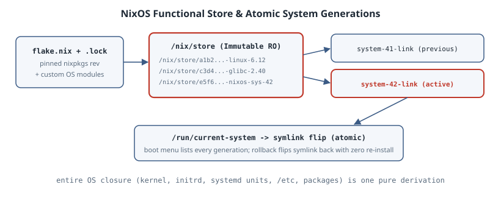

# Functional Package Store and Atomic Generations

Every traditional Linux distribution built in Chapters 1–13 mutates a shared global filesystem in place: installing a package overwrites `/usr/lib/libssl.so.3`, edits `/etc/systemd/system/`, and hopes no two packages need conflicting versions of the same library. **NixOS** replaces mutable filesystem state with a purely **functional build model**: the entire operating system — kernel, initramfs, glibc, systemd units, `/etc` files, and user packages — is compiled as an immutable graph of cryptographic store paths under `/nix/store/<hash>-<name>`, and switching OS versions is a single atomic symlink flip.



## Traditional mutable distributions vs. NixOS

| Dimension | Traditional Distro (`apt` / `dnf` / `pacman`) | NixOS (Functional / Declarative) |
| :--- | :--- | :--- |
| **Filesystem layout** | Shared FHS (`/usr/bin`, `/usr/lib`, `/etc`) | Isolated `/nix/store/<32-char-hash>-<name>-<ver>` + minimal `/bin/sh` & `/usr/bin/env` |
| **Dependency isolation** | Single global version per library soname | Unlimited coexisting versions; ELF `RPATH` points directly into `/nix/store` |
| **Upgrade model** | In-place overwrite; partial failures leave broken state | Builds complete new closure alongside the old one, then atomically flips symlink |
| **Rollback** | Hard (manual snapshots or reinstall) | Built-in: pick any previous generation at the bootloader or run `nixos-rebuild switch --rollback` |
| **Reproducibility** | Best-effort via lockfiles & container rebuilds | Cryptographic input-hashing via `flake.lock` guarantees identical closures across machines |

## How `/nix/store` breaks FHS assumptions cleanly

When Nix builds a package (a **derivation**), it hashes *every single build input* — source tarballs, compiler version, configure flags, build scripts, and transitive dependency hashes — into a 32-character base32 prefix:

```text
/nix/store/4k9x2v8q1m7p3n6r5w8z0y2j4c6h8b1d-openssl-3.4.0/lib/libssl.so.3
/nix/store/9p2m7r4w1x8k5v3n6q0z2y4j8c1h6b9f-nginx-1.27.2/bin/nginx
```

Because each compiled binary embeds exact `/nix/store/...` paths in its ELF `DT_RUNPATH` and `PT_INTERP` (dynamic linker) headers, `nginx` never searches `/usr/lib` and can never be broken by upgrading another package's OpenSSL.

## Atomic generations and `/run/current-system`

A NixOS system configuration evaluates to a single top-level derivation containing:
- `kernel` and `initrd` (symlinked to `/boot/EFI/Linux` or `/boot/loader/entries`)
- `etc/` (the complete, generated `/etc` tree)
- `sw/` (the system-wide `PATH` of binaries and systemd unit files)
- `activate` (an idempotent script that updates symlinks and reloads changed systemd units)

Every `nixos-rebuild switch` creates a numbered profile link under `/nix/var/nix/profiles/system-<N>-link` and updates `/run/current-system`. If a new kernel or firewall rule breaks networking, rebooting into `Generation N-1` in `systemd-boot` or GRUB restores the exact previous kernel, initrd, packages, and `/etc` atomically.

## Hands-on lab: inspect a NixOS closure, ELF `RPATH`, and generation links

Run these commands on any NixOS host or VM (or inside a Nix-enabled container) to verify how NixOS wires binaries without `/usr/lib`:

```bash
# 1. Inspect the active system generation symlink
readlink -f /run/current-system

# 2. List all bootable system generations
sudo nix-env --list-generations --profile /nix/var/nix/profiles/system

# 3. Inspect a binary's ELF interpreter and RPATH pointing straight into /nix/store
readelf -l "$(which bash)" | grep 'program interpreter'
readelf -d "$(which bash)" | grep -E 'RUNPATH|RPATH'

# 4. Measure the exact closure size of the running OS or a single package
nix path-info -Sh /run/current-system
nix-store -q --tree "$(which curl)" | head -n 25
```

Observe that `bash` does **not** use `/lib64/ld-linux-x86-64.so.2` — its interpreter is a hashed `/nix/store/...-glibc-.../lib/ld-linux-x86-64.so.2`, making every closure self-contained and non-conflicting.

## Summary

- NixOS eliminates "works on my machine" drift and broken partial upgrades by compiling the entire OS into immutable `/nix/store/<hash>-<name>` paths.
- Every system rebuild produces a numbered, bootable generation; rolling back is an atomic symlink flip rather than an imperative downgrade.

## Sources

- [NixOS Manual — Architecture & Profiles](https://nixos.org/manual/nixos/stable/)
- [Eelco Dolstra, The Purely Functional Software Deployment Model](https://edolstra.github.io/pubs/phd-thesis.pdf)
