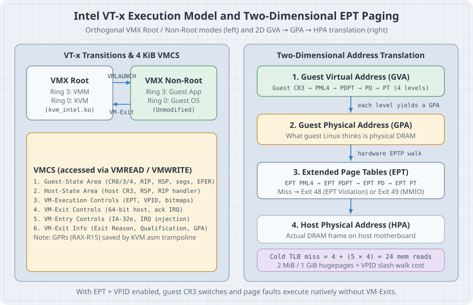

# Trap-and-Emulate to VT-x, VMCS, and EPT

Every microVM—whether a 300-line Rust experiment or AWS Lambda's Firecracker—ultimately rests on silicon. Before writing a single `ioctl` against `/dev/kvm`, you need an exact mental model of why x86 could not be virtualized cleanly in software, how Intel VT-x (and AMD-V) redesigned the processor execution model, what lives inside the 4 KiB **VMCS**, and what actually happens during a two-dimensional **EPT** page-table walk.

## Classical Virtualization and the Popek–Goldberg Theorem

In 1974, Gerald Popek and Robert Goldberg formalized the exact conditions under which a computer architecture can support a classical **trap-and-emulate** Virtual Machine Monitor (VMM). They defined three properties a VMM must satisfy:

1. **Equivalence (Fidelity):** Any program executing under the VMM exhibits behavior essentially identical to executing directly on bare hardware, modulo timing differences and resource availability.
2. **Resource Control (Safety):** The VMM retains complete control over all virtualized system resources; no guest code can directly affect physical hardware state or escape its allocated memory.
3. **Efficiency (Performance):** A statistically dominant fraction of guest instructions execute directly on the physical CPU without VMM intervention.

To determine whether an Instruction Set Architecture (ISA) can achieve all three via pure trap-and-emulate, Popek and Goldberg partitioned instructions into two sets:

- **Privileged instructions:** Instructions that trap (raise a synchronous exception into the VMM) whenever executed outside the highest hardware privilege level (Ring 0 on x86).
- **Sensitive instructions:** Instructions that either *modify* system-wide configuration/resources (*control-sensitive*, e.g., loading page table roots, disabling interrupts, changing protection rings) or whose behavior *depends* on the current hardware configuration or privilege level (*behavior-sensitive*, e.g., reading the current privilege level or descriptor table registers).

> [!IMPORTANT]
> **The Popek–Goldberg Theorem:** A conventional third-generation architecture is classically virtualizable if and only if the set of **sensitive instructions** is a subset of the set of **privileged instructions** ($\text{Sensitive} \subseteq \text{Privileged}$).

If that condition holds, virtualization is conceptually simple: run the VMM in Ring 0 and de-privilege the guest OS into Ring 1 (or Ring 3). Normal guest arithmetic, branches, and loads run at native speed. Whenever the guest OS attempts anything sensitive, the CPU traps into Ring 0, the VMM emulates the instruction against virtualized state, advances the guest instruction pointer, and resumes the guest.

### Why Classical x86 Failed Popek–Goldberg

The x86 ISA violated Popek–Goldberg catastrophically. In 1998, Robin and Irvine cataloged **17 sensitive-but-unprivileged x86 instructions**—instructions that read or attempt to modify privileged state yet **do not trap** when executed in Ring 1, 2, or 3. Instead, they silently fail, silently ignore bits, or leak real host state.

| Instruction(s) | Category | Behavior in Ring 1–3 (De-privileged Guest OS) | Why It Breaks Virtualization |
|---|---|---|---|
| `POPF` / `POPFD` | Control-sensitive | Silently ignores writes to `IF` (Interrupt Flag) and `IOPL`; does **not** raise `#GP` | Guest OS thinks it disabled interrupts, but host interrupts remain enabled—no trap occurs for VMM to intercept |
| `PUSHF` / `PUSHFD` | Behavior-sensitive | Pushes real hardware `EFLAGS` (including real `IF`/`IOPL`) | Guest sees host interrupt state instead of virtual interrupt state |
| `SGDT`, `SIDT`, `SLDT`, `STR` | Behavior-sensitive | Unprivileged read of `GDTR`, `IDTR`, `LDTR`, `TR` | Leaks real host descriptor table base addresses and limits to guest |
| `SMSW` | Behavior-sensitive | Reads lower 16 bits of `CR0` without trapping | Exposes real host `CR0` protection/paging bits |
| `PUSH CS`, `MOV ..., CS` | Behavior-sensitive | Exposes Current Privilege Level (`CPL` in bits 1:0) | Guest OS expects `CPL == 0`, sees `CPL == 1` or `3` |
| `LAR`, `LSL`, `VERR`, `VERW` | Behavior-sensitive | Checks segment access rights against current `CPL` | Returns wrong results when guest kernel runs at `CPL > 0` |
| `POP SS`, `MOV SS` | Behavior-sensitive | Suppresses debug/interrupts for one instruction; checks `RPL == CPL` | Breaks ring-0 guest stack switching assumptions |
| `INT n` / `IRET` | Control/Behavior | `IRET` in Ring 1–3 skips privilege-level transitions or drops `IF` silently | Guest kernel cannot return cleanly to guest userspace with `CPL` checks |

Even worse, x86 had a **ring compression** problem: x86-64 Long Mode eliminated segment limit checks (`CS`/`DS`/`ES`/`SS` base is forced to 0, limits are ignored) and left only two effective page-table privilege levels (Supervisor `U/S=0` for Rings 0–2, and User `U/S=1` for Ring 3). Running a 64-bit guest kernel in Ring 1 or Ring 2 meant it could still overwrite Ring 0 VMM pages if mapped in the same address space!

### Pre-Hardware Workarounds: Binary Translation and Paravirtualization

Before hardware virtualization arrived in 2005–2006, two software approaches bridged the gap:

1. **Dynamic Binary Translation (BT) — VMware Workstation / ESX:**
   The VMM runs guest *userspace* directly on the CPU, but never executes unmodified guest *kernel* code. Instead, a JIT-like translator reads guest kernel basic blocks, replaces every sensitive-but-unprivileged instruction (`POPF`, `SGDT`, `CLI`, `IRET`) with safe instruction sequences or calls into the VMM, caches the translated blocks in a code cache, and executes the cache. BT preserved full unmodified OS compatibility, at the cost of enormous VMM complexity, code-cache memory overhead, and poor performance on kernel-heavy workloads (fork/exec, page faults, syscalls).
2. **Paravirtualization (PV) — Early Xen:**
   Modify the guest OS source code so it never executes sensitive x86 instructions at all. Instead, the guest kernel invokes explicit **hypercalls** (e.g., `HYPERVISOR_mmu_update`) to ask the Ring 0 hypervisor to update page tables, toggle virtual interrupts, or switch stacks. PV was fast on 2003-era CPUs, but it required maintaining invasive patches for every guest OS (and could not run closed-source kernels like Windows).

Both approaches were rendered obsolete for general compute when Intel introduced **VT-x (VMX)** in 2005 and AMD introduced **AMD-V (SVM)** in 2006.

## Intel VT-x (VMX) Architectural Execution Model

Intel's Virtual Machine Extensions (VMX) solved x86 virtualization by adding an **orthogonal privilege dimension** rather than squeezing the VMM and guest into the existing four rings.



In **VMX Non-Root Operation**:
- The guest kernel runs natively in **Ring 0** (`CPL = 0`) and guest applications run in **Ring 3** (`CPL = 3`). There is zero ring compression.
- Sensitive instructions, exceptions, interrupts, I/O port accesses, MSR reads/writes, `CPUID`, and control register updates are **selectively intercepted** by hardware according to bitmaps in the active VMCS.
- When an intercepted event occurs, the CPU performs an atomic **VM-Exit** back to **VMX Root Operation Ring 0** (specifically to the host `RIP` stored in the VMCS, inside `kvm_intel.ko`).
- When the hypervisor finishes handling the exit, it executes `VMRESUME`, performing an atomic **VM-Entry** back into VMX Non-Root Operation.

### The VMX Instruction Lifecycle

Every physical logical CPU (hardware thread) maintains its own VMX state machine. On Linux, `kvm_intel.ko` executes this lifecycle across all online CPUs:

1. **Enable VMX (`VMXON`):**
   - Verify `CPUID.1:ECX.VMX[bit 5] == 1`.
   - Check `IA32_FEATURE_CONTROL` MSR (`0x3A`): bit 0 (Lock) must be 1 and bit 2 (Enable VMX outside SMX) must be 1 (this is what the BIOS "Intel Virtualization Technology" toggle controls).
   - Set `CR4.VMXE[bit 13] = 1`.
   - Allocate a 4 KiB-aligned **VMXON region** per physical core, write the 31-bit **VMCS revision identifier** (read from `IA32_VMX_BASIC` MSR `0x480`) into bytes `0..3`, and execute `VMXON [phys_addr]`. The core is now in VMX Root Operation.
2. **Initialize a VMCS (`VMCLEAR`):**
   - Allocate a 4 KiB-aligned **VMCS region** per vCPU, write the same revision ID into bytes `0..3`, and execute `VMCLEAR [vmcs_phys]`. This initializes the VMCS to the **clear** (not launched) state and flushes any CPU-internal cached VMCS data to memory.
3. **Activate a VMCS (`VMPTRLD`):**
   - Execute `VMPTRLD [vmcs_phys]` to make this VMCS the **current VMCS** on this physical core. All subsequent `VMREAD` and `VMWRITE` instructions operate implicitly on the current VMCS.
4. **Configure Fields (`VMWRITE` / `VMREAD`):**
   - Populate guest state, host state, and execution/entry/exit controls. Software must **never** read or write VMCS fields with normal `MOV` instructions—the internal layout is microarchitecture-specific and cached inside the CPU core.
5. **First Entry (`VMLAUNCH`) and Subsequent Entries (`VMRESUME`):**
   - `VMLAUNCH` validates all VMCS fields (failing with `VMfailValid` and an error code in `VM_INSTRUCTION_ERROR` if any invariant is violated), transitions the VMCS launch state from `clear` to `launched`, and enters Non-Root mode.
   - After a VM-Exit, the VMCS remains in the `launched` state, so subsequent re-entries use `VMRESUME` (which skips the initial clear-state check). If a vCPU migrates to another physical core, KVM executes `VMCLEAR` on the old core (via IPI) and `VMPTRLD` + `VMLAUNCH` on the new core.
6. **Teardown (`VMXOFF`):**
   - Leaves VMX operation when `kvm_intel` is unloaded or the CPU goes offline.

> [!NOTE]
> **Cost of a VM-Exit + VM-Entry round trip:** On modern x86-64 CPUs (Intel Ice Lake / Sapphire Rapids / AMD Zen 4), a minimal round-trip VM-Exit + VM-Entry handled entirely inside `kvm_intel.ko` (e.g., a `CPUID` or `VMWRITE` microbenchmark) takes roughly **400 to 900 CPU cycles** (~150–350 ns). If KVM must return out of the kernel to a userspace VMM (`KVM_RUN` return -> userspace handler -> `ioctl(KVM_RUN)`), add another **1,500 to 4,000+ cycles** (~0.6–2 µs) for kernel/user transitions and mitigation barriers (e.g., IBPB/VERW/L1D flush). Minimizing VM exits—especially userspace VM exits—is the single most important performance principle in microVM engineering.

## The VMCS (Virtual Machine Control Structure) Internals

The VMCS is the hardware ABI between the hypervisor and the CPU. Although it occupies a single 4 KiB page of physical memory, you address every field via a **32-bit field encoding** passed in a register to `VMREAD` / `VMWRITE`:

```text
31         15 14   13 12 11   10 9              1   0
+------------+-------+--+-------+----------------+----+
|  Reserved  | Width |0 | Type  |     Index      |Acc |
+------------+-------+--+-------+----------------+----+
  Width: 00 = 16-bit, 01 = 64-bit, 10 = 32-bit, 11 = Natural (64-bit on x86-64)
  Type:  00 = Control, 01 = VM-exit info, 10 = Guest-state, 11 = Host-state
  Acc:   0 = Full, 1 = High (upper 32 bits of 64-bit field in 32-bit mode)
```

Logically, the VMCS is divided into **six regions**:

### 1. Guest-State Area
Loaded into CPU registers on VM-Entry; saved automatically from CPU registers on VM-Exit.
- **Control & Debug Registers:** `CR0`, `CR3`, `CR4`, `DR7`.
- **Execution Pointer & Flags:** `RSP`, `RIP`, `RFLAGS`.
- **Segment Registers (`CS`, `SS`, `DS`, `ES`, `FS`, `GS`, `LDTR`, `TR`):** Crucially, the VMCS stores not just the 16-bit selector, but also the **hidden descriptor cache** (`base`, `limit`, and `access_rights`) for each segment. This is why a VMM can drop a guest straight into 64-bit Long Mode without executing a `far jmp`!
- **Descriptor Tables:** `GDTR` (base + limit), `IDTR` (base + limit).
- **Key MSRs:** `IA32_DEBUGCTL`, `IA32_SYSENTER_CS/ESP/EIP`, `IA32_PERF_GLOBAL_CTRL`, `IA32_PAT`, `IA32_EFER`.
- **Non-Register State:**
  - *Activity State:* `0 = Active`, `1 = HLT`, `2 = Shutdown`, `3 = Wait-for-SIPI` (used for secondary vCPUs in SMP bringup).
  - *Interruptibility State:* tracks blocking by `STI` (interrupt shadow), `MOV SS`, SMI, or NMI.
  - *VMCS Link Pointer:* set to `0xFFFF_FFFF_FFFF_FFFF` unless using Shadow VMCS for nested virtualization.

### 2. Host-State Area
Loaded into CPU registers on every VM-Exit so the CPU lands cleanly inside `kvm_intel.ko`'s assembly trampoline (`__vmx_vcpu_run`):
- Host `CR0`, `CR3` (host kernel page table), `CR4`.
- Host `RSP` (host kernel stack pointer for this vCPU thread) and Host `RIP` (the exact assembly label right after `VMLAUNCH`/`VMRESUME`).
- Host segment selectors (`CS`, `SS`, `DS`, `ES`, `FS`, `GS`, `TR`) and bases (`FS`, `GS`—pointing to host per-CPU data, `TR`, `GDTR`, `IDTR`).
- Host `IA32_SYSENTER_*`, `IA32_PAT`, `IA32_EFER`.

Notice what is **not** in the VMCS: **General-Purpose Registers (`RAX`–`R15`) and FPU/SSE/AVX (`XMM`/`YMM`/`ZMM`) state!** The CPU does not save or restore GPRs in the VMCS. Instead, KVM's assembly trampoline (`arch/x86/kvm/vmx/vmenter.S`) saves host callee-saved registers onto the host stack, loads guest GPRs from `struct vcpu_vmx` right before `VMRESUME`, and immediately dumps guest GPRs back into memory right after VM-Exit (followed by clearing registers to prevent Spectre v1/v2 speculation gadgets using guest-controlled values).

### 3. VM-Execution Control Fields
These bitmasks dictate *what causes a VM-Exit* while the guest runs:

- **Pin-Based Controls (32-bit):**
  - `External-Interrupt Exiting`: Physical hardware IRQs (host timer, host NIC, host NVMe) immediately force a VM-Exit so the host kernel can service them.
  - `NMI Exiting` & `Virtual NMIs`: Intercept physical NMIs cleanly.
  - `Activate VMX-Preemption Timer`: A hardware countdown timer that triggers a VM-Exit when it hits zero (used by KVM to emulate guest APIC timer deadlines without host hrtimers).
  - `Process Posted Interrupts`: Enables hardware interrupt delivery to a running vCPU without VM-Exit.
- **Primary Processor-Based Controls (32-bit):**
  - `HLT Exiting`: Trap guest `HLT` so KVM can put the vCPU thread to sleep (`kvm_vcpu_block`) instead of burning a physical core.
  - `INVLPG` / `CR3-Load` / `CR3-Store` Exiting: Required for shadow page tables; **turned OFF** when EPT is active!
  - `Use I/O Bitmaps`: Points to two 4 KiB bitmaps (Bitmap A for ports `0x0000`–`0x7FFF`, Bitmap B for `0x8000`–`0xFFFF`, 1 bit per port). A `1` bit triggers a VM-Exit on `IN`/`OUT`.
  - `Use MSR Bitmaps`: Points to a single 4 KiB page divided into four 1 KiB bitmaps: read low MSRs (`0x0000_0000`–`0x0000_1FFF`), read high MSRs (`0xC000_0000`–`0xC000_1FFF`), write low MSRs, write high MSRs. Only intercepted MSRs exit; safe MSRs (like `IA32_FS_BASE`, `IA32_GS_BASE`, `IA32_KERNEL_GS_BASE` on context switch) execute at native speed!
  - `Activate Secondary Controls`: Unlocks the secondary processor-based control word.
- **Secondary Processor-Based Controls (32-bit):**
  - `Enable EPT` (bit 1): Activates two-dimensional hardware paging.
  - `Enable RDTSCP` (bit 3): Allows guest `RDTSCP` without `#UD`.
  - `Enable VPID` (bit 5): Tags TLB entries with a Virtual Processor ID.
  - `Unrestricted Guest` (bit 7): Allows the guest to run with `CR0.PE = 0` and `CR0.PG = 0` (real mode and unpaged protected mode) directly on hardware when EPT is enabled! Without this, early VT-x CPUs forced KVM to emulate real-mode boot instruction-by-instruction.
  - `APIC-Register Virtualization` (bit 8) & `Virtual-Interrupt Delivery` (bit 9): Hardware-accelerated Local APIC.
  - `Enable PML` (Page Modification Logging, bit 17): Hardware logs dirty guest physical pages into a 4 KiB ring buffer (512 entries) before exiting, massively accelerating live migration and snapshot diffing.
- **Exception Bitmap (32-bit):** One bit per architectural exception vector (0–31). For example, with EPT enabled, bit 14 (`#PF`, Page Fault) is **0**—guest page faults are delivered directly to the guest kernel's IDT without ever exiting to the host!
- **CR0 / CR4 Guest/Host Masks and Read Shadows:** Bits set to `1` in the mask are "owned by the host": if the guest tries to change them to a value differing from the Read Shadow, a VM-Exit occurs; if the guest *reads* `CR0`/`CR4`, it sees the Read Shadow for host-owned bits and the real guest register for guest-owned bits.

### 4. VM-Exit Control Fields
Controls what happens during a VM-Exit:
- `Host Address-Space Size`: Set to `1` for 64-bit host kernels.
- `Acknowledge Interrupt on Exit`: CPU automatically acknowledges the physical interrupt controller during VM-Exit and records the vector in the VM-Exit Interruption Information field.
- `Save/Load IA32_EFER` and `VM-Exit MSR-Store / MSR-Load` lists for atomically swapping MSRs not directly in the VMCS.

### 5. VM-Entry Control Fields
Controls what happens during a VM-Entry:
- `IA-32e Mode Guest`: Set to `1` when entering a 64-bit guest (must match `IA32_EFER.LMA`).
- **VM-Entry Interruption-Information Field (32-bit):** The mechanism KVM uses to **inject virtual interrupts and exceptions** into the guest upon `VMRESUME`:
  ```text
  31    30..12     11          10..8              7..0
  +---+----------+-----------+------------------+--------+
  | V | Reserved | ErrCode   | InterruptionType | Vector |
  +---+----------+-----------+------------------+--------+
  V = Valid (1 = inject on entry)
  Type: 0 = External IRQ, 2 = NMI, 3 = Hardware Exception, 4 = Software INT
  ```
  When the CPU executes `VMRESUME` with `V=1`, it delivers the vector straight through the guest's IDT as if hardware had fired it.

### 6. VM-Exit Information Fields (Read-Only)
Populated by hardware on every VM-Exit so KVM knows *why* the guest stopped:

| Basic Exit Reason | Hex | Meaning | Typical KVM / VMM Action |
|---|---|---|---|
| `0` | `0x00` | Exception or NMI | Re-inject, handle host NMI, or debug trap |
| `1` | `0x01` | External Interrupt | Return to host IRQ handler, re-enter guest |
| `10` | `0x0A` | `CPUID` | Emulate virtualized CPUID leaves in KVM |
| `12` | `0x0C` | `HLT` | Sleep vCPU thread until virtual IRQ arrives |
| `28` | `0x1C` | Control Register Access | Emulate `CR0`/`CR4`/`CR8` update |
| `30` | `0x1E` | I/O Instruction (`IN`/`OUT`) | Decode port/size/direction; exit to userspace (`KVM_EXIT_IO`) if not in-kernel (e.g., UART `0x3F8`) |
| `31` / `32` | `0x1F`/`0x20` | `RDMSR` / `WRMSR` | Emulate virtualized MSRs in KVM |
| `48` | `0x30` | **EPT Violation** | Demand-page guest RAM, mark dirty, or trap to MMIO (`KVM_EXIT_MMIO`) |
| `49` | `0x31` | **EPT Misconfiguration** | Reserved bit set in EPT entry; KVM intentionally uses this as a fast-path marker for **MMIO SPTEs**! |
| `52` | `0x34` | VMX-Preemption Timer Expired | Inject virtual APIC timer interrupt |

Alongside Basic Exit Reason, the CPU populates **Exit Qualification** (a bitmask encoding exact details—for I/O exits, port number, operand size, and direction; for EPT violations, whether it was a read, write, or instruction fetch), **Guest-Linear Address**, and **Guest-Physical Address**.

> [!TIP]
> **KVM's EPT Misconfiguration Trick (Exit 49):** Because an unmapped EPT entry (Exit 48) is ambiguous—it could mean either "lazy demand-paged RAM" or "emulated MMIO device"—KVM caches known MMIO addresses directly inside the EPT by writing a deliberately *invalid* memory-type bit pattern (`0b110` or `0b010` with reserved bits) into the EPT leaf PTE. Future guest accesses to that MMIO address trigger **EPT Misconfiguration (Exit 49)**, telling KVM immediately "this is MMIO, skip the memslot lookup and go straight to MMIO emulation or `ioeventfd`!"

## Memory Virtualization: Shadow Page Tables to EPT

Virtualizing memory requires translating across **four address spaces**:

1. **GVA (Guest Virtual Address):** Address used by a guest process or guest kernel.
2. **GPA (Guest Physical Address):** What the guest kernel *believes* is physical RAM (e.g., `0x0000_0000` to `0x1000_0000` for a 256 MiB microVM).
3. **HVA (Host Virtual Address):** The virtual address inside the userspace VMM process (e.g., returned by `mmap()`) that backs a GPA range.
4. **HPA (Host Physical Address):** The actual physical DRAM frame address on the host motherboard.

### Why Shadow Page Tables Were Abandoned

Before EPT/NPT, the CPU MMU understood only a single page-table hierarchy (`CR3`). The hypervisor therefore had to maintain **Shadow Page Tables (SPT)** mapping `GVA -> HPA` directly and load the *shadow* root into the hardware `CR3`, while keeping the guest's `CR3` virtualized.

Keeping shadow tables synchronized with guest page tables was brutal:
- Every guest page-table page had to be **write-protected** in the shadow tables so any guest `PTE` update caused a `#PF` VM-Exit.
- Every guest `CR3` write (every guest process context switch!) and every `INVLPG` triggered a VM-Exit.
- Memory overhead grew linearly with the number of guest processes, because each guest `mm_struct` required a separate shadow tree.

### Intel EPT (Extended Page Tables): Two-Dimensional Hardware Paging

Intel EPT (and AMD NPT) added a **second MMU translation layer** in silicon. The guest owns its own `CR3` and page tables (`GVA -> GPA`) completely without exits. Whenever the hardware MMU needs to read a physical address while in VMX Non-Root mode, it automatically translates that `GPA -> HPA` using the **EPT Pointer (`EPTP`)** configured in the VMCS:

```text
EPTP (64-bit VMCS field):
63..52       51..12                       11..7   6     5..3         2..0
+-----------+----------------------------+-------+-----+------------+----------+
| Reserved  | EPT PML4 Physical Address  | Rsrvd | A/D | WalkLen-1  | MemType  |
| (0)       | (4 KiB aligned HPA)        | (0)   | En  | (3 = 4-lvl)| (6 = WB) |
+-----------+----------------------------+-------+-----+------------+----------+
```

Each EPT level mirrors x86-64 4-level paging (`EPT PML4` -> `EPT PDPT` -> `EPT PD` -> `EPT PT`), indexing 9 bits of the 48-bit GPA per level (bits `47:39`, `38:30`, `29:21`, `20:12`), with bits `11:0` as the 4 KiB page offset (or terminating early at `EPT PD` for 2 MiB hugepages, or `EPT PDPT` for 1 GiB hugepages):

```text
EPT Leaf Entry (4 KiB Page, 64-bit):
63..52   51..12                     11..10  9   8   7   6      5..3      2   1   0
+-------+--------------------------+-------+---+---+---+------+---------+---+---+---+
| Ign   | Host Physical Frame (HPA)|  Ign  | D | A | 0 | IPAT | EPT MT  | X | W | R |
+-------+--------------------------+-------+---+---+---+------+---------+---+---+---+
  R (bit 0) = Read access allowed      W (bit 1) = Write access allowed
  X (bit 2) = Execute access allowed   EPT MT    = 0 (UC), 6 (WB)
  A (bit 8) = Accessed                 D (bit 9) = Dirty (for live migration/snapshots)
```

Notice that an EPT entry with `R=0, W=0, X=0` is **not present**—any guest access raises an **EPT Violation (Exit 48)**.

### The 24-Access Two-Dimensional Page Walk

EPT eliminates guest page-table VM-Exits, but it introduces a steep **TLB miss penalty**. When a guest instruction accesses a `GVA` that misses in the TLB, the hardware page-table walker must perform a **two-dimensional walk**:

```text
Guest Walk (GVA -> GPA)          Host EPT Walk (GPA -> HPA) for EACH step
-----------------------          ----------------------------------------
1. Guest CR3 (GPA)     ------->  EPT PML4 -> EPT PDPT -> EPT PD -> EPT PT  (4 reads)
   -> Read Guest PML4E  (1 read)
2. Guest PDPT (GPA)    ------->  EPT PML4 -> EPT PDPT -> EPT PD -> EPT PT  (4 reads)
   -> Read Guest PDPTE  (1 read)
3. Guest PD (GPA)      ------->  EPT PML4 -> EPT PDPT -> EPT PD -> EPT PT  (4 reads)
   -> Read Guest PDE    (1 read)
4. Guest PT (GPA)      ------->  EPT PML4 -> EPT PDPT -> EPT PD -> EPT PT  (4 reads)
   -> Read Guest PTE    (1 read)
5. Final Data (GPA)    ------->  EPT PML4 -> EPT PDPT -> EPT PD -> EPT PT  (4 reads)
                                 -> Final HPA!
-------------------------------------------------------------------------
Worst-case cold TLB miss = (4 guest reads) + (5 x 4 EPT reads) = 24 memory accesses!
(With 5-level guest + 5-level EPT paging: 5 + 6 x 5 = 35 memory accesses!)
```

This is why **Transparent Huge Pages (THP)** or explicit **2 MiB / 1 GiB HugeTLB** backing for guest memory is so impactful in virtualization:
- Backing guest RAM with 2 MiB EPT pages cuts each EPT walk from 4 levels to 3 (and 1 GiB pages cut it to 2), reducing the worst-case 2D walk from 24 accesses down to **19 or 14**, while dramatically increasing TLB reach.
- Modern CPUs also maintain dedicated **Paging-Structure Caches** (caching upper `EPT PML4`/`PDPT`/`PD` entries) so most EPT walks hit in cache rather than DRAM.

### VPID (Virtual Processor Identifier) and TLB Tagging

Without VPID, every VM-Entry and VM-Exit must **flush the entire CPU TLB** so host and guest translations (which can share the same linear addresses) never collide. Enabling **VPID** (Secondary Control bit 5) assigns a 16-bit tag (`VPID = 0` for VMX Root / host; `VPID = 1..65535` for each vCPU) to every TLB entry. Combined with `PCID` inside the guest, host and guest translations coexist peacefully in the TLB across VM-Exits. Hypervisors invalidate stale entries selectively with `INVVPID` (for linear translations) and `INVEPT` (when unmapping or write-protecting EPT entries, e.g., during dirty-page logging).

## Interrupt Virtualization and APICv

In early VT-x, every guest Local APIC register access (reading `TPR`, writing `EOI` at the end of every interrupt handler, sending an IPI via `ICR`) triggered an EPT Violation or MMIO exit—causing tens of thousands of VM-Exits per second on I/O-heavy workloads.

Modern Intel CPUs implement **APICv** (and AMD implements **AVIC**):
- **Virtual-APIC Page:** A 4 KiB page in host memory mapped into the VMCS that holds the guest's virtual Local APIC registers (`IRR`, `ISR`, `TPR`, `PPR`).
- **APIC-Register Virtualization:** Guest reads from the APIC page execute directly in hardware without a VM-Exit.
- **Virtual-Interrupt Delivery (VID):** Hardware evaluates `IRR` vs. `PPR` and delivers pending virtual interrupts directly on `EOI`—eliminating `EOI` VM-Exits for edge-triggered interrupts (MSI/MSI-X!).
- **Posted Interrupts:** An IOMMU (VT-d) or another physical CPU can set a bit in the guest's **Posted-Interrupt Descriptor (PID)** in memory and send a special physical *posted-interrupt notification vector* to the core running the target vCPU. The receiving core merges the pending virtual IRQ into `VIRR` and delivers it to the guest **without ever taking a VM-Exit**.

## Intel VT-x vs. AMD-V (SVM) Quick Reference

Linux KVM abstracts both architectures behind the same `/dev/kvm` userspace ABI, but knowing the hardware vocabulary mapping is essential when reading kernel traces or `kvm_stat` output:

| Concept | Intel VT-x (VMX) | AMD-V (SVM) |
|---|---|---|
| Kernel Module | `kvm_intel.ko` | `kvm_amd.ko` |
| CPUID Feature Flag | `vmx` (`CPUID.1:ECX[5]`) | `svm` (`CPUID.80000001h:ECX[2]`) |
| Control Structure | **VMCS** (opaque, `VMREAD`/`VMWRITE` only) | **VMCB** (normal memory struct, direct `MOV` access) |
| Enter Guest | `VMLAUNCH` / `VMRESUME` | `VMRUN` (implicit save/restore via `VMLOAD`/`VMSAVE`) |
| 2D Paging | **EPT** (Extended Page Tables) | **NPT** (Nested Page Tables / RVI) |
| TLB Tagging | **VPID** (16-bit) | **ASID** (Address Space ID, 16-bit+) |
| Interrupt Virtualization | **APICv** + Posted Interrupts | **AVIC** / **x2AVIC** |
| Global Interrupt Flag | Implicitly masked on VM-Exit | Explicit `GIF` controlled via `CLGI` / `STGI` |

## Observing Hardware Virtualization on a Linux Host

You can inspect your host's exact VT-x/SVM capabilities, active KVM module parameters, and live VM-Exit rates directly from the shell:

```bash
# 1. Verify CPU hardware virtualization flags and EPT/VPID/APICv support
grep -m1 -oE '\b(vmx|svm|ept|vpid|npt|avic|vnmi|tsc_deadline_timer)\b' /proc/cpuinfo | sort -u

# 2. Inspect active kvm_intel (or kvm_amd) hardware parameters
head -n 1 /sys/module/kvm_intel/parameters/{ept,vpid,unrestricted_guest,enable_apicv,pml,nested} 2>/dev/null

# 3. Watch live VM-Exit reasons per second across all running VMs/microVMs
sudo kvm_stat -1
```

For microsecond-level attribution of which exact VM-Exit reasons are burning CPU cycles on a running microVM, use `perf kvm`:

```bash
# Record 5 seconds of KVM VM-Exits and summarize by exit reason and latency
sudo perf kvm stat record -a -- sleep 5
sudo perf kvm stat report --event=vmexit
```

Typical healthy microVM output shows `HLT` (idle guest) dominating total time, while `EPT_VIOLATION`, `IO_INSTRUCTION`, and `MSR_WRITE` remain low during steady-state workloads. If `CPUID`, `IO_INSTRUCTION`, or `EPT_VIOLATION` spikes unexpectedly, you have found a virtualization bottleneck in either the guest kernel or the VMM.

With the silicon model clear—VMX Root vs. Non-Root, the 6 VMCS regions, and 2D EPT paging—we are ready to cross into Linux userspace and drive KVM directly from Rust in [Chapter 2: KVM from User Space in Rust](02-kvm-from-user-space-in-rust.md).
