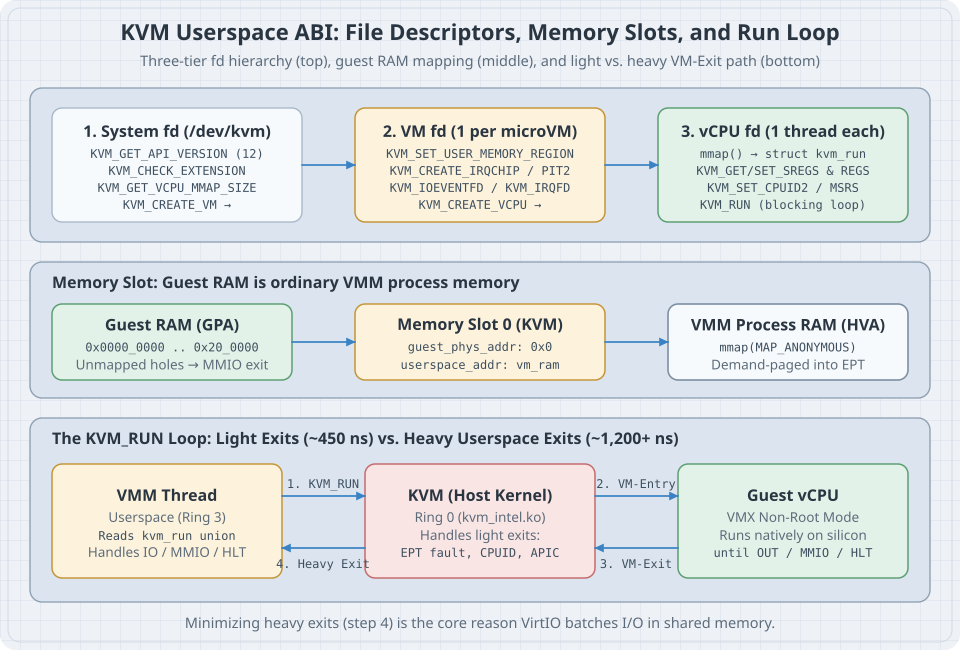

# KVM from User Space in Rust

Linux **KVM (Kernel-based Virtual Machine)** is not a complete hypervisor on its own. It is a kernel subsystem (`kvm.ko` + `kvm_intel.ko`/`kvm_amd.ko`) that exposes hardware virtualization primitives—VMCS/VMCB lifecycle, EPT/NPT page tables, vCPU scheduling, and in-kernel interrupt controllers—to ordinary userspace processes through a single character device: `/dev/kvm`.

Everything else—allocating guest RAM, loading a kernel image, emulating serial ports and VirtIO devices, enforcing rate limits, and managing lifecycle—belongs to the **userspace Virtual Machine Monitor (VMM)**. In this chapter, we build a working VMM in Rust in **three progressive stages**:

1. **Raw system calls (`open`, `ioctl`, `mmap`)** — nothing hidden, so you see every `ioctl` number, struct layout, and shared-page read.
2. **The `rust-vmm` crates (`kvm-ioctls`, `kvm-bindings`, `vm-memory`)** — the same libraries Firecracker and Cloud Hypervisor are built on.
3. **Jumping from 16-bit Real Mode to 64-bit Long Mode** — constructing a GDT, 2 MiB hugepage identity page tables, special registers (`CR0`/`CR3`/`CR4`/`EFER`), and `CPUID`, which is the exact bridge required before [Chapter 3: Booting Linux](03-booting-linux.md) boots a real kernel.

## Host Prerequisites

To run KVM programs on a Linux machine, three conditions must hold:

```bash
# 1. Hardware virtualization enabled in CPU and firmware (must be > 0)
grep -Ec '(vmx|svm)' /proc/cpuinfo

# 2. KVM kernel modules loaded and /dev/kvm present
lsmod | grep -E '^kvm'
ls -l /dev/kvm

# 3. Your user has read/write access to /dev/kvm (typically via the kvm group)
test -r /dev/kvm && test -w /dev/kvm && echo "OK: /dev/kvm accessible"
```

> [!NOTE]
> **Running inside a cloud VM:** A cloud VM is already a guest. To open `/dev/kvm` inside it, the cloud provider must expose **nested virtualization** (`vmx`/`svm` passed into the L1 guest). Bare-metal instances always have `/dev/kvm` available.

## The KVM ABI: Three File Descriptors, Memory Slots, and the Run Loop

KVM models virtualization objects as Linux file descriptors arranged in a three-tier hierarchy. Because every tier is a standard `fd`, normal ownership, `close()` teardown, `mmap()`, `epoll`, and `seccomp` policies apply directly.



- **System `fd` (`/dev/kvm`):** Opened once. Queries API version (`12`, frozen since 2007), optional capabilities (`KVM_CHECK_EXTENSION`), `kvm_run` page size (`KVM_GET_VCPU_MMAP_SIZE`), supported `CPUID` leaves, and creates VMs via `KVM_CREATE_VM`.
- **VM `fd`:** One per microVM. Configures resources shared by all vCPUs: memory slots (`KVM_SET_USER_MEMORY_REGION`), TSS address (`KVM_SET_TSS_ADDR`), in-kernel interrupt controllers (`KVM_CREATE_IRQCHIP`, `KVM_CREATE_PIT2`), async VirtIO signaling (`KVM_IOEVENTFD`, `KVM_IRQFD`), and creates vCPUs via `KVM_CREATE_VCPU`.
- **vCPU `fd`:** One per virtual CPU, driven by **one POSIX thread per vCPU**. Behind each vCPU `fd` sits a VMCS (Intel) or VMCB (AMD). You never touch the VMCS directly—`KVM_GET_REGS`/`KVM_SET_REGS` and `KVM_GET_SREGS`/`KVM_SET_SREGS` read and write it on your behalf, which is why the same userspace code runs on both Intel and AMD CPUs.

### Guest Memory Registration (`KVM_SET_USER_MEMORY_REGION`)

Guest "physical" RAM is just an ordinary `mmap(MAP_PRIVATE | MAP_ANONYMOUS)` allocation in the VMM's own virtual address space, registered with KVM as a **memory slot**:

```rust
#[repr(C)]
#[derive(Debug, Default, Copy, Clone)]
pub struct KvmUserspaceMemoryRegion {
    pub slot: u32,            // Memslot index (0, 1, ...)
    pub flags: u32,           // KVM_MEM_LOG_DIRTY_PAGES (1) | KVM_MEM_READONLY (2)
    pub guest_phys_addr: u64, // Start GPA (must be 4 KiB page-aligned)
    pub memory_size: u64,     // Size in bytes (0 deletes the slot)
    pub userspace_addr: u64,  // Start HVA returned by mmap()
}
```

Three architectural consequences follow directly from this design:
1. **Direct VMM access:** Loading a kernel, parsing a VirtIO descriptor ring, or writing network packets into guest buffers are ordinary memory accesses inside the VMM process—no `ioctl` required.
2. **Lazy EPT demand paging:** `KVM_SET_USER_MEMORY_REGION` does not allocate host DRAM or populate EPT entries. When the guest first touches a GPA, the CPU raises an EPT Violation (Exit 48); KVM resolves `GPA -> HVA -> HPA` via `get_user_pages()`, installs the EPT leaf PTE, and resumes the guest—a **light exit** that userspace never sees. A 512 MiB microVM that only touches 140 MiB only consumes ~140 MiB of host RSS.
3. **Deliberate MMIO holes:** Any GPA not covered by a memslot is not RAM. When the guest reads or writes an unmapped GPA (such as `0xD000_0000`), KVM decodes the instruction and exits to userspace with `KVM_EXIT_MMIO` (or fires an `ioeventfd`).

## Stage 1: A Minimal VMM with Raw `ioctl`s

Every VMM—from a 100-line toy to Firecracker—executes the same **six setup-and-run steps**:
1. Open `/dev/kvm` and verify `KVM_GET_API_VERSION == 12`.
2. Create a VM (`KVM_CREATE_VM`).
3. Allocate guest RAM with `mmap()`, copy guest code into it, and register it (`KVM_SET_USER_MEMORY_REGION`).
4. Create vCPU 0 (`KVM_CREATE_VCPU`) and `mmap()` its shared `struct kvm_run` page.
5. Configure `kvm_sregs` and `kvm_regs` so the vCPU starts at our code.
6. Loop on `KVM_RUN`, dispatching exits from `kvm_run` until `KVM_EXIT_HLT`.

### How Linux Encodes KVM `ioctl` Request Numbers

Linux `ioctl` command numbers are not arbitrary integers—they pack four fields into 32 bits: transfer direction (bits `31:30`), argument struct byte size (bits `29:16`), driver magic byte (`0xAE` for KVM in bits `15:8`), and command number (bits `7:0`):

```rust
use std::mem::size_of;

const KVMIO: u64 = 0xae;
const fn io(nr: u64) -> u64 { (KVMIO << 8) | nr }
const fn iow<T>(nr: u64) -> u64 { (1 << 30) | ((size_of::<T>() as u64) << 16) | io(nr) }
const fn ior<T>(nr: u64) -> u64 { (2 << 30) | ((size_of::<T>() as u64) << 16) | io(nr) }
```

> [!TIP]
> **Why `size_of::<T>()` is baked into the `ioctl` number:** If a kernel struct ever changes size in a new ABI revision, its `ioctl` number automatically changes with it—so an older userspace binary passing a smaller struct receives `-ENOTTY` instead of causing the kernel to read past the end of the caller's stack buffer.

### The 16-Bit Real-Mode Guest

A freshly created KVM vCPU starts in **16-bit Real Mode** at the IBM PC reset vector (`CS.base = 0xFFFF_0000`), just like bare x86 silicon at power-on. By zeroing `CS.base` and setting `RIP = 0x1000`, we can run a tiny 36-byte x86 program that loops over a null-terminated string, writes each byte to serial port `0x3F8` (`OUT dx, al`), and halts (`HLT`):

```asm
bits 16
org 0x1000
    mov dx, 0x3f8      ; COM1 serial I/O port
    mov si, msg        ; SI = address of message
next:
    lodsb              ; AL = [SI++]
    test al, al        ; null terminator?
    jz done
    out dx, al         ; write byte to port 0x3f8 -> KVM_EXIT_IO
    jmp next
done:
    hlt                ; stop vCPU -> KVM_EXIT_HLT
msg:
    db "Hello from KVM!", 10, 0
```

### Complete Raw-`ioctl` Rust VMM

```rust
use std::fs::{File, OpenOptions};
use std::io::{self, Write};
use std::mem::size_of;
use std::os::unix::io::{AsRawFd, FromRawFd, RawFd};
use std::ptr;

const KVMIO: u64 = 0xae;
const fn io(nr: u64) -> u64 { (KVMIO << 8) | nr }
const fn iow<T>(nr: u64) -> u64 { (1 << 30) | ((size_of::<T>() as u64) << 16) | io(nr) }
const fn ior<T>(nr: u64) -> u64 { (2 << 30) | ((size_of::<T>() as u64) << 16) | io(nr) }

const KVM_GET_API_VERSION: u64 = io(0x00);
const KVM_CREATE_VM: u64 = io(0x01);
const KVM_GET_VCPU_MMAP_SIZE: u64 = io(0x04);
const KVM_CREATE_VCPU: u64 = io(0x41);
const KVM_SET_USER_MEMORY_REGION: u64 = iow::<KvmUserspaceMemoryRegion>(0x46);
const KVM_RUN: u64 = io(0x80);
const KVM_SET_REGS: u64 = iow::<KvmRegs>(0x82);
const KVM_GET_SREGS: u64 = ior::<KvmSregs>(0x83);
const KVM_SET_SREGS: u64 = iow::<KvmSregs>(0x84);

const KVM_EXIT_IO: u32 = 2;
const KVM_EXIT_HLT: u32 = 5;
const KVM_EXIT_IO_OUT: u8 = 1;
const COM1: u16 = 0x3f8;
const LOAD_ADDR: u64 = 0x1000;
const MEM_SIZE: usize = 2 * 1024 * 1024; // 2 MiB

// Assembled machine code for the 16-bit guest above
const GUEST16: &[u8] = &[
    0xba, 0xf8, 0x03, // mov dx, 0x3f8
    0xbe, 0x0f, 0x10, // mov si, 0x100f (msg)
    0xac,             // lodsb
    0x84, 0xc0,       // test al, al
    0x74, 0x03,       // jz done
    0xee,             // out dx, al
    0xeb, 0xf8,       // jmp next
    0xf4,             // hlt
    b'H', b'e', b'l', b'l', b'o', b' ', b'f', b'r', b'o', b'm',
    b' ', b'K', b'V', b'M', b'!', b'\n', 0,
];

#[repr(C)]
struct KvmUserspaceMemoryRegion {
    slot: u32, flags: u32, guest_phys_addr: u64, memory_size: u64, userspace_addr: u64,
}
#[repr(C)] #[derive(Default)]
struct KvmRegs {
    rax: u64, rbx: u64, rcx: u64, rdx: u64, rsi: u64, rdi: u64, rsp: u64, rbp: u64,
    r8: u64, r9: u64, r10: u64, r11: u64, r12: u64, r13: u64, r14: u64, r15: u64,
    rip: u64, rflags: u64,
}
#[repr(C)] #[derive(Default, Copy, Clone)]
struct KvmSegment {
    base: u64, limit: u32, selector: u16, type_: u8, present: u8, dpl: u8,
    db: u8, s: u8, l: u8, g: u8, avl: u8, unusable: u8, padding: u8,
}
#[repr(C)] #[derive(Default, Copy, Clone)]
struct KvmDtable { base: u64, limit: u16, padding: [u16; 3] }
#[repr(C)] #[derive(Default)]
struct KvmSregs {
    cs: KvmSegment, ds: KvmSegment, es: KvmSegment, fs: KvmSegment,
    gs: KvmSegment, ss: KvmSegment, tr: KvmSegment, ldt: KvmSegment,
    gdt: KvmDtable, idt: KvmDtable,
    cr0: u64, cr2: u64, cr3: u64, cr4: u64, cr8: u64, efer: u64, apic_base: u64,
    interrupt_bitmap: [u64; 4],
}
#[repr(C)] #[derive(Copy, Clone)]
struct KvmRunIo { direction: u8, size: u8, port: u16, count: u32, data_offset: u64 }
#[repr(C)]
union KvmExitUnion { io: KvmRunIo, padding: [u8; 256] }
#[repr(C)]
struct KvmRun {
    request_interrupt_window: u8, immediate_exit: u8, padding1: [u8; 6],
    exit_reason: u32, ready_for_interrupt_injection: u8, if_flag: u8, flags: u16,
    cr8: u64, apic_base: u64, exit_data: KvmExitUnion,
}

fn ioctl(fd: RawFd, req: u64, arg: u64) -> io::Result<i32> {
    // `req as _` handles glibc (c_ulong) vs musl (c_int) transparently.
    let ret = unsafe { libc::ioctl(fd, req as _, arg) };
    if ret < 0 { Err(io::Error::last_os_error()) } else { Ok(ret) }
}

fn main() -> io::Result<()> {
    // 1–2. Open /dev/kvm, verify API version 12, create VM
    let kvm = OpenOptions::new().read(true).write(true).open("/dev/kvm")?;
    assert_eq!(ioctl(kvm.as_raw_fd(), KVM_GET_API_VERSION, 0)?, 12);
    let vm = unsafe { File::from_raw_fd(ioctl(kvm.as_raw_fd(), KVM_CREATE_VM, 0)?) };

    // 3. Allocate 2 MiB guest RAM, copy guest code, register slot 0
    let vm_ram = unsafe {
        libc::mmap(
            ptr::null_mut(), MEM_SIZE,
            libc::PROT_READ | libc::PROT_WRITE,
            libc::MAP_PRIVATE | libc::MAP_ANONYMOUS, -1, 0,
        )
    };
    assert_ne!(vm_ram, libc::MAP_FAILED);
    unsafe {
        ptr::copy_nonoverlapping(GUEST16.as_ptr(), (vm_ram as *mut u8).add(LOAD_ADDR as usize), GUEST16.len());
    }
    let region = KvmUserspaceMemoryRegion {
        slot: 0, flags: 0, guest_phys_addr: 0, memory_size: MEM_SIZE as u64, userspace_addr: vm_ram as u64,
    };
    ioctl(vm.as_raw_fd(), KVM_SET_USER_MEMORY_REGION, &region as *const _ as u64)?;

    // 4. Create vCPU 0 and mmap its shared kvm_run page
    let vcpu = unsafe { File::from_raw_fd(ioctl(vm.as_raw_fd(), KVM_CREATE_VCPU, 0)?) };
    let mmap_size = ioctl(kvm.as_raw_fd(), KVM_GET_VCPU_MMAP_SIZE, 0)? as usize;
    let run_ptr = unsafe {
        libc::mmap(ptr::null_mut(), mmap_size, libc::PROT_READ | libc::PROT_WRITE, libc::MAP_SHARED, vcpu.as_raw_fd(), 0)
    };
    assert_ne!(run_ptr, libc::MAP_FAILED);

    // 5. Point CS.base = 0 and RIP = 0x1000
    let mut sregs = KvmSregs::default();
    ioctl(vcpu.as_raw_fd(), KVM_GET_SREGS, &mut sregs as *mut _ as u64)?;
    sregs.cs.base = 0;
    sregs.cs.selector = 0;
    ioctl(vcpu.as_raw_fd(), KVM_SET_SREGS, &sregs as *const _ as u64)?;

    let regs = KvmRegs { rip: LOAD_ADDR, rflags: 0x2, ..Default::default() };
    ioctl(vcpu.as_raw_fd(), KVM_SET_REGS, &regs as *const _ as u64)?;

    // 6. Run loop: rebuild &KvmRun after every KVM_RUN (KVM mutates the page on each exit)
    let mut stdout = io::stdout();
    loop {
        match ioctl(vcpu.as_raw_fd(), KVM_RUN, 0) {
            Err(e) if e.kind() == io::ErrorKind::Interrupted => continue, // EINTR from signal
            r => r?,
        };
        let run = unsafe { &*(run_ptr as *const KvmRun) };
        match run.exit_reason {
            KVM_EXIT_IO => unsafe {
                let io_exit = run.exit_data.io;
                // data_offset is measured from the start of the kvm_run mmap, NOT inside KvmRunIo!
                let byte = *(run_ptr as *const u8).add(io_exit.data_offset as usize);
                if io_exit.direction == KVM_EXIT_IO_OUT && io_exit.port == COM1 {
                    stdout.write_all(&[byte])?;
                }
            },
            KVM_EXIT_HLT => {
                println!("[raw] guest halted");
                return Ok(());
            }
            other => panic!("unexpected KVM exit reason: {other}"),
        }
    }
}
```

> [!WARNING]
> **Watch `KvmRunIo::data_offset` and `EINTR`:**
> - For `KVM_EXIT_IO`, the payload bytes sit at `(run_ptr as *const u8).add(io.data_offset as usize)`—relative to the start of the `kvm_run` mapping. For `KVM_EXIT_IO_IN`, you write the response byte to that exact offset before the next `KVM_RUN`.
> - If a signal arrives while the guest runs, `KVM_RUN` returns `-EINTR` (`ErrorKind::Interrupted`). That is not a failure—production VMMs intentionally send `SIGUSR1` (with `kvm_run.immediate_exit = 1`) to preempt a running vCPU thread for shutdown or snapshotting.

## Stage 2: Rewriting with the `rust-vmm` Crates

Production Rust VMMs do not hand-code `ioctl` numbers or raw `kvm_run` union casts. They build on the modular **`rust-vmm`** crates:

| Raw `ioctl` Step | `rust-vmm` Equivalent | What the Crate Handles Safely |
|---|---|---|
| `open("/dev/kvm")` + `KVM_GET_API_VERSION` | `Kvm::new()?` | Opens fd and validates API version 12 |
| `KVM_CREATE_VM` + `File::from_raw_fd` | `kvm.create_vm()?` | Returns RAII `VmFd` that closes automatically |
| `mmap()` + `ptr::copy_nonoverlapping` | `GuestMemoryMmap::from_ranges()` + `write_slice()` | Bounds-checked guest-address reads/writes |
| `KVM_CREATE_VCPU` + `GET_VCPU_MMAP_SIZE` + `mmap` | `vm.create_vcpu(0)?` | Creates `VcpuFd` and maps `kvm_run` internally |
| `KVM_RUN` + `exit_reason` + C union + `data_offset` | `vcpu.run()?` | Returns a safe Rust `VcpuExit` enum (`IoOut(port, data)`) |

Using `kvm-ioctls`, `kvm-bindings`, and `vm-memory`, the entire VMM shrinks by more than half:

```rust
use kvm_bindings::kvm_userspace_memory_region;
use kvm_ioctls::{Kvm, VcpuExit, VmFd};
use std::io::{self, Write};
use vm_memory::{Bytes, GuestAddress, GuestMemory, GuestMemoryMmap, GuestMemoryRegion};

fn register_memory(vm: &VmFd, mem: &GuestMemoryMmap) -> Result<(), Box<dyn std::error::Error>> {
    for (slot, region) in mem.iter().enumerate() {
        let host_addr = mem.get_host_address(region.start_addr())?;
        let r = kvm_userspace_memory_region {
            slot: slot as u32,
            flags: 0,
            guest_phys_addr: region.start_addr().raw_value(),
            memory_size: region.len(),
            userspace_addr: host_addr as u64,
        };
        // SAFETY: `mem` owns the mmap and must outlive `vm`.
        unsafe { vm.set_user_memory_region(r)? };
    }
    Ok(())
}

fn main() -> Result<(), Box<dyn std::error::Error>> {
    let kvm = Kvm::new()?;
    let vm = kvm.create_vm()?;

    let mem = GuestMemoryMmap::<()>::from_ranges(&[(GuestAddress(0), 2 * 1024 * 1024)])?;
    mem.write_slice(GUEST16, GuestAddress(0x1000))?;
    register_memory(&vm, &mem)?;

    let mut vcpu = vm.create_vcpu(0)?;
    let mut sregs = vcpu.get_sregs()?;
    sregs.cs.base = 0;
    sregs.cs.selector = 0;
    vcpu.set_sregs(&sregs)?;

    let mut regs = vcpu.get_regs()?;
    regs.rip = 0x1000;
    regs.rflags = 0x2;
    vcpu.set_regs(&regs)?;

    let mut out = io::stdout();
    let mut exits = 0u64;
    loop {
        exits += 1;
        match vcpu.run()? {
            VcpuExit::IoOut(0x3f8, data) => out.write_all(data)?,
            VcpuExit::Hlt => break,
            other => return Err(format!("unexpected exit: {other:?}").into()),
        }
    }
    println!("[rust-vmm] guest halted after {exits} exits");
    Ok(())
}
```

### Why `set_user_memory_region` Stays `unsafe` — and Rust's Guest-RAM UB Rule

Notice the single remaining `unsafe` block: `vm.set_user_memory_region(r)`. KVM holds a raw pointer (`userspace_addr`) into our process, and guest vCPUs mutate those pages concurrently behind Rust's borrow checker. Two strict safety invariants apply to every Rust VMM:
1. **Lifetime:** `GuestMemoryMmap` must strictly outlive `VmFd` (dropping guest memory while a vCPU still runs corrupts arbitrary host heap memory).
2. **No `&[u8]` / `&mut [u8]` into live guest RAM:** Because a running guest vCPU can overwrite any guest page from another physical core at any instant, holding a Rust `&[u8]` violates LLVM's immutability assumptions and invites TOCTOU vulnerabilities. `vm-memory` enforces **`VolatileSlice`** and **`AtomicAccess`** (`read_obj`, `write_obj`, `read_volatile`) so untrusted guest structs are copied once into VMM-private memory before validation.

## The Run Loop Up Close: Light Exits, Heavy Exits, and `strace`

In our 16-byte string example, printing `"Hello from KVM!\n"` took **17 heavy exits** (16 `IoOut` + 1 `Hlt`):
- A **light exit** handled completely inside `kvm_intel.ko` (an EPT demand fault or `CPUID`) costs roughly **400–500 ns**.
- A **heavy exit** returning all the way out of `ioctl(KVM_RUN)` into userspace and back costs roughly **1,200–2,000+ ns**.

At ~1.2 µs per byte, pushing 1 MiB through a byte-at-a-time emulated serial port would burn **>1.2 seconds** purely on VM-Exits! Even a real Linux kernel emitting ~1.2 KiB of early boot logs triggers ~1,800+ serial port exits because the `8250` driver also polls the `LSR` status register before every character. That is why high-speed I/O requires VirtIO shared-memory rings plus **`KVM_IOEVENTFD`** (in-kernel doorbell wakeup) and **`KVM_IRQFD`** (in-kernel interrupt injection), covered in [Chapter 4: virtio Devices](04-virtio-devices.md).

Even for a full VMM booting Linux, the KVM `ioctl` surface stays remarkably compact. Counting every KVM `ioctl` issued by a minimal `rust-vmm` VMM during a full Linux boot shows that every setup `ioctl` executes once or twice, while `KVM_RUN` dominates runtime:

```text
34406 KVM_RUN
    2 KVM_IRQFD
    2 KVM_GET_SUPPORTED_CPUID
    1 KVM_CREATE_VM
    1 KVM_CREATE_IRQCHIP
    1 KVM_CREATE_PIT2
    1 KVM_SET_TSS_ADDR
    1 KVM_SET_USER_MEMORY_REGION
    1 KVM_CREATE_VCPU
    1 KVM_GET_VCPU_MMAP_SIZE
    1 KVM_SET_CPUID2
    1 KVM_GET_SREGS
    1 KVM_SET_SREGS
    1 KVM_SET_REGS
    1 KVM_SET_FPU
    1 KVM_IOEVENTFD
```

### Essential `KVM_EXIT_*` Reasons

| KVM Constant | `kvm-ioctls` `VcpuExit` | Cause & VMM Handling |
|---|---|---|
| `KVM_EXIT_IO` | `IoOut(port, data)` / `IoIn(port, data)` | Guest executed `OUT`/`IN` on an intercepted port (e.g., UART `0x3F8`) |
| `KVM_EXIT_MMIO` | `MmioRead(addr, data)` / `MmioWrite(addr, data)` | Guest accessed a GPA not covered by any memory slot (e.g., VirtIO-MMIO) |
| `KVM_EXIT_HLT` | `Hlt` | Guest halted with no in-kernel IRQCHIP to wake it |
| `KVM_EXIT_SHUTDOWN` | `Shutdown` | **Triple fault** (unhandled fault while handling a double fault)—almost always bad page tables or stack |
| `KVM_EXIT_FAIL_ENTRY` | `FailEntry(reason, cpu)` | Hardware VMCS validation failed on `VMLAUNCH` (illegal `sregs` combination) |
| `KVM_EXIT_INTERNAL_ERROR` | `InternalError` | KVM failed to emulate an instruction (e.g., invalid opcode at MMIO address) |

## Stage 3: Jumping Straight from 16-Bit Real Mode to 64-Bit Long Mode

A real x86-64 PC boots through 16-bit Real Mode -> 32-bit Protected Mode -> 64-bit Long Mode. A VMM skips that entire sequence: via `KVM_SET_SREGS`, it places the vCPU directly into **64-bit Long Mode** before its first instruction executes.

To satisfy Intel VT-x / AMD-V entry checks, the VMM must write two structures into guest RAM first:
1. **A 3-entry GDT** at `0x500` (null entry `0x00`, 64-bit code descriptor `0x08` with `L=1, D/B=0`, flat data descriptor `0x10`), and mirror their decoded hidden caches into `sregs.cs`..`sregs.ss`.
2. **A 3-table 2 MiB hugepage identity map** (`PML4` at `0x9000` -> `PDPT` at `0xA000` -> `PD` at `0xB000` with `PS = 1 << 7`), so `GVA == GPA` across `[0x0, 0x20_0000)` without needing a 4th-level PT.

```rust
use kvm_bindings::{kvm_segment, kvm_sregs, KVM_MAX_CPUID_ENTRIES};

const GDT_ADDR: u64  = 0x0500;
const PML4_ADDR: u64 = 0x9000;
const PDPT_ADDR: u64 = 0xA000;
const PD_ADDR: u64   = 0xB000;

const CODE64_FLAGS: u16 = 0xa09b; // G=1, L=1, D/B=0, P=1, S=1, code r/x
const DATA_FLAGS: u16   = 0xc093; // G=1, D/B=1, P=1, S=1, data r/w

fn gdt_entry(flags: u16, base: u32, limit: u32) -> u64 {
    let (b, l, f) = (base as u64, limit as u64, flags as u64);
    ((b & 0xff00_0000) << 32)
        | ((f & 0xf0ff) << 40)
        | ((l & 0x000f_0000) << 32)
        | ((b & 0x00ff_ffff) << 16)
        | (l & 0x0000_ffff)
}

fn write_long_mode_tables(mem: &GuestMemoryMmap) -> Result<(), vm_memory::GuestMemoryError> {
    let gdt = [0u64, gdt_entry(CODE64_FLAGS, 0, 0xfffff), gdt_entry(DATA_FLAGS, 0, 0xfffff)];
    for (i, entry) in gdt.iter().enumerate() {
        mem.write_obj(*entry, GuestAddress(GDT_ADDR + (i as u64) * 8))?;
    }
    const P_W: u64 = 0x3;          // Present | Writable
    const HUGE_2MIB: u64 = 1 << 7; // Page Size (2 MiB leaf in PD)
    mem.write_obj(PDPT_ADDR | P_W, GuestAddress(PML4_ADDR))?;
    mem.write_obj(PD_ADDR | P_W, GuestAddress(PDPT_ADDR))?;
    mem.write_obj(0u64 | P_W | HUGE_2MIB, GuestAddress(PD_ADDR))?;
    Ok(())
}

fn enable_long_mode(sregs: &mut kvm_sregs) {
    sregs.gdt.base = GDT_ADDR;
    sregs.gdt.limit = (3 * 8 - 1) as u16;
    sregs.cs = kvm_segment {
        base: 0, limit: 0xffff_ffff, selector: 0x08,
        type_: 0xb, present: 1, dpl: 0, db: 0, s: 1, l: 1, g: 1, ..Default::default()
    };
    let data = kvm_segment {
        base: 0, limit: 0xffff_ffff, selector: 0x10,
        type_: 0x3, present: 1, dpl: 0, db: 1, s: 1, l: 0, g: 1, ..Default::default()
    };
    sregs.ds = data; sregs.es = data; sregs.fs = data; sregs.gs = data; sregs.ss = data;

    sregs.cr3 = PML4_ADDR;
    sregs.cr4 |= 1 << 5;                    // CR4.PAE
    sregs.cr0 |= (1 << 0) | (1 << 31);      // CR0.PE | CR0.PG
    sregs.efer |= (1 << 8) | (1 << 10);     // EFER.LME | EFER.LMA (0x500)
}
```

Finally, before `vcpu.run()`, pass the host's supported `CPUID` leaves into the vCPU so the guest knows Long Mode (`LM`) exists:

```rust
let cpuid = kvm.get_supported_cpuid(KVM_MAX_CPUID_ENTRIES)?;
vcpu.set_cpuid2(&cpuid)?;
```

> [!IMPORTANT]
> **Diagnosing the two Long-Mode bringup failures:**
> - **`VcpuExit::FailEntry` (or `EINVAL` from `KVM_SET_SREGS`):** Your `sregs` violate a CPU invariant (for example, `CR0.PG=1` without `CR0.PE=1`, `CS.l=1` with `CS.db=1`, or `EFER.LMA=1` without paging).
> - **`VcpuExit::Shutdown`:** Your `sregs` were valid, so the CPU entered the guest, fetched the first instruction, immediately took a `#PF` because the page tables didn't map `RIP`, faulted again looking for an IDT (`#DF`), and triple-faulted into `Shutdown`. A triple fault on instruction 1 almost always points to the page tables.

## Hands-On Exercises

1. **Count exits:** Modify the raw `ioctl` VMM to count total `KVM_RUN` exits and verify that printing an $n$-byte string (including `\n`) produces exactly $n + 1$ exits.
2. **Trigger an MMIO hole:** Shrink the memory slot to `0x2000` (8 KiB) and have the guest execute `mov [0x4000], al` (`0xa2, 0x00, 0x40`) before `out`. Observe `VcpuExit::MmioWrite(0x4000, data)`.
3. **Trigger a triple fault on purpose:** Clear `HUGE_2MIB` (`1 << 7`) from the `PD` entry in `write_long_mode_tables()`. Run the 64-bit guest and confirm it exits immediately with `VcpuExit::Shutdown` (because the CPU treats `0x0` as a 4th-level PT filled with zeroes).
4. **Emulate `IN`:** Add `in al, dx` (`0xec`) from port `0x3f9` in the guest and handle `VcpuExit::IoIn(0x3f9, data)` by writing `data[0] = b'K'`.

With a 64-bit Long Mode vCPU running under our Rust VMM, we have everything needed to load and boot an actual Linux kernel in [Chapter 3: Booting Linux](03-booting-linux.md).
