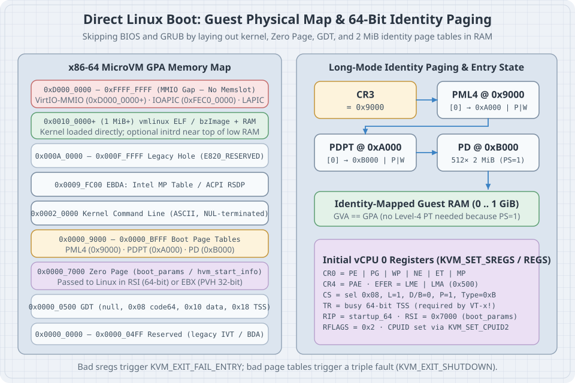

# Booting Linux

On a physical server—or a traditional QEMU VM—booting Linux is a multi-second relay race: CPU resets into 16-bit Real Mode at `0xFFFF_FFF0`, BIOS/UEFI initializes chipsets, enumerates PCI buses, loads option ROMs, reads the GPT/ESP, launches GRUB, which reads `vmlinuz` and `initramfs` from disk, switches to 32-bit Protected Mode, decompresses the kernel, and finally transitions to 64-bit Long Mode.

A **microVM** throws away that entire legacy chain. Because the userspace VMM controls guest RAM and every register in the VMCS before the first `KVM_RUN`, the VMM acts as both firmware and bootloader: it lays out the kernel image, page tables, GDT, memory map, and command line directly in guest RAM, programs vCPU 0 straight into **64-bit Long Mode** (or 32-bit flat Protected Mode for PVH), points `RIP` at the kernel's entry symbol, and enters the guest. The Linux kernel prints its first boot message within **5–15 milliseconds**.

## Direct Kernel Boot Formats: `bzImage`, `vmlinux` ELF, and PVH

MicroVM VMMs support three Linux kernel boot paths on x86-64:

| Format | Entry Mode | Decompression | Used By | Tradeoffs |
|---|---|---|---|---|
| **`bzImage`** (Linux x86 Boot Protocol) | 64-bit (`startup_64` at `code32_start + 0x200`) or 32-bit | Self-decompresses inside guest (~20–60 ms) | Cloud Hypervisor, QEMU `-kernel`, standard distro kernels | Works with unmodified distro kernels, but decompression adds boot latency |
| **Uncompressed `vmlinux` ELF** | 64-bit (`e_entry` / `startup_64`) | None (loaded straight into guest RAM) | Firecracker (classic), custom VMMs | Fastest boot; VMM reads ELF `PT_LOAD` segments directly into GPA |
| **PVH ELF** (`XEN_ELFNOTE_PHYS32_ENTRY`) | 32-bit flat Protected Mode (paging off), `EBX = &hvm_start_info` | None (uncompressed ELF) | Firecracker (modern), Cloud Hypervisor, QEMU `microvm` | Cleanest, firmware-free ABI; standardized `hvm_start_info` instead of legacy `boot_params` |

> [!TIP]
> **Why Firecracker prefers uncompressed `vmlinux` ELF / PVH:** Decompressing a 12 MiB `gzip`/`zstd` `bzImage` inside a single vCPU takes 30–80 ms and touches every page of the kernel image up front. Loading an uncompressed `vmlinux` ELF (or `mmap`-ing it) skips decompression completely and lets EPT demand-page only the kernel code paths actually executed during boot.

## The x86-64 MicroVM Guest Physical Memory Map

Before loading a single byte, the VMM must design a clean Guest Physical Address (GPA) layout that avoids the legacy x86 640 KiB–1 MiB ISA/EBDA hole and reserves an unmapped MMIO gap below 4 GiB:



Notice that if a microVM has more than ~3 GiB of RAM (e.g., 8 GiB), guest memory is split across **two KVM memslots**:
- **Slot 0:** `0x0000_0000` .. `0xCFFF_FFFF` (low RAM below the MMIO hole).
- **Slot 1:** `0x1_0000_0000` .. top of high RAM (above 4 GiB).
The gap `[0xD000_0000, 0xFFFF_FFFF]` has **no memslot**, ensuring guest accesses to VirtIO-MMIO registers trap cleanly into KVM/userspace.

## Populating the Zero Page (`struct boot_params`) and E820 Map

For the standard Linux x86-64 64-bit boot protocol (`Documentation/arch/x86/boot.rst`), the kernel expects `RSI` to point to a zero-initialized 4 KiB `struct boot_params` (known historically as the **Zero Page**) at `0x7000`.

Inside `struct boot_params`:
- **Offset `0x1E8` (`e820_entries: u8`)** and **offset `0x2D0` (`e820_table: [BootE820Entry; 128]`)**: Tells the guest kernel the exact map of usable RAM (`E820_RAM = 1`) versus reserved holes (`E820_RESERVED = 2`). Without a valid E820 table, Linux will panic during early `memblock` initialization or try to allocate pages inside the MMIO hole!
- **Offset `0x1F1` (`hdr: struct setup_header`)**:
  - `boot_flag` (`0x1FE`): `0xAA55`
  - `header` (`0x202`): `0x5372_6448` (`"HdrS"`)
  - `type_of_loader` (`0x210`): `0xFF` (undefined/custom VMM)
  - `loadflags` (`0x211`): `LOADED_HIGH (0x01) | KEEP_SEGMENTS (0x40) | CAN_USE_HEAP (0x80)`
  - `cmd_line_ptr` (`0x228`): `0x0002_0000` (32-bit GPA of null-terminated kernel cmdline)
  - `ramdisk_image` (`0x218`) and `ramdisk_size` (`0x21C`): GPA and byte length of `initrd` (0 if booting directly to a `virtio-blk` rootfs)

### The PVH Alternative (`struct hvm_start_info`)

When booting a PVH-enabled `vmlinux` ELF (compiled with `CONFIG_PVH=y`), the VMM searches the ELF `PT_NOTE` segments for note type `XEN_ELFNOTE_PHYS32_ENTRY` (`18`), which gives the 32-bit physical entry address. Instead of the legacy 4 KiB `boot_params` struct, the VMM writes a compact 56-byte `struct hvm_start_info`:

```rust
#[repr(C)]
pub struct HvmStartInfo {
    pub magic: u32,            // 0x336e_c578 ("xEn3")
    pub version: u32,          // 1 (supports memmap_paddr)
    pub flags: u32,            // 0
    pub nr_modules: u32,       // 1 if initrd present, else 0
    pub modlist_paddr: u64,    // GPA of HvmModlistEntry array
    pub cmdline_paddr: u64,    // GPA of null-terminated cmdline
    pub rsdp_paddr: u64,       // GPA of ACPI RSDP (0 if no ACPI)
    pub memmap_paddr: u64,     // GPA of HvmMemmapTableEntry array
    pub memmap_entries: u32,   // Number of memory map entries
    pub reserved: u32,
}
```

The VMM enters vCPU 0 in flat 32-bit Protected Mode (`CR0.PE = 1, CR0.PG = 0`, `CS`/`DS`/`SS` base=0, limit=`0xFFFF_FFFF`) with `EBX = &hvm_start_info` and `EIP = phys32_entry`. Linux's `pvh_start_xen()` sets up its own 64-bit page tables and jumps straight to `startup_64`. This is why Firecracker and Cloud Hypervisor both prefer PVH on x86-64.

## Entering 64-Bit Long Mode Directly from the VMM

If booting a 64-bit `vmlinux` or `bzImage` directly at `startup_64`, the VMM must build a minimal **GDT** and **4-level identity page tables** in guest RAM and program `kvm_sregs` + `kvm_regs` before calling `KVM_RUN`.

### Minimal 4-Level Identity Page Tables (Mapping First 1 GiB)

Using 2 MiB large pages (`PS` bit 7 = 1 in the Page Directory), three 4 KiB pages map the entire first 1 GiB of GPA identically (`GVA == GPA`):

```rust
const PTE_PRESENT: u64 = 1 << 0;
const PTE_WRITABLE: u64 = 1 << 1;
const PTE_PS_2MIB: u64 = 1 << 7;

const PML4_ADDR: u64 = 0x9000;
const PDPT_ADDR: u64 = 0xA000;
const PD_ADDR: u64   = 0xB000;

fn setup_identity_page_tables(guest_mem: &mut [u8]) {
    // PML4[0] -> PDPT at 0xA000
    write_u64(guest_mem, PML4_ADDR, PDPT_ADDR | PTE_PRESENT | PTE_WRITABLE);
    // PDPT[0] -> PD at 0xB000
    write_u64(guest_mem, PDPT_ADDR, PD_ADDR | PTE_PRESENT | PTE_WRITABLE);
    // PD[0..512] -> 512 x 2 MiB identity-mapped pages (0x0000_0000 .. 0x3FFF_FFFF)
    for i in 0..512u64 {
        let entry = (i << 21) | PTE_PRESENT | PTE_WRITABLE | PTE_PS_2MIB;
        write_u64(guest_mem, PD_ADDR + i * 8, entry);
    }
}
```

### Programming `kvm_sregs` and `kvm_regs` for 64-Bit Linux

With the GDT written at `0x500` (entry 0: null, entry 1 `0x08`: 64-bit code `0x00AF9B00_0000FFFF`, entry 2 `0x10`: data `0x00CF9300_0000FFFF`, entry 3 `0x18`: TSS), we configure `kvm_sregs`:

```rust
// Control registers for x86-64 Long Mode
sregs.cr0 = 0x8005_0033; // PE | MP | ET | NE | WP | AM | PG
sregs.cr3 = PML4_ADDR;   // 0x9000
sregs.cr4 = 1 << 5;      // PAE (Physical Address Extension, required for Long Mode)
sregs.efer = (1 << 8) | (1 << 10); // LME (Long Mode Enable) | LMA (Long Mode Active)

// 64-bit Code Segment (selector 0x08, L=1, D/B=0, P=1, S=1, Type=0xB [Exec/Read/Accessed])
sregs.cs = KvmSegment {
    base: 0, limit: 0xFFFF_FFFF, selector: 0x08,
    type_: 0xB, present: 1, dpl: 0, db: 0, s: 1, l: 1, g: 1,
    ..Default::default()
};

// Flat Data Segments (selector 0x10, P=1, S=1, Type=0x3 [Read/Write/Accessed])
let data_seg = KvmSegment {
    base: 0, limit: 0xFFFF_FFFF, selector: 0x10,
    type_: 0x3, present: 1, dpl: 0, db: 1, s: 1, l: 0, g: 1,
    ..Default::default()
};
sregs.ds = data_seg;
sregs.es = data_seg;
sregs.fs = data_seg;
sregs.gs = data_seg;
sregs.ss = data_seg;

// General-purpose registers: Linux x86-64 boot ABI
regs.rip    = kernel_entry_gpa; // e.g. 0x0100_0000 (startup_64)
regs.rsi    = 0x7000;           // Pointer to struct boot_params (Zero Page)
regs.rflags = 0x2;              // Reserved bit 1 must always be 1; IF=0 (IRQs masked)
```

> [!IMPORTANT]
> **VMCS consistency traps (`KVM_EXIT_FAIL_ENTRY`):** Intel VT-x enforces strict hardware consistency checks on `VMLAUNCH`. The three most common mistakes when hand-coding `sregs` are:
> 1. Setting both `CS.l = 1` and `CS.db = 1` (illegal in 64-bit mode—`db` **must** be `0`).
> 2. Leaving `sregs.tr` (Task Register) with `present = 0` or `type_ != 0xB` (busy 64-bit TSS)—VT-x requires a valid busy TSS even if the guest never uses hardware task switching!
> 3. Setting `CR0.PG = 1` without `CR4.PAE = 1` and `EFER.LME | EFER.LMA`.

## CPUID, MSRs, Interrupt Controllers, and SMP Discovery

A Linux kernel will panic almost immediately if `CPUID`, timers, or interrupt controllers are missing:

1. **In-Kernel IRQCHIP and PIT:**
   Before creating vCPUs, call `KVM_SET_TSS_ADDR(0xFFFB_D000)` (required on Intel CPUs for real-mode/unrestricted-guest TSS), `KVM_CREATE_IRQCHIP` (creates in-kernel Local APIC per vCPU, IOAPIC at `0xFEC0_0000`, and dual 8259 PICs), and `KVM_CREATE_PIT2` (8254 programmable interval timer).
2. **`CPUID` Configuration (`KVM_SET_CPUID2`):**
   Query `KVM_GET_SUPPORTED_CPUID` from `/dev/kvm`, then sanitize the entries before passing them to `KVM_SET_CPUID2` on each vCPU:
   - Set **Leaf `0x1`, `ECX[31] = 1`** (Hypervisor Present bit) so Linux activates KVM paravirtualized clock (`kvm-clock`) and paravirtualized spinlocks instead of calibrating legacy hardware timers!
   - Populate **Leaf `0xB` / `0x1F`** (extended topology) and initial APIC ID (`Leaf 0x1, EBX[31:24] = vcpu_id`) so SMP discovery knows how many vCPUs exist.
   - Mask out host features the VMM does not expose (e.g., `XSAVE` extensions not migrated, `MWAIT`/`MONITOR`, `SGX`).
3. **Discovering Multiple vCPUs (MP Tables vs. ACPI):**
   On x86-64, Linux discovers secondary vCPUs (Application Processors, APs) and IOAPIC IRQ routing from either **Intel MultiProcessor (MP) Specification tables** (placed in the EBDA at `0x9FC00`) or **ACPI tables** (`RSDP` -> `XSDT` -> `MADT`).
   - **Firecracker** writes a ~200-byte **MP Table** on x86-64—zero ACPI AML interpreter needed!
   - **Cloud Hypervisor** generates minimal **ACPI tables** (`RSDP`, `XSDT`, `FADT`, `MADT`, `MCFG`, `DSDT`), because PCIe ECAM, CPU hotplug, and memory hotplug require ACPI.

## Emulating the 16550A Serial Console (COM1)

Before any VirtIO device initializes, the guest kernel needs a console to emit early boot logs (`earlyprintk=ttyS0 console=ttyS0`). The standard **16550A UART** on I/O ports `0x3F8`–`0x3FF` (IRQ 4) takes fewer than 80 lines of Rust to emulate:

| Offset | Port | Read Register | Write Register | Essential VMM Behavior |
|---|---|---|---|---|
| `+0` | `0x3F8` | `RBR` (Receive Buffer) | `THR` (Transmit Holding) | When `DLAB == 0`: write emits byte to host stdout! Read pops from host stdin FIFO |
| `+1` | `0x3F9` | `IER` (Interrupt Enable) | `IER` | Bit 0: Received Data Available IRQ; Bit 1: THR Empty IRQ |
| `+2` | `0x3FA` | `IIR` (Interrupt ID) | `FCR` (FIFO Control) | Return `0x01` (no pending IRQ), `0x02` (THRE IRQ), or `0x04` (RDA IRQ) |
| `+3` | `0x3FB` | `LCR` (Line Control) | `LCR` | Bit 7 is `DLAB` (Divisor Latch Access Bit—when 1, `+0`/`+1` set baud rate) |
| `+5` | `0x3FD` | `LSR` (Line Status) | — | Always set bit 5 (`THRE = 0x20`) and bit 6 (`TEMT = 0x40`) so guest never stalls waiting to transmit; set bit 0 (`DR = 0x01`) when stdin has bytes |

When the guest writes `0x02` (THRE interrupt enable) to `IER`, raising IRQ 4 via `KVM_IRQ_LINE` (or `irqfd`) tells Linux's `8250_core` driver that the transmit register is ready for the next character.

## Kernel Command Line and Sub-100ms Boot Optimization

A typical Firecracker-style microVM kernel command line looks like this:

```text
console=ttyS0 reboot=k panic=1 pci=off nomodules random.trust_cpu=on 8250.nr_uarts=1 i8042.noaux virtio_mmio.device=4K@0xd0000000:5 virtio_mmio.device=4K@0xd0001000:6 root=/dev/vda rw init=/sbin/init
```

Every single flag removes millisecond-scale boot delays:
- `pci=off`: Skips PCI bus probing completely (when using VirtIO-MMIO).
- `reboot=k`: On shutdown/reboot, guest triggers a clean triple-fault / keyboard-controller reset (`0xFE` to port `0x64`), causing `KVM_EXIT_SHUTDOWN` so the VMM exits cleanly.
- `panic=1`: Never hang forever on kernel panic.
- `8250.nr_uarts=1`: Stops Linux from probing COM2/COM3/COM4 (`0x2F8`, `0x3E8`, `0x2E8`), avoiding wasted I/O port VM-Exits.
- `virtio_mmio.device=4K@0xd0000000:5`: Hard-wires the GPA (`0xD000_0000`), size (`4K`), and IOAPIC GSI/IRQ (`5`) of each VirtIO-MMIO device directly into the kernel's `virtio_mmio` driver—zero device discovery overhead!
- **Skipping `initramfs`:** Compiling `CONFIG_VIRTIO_BLK=y`, `CONFIG_VIRTIO_MMIO=y`, and `CONFIG_EXT4_FS=y` statically into `vmlinux` lets the kernel mount `root=/dev/vda` directly without unpacking a `cpio` archive.

Combined with a stripped kernel `.config` (no USB, no sound, no DRM/GPU, no legacy filesystems, `CONFIG_NO_HZ_IDLE=y`), total time from `VMLAUNCH` to PID 1 `/sbin/init` drops from ~1.5 seconds (stock distro kernel) down to **~60–125 milliseconds**.

A booted Linux kernel with only a serial port cannot read disks or send packets. Next, in [Chapter 4: virtio Devices](04-virtio-devices.md), we dissect the VirtIO 1.1/1.2 specification, lockless virtqueues, memory barriers, and `vhost` acceleration.
