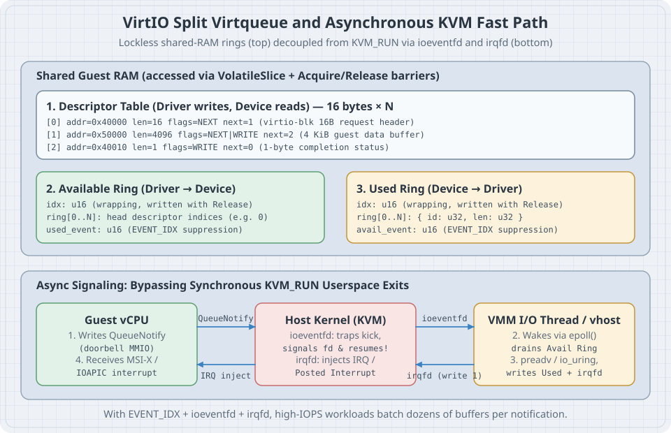

# virtio Devices

Emulating real physical hardware (such as an Intel e1000 NIC, an IDE controller, or an NVMe HBA) inside a VMM is fundamentally slow and insecure. Physical hardware registers were designed for nanosecond PCIe bus transactions—not 1,000-cycle VM-Exits. Emulating a single packet transmit on an e1000 requires multiple register reads/writes (multiple VM-Exits) plus thousands of lines of brittle legacy state-machine code.

**VirtIO** (standardized as OASIS VirtIO 1.0 / 1.1 / 1.2) solves this through **paravirtualized I/O**: the guest kernel knows it is running inside a VM and communicates with the VMM over shared lockless ring buffers (**virtqueues**) in guest RAM. Hundreds of disk blocks or network packets can be queued and completed with **zero or one VM-Exit**.

## Device Initialization State Machine and Feature Negotiation

Every VirtIO device—regardless of transport (MMIO or PCI) or type (block, net, vsock, fs)—follows an identical initialization handshake driven by the guest's `Device Status` register:

1. **Reset:** Guest writes `0` to `Status`. Device resets all queues and internal state.
2. **`ACKNOWLEDGE` (`0x01`):** Guest OS has noticed the device.
3. **`DRIVER` (`0x02`):** Guest OS has found a matching driver (`virtio_blk`, `virtio_net`, etc.).
4. **Feature Negotiation:**
   - Guest reads the device's 64-bit offered feature bitmap (two 32-bit reads via `DeviceFeaturesSel = 0` and `1`): bits `0..23` are device-specific (e.g., `VIRTIO_BLK_F_RO`, `VIRTIO_NET_F_CSUM`), bits `24..37` are transport/ring features (`VIRTIO_F_VERSION_1` [bit 32], `VIRTIO_RING_F_INDIRECT_DESC` [bit 28], `VIRTIO_RING_F_EVENT_IDX` [bit 29]).
   - Guest intersects offered features with features it understands and writes them back via `DriverFeatures`.
5. **`FEATURES_OK` (`0x08`):** Guest sets `FEATURES_OK`, then **re-reads `Status`**. If the device cleared `FEATURES_OK`, the feature combination is unsupported and the driver aborts.
6. **Virtqueue Setup:** Guest allocates the ring structures in guest RAM, writes their GPAs (`QueueDesc`, `QueueDriver`, `QueueDevice`) and ring size (`QueueNum`) to the device, and sets `QueueReady = 1`.
7. **`DRIVER_OK` (`0x04`):** Device is live! The guest can now place descriptors in the Available Ring and kick `QueueNotify`.

## Transports: VirtIO-MMIO vs. VirtIO-PCI

VirtIO cleanly separates the *device model* from the *transport* that delivers configuration reads/writes, kicks, and interrupts:

### VirtIO-MMIO (Used by Firecracker)
Each device occupies a single **4 KiB unmapped GPA page** (e.g., `0xD000_0000`, `0xD000_1000`, ...) with a flat register layout:

| Offset | Name | R/W | Purpose |
|---|---|---|---|
| `0x000` | `MagicValue` | R | Always `0x7472_6976` (ASCII `"virt"`) |
| `0x004` | `Version` | R | `2` (Modern VirtIO 1.0+); `1` is legacy |
| `0x008` | `DeviceID` | R | `1` = net, `2` = blk, `3` = console, `4` = rng, `5` = balloon, `19` = vsock, `26` = fs |
| `0x00C` | `VendorID` | R | VMM vendor identifier |
| `0x010` / `0x014` | `DeviceFeatures` / `Sel` | R/W | 64-bit device feature bitmask (paged by `Sel`) |
| `0x020` / `0x024` | `DriverFeatures` / `Sel` | W | 64-bit negotiated feature bitmask |
| `0x030` | `QueueSel` | W | Selects which virtqueue (`0, 1, ...`) subsequent queue registers configure |
| `0x034` / `0x038` | `QueueNumMax` / `QueueNum` | R/W | Max ring size (power of 2, e.g., 256) and driver-chosen size |
| `0x044` | `QueueReady` | R/W | `1` activates the selected virtqueue |
| `0x050` | `QueueNotify` | W | **Doorbell register!** Guest writes queue index; bound to `KVM_IOEVENTFD` |
| `0x060` / `0x064` | `InterruptStatus` / `ACK` | R/W | Bit 0 = Used Buffer Notification, Bit 1 = Config Change |
| `0x070` | `Status` | R/W | Device status state machine (`ACKNOWLEDGE`, `DRIVER`, `FEATURES_OK`, `DRIVER_OK`) |
| `0x080`–`0x0A4` | `QueueDesc`/`Driver`/`Device` | W | 64-bit GPAs (Low/High) of the three Split Virtqueue rings |
| `0x100+` | `Config` | R/W | Device-specific config space (e.g., disk capacity in sectors, NIC MAC address) |

**Strengths:** Tiny VMM footprint (~200 lines of Rust), zero PCI/ACPI complexity, instant boot.
**Limitations:** Uses legacy shared/IOAPIC IRQ lines (GSIs 5–23 on x86-64), no PCI hotplug, no MSI-X per-queue interrupt steering across vCPUs.

### VirtIO-PCI (Used by Cloud Hypervisor and QEMU)
Presents each VirtIO device as a PCIe function discovered via PCI ECAM (`MCFG` ACPI table), exposing MMIO regions through PCI Capabilities (`VIRTIO_PCI_CAP_COMMON_CFG`, `NOTIFY_CFG`, `ISR_CFG`, `DEVICE_CFG`).
- **Why production multi-vCPU VMs prefer VirtIO-PCI:** Supports **MSI-X** (Message Signaled Interrupts Extended), allowing each virtqueue of a multi-queue `virtio-net` or `virtio-blk` device to fire an edge-triggered interrupt straight to a dedicated vCPU (combining with Intel APICv Posted Interrupts for zero-VM-Exit interrupt delivery!), plus **PCI hotplug** and **VFIO** coexistence.

## Split Virtqueues: Binary Layout and Lockless Memory Ordering

A **Split Virtqueue** of size $N$ (a power of 2, e.g., `256` or `1024`) consists of three contiguous arrays allocated by the guest driver in guest RAM, paired with KVM's asynchronous `ioeventfd` and `irqfd` signaling path:



In Rust (`#[repr(C)]`), the three structures look like this:

```rust
pub const VIRTQ_DESC_F_NEXT: u16     = 1; // Buffer continues via `next` field
pub const VIRTQ_DESC_F_WRITE: u16    = 2; // Buffer is device-WRITABLE (else device-READ-ONLY)
pub const VIRTQ_DESC_F_INDIRECT: u16 = 4; // Buffer contains a table of descriptors

#[repr(C)]
#[derive(Copy, Clone, Debug)]
pub struct VirtqDesc {
    pub addr: u64,  // Guest Physical Address (GPA)
    pub len: u32,   // Length in bytes
    pub flags: u16, // NEXT | WRITE | INDIRECT
    pub next: u16,  // Next descriptor index if VIRTQ_DESC_F_NEXT is set
}

#[repr(C)]
#[derive(Copy, Clone, Debug)]
pub struct VirtqUsedElem {
    pub id: u32,  // Head descriptor index of the completed chain
    pub len: u32, // Total bytes WRITTEN by the device into device-writable descriptors
}
```

### The Exact Producer/Consumer Lifecycle and Memory Barriers

Because the guest vCPU and the host VMM device thread run concurrently on different physical cores, strict **acquire/release memory ordering** is mandatory (especially on weakly-ordered ARM64 CPUs, and to prevent compiler reordering on x86-64):

1. **Guest Driver Submits a Chain:**
   - Populates descriptors `d0 -> d1 -> d2` in the Descriptor Table.
   - Writes `avail.ring[avail.idx % N] = d0`.
   - Executes a **write memory barrier (`smp_wmb` / `Ordering::Release`)** so descriptor contents and ring slot are globally visible *before* `avail.idx` increments.
   - Increments `avail.idx` (wrapping `u16` arithmetic—never modulo!).
   - Executes a **full memory barrier (`smp_mb`)**, checks `used.flags` (or `used.avail_event`), and if notifications are not suppressed, writes the queue index to `QueueNotify` (triggering `KVM_IOEVENTFD`).
2. **Host VMM Device Thread Consumes and Completes:**
   - Maintains a private `next_avail: u16` cursor.
   - Reads `avail.idx` with **`Ordering::Acquire`**—pairing with the guest's `Release` so all descriptor writes are guaranteed visible.
   - While `next_avail != avail_idx`:
     - Reads `head = avail.ring[next_avail % N]`.
     - Walks the descriptor chain (`VIRTQ_DESC_F_NEXT`), **copying each `VirtqDesc` into local VMM memory before validating** (preventing TOCTOU attacks and capping chain length at `N` to prevent infinite loops from a malicious cyclic guest chain!).
     - Executes the I/O (e.g., `preadv`/`pwritev` or `io_uring` directly against the `VolatileSlice`s resolved from `desc.addr` + `desc.len`).
     - Writes `used.ring[used_idx % N] = VirtqUsedElem { id: head, len: bytes_written }`.
     - Increments `next_avail` and `used_idx`.
   - Executes **`Ordering::Release`**, writes the new `used.idx`, executes a full fence (`Ordering::SeqCst`), checks `avail.flags` / `avail.used_event`, and if required, writes `1u64` to **`irqfd`** to inject the guest interrupt!

### Notification Suppression (`VIRTIO_RING_F_EVENT_IDX`)

Under high I/O load (e.g., 100k IOPS NVMe or 10 Gbps networking), interrupting the guest on *every* completed descriptor or kicking the host on *every* submitted packet destroys throughput. When `VIRTIO_RING_F_EVENT_IDX` is negotiated:
- The VMM writes `used.avail_event = next_avail` (or `next_avail + batch`) to tell the guest: *"Do not ring `QueueNotify` until `avail.idx` crosses `avail_event`."*
- The guest driver (e.g., Linux NAPI polling inside `virtio_net`) writes `avail.used_event` to tell the VMM: *"Do not fire an `irqfd` interrupt while I am actively draining the Used Ring."*
- Under heavy load, both sides stay in a continuous lockless polling loop with **nearly zero VM-Exits and zero interrupts per packet**.

### Packed Virtqueues (VirtIO 1.1+)

Split virtqueues scatter each I/O across three separate cache lines (Descriptor Table, Available Ring, Used Ring), causing up to 3–4 cross-core cache-line bounces per request. **Packed Virtqueues** (`VIRTIO_F_RING_PACKED`, bit 34) unify all three into a single ring of 16-byte descriptors containing two polarity bits: `AVAIL` (bit 7) and `USED` (bit 15). Both driver and device track a 1-bit **wrap counter** that flips every time their cursor wraps past `N - 1`: a descriptor is available when `AVAIL == wrap_counter && USED != wrap_counter`, and used when `AVAIL == USED == wrap_counter`. This cuts cache-line transfers roughly in half and is friendly to hardware DMA engines (vDPA).

## Anatomy of Core MicroVM VirtIO Devices

### `virtio-blk` (Device ID 2)
Every block request is a 3-part descriptor chain:
1. **Header (device-read-only, 16 bytes):** `type: u32` (`IN=0` read, `OUT=1` write, `FLUSH=4`, `DISCARD=11`, `WRITE_ZEROES=13`), `reserved: u32`, `sector: u64` (512-byte LBA).
2. **Data payload (1 or more chained descriptors):** `VIRTQ_DESC_F_WRITE` set for `IN` (reads into guest RAM), cleared for `OUT` (writes from guest RAM).
3. **Status footer (device-writable, 1 byte):** `0 = OK`, `1 = IOERR`, `2 = UNSUPP`.

Production VMMs translate the scatter-gather data descriptors directly into a single host `preadv2`/`pwritev2` or **`io_uring` `IORING_OP_READV` / `IORING_OP_WRITEV`** submission—achieving zero extra memory copies between host page cache/block device and guest RAM!

### `virtio-net` (Device ID 1)
Uses pairs of virtqueues: **RX queue (even: 0, 2, ...)** where the guest pre-posts empty receive buffers and the VMM fills them when packets arrive from a host **TAP** device (`IFF_TAP | IFF_NO_PI | IFF_VNET_HDR`), and **TX queue (odd: 1, 3, ...)** where the guest posts outbound Ethernet frames prefixed by a 12-byte `struct virtio_net_hdr_v1` carrying hardware-style offloads (`VIRTIO_NET_F_CSUM`, `HOST_TSO4`/`TSO6`, `GUEST_TSO4`/`TSO6`). Because the Linux kernel's `tun/tap` driver natively speaks `IFF_VNET_HDR`, the VMM can pass a 64 KiB GSO super-frame straight between the guest and the host TCP/IP stack without segmenting it into 1500-byte MTU frames!

### `virtio-vsock` (Device ID 19)
Provides **AF_VSOCK** stream sockets between host and guest **with zero IP networking, zero TAP devices, and zero firewall rules**. Endpoints are addressed by `(CID, port)` where `CID 0` = hypervisor, `CID 2` = host, and `CID >= 3` = guest microVM.
- Firecracker implements `virtio-vsock` completely in userspace by multiplexing guest `AF_VSOCK` connections onto a single host **Unix Domain Socket** (using a tiny `CONNECT <port>\n` text handshake)—avoiding the host kernel's `vhost-vsock` module and keeping all traffic confined inside the microVM's chroot jail.

### `virtio-balloon`, `virtio-rng`, and `virtio-fs`
- **`virtio-balloon` (ID 5):** Reclaims idle guest RAM dynamically. The VMM requests $K$ pages; the guest kernel allocates $K$ 4 KiB pages, pins them so guest processes cannot use them, and sends their GPAs to the VMM; the VMM calls `madvise(hva, 4096, MADV_DONTNEED)` to return the host physical pages to the host kernel immediately.
- **`virtio-rng` (ID 4):** Feeds host CSPRNG entropy (`getrandom()`) into the guest's `/dev/urandom`, preventing boot stalls and ensuring unique entropy after snapshot restores.
- **`virtio-fs` (ID 26):** Runs the FUSE protocol directly over a virtqueue to share a host directory tree into the guest with near-native POSIX semantics and optional **DAX** (Direct Access) mapping of host page-cache files directly into guest physical memory.

## Kernel, Process, and Hardware Offload: `vhost` and `vDPA`

Handling VirtIO rings inside the VMM process works well for moderate I/O, but every packet still crosses from the host kernel (`tap`) to VMM userspace and back to guest RAM. The **`vhost`** architecture moves the VirtIO **data plane** out of the VMM while keeping the **control plane** (PCI/MMIO config, feature negotiation) in the VMM:

```text
+-----------------------+   Control Plane   +-----------------------------+
|  Userspace VMM        |------------------>|  Offloaded Data Plane       |
|  (Firecracker / CHV)  |  Passes:          |  - vhost-net (host kernel)  |
|  - PCI/MMIO config    |   1. Guest memfd  |  - vhost-user (virtiofsd,   |
|  - Feature negotiate  |   2. Ring GPAs    |    DPDK, SPDK daemon)       |
|  - Setup only         |   3. ioeventfd    |  - vDPA (SmartNIC / NVMe    |
|                       |   4. irqfd        |    hardware DMA directly!)  |
+-----------------------+                   +-----------------------------+
```

- **`vhost-net` (In-Kernel):** A kernel `vhost-<pid>` worker thread reads guest virtqueues directly inside ring 0 and moves packets between guest RAM and the host TAP/macvtap device with zero userspace VMM wakeups.
- **`vhost-user` (Dedicated Process):** The VMM sends the guest RAM `memfd` plus `ioeventfd` and `irqfd` file descriptors over a Unix Domain Socket (`SCM_RIGHTS`) to an independent process (`virtiofsd`, Open vSwitch DPDK, SPDK). This both accelerates I/O (poll-mode userspace drivers) and **isolates device bugs** outside the VMM process.
- **`vDPA` (VirtIO Data Path Acceleration):** Physical NICs and storage controllers that implement the VirtIO ring layout **directly in silicon**. The hardware DMAs packets straight into the guest's virtqueue buffers and fires Posted Interrupts directly into the vCPU—delivering bare-metal SR-IOV performance with full live-migration compatibility!

We now understand every layer from silicon VMCS/EPT through `/dev/kvm` in Rust, direct Linux boot, and VirtIO rings. In [Chapter 5: Production VMMs: Firecracker and Cloud Hypervisor](05-production-vmms-firecracker-and-cloud-hypervisor.md), we examine how two flagship Rust VMMs assemble these exact building blocks into battle-tested cloud infrastructure.
