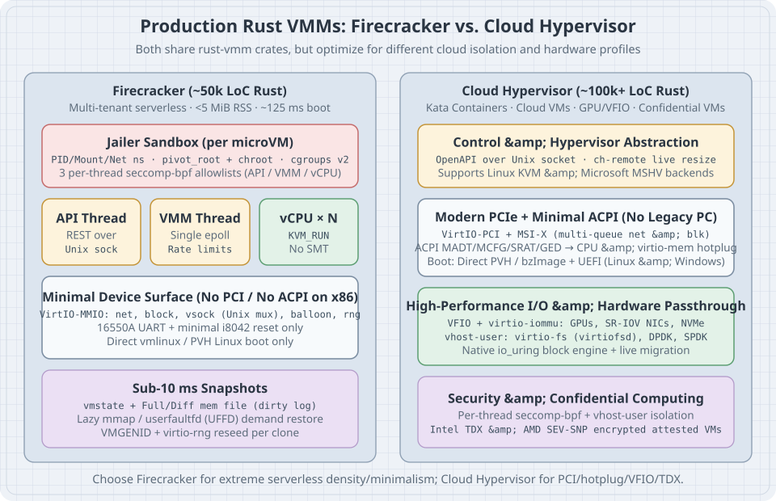

# Production VMMs: Firecracker and Cloud Hypervisor

For two decades, **QEMU** was the undisputed userspace VMM for Linux KVM. QEMU is an extraordinary piece of engineering—capable of emulating dozens of CPU architectures, SoundBlaster cards, floppy controllers, PS/2 mice, VGA framebuffers, IDE buses, and legacy BIOSes across **more than 2 million lines of C**.

That generality is exactly what makes QEMU ill-suited for multi-tenant serverless compute and high-density cloud-native isolation:
- **Attack surface:** Hundreds of legacy C device models have historically been the #1 source of VM-escape CVEs (heap overflows, use-after-free, integer overflows in emulated DMA).
- **Memory overhead:** A minimal QEMU process consumes ~30–100+ MiB of host RSS before the guest allocates a byte, capping density on multi-tenant hosts.
- **Boot latency:** Even stripped-down QEMU configurations carry significant device-tree/QOM initialization overhead.

Out of this tension emerged the **`rust-vmm`** ecosystem and two dominant production Rust VMMs: **Firecracker** (built by AWS for Lambda and Fargate) and **Cloud Hypervisor** (originally started at Intel, now a Linux Foundation project). Both share core `rust-vmm` crates (`kvm-ioctls`, `vm-memory`, `virtio-queue`, `linux-loader`, `seccompiler`), yet they make sharply different architectural tradeoffs.



## Firecracker Deep Dive

Firecracker was designed for one laser-focused mission: **running thousands of untrusted, short-lived, multi-tenant serverless functions and containers per bare-metal host** with hardware-virtualized isolation, **<5 MiB VMM memory overhead**, **~125 ms cold boot**, and **up to 150 microVMs/sec/host** creation rate.

### Minimalist Architecture and Threading Model

Firecracker is ~50,000 lines of Rust with a rigid, predictable threading topology per microVM:

```text
+-----------------------------------------------------------------------------+
|  firecracker process (1 process = 1 microVM, inside jailer chroot/cgroups)  |
|                                                                             |
|  +--------------------+   +----------------------+   +-------------------+  |
|  | API Thread (1)     |   | VMM Thread (1)       |   | vCPU Threads (N)  |  |
|  | - HTTP/1.1 REST    |-->| - Single epoll loop  |   | - 1 POSIX thread  |  |
|  |   over Unix socket |   | - VirtIO-MMIO I/O    |   |   per vCPU        |  |
|  | - Zero TCP sockets |   | - Token-bucket rate  |   | - Runs KVM_RUN    |  |
|  | - Strict seccomp   |   |   limiters (net/blk) |   | - Tightest        |  |
|  |   profile #1       |   | - Metrics & signals  |   |   seccomp profile |  |
|  +--------------------+   +----------------------+   +-------------------+  |
+-----------------------------------------------------------------------------+
```

### Radical Device Minimalism

Firecracker intentionally refuses to implement PCI on x86-64, ACPI on x86-64, BIOS/UEFI, USB, GPU, audio, or live migration. Its entire emulated device surface consists of only:
- `virtio-net` (TAP-backed, single queue, with token-bucket bandwidth & ops rate limiters)
- `virtio-block` (file/block-backed, `sync` or `io_uring` engine, with rate limiters)
- `virtio-vsock` (userspace Unix-socket multiplexer)
- `virtio-balloon` (dynamic memory reclamation)
- `virtio-rng` (host entropy injection)
- `16550A` serial console (COM1) and a minimal i8042 keyboard controller (solely to handle `0xFE` guest reboot reset)

Every omitted device is an entire class of CVEs that can never exist.

### Defense-in-Depth: The `jailer` and Per-Thread Seccomp-BPF

Even with Rust's memory safety and a tiny device model, AWS treats the VMM process itself as **potentially compromisable**. Every production Firecracker instance is launched through the companion **`jailer`** binary, which constructs a multi-layered sandbox *before* `execve("/usr/bin/firecracker")`:

1. **Namespaces:** Enters a fresh PID namespace, mount namespace, and (optionally) network namespace (`unshare` / `clone`).
2. **Filesystem `pivot_root` + `chroot`:** Creates an empty directory `/srv/jailer/firecracker/<id>/root`, creates only the bare minimum device nodes (`/dev/kvm`, `/dev/net/tun`, `/dev/urandom`) via `mknod`, hard-links or bind-mounts the kernel and rootfs image, and calls `pivot_root` so the host filesystem is completely unreachable.
3. **Privilege Drop & Resource Limits:** Drops all Linux capabilities, switches to a dedicated unprivileged `uid`/`gid` (unique per microVM to prevent cross-VM ptrace or `/proc` interference), closes all extra file descriptors, and joins a dedicated **cgroups v2** slice (`cpu.max`, `memory.max`, `pids.max`).
4. **Per-Thread Seccomp-BPF Filters (`seccompiler`):**
   Right before starting guest execution, Firecracker installs **three distinct, statically compiled BPF syscall allowlists**—one for the API thread, one for the VMM thread, and the strictest one for the vCPU threads!
   - A vCPU thread is only permitted ~25 syscalls (`ioctl` restricted strictly to specific KVM ioctl numbers like `KVM_RUN`, `futex`, `rt_sigreturn`, `read`/`write` on specific fds, etc.). If an attacker somehow achieved arbitrary code execution inside a vCPU thread, calling `execve`, `openat`, `socket`, or `connect` immediately terminates the process with `SIGSYS` (`SECCOMP_RET_KILL_PROCESS`).
5. **Host-Level Side-Channel Hardening:**
   In production, Firecracker hosts disable **SMT (Hyper-Threading)** (preventing cross-tenant L1TF/MDS/Spectre leakage across sibling hardware threads), disable **KSM** (preventing Flush+Reload/page-deduplication side channels), disable **swap**, and enforce **token-bucket rate limiters** on `virtio-net` and `virtio-blk` to prevent a noisy tenant from starving the host's I/O queues.

### MicroVM Snapshots and Sub-10ms Demand-Paged Restore

A cold boot of ~125 ms is fast, but serverless platforms like AWS Lambda need **sub-10 ms** startup for pre-warmed language runtimes (Python, Node.js, JVM). Firecracker achieves this via **microVM snapshots**:

1. **Snapshot Creation (`PUT /snapshot/create`):**
   - Pauses all vCPU threads (`immediate_exit = 1` + `SIGUSR1`).
   - Serializes vCPU architectural state (`KVM_GET_REGS`, `SREGS`, `MSRS`, `XCRS`, `FPU`, `LAPIC`), in-kernel IRQCHIP/PIT state, and VirtIO device ring cursors into a small **`vmstate`** file (~tens of KiB).
   - Dumps guest RAM into a **`mem`** file—either a `Full` snapshot or a `Diff` snapshot containing only pages marked dirty via `KVM_MEM_LOG_DIRTY_PAGES`.
2. **Demand-Paged Restore (`PUT /snapshot/load`):**
   - Instead of reading a 512 MiB `mem` file eagerly into RAM, Firecracker simply `mmap(MAP_PRIVATE)`s the snapshot file (or registers it with Linux **`userfaultfd` (`UFFD`)** for custom remote/compressed page fetching!).
   - Restores vCPU/device state and immediately calls `KVM_RUN`.
   - **Time to resume:** **<5–10 milliseconds!** As the guest executes, EPT violations trigger host page faults (or `UFFD` messages) that fault in *only* the ~5–15 MiB hot working set actually touched by the function invocation.

> [!CAUTION]
> **The Snapshot Uniqueness / Entropy Pitfall:** If you restore 100 microVMs from the *same* snapshot, every clone wakes up with the exact same kernel CSPRNG state, identical TLS session keys, identical TCP Initial Sequence Numbers (ISNs), and identical MAC/IP addresses!
> Production snapshot orchestration solves this by:
> 1. Exposing **VMGENID** (Virtual Machine Generation ID) so the guest Linux kernel detects a snapshot restore and **immediately reseeds its CSPRNG** from `virtio-rng` / `RDRAND`.
> 2. Using network namespaces + NAT or `MMDS` (MicroVM Metadata Service) to give each clone a unique identity without reconfiguring the guest's internal IP.

### Hands-On Firecracker REST API Workflow

Firecracker is configured entirely over a local Unix Domain Socket (`--api-sock /tmp/firecracker.socket`):

```bash
# Terminal 1: Start Firecracker listening on a Unix socket
rm -f /tmp/firecracker.socket
firecracker --api-sock /tmp/firecracker.socket

# Terminal 2: Configure vCPUs/RAM, kernel, rootfs, and boot
SOCK=/tmp/firecracker.socket

curl --unix-socket "$SOCK" -X PUT http://localhost/machine-config \
  -H 'Content-Type: application/json' \
  -d '{"vcpu_count": 2, "mem_size_mib": 256, "smt": false}'

curl --unix-socket "$SOCK" -X PUT http://localhost/boot-source \
  -H 'Content-Type: application/json' \
  -d '{
    "kernel_image_path": "/var/lib/microvm/vmlinux-6.8",
    "boot_args": "console=ttyS0 reboot=k panic=1 pci=off"
  }'

curl --unix-socket "$SOCK" -X PUT http://localhost/drives/rootfs \
  -H 'Content-Type: application/json' \
  -d '{
    "drive_id": "rootfs",
    "path_on_host": "/var/lib/microvm/rootfs.ext4",
    "is_root_device": true,
    "is_read_only": false
  }'

curl --unix-socket "$SOCK" -X PUT http://localhost/actions \
  -H 'Content-Type: application/json' \
  -d '{"action_type": "InstanceStart"}'
```

## Cloud Hypervisor Deep Dive

While Firecracker optimizes for extreme minimalism and single-purpose serverless microVMs, **Cloud Hypervisor** targets **modern cloud-native infrastructure**—Kubernetes pod sandboxes (via **Kata Containers**), multi-vCPU cloud VMs, AI/ML GPU workloads, Windows guests, and confidential computing—still written in memory-safe Rust on `rust-vmm` and free of legacy PC hardware.

### Key Architectural Capabilities Beyond Firecracker

1. **VirtIO-PCI + MSI-X & Minimal ACPI:**
   Cloud Hypervisor implements a clean PCIe root complex (ECAM) and dynamically generates minimal **ACPI tables** (`MADT`, `MCFG`, `SRAT`, `SLIT`, `GED` Generic Event Device). This unlocks:
   - **Multi-queue `virtio-net` and `virtio-blk`** with per-queue MSI-X vectors pinned to distinct vCPUs.
   - **Live CPU hotplug** and **Memory hotplug** (via ACPI and `virtio-mem`, allowing a VM's RAM to grow and shrink dynamically without rebooting).
   - **NUMA topology exposure** (`SRAT`/`SLIT`) so large multi-socket VMs keep memory allocations local to each vCPU's NUMA node.
2. **VFIO Direct Hardware Passthrough:**
   Because Cloud Hypervisor has a PCIe bus and supports **vIOMMU (`virtio-iommu`)**, it can pass physical PCIe devices—**NVIDIA GPUs, SR-IOV NIC VFs, NVMe controllers**—directly into a microVM via Linux **VFIO** with hardware DMA isolation (Intel VT-d / AMD-Vi). This makes Cloud Hypervisor a premier VMM for isolated AI inference and high-throughput networking.
3. **First-Class `vhost-user` and `virtio-fs`:**
   Cloud Hypervisor natively integrates with `virtiofsd` (sharing container rootfs layers from the host into Kata Containers pods without block-image overhead), `vhost-user-net` (DPDK/OVS), and `vhost-user-blk` (SPDK).
4. **Native `io_uring` Block Engine & Live Migration:**
   Supports asynchronous **`io_uring`** submission/completion rings for `virtio-blk` (drastically cutting syscall overhead at high IOPS) and full **iterative pre-copy live migration** between hosts over TCP or Unix sockets using KVM's dirty-page log.
5. **Confidential Computing (Intel TDX & AMD SEV-SNP):**
   Supports hardware-encrypted, attested Confidential VMs where guest memory is encrypted by the CPU memory controller with per-VM keys and the guest's initial state is cryptographically measured—removing even the host Linux kernel and host VMM from the Trusted Computing Base (TCB).
6. **Flexible Boot & Multi-Hypervisor Support:**
   Boots uncompressed PVH `vmlinux`, standard `bzImage`, or **UEFI (`rust-hypervisor-firmware` / OVMF)** for unmodified Ubuntu/Windows cloud images, and abstracts the hypervisor backend to support both Linux **KVM** and Microsoft **MSHV** (`/dev/mshv`).

### Hands-On Cloud Hypervisor Workflow

Cloud Hypervisor can be driven via a single CLI command or its OpenAPI HTTP-over-Unix-socket control plane:

```bash
cloud-hypervisor \
  --api-socket /tmp/chv.sock \
  --kernel /var/lib/microvm/vmlinux-6.8 \
  --cmdline "console=ttyS0 root=/dev/vda1 rw" \
  --cpus boot=2,max=8 \
  --memory size=512M,hotplug_method=virtio-mem,hotplug_size=2G,shared=on \
  --disk path=/var/lib/microvm/rootfs.raw,direct=on,num_queues=2 \
  --net tap=tap0,mac=12:34:56:78:90:ab,num_queues=2 \
  --fs tag=shared,socket=/tmp/virtiofsd.sock \
  --console off \
  --serial tty
```

While the VM is running, you can dynamically scale vCPUs or RAM over the control socket without downtime:

```bash
# Hotplug up to 4 vCPUs and resize virtio-mem to 1 GiB live
ch-remote --api-socket /tmp/chv.sock resize --cpus 4 --memory 1024M
```

## Architectural Comparison: Firecracker vs. Cloud Hypervisor vs. QEMU

| Dimension | Firecracker | Cloud Hypervisor | QEMU / KVM |
|---|---|---|---|
| **Language & Codebase** | Rust (~50k LoC) | Rust (~100k+ LoC) | C (~2M+ LoC) |
| **Primary Transport** | VirtIO-MMIO (x86-64) | VirtIO-PCI + MSI-X | VirtIO-PCI, legacy PCI/ISA |
| **Firmware / Boot** | Direct Linux (`vmlinux`/PVH) only | Direct Linux (PVH/`bzImage`) + UEFI | BIOS (SeaBIOS), UEFI (OVMF), Direct |
| **Guest OS Support** | Linux only | Linux & Windows | Virtually any OS |
| **Cold Boot Time** | ~60–125 ms (<10 ms snapshot) | ~100–250 ms | ~500 ms–2+ s |
| **VMM Memory Overhead** | <5 MiB | ~10–20 MiB | ~30–100+ MiB |
| **CPU / Memory Hotplug** | No (balloon only) | Yes (ACPI + `virtio-mem`) | Yes |
| **VFIO / GPU Passthrough** | No | Yes (with `virtio-iommu`) | Yes |
| **`vhost-user` / `virtio-fs`** | `vhost-user-blk` (limited); no `virtio-fs` | Full (`virtio-fs`, DPDK, SPDK) | Full |
| **Snapshots & Live Migration** | Snapshots + UFFD restore; no live migration | Snapshots + live migration | Snapshots + live migration |
| **Confidential Computing** | No | Intel TDX, AMD SEV-SNP | Intel TDX, AMD SEV-SNP |
| **Built-in Sandboxing** | `jailer` + per-thread seccomp-bpf | Per-thread seccomp-bpf + `vhost-user` split | External (libvirt/AppArmor/SELinux) |
| **Best Production Fit** | Multi-tenant serverless (Lambda, Fargate, Fly.io) | Kata Containers, cloud VMs, GPU/AI sandboxes, Confidential VMs | Legacy OSes, desktop/dev emulation, complex enterprise VMs |

## Observing and Debugging MicroVMs from the Host

Because every microVM is an ordinary Linux process with one POSIX thread per vCPU, standard Linux observability tools work directly on the host:

```bash
# 1. Inspect true host memory footprint (RSS vs PSS) of a running microVM
grep -E '^(Rss|Pss|Anonymous|Shared_Clean):' /proc/$(pgrep -n firecracker)/smaps_rollup

# 2. List vCPU, VMM, and API threads and their CPU affinity
ps -L -o pid,tid,psr,pcpu,comm -p $(pgrep -n firecracker)

# 3. Verify active seccomp mode (2 = SECCOMP_MODE_FILTER) on every thread
grep -H '^Seccomp:' /proc/$(pgrep -n firecracker)/task/*/status

# 4. Monitor KVM VM-Exit rates and host-side latency
sudo kvm_stat -p $(pgrep -n firecracker) -1
```

> [!WARNING]
> **Avoid `strace` on production microVM vCPU threads:** Attaching `ptrace`/`strace` to a running vCPU thread intercepts every `ioctl(KVM_RUN)` boundary and can interact poorly with `SIGUSR1` preemption and seccomp filters. Use `kvm_stat`, `perf kvm stat`, or eBPF tracepoints (`kvm:kvm_entry`, `kvm:kvm_exit`, `kvm:kvm_mmio`) instead—they observe VM-Exits in-kernel with near-zero perturbation.

From Popek and Goldberg's 1974 theorem, through Intel's VMCS and 24-access EPT walks, raw `/dev/kvm` Rust code, firmware-free Linux boot, lockless VirtIO rings, and the production architectures of Firecracker and Cloud Hypervisor, you now have the complete systems map of how modern microVMs deliver bare-metal isolation at container speed.
