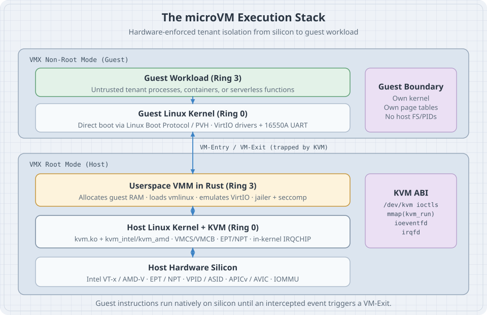

# microVMs

A **microVM** is a hardware-virtualized virtual machine stripped down to the bare minimum required to boot a modern Linux kernel and run isolated workloads with near-container startup latency and memory density. Unlike Linux containers—which share a single host kernel and rely on namespaces, cgroups, and seccomp for isolation—a microVM gives every tenant its own Linux kernel behind a hardware-enforced CPU and memory boundary (Intel VT-x / AMD-V + EPT/NPT). Unlike traditional QEMU/libvirt VMs, a microVM eliminates legacy PC hardware emulation (BIOS, floppy, PS/2, VGA, IDE, sprawling PCI hierarchies), cutting the Virtual Machine Monitor (VMM) down to tens of thousands of lines of memory-safe Rust and reducing boot time from seconds to tens of milliseconds.

This sub-section builds a complete, bottom-up engineering understanding of microVMs—from silicon page-table walks and VMCS control fields, through raw `/dev/kvm` `ioctl` programming in Rust, direct Linux kernel boot without firmware, lockless VirtIO rings, and finally into the internals of production VMMs (**Firecracker** and **Cloud Hypervisor**).

## Chapter Roadmap

| Chapter | Title | Core Mechanisms Covered |
|---|---|---|
| **01** | [Trap-and-Emulate to VT-x, VMCS, and EPT](01-trap-and-emulate-to-vtx-vmcs-and-ept.md) | Popek & Goldberg theorem, x86 virtualization holes, VMX Root vs. Non-Root operation, all 6 VMCS regions, 2D EPT page walks, VPID, APICv, and AMD-V (SVM) equivalents |
| **02** | [KVM from User Space in Rust](02-kvm-from-user-space-in-rust.md) | The 3-tier `/dev/kvm` fd model, `KVM_SET_USER_MEMORY_REGION`, `struct kvm_run`, building a complete minimal Rust VMM from raw `ioctl`s, `rust-vmm` crates, and Rust UB rules for guest memory |
| **03** | [Booting Linux](03-booting-linux.md) | Direct kernel boot (`bzImage` & PVH `vmlinux`), guest physical memory map, Zero Page (`boot_params`), E820, 4-level identity paging, x86-64 long-mode bringup, `CPUID`/MSRs, 16550A UART, and sub-100ms kernel tuning |
| **04** | [virtio Devices](04-virtio-devices.md) | VirtIO 1.1/1.2 state machine, VirtIO-MMIO vs. VirtIO-PCI/MSI-X, split & packed virtqueues, memory barriers, `EVENT_IDX`, `ioeventfd`/`irqfd` fast paths, `virtio-blk`/`net`/`vsock`/`fs`, and `vhost`/`vDPA` offload |
| **05** | [Production VMMs: Firecracker and Cloud Hypervisor](05-production-vmms-firecracker-and-cloud-hypervisor.md) | `rust-vmm` ecosystem, Firecracker's threading/jailer/seccomp/snapshot-UFFD architecture, Cloud Hypervisor's PCI/ACPI/VFIO/`io_uring`/TDX/SEV-SNP architecture, comparison matrix, and host observability |

## Prerequisites and Related Reading

To get the most out of this sub-section, you should be comfortable with x86-64 virtual memory, Linux processes and file descriptors, and basic Rust or C systems programming. Several other parts of *Boring Linux* connect directly to these chapters:

- [Part 03 — Boot, Shutdown and Recovery](../../03-boot-shutdown-and-recovery/02-kernel-and-early-userspace/01-kernel-images-command-lines-and-modules.md) for standard Linux kernel images, initramfs, and command lines.
- [Part 07 — Processes, Memory and Resource Administration](../../07-processes-memory-and-resource-administration/08-cgroups-v2-hierarchy-controllers-delegation-and-accounting.md) for cgroups v2 and host resource boundaries.
- [Part 33 — Hardware-Assisted Multi-Kernel with KVM/QEMU](../../33-running-multiple-kernels-on-one-bare-metal-server/05-hardware-assisted-multi-kernel-with-kvm-qemu.md) for CPU pinning, NUMA locality, and static hugepages.
- [Part 37 — Hardware Foundations and Address Translation](../../37-a-complete-guide-to-virtual-memory-allocators-paging-and-performance-in-the-modern-linux-kernel/02-hardware-foundations-and-address-translation.md) for 4-level/5-level x86-64 paging and TLB mechanics.

> [!NOTE]
> **Architecture focus:** Examples, register layouts, and Rust code in this sub-section target **x86-64 with Intel VT-x** as the primary reference, with explicit architectural mappings to **AMD-V (SVM)** and notes on **ARM64 (KVM/EL2)** where designs diverge.
