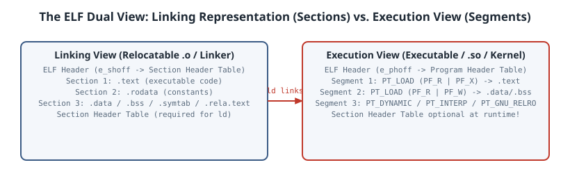

# Chapter 2: ELF at a Glance

## The Dual View: Linking Representation and Execution Representation

ELF's most important conceptual breakthrough is its **dual view** of the exact same bytes on disk. A static linker (`ld`, `lld`, `mold`) opens an object file using the **Section Header Table** to combine `.text`, resolve symbols in `.symtab`, and patch `.rela.*` relocations. Once linked into an executable or shared library, the Linux kernel and dynamic linker ignore the Section Header Table completely and instead read the **Program Header Table**, mapping coarse page-aligned **segments** into virtual memory.



## High-Level File Layout

Every ELF file starts at byte offset `0` with the **ELF Header**. Beyond that header, the specification imposes no rigid ordering on the Program Header Table, sections, or the Section Header Table—their exact byte offsets live inside `e_phoff` and `e_shoff`. By convention, linkers emit:

1. **ELF Header** at offset `0` (`64` bytes for ELF64, `52` bytes for ELF32).
2. **Program Header Table** immediately following the ELF header (for executables and shared objects).
3. **Section payloads** grouped by memory permissions (`.interp`, `.note.*`, `.rodata`, `.text`, `.data`, `.dynamic`, `.got`).
4. **Non-allocatable metadata** (`.symtab`, `.strtab`, `.shstrtab`, `.debug_*`).
5. **Section Header Table** at the very end of the file.

## ELF File Types

The `e_type` field classifies every ELF binary into one of four primary types:

| Constant | Value | Meaning |
| :--- | :--- | :--- |
| `ET_NONE` | `0` | Unknown / uninitialized object type |
| `ET_REL` | `1` | Relocatable object file (`.o`, kernel `.ko`, static archive `.a` member) |
| `ET_EXEC` | `2` | Non-PIE position-dependent executable with fixed load addresses |
| `ET_DYN` | `3` | Shared object (`.so`) **or** Position-Independent Executable (PIE) |
| `ET_CORE` | `4` | Core dump capturing process registers and memory segments at crash time |

> [!NOTE]
> Modern Linux distributions compile almost all executables as **PIE (`ET_DYN`)** so ASLR can randomize the executable base address. Tools distinguish a PIE executable from a `.so` library by checking for a `PT_INTERP` segment or the `DF_1_PIE` flag in `DT_FLAGS_1`.

## Identification: Magic, Class, Data Encoding, Version, OS ABI

The first 16 bytes (`e_ident[EI_NIDENT]`) are byte-order-independent:
- **Bytes 0–3 (`EI_MAG0..3`):** `0x7f 'E' 'L' 'F'` (`7f 45 4c 46`).
- **Byte 4 (`EI_CLASS`):** `ELFCLASS32` (`1`) or `ELFCLASS64` (`2`).
- **Byte 5 (`EI_DATA`):** `ELFDATA2LSB` (`1`, little-endian) or `ELFDATA2MSB` (`2`, big-endian).
- **Byte 6 (`EI_VERSION`):** `EV_CURRENT` (`1`).
- **Byte 7 (`EI_OSABI`):** `ELFOSABI_NONE`/`SYSV` (`0`), `ELFOSABI_LINUX`/`GNU` (`3`), `ELFOSABI_FREEBSD` (`9`).

## Word Size, Endianness and Alignment Rules

ELF defines explicit fixed-width data types so C structs match on-disk bytes deterministically:
- **ELF32:** `Elf32_Addr` (4 B), `Elf32_Off` (4 B), `Elf32_Half` (2 B), `Elf32_Word` (4 B).
- **ELF64:** `Elf64_Addr` (8 B), `Elf64_Off` (8 B), `Elf64_Half` (2 B), `Elf64_Word` (4 B), `Elf64_Xword` (8 B).
- All data structures are naturally aligned to their word size (`4` bytes for ELF32, `8` bytes for ELF64), and every `PT_LOAD` segment obeys `p_offset % p_align == p_vaddr % p_align`.

## Hands-On Lab: Dump the First 64 Raw Bytes of an ELF File

```bash
# Inspect the 16-byte e_ident magic, class, endianness, and header layout
hexdump -C -n 64 /bin/ls 2>/dev/null || od -tx1 -N 64 /bin/ls
```
