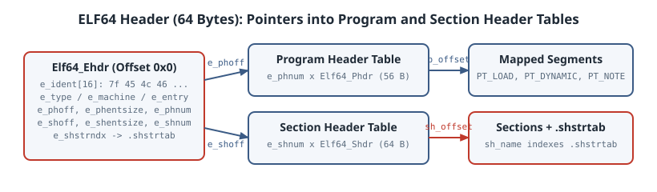

# Chapter 3: The ELF Header

The ELF header sits at byte offset `0` of every ELF file and acts as the master directory for every table inside the binary.



## `e_ident`: The Identification Array in Detail

| Index | Constant | Purpose | Common Values |
| :--- | :--- | :--- | :--- |
| `0..3` | `EI_MAG0..3` | Magic signature | `0x7f, 'E', 'L', 'F'` |
| `4` | `EI_CLASS` | Address width | `1` (`ELFCLASS32`), `2` (`ELFCLASS64`) |
| `5` | `EI_DATA` | Endianness | `1` (`ELFDATA2LSB`), `2` (`ELFDATA2MSB`) |
| `6` | `EI_VERSION` | ELF spec version | `1` (`EV_CURRENT`) |
| `7` | `EI_OSABI` | OS/ABI extensions | `0` (SysV), `3` (GNU/Linux) |
| `8` | `EI_ABIVERSION` | ABI sub-version | `0` (standard) |
| `9..15` | `EI_PAD` | Zero padding | Seven `0x00` bytes |

## 32-bit ELF Header Structure: `Elf32_Ehdr` Field by Field

```c
typedef struct {
    unsigned char e_ident[16]; /* Magic, class, endianness, OS/ABI */
    uint16_t      e_type;      /* Object file type (ET_REL/EXEC/DYN/CORE) */
    uint16_t      e_machine;   /* Target ISA (EM_386, EM_ARM, ...) */
    uint32_t      e_version;   /* EV_CURRENT (1) */
    uint32_t      e_entry;     /* Virtual entry point address */
    uint32_t      e_phoff;     /* Program header table file offset */
    uint32_t      e_shoff;     /* Section header table file offset */
    uint32_t      e_flags;     /* Architecture-specific flags */
    uint16_t      e_ehsize;    /* Size of this header (52 bytes) */
    uint16_t      e_phentsize; /* Size of one Elf32_Phdr (32 bytes) */
    uint16_t      e_phnum;     /* Number of program header entries */
    uint16_t      e_shentsize; /* Size of one Elf32_Shdr (40 bytes) */
    uint16_t      e_shnum;     /* Number of section header entries */
    uint16_t      e_shstrndx;  /* Section index of .shstrtab */
} Elf32_Ehdr;                  /* Total: 52 bytes */
```

## 64-bit ELF Header Structure: `Elf64_Ehdr` Field by Field

```c
typedef struct {
    unsigned char e_ident[16]; /* Offset 0x00 (16 B) */
    uint16_t      e_type;      /* Offset 0x10 (2 B)  */
    uint16_t      e_machine;   /* Offset 0x12 (2 B)  */
    uint32_t      e_version;   /* Offset 0x14 (4 B)  */
    uint64_t      e_entry;     /* Offset 0x18 (8 B)  */
    uint64_t      e_phoff;     /* Offset 0x20 (8 B)  */
    uint64_t      e_shoff;     /* Offset 0x28 (8 B)  */
    uint32_t      e_flags;     /* Offset 0x30 (4 B)  */
    uint16_t      e_ehsize;    /* Offset 0x34 (2 B) -> 64 */
    uint16_t      e_phentsize; /* Offset 0x36 (2 B) -> 56 */
    uint16_t      e_phnum;     /* Offset 0x38 (2 B)  */
    uint16_t      e_shentsize; /* Offset 0x3a (2 B) -> 64 */
    uint16_t      e_shnum;     /* Offset 0x3c (2 B)  */
    uint16_t      e_shstrndx;  /* Offset 0x3e (2 B)  */
} Elf64_Ehdr;                  /* Total: 64 bytes */
```

## Machine Types: `EM_X86_64`, `EM_AARCH64` and the Complete List

| Constant | Value | Architecture |
| :--- | :--- | :--- |
| `EM_386` | `3` | Intel 80386 (32-bit x86) |
| `EM_MIPS` | `8` | MIPS RS3000 |
| `EM_PPC64` | `21` | 64-bit PowerPC |
| `EM_ARM` | `40` | 32-bit ARM |
| `EM_X86_64` | `62` | AMD x86-64 / Intel 64 |
| `EM_AARCH64` | `183` | 64-bit ARMv8/v9 (AArch64) |
| `EM_RISCV` | `243` | RISC-V (32/64-bit) |
| `EM_BPF` | `247` | Linux eBPF virtual machine |
| `EM_LOONGARCH` | `258` | LoongArch |

## Entry Points, Program Header Table and Section Header Table Offsets

- **`e_entry`:** Virtual address of `_start` (for `ET_EXEC`) or offset from load base (for PIE `ET_DYN`). Zero for relocatable `.o` files and non-executable shared libraries.
- **`e_phoff` / `e_phentsize` / `e_phnum`:** Locate the Program Header Table. If `e_phnum == 0xffff` (`PN_XNUM`), the real count lives in `sh_info` of section 0.
- **`e_shoff` / `e_shentsize` / `e_shnum` / `e_shstrndx`:** Locate the Section Header Table and `.shstrtab`. For objects with `>= 65280` sections (`SHN_LORESERVE`), `e_shnum` is `0` and the true section count is stored in section 0's `sh_size`.

## Flags, Header Sizes and Alignment Constraints

`e_flags` carries architecture-specific ABI bits (zero on x86-64 and standard AArch64; encodes soft/hard-float EABI on 32-bit ARM and RVC/float-ABI on RISC-V). Always validate `e_ehsize == sizeof(Elf64_Ehdr)` and check `e_phoff + e_phnum * e_phentsize <= file_size` before indexing into tables to prevent out-of-bounds reads on malformed inputs.

## Hands-On Lab: Decode an ELF64 Header in 15 Lines of Python

```python
import struct, sys

with open(sys.argv[1], "rb") as f:
    raw = f.read(64)
ident = raw[:16]
assert ident[:4] == b"ELF", "Not an ELF binary"
e_type, e_machine, e_ver, e_entry, e_phoff, e_shoff, e_flags, ehsz, phent, phnum, shent, shnum, shstr =     struct.unpack("<HHIQQQIHHHHHH", raw[16:64])
print(f"type={e_type} machine={e_machine} entry={hex(e_entry)} phoff={e_phoff}({phnum}) shoff={e_shoff}({shnum})")
```
