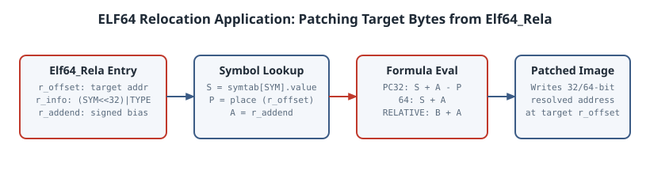

# Chapter 7: Relocations

## Why Relocation is Necessary: Positions, Dependencies and Resolving Addresses

When the compiler compiles `main.c` into `main.o`, it does not yet know the final virtual address of `printf`, global variables in `other.o`, or even where `.rodata` will land after linking. Instead, the compiler emits placeholder zero bytes in the machine instruction and records a **relocation entry** telling the linker (or dynamic loader) exactly which byte offset to patch and what formula to apply.



## Relocation Entry Formats: `Elf64_Rel` vs `Elf64_Rela`

```c
typedef struct {
    uint64_t r_offset; /* Byte offset (ET_REL) or VMA (ET_EXEC/ET_DYN) */
    uint64_t r_info;   /* Upper 32 bits: sym index; lower 32 bits: reloc type */
} Elf64_Rel;           /* 16 bytes: implicit addend stored in target bytes */

typedef struct {
    uint64_t r_offset;
    uint64_t r_info;
    int64_t  r_addend; /* Explicit signed constant bias */
} Elf64_Rela;          /* 24 bytes: standard on x86-64, AArch64, RISC-V */

#define ELF64_R_SYM(i)  ((i) >> 32)
#define ELF64_R_TYPE(i) ((i) & 0xffffffffUL)
```

x86-64 and AArch64 use **`Elf64_Rela`** exclusively so linkers can inspect and transform addends cleanly without decoding architecture-specific instruction bitfields.

## The `r_offset`, `r_info` and `r_addend` Fields Decoded

- **`r_offset`:** In `.o` files (`ET_REL`), byte offset from the start of the target section (`sh_info`). In executables/shared libraries, the virtual address to patch.
- **`r_info`:** Packs both the symbol table index (`ELF64_R_SYM`) and architecture-specific relocation type (`ELF64_R_TYPE`).
- **`r_addend`:** Signed offset added to the symbol address (for example, `-4` on x86-64 `call rel32` because RIP points to the *next* instruction after the 4-byte displacement).

## Relocation Type Encoding and Architecture-Specific Types

| Relocation (x86-64) | Formula | Typical Purpose |
| :--- | :--- | :--- |
| `R_X86_64_64` | `S + A` | 64-bit absolute pointer in `.data` |
| `R_X86_64_PC32` / `PLT32` | `S + A - P` | 32-bit PC-relative call or branch |
| `R_X86_64_GOTPCREL` | `G + GOT + A - P` | PC-relative load of a GOT slot |
| `R_X86_64_RELATIVE` | `B + A` | Load-base adjustment for PIE / `.so` internal pointers |
| `R_X86_64_GLOB_DAT` | `S` | Populates a `.got` data/function pointer at load time |
| `R_X86_64_JUMP_SLOT` | `S` | Populates a `.got.plt` entry (lazy or eager) |
| `R_X86_64_COPY` | Copy `st_size` bytes | Legacy non-PIE executable referencing a `.so` global variable |

*(Legend: `S` = symbol value, `A` = addend, `P` = place/`r_offset`, `B` = shared object load base.)*

## Relative, Absolute and Copy Relocations: How Each Works

- **Relative (`R_*_RELATIVE`):** Need no symbol lookup (`ELF64_R_SYM == 0`); `ld.so` simply adds the ASLR base address `B + A`. Modern toolchains pack thousands of these into compact **`.relr.dyn`** sections (`DT_RELR`).
- **Absolute (`R_*_64`, `R_*_GLOB_DAT`):** Require symbol resolution and write a full 64-bit virtual address.
- **Copy (`R_*_COPY`):** Used when a non-PIE executable accesses a global variable defined in a `.so`; the linker allocates space in the executable's `.bss` and instructs `ld.so` to copy the initial bytes from the library at startup.

## The Relocation Application Algorithm

1. Locate target section or VMA `P = r_offset`.
2. Extract `sym_idx = ELF64_R_SYM(r_info)` and `type = ELF64_R_TYPE(r_info)`.
3. If `sym_idx != 0`, resolve symbol `S` (accounting for interposition and versioning).
4. Evaluate the architecture formula for `type`, verify signed/unsigned width overflow, and write the result at `P`.

## Hands-On Lab: Inspect Unresolved Relocations in an Object File

```bash
cat > /tmp/reloc_lab.c <<'C'
extern int ext_fn(int x);
int caller(int v) { return ext_fn(v + 1); }
C
cc -c /tmp/reloc_lab.c -o /tmp/reloc_lab.o
readelf -r /tmp/reloc_lab.o
objdump -dr /tmp/reloc_lab.o
rm -f /tmp/reloc_lab.c /tmp/reloc_lab.o
```
