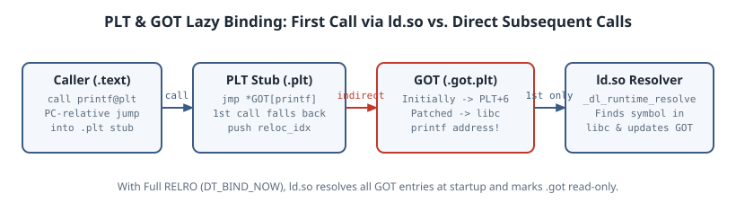

# Chapter 11: PLT, GOT and Lazy Binding

## The Global Offset Table: Indirect Addressing for Data and Code

Because shared library `.text` pages are mapped read-only and shared across every process using `libc.so.6`, machine code cannot be patched in place with absolute addresses of external variables or functions. Instead, all external references route through the **Global Offset Table (`.got` and `.got.plt`)**—a per-process writable table located at a fixed PC-relative offset from `.text`.



## The Procedure Linkage Table: Trampolines for Indirect Calls

Every call to an external function (`call printf@plt`) targets a small stub in **`.plt`**. Each PLT stub performs an indirect jump through its dedicated slot in `.got.plt`.

## Lazy Binding: How `dlopen` and Symbol Resolution Work at Runtime

Resolving all 2,000 external functions in a GUI application before `main()` starts wastes startup time if 90% of those functions are never called. Under **lazy binding**:
1. Initially, `GOT[printf]` points back to the **second instruction** of `printf@plt`.
2. On the **first call**, `printf@plt` pushes its relocation index and jumps to `PLT[0]`, which pushes the library's `link_map` (`GOT[1]`) and invokes `_dl_runtime_resolve` (`GOT[2]`).
3. `_dl_runtime_resolve` finds `printf` in `libc.so.6`, **overwrites `GOT[printf]`** with the real address, and jumps to `printf`.
4. Every subsequent call jumps straight through `GOT[printf]` in one indirect branch—zero resolver overhead!

## Eager Binding: `DT_BIND_NOW` and `DF_1_NOW`

Lazy binding requires `.got.plt` to remain writable for the lifetime of the process—creating a prime target for GOT overwrite exploits. Linking with **`-Wl,-z,relro,-z,now`** sets `DT_BIND_NOW` / `DF_1_NOW`: `ld.so` resolves every function pointer at startup and calls `mprotect(PROT_READ)` on the entire GOT (**Full RELRO**).

## PLT/GOT Layout: x86-64 Convention and AArch64 Equivalents

- **x86-64:** Uses RIP-relative addressing (`jmp *0x2fe2(%rip)`). With `-fno-plt`, GCC skips the PLT stub entirely and emits a direct `call *printf@GOTPCREL(%rip)`.
- **AArch64:** Uses `adrp x16, page(GOT)` + `ldr x17, [x16, lo12(GOT)]` + `br x17` (3 instructions to reach any +/-4 GiB PC-relative GOT page).

## Symbol Interposition and the PLT

Because every global call in a shared object routes through the PLT by default, `LD_PRELOAD` can intercept functions cleanly. Marking internal helpers `__attribute__((visibility("hidden")))` or compiling with `-Bsymbolic` bypasses the PLT for intra-library calls.

## Hands-On Lab: Disassemble `.plt` and Inspect `.got.plt`

```bash
objdump -d -j .plt /bin/ls 2>/dev/null | head -n 35 || true
readelf -r /bin/ls 2>/dev/null | grep JUMP_SLOT | head -n 10 || true
```
