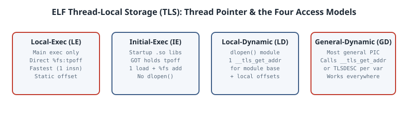

# Chapter 13: Thread-Local Storage

## TLS Concepts: Thread-Local Data and Storage Models

In multithreaded programs, variables like `errno`, allocator thread caches (`tcache`), and per-thread request contexts must give every OS thread its own private instance without mutex locking. ELF **Thread-Local Storage (TLS)** (`_Thread_local` in C11, `__thread` in GNU C, `thread_local` in C++11) achieves this by pairing a read-only initialization image in the ELF file with a hardware **Thread Pointer** register per thread.



## TLS Sections: `.tdata`, `.tbss` and the `SHF_TLS` Flag

- **`.tdata` (`SHT_PROGBITS`, `SHF_ALLOC | SHF_WRITE | SHF_TLS`):** Initial non-zero template bytes copied into each new thread's TLS block.
- **`.tbss` (`SHT_NOBITS`, `SHF_ALLOC | SHF_WRITE | SHF_TLS`):** Zero-initialized thread-local variables (occupy zero bytes on disk).
- **`PT_TLS` program header:** Bundles `.tdata` (`p_filesz`) and `.tbss` (`p_memsz - p_filesz`) so `ld.so` and `pthread_create()` know how much memory to allocate and copy for each thread.

## TLS Relocation Types: `R_X86_64_TPOFF32`, `R_X86_64_GOTTPOFF` and Others

| Relocation (x86-64) | Model | Meaning |
| :--- | :--- | :--- |
| `R_X86_64_TPOFF32` | Local-Exec (LE) | Negative 32-bit offset from thread pointer `%fs:0` |
| `R_X86_64_GOTTPOFF` | Initial-Exec (IE) | PC-relative offset to GOT entry holding `TPOFF64` |
| `R_X86_64_TLSGD` | General-Dynamic (GD) | Pair `(module_id, offset)` passed to `__tls_get_addr` |
| `R_X86_64_TLSLD` | Local-Dynamic (LD) | Module base lookup once, plus `DTPOFF32` per variable |

## The Four TLS Access Models: Local-Exec, Initial-Exec, Local-Dynamic, General-Dynamic

1. **Local-Exec (LE):** Fastest (single `mov %fs:-4, %eax`). Usable only inside the main executable where static TLS offsets are fixed at link time.
2. **Initial-Exec (IE):** One GOT load + `%fs` add. Usable in shared libraries loaded at startup, but incompatible with arbitrary `dlopen()` once static TLS surplus fills up.
3. **Local-Dynamic (LD):** Calls `__tls_get_addr` once to fetch the module's Dynamic Thread Vector (DTV) base, then accesses multiple static TLS variables via cheap offsets.
4. **General-Dynamic (GD):** Works universally in any `dlopen()`-ed `.so` by querying `__tls_get_addr(module_id, offset)`.

## TLS Descriptor Mechanism

**TLSDESC** (`-mtls-dialect=gnu2` on x86-64, default on AArch64) replaces rigid `__tls_get_addr` calls with an indirect function pointer in the GOT that `ld.so` resolves to a 2-instruction fast path when the library fits in static TLS, or a full DTV lookup when `dlopen()`-ed dynamically.

## Thread Pointer and TLS Base

- **x86-64 (Variant II):** `%fs:0` points to the Thread Control Block (TCB), and static TLS variables live at **negative offsets** below `%fs:0`.
- **AArch64 (Variant I):** `TPIDR_EL0` points to the TCB, and static TLS variables live at **positive offsets** above the TCB.

## Hands-On Lab: Inspect `PT_TLS` and Disassemble Local-Exec TLS Access

```bash
cat > /tmp/tls_lab.c <<'C'
#include <stdio.h>
_Thread_local int counter = 7;
int inc(void) { return ++counter; }
int main(void) { printf("%d
", inc()); return 0; }
C
cc -O2 /tmp/tls_lab.c -o /tmp/tls_lab
readelf -l /tmp/tls_lab | grep -A1 TLS
objdump -d /tmp/tls_lab | grep -A6 '<inc>:'
rm -f /tmp/tls_lab.c /tmp/tls_lab
```
