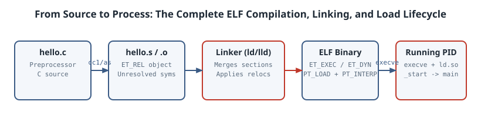

# Chapter 16: From Source to Binary: The Complete Lifecycle



## Compilation: From C to Assembly to Object File

Running `gcc -v hello.c -o hello` orchestrates four distinct tools under the hood:
1. **Preprocessor (`cpp`):** Expands `#include` headers and `#define` macros into a pure translation unit (`hello.i`).
2. **Compiler (`cc1`):** Parses C into AST/GIMPLE/RTL, runs optimizations, and emits architecture assembly (`hello.s`).
3. **Assembler (`as`):** Encodes mnemonics into machine opcodes and emits a relocatable ELF object (`hello.o`, `ET_REL`).
4. **Linker (`collect2` → `ld` / `lld`):** Combines `hello.o` with C runtime startup objects (`crt1.o`, `crti.o`, `crtn.o`) and libraries (`libc.so.6`) into the final ELF executable.

## The Object File: Sections, Symbols and Relocations Generated

A freshly assembled `hello.o` contains **no Program Header Table** (`e_phnum == 0`) and `e_entry == 0`. Its `.text` starts at address `0x0`, string literals sit in `.rodata`, `main` is a `GLOBAL` symbol in `.symtab`, and external calls like `puts` appear as `UND` (`SHN_UNDEF`) symbols paired with `R_X86_64_PLT32` entries in `.rela.text`.

## Static Linking: Merging Objects, Resolving Symbols, Applying Relocations

When linking with `-static`, the linker extracts only the needed `.o` members from static archives (`libc.a`), merges all `.text`, `.rodata`, `.data`, and `.bss` sections, assigns final virtual addresses, patches every relocation in place, and writes a self-contained binary with **no `PT_INTERP`** and **no `PT_DYNAMIC`**.

## Dynamic Linking: Shared Object References and Unresolved Symbols

In dynamic linking (the default), the linker verifies that every undefined symbol exists in one of the input `.so` files, records each library's `DT_SONAME` in `DT_NEEDED`, generates `.plt` and `.got.plt` entries for external calls, embeds `PT_INTERP`, and defers final address binding to `ld.so` at runtime.

## Build Case Study: From `hello.c` Through All Stages to a Running Process

```bash
mkdir -p /tmp/elf-lifecycle && cd /tmp/elf-lifecycle
cat > hello.c <<'C'
#include <stdio.h>
int main(void) { puts("hello ELF"); return 0; }
C

cc -E hello.c -o hello.i          # 1. Preprocessed C
cc -S -O2 hello.i -o hello.s      # 2. Assembly
cc -c hello.s -o hello.o          # 3. Relocatable ELF (ET_REL)
cc hello.o -o hello               # 4. Linked PIE ELF (ET_DYN)

readelf -h hello.o | grep -E 'Type|Entry|program headers'
readelf -h hello   | grep -E 'Type|Entry|program headers'
./hello
```
