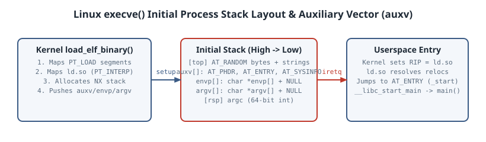

# Chapter 18: Executing an ELF Binary



## `execve` and the Kernel: Parsing ELF in `sys_execve`

When a shell runs `execve("/usr/bin/ls", argv, envp)`, the kernel dispatches through `fs/exec.c` to `fs/binfmt_elf.c:load_elf_binary()`. The kernel reads the first 64 bytes, validates `ELF`, `ET_EXEC`/`ET_DYN`, and `e_machine`, then loads the Program Header Table. Note that `load_elf_binary()` never reads the Section Header Table—an executable with stripped section headers executes identically.

## Kernel ELF Loading: Mapping Segments into Address Space

For every `PT_LOAD` segment, the kernel calls `elf_map()` (`vm_mmap`), aligning the mapping down to the nearest 4 KiB page boundary, setting `PROT_READ`/`PROT_WRITE`/`PROT_EXEC` from `p_flags`, and zero-filling the tail (`p_memsz - p_filesz`) for `.bss`. If `PT_INTERP` is present, the kernel opens and maps `ld.so` as well.

## `PT_GNU_STACK` and Stack Permissions

The kernel inspects `PT_GNU_STACK` before allocating the initial user stack:
- `p_flags == PF_R | PF_W`: Stack mapped non-executable (NX enforced).
- `p_flags == PF_R | PF_W | PF_X`: Kernel marks the stack executable (usually triggered accidentally by an assembly `.S` file missing `.section .note.GNU-stack,"",@progbits`).

## Auxiliary Vector: `AT_ENTRY`, `AT_PHDR`, `AT_RANDOM` and Others

The kernel passes critical boot parameters to userspace on the initial stack as an array of `(a_type, a_val)` pairs (`Elf64_auxv_t`) terminated by `AT_NULL`:

| Key | Purpose |
| :--- | :--- |
| `AT_PHDR` / `AT_PHENT` / `AT_PHNUM` | In-memory address and dimensions of the executable's Program Header Table |
| `AT_ENTRY` | Entry point (`_start`) where `ld.so` must jump after relocations |
| `AT_BASE` | Randomized virtual base address of `ld.so` |
| `AT_PAGESZ` | Hardware page size (4096 or 65536 on ARM64) |
| `AT_RANDOM` | Pointer to 16 kernel-generated random bytes (seeds stack canary and pointer guard) |
| `AT_SYSINFO_EHDR` | Base address of the kernel's mapped `vDSO` ELF image |
| `AT_SECURE` | `1` for `setuid`/capability-elevated binaries (disables `LD_PRELOAD` and `LD_LIBRARY_PATH`) |

## Stack Setup, Environment and `argc`/`argv`

`create_elf_tables()` lays out the initial 16-byte-aligned stack from low to high addresses: `argc`, `argv[0..argc]`, `NULL`, `envp[0..n]`, `NULL`, `auxv[]`, `AT_NULL`, followed by the string pool and `AT_RANDOM` bytes.

## Transfer of Control to Entry Point and `_start`

The kernel executes `START_THREAD` (setting `RIP` to `ld.so` or `e_entry`, `RSP` to `&argc`), returning to Ring 3. `_start` (from `crt1.o`) aligns the stack, extracts `argc`/`argv`, and invokes `__libc_start_main(main, argc, argv, ...)`.

## Hands-On Lab: Dump the Live Auxiliary Vector of Any Command

```bash
LD_SHOW_AUXV=1 /bin/true 2>/dev/null || true
```
