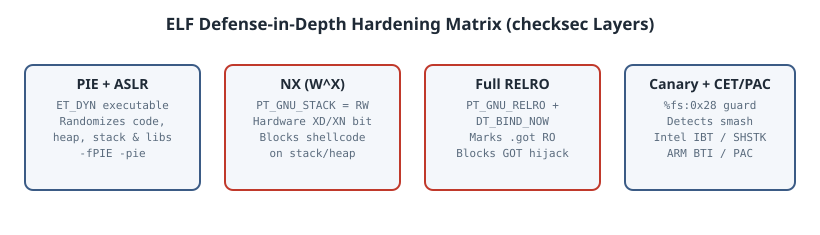

# Chapter 25: ELF Security



## Buffer Overflows and Stack Smashing: ELF Perspective

Classic stack buffer overflows overwrite the saved return address (`RIP`/`LR`) on the stack to hijack control flow. ELF binaries defend against stack smashing through **stack canaries** (`-fstack-protector-strong`, seeded from `AT_RANDOM` in `%fs:0x28`) and hardware shadow stacks (`GNU_PROPERTY_X86_FEATURE_1_SHSTK`).

## Format String Vulnerabilities and GOT Overwrite

An unvalidated `printf(user_input)` call allows arbitrary memory reads (`%p`, `%s`) and writes (`%n`). Historically, attackers targeted writable `.got.plt` entries (for example, overwriting `GOT[exit]` with a target function address). Compiling with `-Wformat -Werror=format-security`, `-D_FORTIFY_SOURCE=3`, and **Full RELRO** closes both the vulnerability class and its primary target.

## Return-Oriented Programming: PLT, Gadgets and RELRO

When NX blocks executing injected stack bytes, exploits chain short instruction sequences ending in `ret` (**ROP gadgets**) already present inside executable `.text` and `.plt` segments. Defending against ROP requires combining **PIE + ASLR** (randomizing gadget addresses), **Full RELRO** (locking down GOT pointers), and hardware **CET/IBT/BTI/PAC** (constraining valid indirect branch targets).

## GOT Hijacking and Symbol Interposition Attacks

Under Partial RELRO (lazy binding), `.got.plt` stays `RW` for the entire process lifetime. Enabling **Full RELRO (`-Wl,-z,relro,-z,now`)** forces `ld.so` to resolve all `JUMP_SLOT` relocations before `main()` and mark `.got` and `.got.plt` strictly read-only (`PROT_READ`).

## ASLR and PIE: Mitigating Address Revelation

Verify that every production binary compiles with `-fPIE -pie` (`ET_DYN` + `DF_1_PIE`) and that `/proc/sys/kernel/randomize_va_space` equals `2` (full randomization of stack, heap, `mmap` libraries, vDSO, and PIE base).

## NX and W^X: Enforcing Through `PT_GNU_STACK` and Segment Permissions

No `PT_LOAD` segment should ever carry both `PF_W` and `PF_X`, and `PT_GNU_STACK` must be `RW` (never `RWE`). Always pass `-Wl,-z,noexecstack` when linking assembly objects.

## `LD_PRELOAD` Attacks and Defense

`LD_PRELOAD` instructs `ld.so` to load an attacker-supplied `.so` first, preempting `libc` functions. The Linux kernel defends privileged binaries automatically by setting **`AT_SECURE = 1`** in `auxv` for `setuid`/`setgid`/file-capability executables, causing `ld.so` to ignore `LD_PRELOAD`, `LD_LIBRARY_PATH`, and `LD_AUDIT`.

## Malformed ELF Exploitation and Parser Robustness

Tools that inspect untrusted ELF binaries (antivirus scanners, CI linters, debuggers, container runtimes) are frequent targets of integer-overflow bugs (`e_shnum * e_shentsize`), overlapping `sh_offset`/`sh_size` claims, circular `sh_link` chains, and non-terminated strings in `.shstrtab`. Always use checked bounds arithmetic (`off <= fsize && len <= fsize - off`), cap table iteration counts, and fuzz parsers with `libFuzzer` or `AFL++`.

## Hands-On Lab: Hardened Build Flags & Security Audit Script

```bash
# Recommended production hardening flags for GCC/Clang on Linux:
# -fPIE -pie -fstack-protector-strong -D_FORTIFY_SOURCE=3 -O2 # -Wl,-z,relro,-z,now -Wl,-z,noexecstack -Wl,-z,separate-code

# Quick checksec-style audit using readelf:
BIN=/bin/ls
echo "PIE:   $(readelf -h "$BIN" 2>/dev/null | grep -q 'Type:.*DYN' && echo YES || echo NO)"
echo "NX:    $(readelf -l "$BIN" 2>/dev/null | grep -A1 GNU_STACK | grep -q 'RWE' && echo NO || echo YES)"
echo "RELRO: $(readelf -l "$BIN" 2>/dev/null | grep -q GNU_RELRO && (readelf -d "$BIN" 2>/dev/null | grep -q BIND_NOW && echo FULL || echo PARTIAL) || echo NONE)"
```
