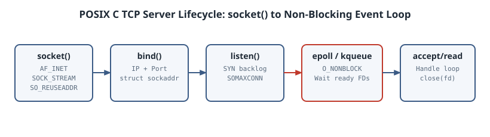

# Module 11: Network Programming

## Overview

Network programming is a critical skill for developing modern applications that communicate over networks. This module covers the fundamentals of network programming in C, from basic concepts to advanced techniques. You'll learn how to create network applications that can communicate over local networks and the internet.

## Learning Objectives

By the end of this module, you should be able to:
- Understand fundamental networking concepts and protocols
- Implement client-server applications using sockets
- Work with different network protocols (TCP, UDP)
- Handle network errors and implement robust communication
- Implement advanced networking features like non-blocking I/O
- Understand network security considerations

## Chapters

1. **Network Fundamentals** - Basic networking concepts, OSI model, IP addressing, and network protocols
2. **Socket Programming** - Creating sockets, binding, connecting, and basic client-server communication
3. **Advanced Networking** - Non-blocking I/O, select/poll, multiplexing, and advanced socket options
4. **Network Protocols** - HTTP, FTP, DNS, and other common protocols implementation
5. **Network Security** - Secure communication, encryption, and network security best practices

## Prerequisites

Before starting this module, you should have a solid understanding of:
- C programming fundamentals
- Pointers and memory management
- File I/O operations
- Basic understanding of computer networks

## Key Concepts

- OSI and TCP/IP models
- IP addressing and subnetting
- Socket programming fundamentals
- Client-server architecture
- TCP and UDP protocols
- Network error handling
- Concurrent network programming
- Network security principles
## POSIX Socket Lifecycle Diagram & Byte-Order Verification Lab



Verify network byte order (`htons` / `htonl`) and address formatting (`inet_pton` / `inet_ntop`) with a portable C11 snippet:

```c
#include <arpa/inet.h>
#include <stdio.h>

int main(void) {
    uint16_t host_port = 8080;
    uint16_t net_port = htons(host_port);
    printf("host=0x%04x -> net=0x%04x -> host=%u
", host_port, net_port, ntohs(net_port));

    struct in_addr addr;
    inet_pton(AF_INET, "127.0.0.1", &addr);
    char buf[INET_ADDRSTRLEN];
    inet_ntop(AF_INET, &addr, buf, sizeof(buf));
    printf("round-tripped IPv4: %s
", buf);
    return 0;
}
```
