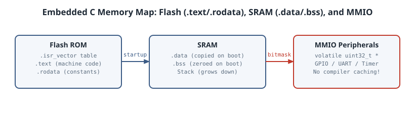

# Module 12: Embedded Systems Programming

## Overview

Embedded systems programming is a specialized area of C development focused on creating software for dedicated computer systems that perform specific functions within larger mechanical or electrical systems. This module covers the unique challenges and techniques involved in programming for resource-constrained environments, real-time requirements, and direct hardware interaction.

## Learning Objectives

By the end of this module, you should be able to:
- Understand the fundamentals of embedded systems and their constraints
- Program at the hardware level with direct memory-mapped I/O
- Implement real-time programming techniques and scheduling
- Work with embedded C extensions and specialized compilers
- Interface with various hardware components and sensors
- Debug and optimize code for embedded environments
- Understand power management and resource optimization

## Chapters

1. **Embedded Basics** - Introduction to embedded systems, architectures, and development environments
2. **Low-Level Programming** - Direct hardware access, memory-mapped I/O, and bit manipulation
3. **Embedded C Techniques** - Specialized C features for embedded systems, compiler extensions
4. **Real-time Programming** - Real-time constraints, scheduling, and timing considerations
5. **Hardware Interfaces** - Working with GPIO, SPI, I2C, UART, and other hardware interfaces

## Prerequisites

Before starting this module, you should have a solid understanding of:
- C programming fundamentals
- Pointers and memory management
- Basic electronics concepts
- Computer architecture fundamentals

## Key Concepts

- Resource-constrained programming
- Real-time constraints and deterministic behavior
- Direct hardware manipulation
- Memory-mapped I/O
- Bit manipulation and bit fields
- Interrupt handling
- Power management
- Cross-compilation for embedded targets
- Hardware-software interface design
## Embedded Memory Map Diagram & Safe Bitmask Register Lab



Practice atomic-style bit set, clear, and toggle operations on a simulated `volatile uint32_t` hardware control register:

```c
#include <stdint.h>
#include <stdio.h>

#define BIT(n) (1u << (n))

int main(void) {
    volatile uint32_t gpio_odr = 0;
    gpio_odr |= BIT(5);   // Enable LED on pin 5
    gpio_odr |= BIT(2);   // Enable TX on pin 2
    printf("After set:   0x%08X
", gpio_odr);
    gpio_odr &= ~BIT(5);  // Clear pin 5 without disturbing pin 2
    printf("After clear: 0x%08X
", gpio_odr);
    return 0;
}
```
