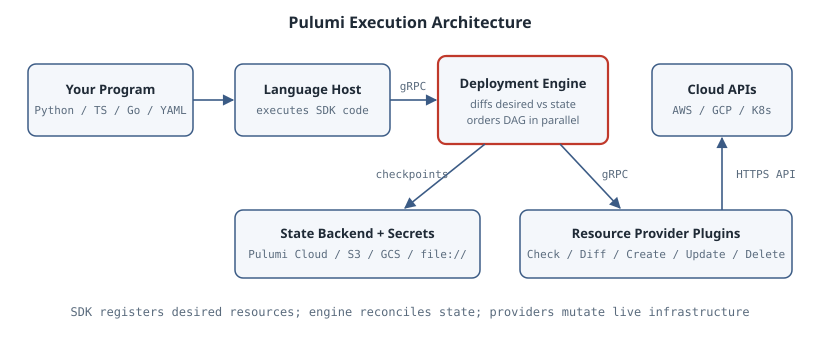

# What Pulumi is (and is not)

Modern cloud infrastructure fails less often from missing cloud features than from drift, copy-pasted configuration, and untested glue code. Pulumi addresses this by combining a declarative **desired-state engine** with **general-purpose programming languages** (Python, TypeScript, Go, .NET, Java) as well as declarative YAML and HCL. You write ordinary code that constructs resource objects; the Pulumi CLI runs your code, diffs the resulting resource graph against recorded **state**, and invokes provider plugins to converge live infrastructure.

By the end of this chapter, you will be able to trace how a Pulumi program executes across the language host, gRPC deployment engine, provider plugins, and state backend — and distinguish clearly between what Pulumi solves and what remains your responsibility.

## How the engine actually works

When you run `pulumi up`, your Python or Go code does **not** talk directly to AWS or Kubernetes APIs. Instead, Pulumi separates *declaring intent* from *mutating infrastructure* across four cooperating processes linked over gRPC.



1. **Language host**: Executes your program inside its native runtime (`python`, `node`, `go`, etc.). Each time your code instantiates a resource class, the SDK sends a `RegisterResource` RPC to the deployment engine and immediately receives an asynchronous `Output` handle.
2. **Deployment engine**: Loads the stack's previous **state checkpoint** from the backend, compares the desired graph emitted by your program against recorded state, and computes a minimal, parallelizable execution plan (a directed acyclic graph, or DAG).
3. **Resource provider plugins**: Standalone binaries (such as `pulumi-resource-aws` or `pulumi-resource-random`) that implement a uniform CRUD contract (`Check`, `Diff`, `Create`, `Read`, `Update`, `Delete`) against a specific cloud or SaaS API.
4. **State backend and secrets provider**: Durable storage (Pulumi Cloud, S3, GCS, Azure Blob, PostgreSQL, or local disk) that records every resource's URN, provider ID, inputs, outputs, and encrypted secrets.

> [!IMPORTANT]
> **Implicit ordering through data flow**
>
> You rarely write manual sleep loops or explicit ordering directives. Whenever you pass an output of Resource A (such as `vpc.id` or `sg.id`) as an input to Resource B, the engine records a directed dependency edge. Creates run in topological order with maximum parallelism; `pulumi destroy` walks the exact reverse order.

## The five nouns every deployment uses

| Noun | What it is | What breaks if you misunderstand it |
| :--- | :--- | :--- |
| **Program** | Source code that constructs resource objects and exports outputs | Wrong property or missing dependency produces wrong cloud state |
| **Project** | A directory anchored by `Pulumi.yaml` (name + runtime metadata) | Wrong runtime or virtualenv prevents the language host from starting |
| **Stack** | One isolated, independently configured instance (`dev`, `staging`, `prod`) | Running `up` against `prod` while testing a `dev` change |
| **Backend & State** | The durable checkpoint mapping logical URNs to live cloud IDs | Lost or concurrently mutated state creates duplicate or orphaned resources |
| **Provider** | The plugin binary that translates engine RPCs into cloud API calls | Missing cloud credentials or IAM roles fail every provider call |

## Multi-language by design: one engine, many SDKs

Because the deployment engine speaks a language-neutral gRPC protocol, the same infrastructure graph can be authored in Python, TypeScript, or Go. All three programs below declare an AWS security group and an EC2 instance wired together by `group.id`.

### Python

```python
import pulumi
import pulumi_aws as aws

group = aws.ec2.SecurityGroup(
    "web-sg",
    description="Allow inbound HTTP",
    ingress=[{
        "protocol": "tcp",
        "from_port": 80,
        "to_port": 80,
        "cidr_blocks": ["0.0.0.0/0"],
    }],
)

server = aws.ec2.Instance(
    "web-server",
    ami="ami-0319ef1a70c93d5c8",
    instance_type="t3.micro",
    vpc_security_group_ids=[group.id],
)

pulumi.export("public_ip", server.public_ip)
```

### TypeScript

```ts
import * as pulumi from "@pulumi/pulumi";
import * as aws from "@pulumi/aws";

const group = new aws.ec2.SecurityGroup("web-sg", {
    description: "Allow inbound HTTP",
    ingress: [{ protocol: "tcp", fromPort: 80, toPort: 80, cidrBlocks: ["0.0.0.0/0"] }],
});

const server = new aws.ec2.Instance("web-server", {
    ami: "ami-0319ef1a70c93d5c8",
    instanceType: "t3.micro",
    vpcSecurityGroupIds: [group.id],
});

export const publicIp = server.publicIp;
```

### Go

```go
package main

import (
	"github.com/pulumi/pulumi-aws/sdk/v6/go/aws/ec2"
	"github.com/pulumi/pulumi/sdk/v3/go/pulumi"
)

func main() {
	pulumi.Run(func(ctx *pulumi.Context) error {
		group, err := ec2.NewSecurityGroup(ctx, "web-sg", &ec2.SecurityGroupArgs{
			Description: pulumi.String("Allow inbound HTTP"),
			Ingress: ec2.SecurityGroupIngressArray{
				&ec2.SecurityGroupIngressArgs{
					Protocol:   pulumi.String("tcp"),
					FromPort:   pulumi.Int(80),
					ToPort:     pulumi.Int(80),
					CidrBlocks: pulumi.StringArray{pulumi.String("0.0.0.0/0")},
				},
			},
		})
		if err != nil {
			return err
		}

		server, err := ec2.NewInstance(ctx, "web-server", &ec2.InstanceArgs{
			Ami:                 pulumi.String("ami-0319ef1a70c93d5c8"),
			InstanceType:        pulumi.String("t3.micro"),
			VpcSecurityGroupIds: pulumi.StringArray{group.ID()},
		})
		if err != nil {
			return err
		}

		ctx.Export("public_ip", server.PublicIp)
		return nil
	})
}
```

Notice that across all three languages, the resource graph sent to the engine is identical: two custom resources (`aws:ec2/securityGroup:SecurityGroup` and `aws:ec2/instance:Instance`), one dependency edge from `group.id`, and one stack export.

## What Pulumi is not

| Common misconception | Reality |
| :--- | :--- |
| **"A wrapper around `aws` / `gcloud` shell scripts"** | Shell scripts are imperative and stateless; re-running them fails or duplicates objects. Pulumi reconciles desired state against a durable checkpoint. |
| **"Just Terraform rewritten in Python"** | Pulumi can bridge Terraform providers and even run HCL, but its programming model gives you native classes, package managers, linters, and in-memory unit tests rather than a restricted DSL. |
| **"A substitute for IAM or cloud governance"** | Pulumi calls cloud APIs using your identity (OIDC, AWS profile, service account). It enforces zero cloud permissions that your credentials do not already hold. |
| **"A guarantee that `preview` equals `up`"** | Preview is a best-effort dry run. Cloud-assigned values (VPC IDs, load balancer DNS names, IAM propagation) only resolve during `up`. |
| **"Free abstraction without blast radius"** | A three-line Python `for` loop can still provision 50 NAT gateways. Code reuse increases leverage in both directions — review both the source code and the preview diff. |

## The daily operator loop

Every stack follows the same five-step rhythm:

1. **Author** resource declarations and reusable components in your project.
2. **Select** the target stack (`dev`, `staging`, `prod`, or an ephemeral PR stack).
3. **Preview** (`pulumi preview`) to inspect creates (`+`), updates (`~`), replacements (`+-`), and deletes (`-`).
4. **Converge** (`pulumi up`) to apply changes, or **reconcile** (`pulumi refresh`) when out-of-band console edits occurred.
5. **Tear down** (`pulumi destroy`) ephemeral environments once they are no longer needed.

## Common pitfalls to avoid early

- **Sharing a DIY state file without locking.** Two engineers running `pulumi up` against an unlocked S3 or local state file can corrupt checkpoints. Pulumi Cloud locks automatically; DIY backends require explicit locking and access controls.
- **Confusing Git branches with stacks.** Stacks share one program and vary by config and state. Creating a new branch does not automatically isolate state unless you also select a separate stack.
- **Hand-editing state JSON.** Manual edits bypass schema invariants. Use `pulumi refresh`, `pulumi state`, or `pulumi import` instead.
- **Over-engineering dynamic control flow.** Infrastructure code should stay boring and readable. Deep metaprogramming makes `pulumi preview` harder to reason about during incident response.

## Hands-on lab: inspect a Pulumi resource graph without a cloud account

In this lab you will inspect how Pulumi turns Python declarations into a concrete resource graph and state checkpoint using only the local filesystem backend and `pulumi_random` — no AWS or GCP credentials required.

### Step 1: Switch to a local backend and scaffold a project

```bash
mkdir -p ~/pulumi-labs/01-overview && cd ~/pulumi-labs/01-overview
pulumi login --local
pulumi new python \
  --name overview-lab \
  --description "Inspect Pulumi's resource graph locally" \
  --stack dev \
  --yes
```

### Step 2: Install `pulumi-random` and declare linked resources

Add `pulumi-random` to `requirements.txt` and install it inside the project's virtual environment:

```bash
./venv/bin/pip install pulumi-random
```

Replace `__main__.py` with a small two-resource graph where `RandomString` depends on `RandomPet` via `keepers`:

```python
import pulumi
import pulumi_random as random

service_name = random.RandomPet(
    "service-name",
    length=2,
    separator="-",
)

api_key = random.RandomPassword(
    "service-api-key",
    length=24,
    special=False,
    keepers={"service": service_name.id},
)

pulumi.export("service_name", service_name.id)
pulumi.export("api_key", api_key.result)
```

### Step 3: Preview, deploy, and inspect the state graph

```bash
pulumi preview
pulumi up --yes
pulumi stack --show-urns
```

Observe three details in the output:
1. `service-name` is created before `service-api-key` because `keepers={"service": service_name.id}` created a dependency edge.
2. `api_key` prints as `[secret]` in stack outputs automatically because `RandomPassword.result` is marked secret by the provider.
3. Export the raw checkpoint and inspect the `dependencies` array on `service-api-key`:

```bash
pulumi stack export | python3 -m json.tool | grep -A 6 '"dependencies"'
```

### Step 4: Clean up

```bash
pulumi destroy --yes
pulumi stack rm dev --yes
```

## Summary

- Pulumi separates **intent** (your program in a language host) from **execution** (the gRPC deployment engine + provider plugins + state backend).
- Passing a resource's output into another resource's input automatically builds the dependency DAG for both creation and destruction.
- **Project**, **stack**, **state**, **backend**, and **provider** are the five core concepts; every later chapter builds directly on them.

## Sources

- [Pulumi Concepts](https://www.pulumi.com/docs/iac/concepts/)
- [How Pulumi Works](https://www.pulumi.com/docs/iac/concepts/how-pulumi-works/)
- [Projects](https://www.pulumi.com/docs/iac/concepts/projects/)
- [Stacks](https://www.pulumi.com/docs/iac/concepts/stacks/)
- [State and Backends](https://www.pulumi.com/docs/iac/concepts/state-and-backends/)
