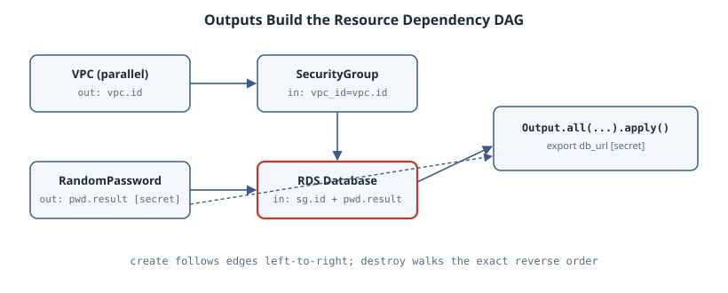

# Inputs, Outputs and the Dependency Graph

A Pulumi program reads top to bottom like ordinary Python, yet the infrastructure it describes is asynchronous and declarative. The bridge between those two worlds is the pair of generic types `Input[T]` and `Output[T]`. Every confusing moment when learning Pulumi — why `print(bucket.id)` prints an object wrapper, why `f"https://{lb.dns_name}"` produces a warning, or why a resource mysteriously disappears from `pulumi preview` — comes from treating an `Output[T]` as if it were already a resolved plain value.



## `Input[T]` vs. `Output[T]`

Every resource constructor parameter has type `pulumi.Input[T]`, which accepts **either** a plain Python value `T` or an `Output[T]` produced by another resource:

```python
import pulumi
import pulumi_aws as aws
import pulumi_random as random

# Plain Python values satisfy Input[T] directly
db_password = random.RandomPassword("db-password", length=24, special=False)

# Passing db_password.result (Output[str]) into password (Input[str])
# wires an automatic dependency edge in the engine's DAG
db = aws.rds.Instance(
    "primary-db",
    instance_class="db.t4g.micro",
    allocated_storage=20,
    engine="postgres",
    username="appuser",
    password=db_password.result,
)
```

Passing an `Output` into an `Input` accomplishes two things simultaneously:
1. **Value propagation**: Once the upstream resource finishes creating, the engine substitutes its resolved value into the downstream provider call.
2. **DAG ordering**: The engine guarantees `db-password` is created before `primary-db` on `pulumi up`, and `primary-db` is deleted before `db-password` on `pulumi destroy`. Independent resources (such as a VPC and a `RandomPassword`) run in **parallel** automatically.

| Term | What it represents | Known during `preview`? |
| :--- | :--- | :--- |
| **Input (`Input[T]`)** | Argument passed into a resource constructor | Yes if plain; unknown if derived from a new resource's output |
| **Resource Output (`Output[T]`)** | Property returned by a provider after create/update | Unknown on initial create; known on subsequent updates |
| **Stack Output (`pulumi.export`)** | Value published at stack level for CLI or `StackReference` | Resolved at the end of `up` |

## Transforming outputs without breaking the graph

Because an `Output[T]` is an asynchronous future carrying both **dependencies** and **secret tainting**, you transform it with SDK combinators rather than raw Python operators.

### Single output: `.apply()`

```python
import pulumi

# Runs only once lb.dns_name is known; preserves dependencies & secretness
base_url = lb.dns_name.apply(lambda host: f"https://{host}/v1")
```

### Multiple outputs: `Output.all()`

Pass outputs positionally (receiving a `list`) or by keyword (receiving a `dict` — much easier to read when combining three or more values):

```python
import pulumi

# Keyword form avoids brittle index numbers like args[0], args[1], args[2]
dsn = pulumi.Output.all(
    host=db.address,
    port=db.port,
    pwd=db_password.result,
).apply(
    lambda v: f"postgres://appuser:{v['pwd']}@{v['host']}:{v['port']}/app"
)
```

### Ergonomic helpers: `format`, `concat`, `json_dumps`, and `json_loads`

Most `.apply()` lambdas exist solely to interpolate strings or serialize JSON. Built-in helpers eliminate the boilerplate and accept `Output` values nested arbitrarily deep inside dicts and lists:

```python
import pulumi

health_url = pulumi.Output.format("https://{0}/healthz", lb.dns_name)
objects_arn = pulumi.Output.concat(bucket.arn, "/*")

# Output.json_dumps resolves nested Outputs automatically
bucket_policy = pulumi.Output.json_dumps({
    "Version": "2012-10-17",
    "Statement": [
        {
            "Sid": "AllowAppRead",
            "Effect": "Allow",
            "Principal": {"AWS": app_role.arn},
            "Action": ["s3:GetObject", "s3:ListBucket"],
            "Resource": [bucket.arn, objects_arn],
        }
    ],
})

# Parse JSON outputs back into structured Outputs
parsed_policy = pulumi.Output.json_loads(bucket_policy)
```

### Property lifting

You can access nested attributes and list elements directly on an `Output` without writing `.apply()`:

```python
# Equivalent to cert.domain_validation_options.apply(lambda opts: opts[0].resource_record_name)
validation_record_name = cert.domain_validation_options[0].resource_record_name
```

## Two golden rules that eliminate 90% of Pulumi bugs

> [!CAUTION]
> **Rule 1: Never treat an `Output` as a plain Python value**
>
> Writing `f"https://{lb.dns_name}"`, `if output == "prod":`, or `json.dumps({"arn": bucket.arn})` evaluates the wrapper object instead of the resolved value. Always use `Output.format()`, `Output.concat()`, `Output.json_dumps()`, or `.apply()`.

> [!WARNING]
> **Rule 2: Never allocate resources inside `.apply()`**
>
> During `pulumi preview`, outputs from newly created resources are unknown, so `.apply()` callbacks **do not execute**. Any resource constructed inside `.apply()` is invisible during `preview` and then suddenly appears during `up` — breaking code review and diff trust. Drive resource counts and conditional branches from **stack configuration** (which is always known at preview time), not from another resource's output.

## Implicit edges vs. explicit `depends_on`

Prefer implicit dependencies (passing `a.id` into `b`) whenever possible. Reach for `pulumi.ResourceOptions(depends_on=[...])` only when a cloud side-effect exists with no data flowing between the two resources — for example, waiting for an IAM role policy attachment before launching an ECS task that assumes that role:

```python
service = aws.ecs.Service(
    "api-service",
    cluster=cluster.arn,
    task_definition=task_def.arn,
    opts=pulumi.ResourceOptions(depends_on=[role_policy_attachment]),
)
```

## Four identities every resource carries

| Identity | Example | When to pass it |
| :--- | :--- | :--- |
| **Logical name** | `"primary-db"` | First constructor argument; tracks resource in Pulumi state |
| **Physical name** | `"primary-db-a1b2c3d"` | Auto-suffixed by Pulumi to allow zero-downtime replacement |
| **Physical ID (`resource.id`)** | `"vpc-0a1b2c3d4e"` | Provider-assigned handle required by most cross-resource references |
| **URN (`resource.urn`)** | `"urn:pulumi:dev::app::aws:ec2/vpc:Vpc::main"` | Globally unique Pulumi state identifier (used by `pulumi state` and `Alias`) |

## Troubleshooting guide

| Symptom | Root cause | Fix |
| :--- | :--- | :--- |
| Tag or name contains `Calling __str__ on an Output[T]` | Used an `Output` in an f-string or `+` | Replace with `Output.format()` or `Output.concat()` |
| `pulumi up` creates more resources than `pulumi preview` showed | Resources instantiated inside `.apply()` | Move resource creation to top level; branch on config |
| `TypeError: Object of type Output is not JSON serializable` | Used stdlib `json.dumps()` instead of `Output.json_dumps()` | Switch to `pulumi.Output.json_dumps(...)` |
| Wrong destroy order fails with "dependency violation" | Hidden cloud dependency not wired through an output | Add `opts=pulumi.ResourceOptions(depends_on=[...])` |

## Hands-on lab: explore DAG parallelism, `Output.all()`, and `Output.json_dumps()` locally

In this lab you will build a local resource graph with two independent branches that execute in parallel, combine their outputs using `Output.all()` and `Output.json_dumps()`, and verify secret propagation.

### Step 1: Initialize the lab project

```bash
export PULUMI_CONFIG_PASSPHRASE="local-lab-passphrase"
pulumi login --local

mkdir -p ~/pulumi-labs/05-outputs-dag && cd ~/pulumi-labs/05-outputs-dag
pulumi new python --name dag-lab --description "Inputs, Outputs, and DAG lab" --stack dev --yes
./venv/bin/pip install pulumi-random
```

### Step 2: Write `__main__.py`

```python
import pulumi
import pulumi_random as random

# Branch A and Branch B have no shared outputs -> created in parallel
cluster_name = random.RandomPet("cluster-name", length=2, separator="-")
vpc_id = random.RandomId("vpc-id", byte_length=4)

# Downstream resource depends on BOTH branches via keepers
app_secret = random.RandomPassword(
    "app-secret",
    length=24,
    special=False,
    keepers={
        "cluster": cluster_name.id,
        "vpc": vpc_id.hex,
    },
)

# 1. Output.format() for clean string assembly
endpoint = pulumi.Output.format("https://{0}.vpc-{1}.internal", cluster_name.id, vpc_id.hex)

# 2. Output.json_dumps() handles nested Outputs directly
service_manifest = pulumi.Output.json_dumps({
    "cluster": cluster_name.id,
    "vpc": pulumi.Output.concat("vpc-", vpc_id.hex),
    "endpoint": endpoint,
})

# 3. Output.all() with keyword arguments (tainted secret because app_secret.result is secret)
connection_bundle = pulumi.Output.all(
    url=endpoint,
    token=app_secret.result,
).apply(lambda v: f"{v['url']}?token={v['token']}")

pulumi.export("endpoint", endpoint)
pulumi.export("service_manifest", service_manifest)
pulumi.export("connection_bundle", connection_bundle)
```

### Step 3: Deploy and inspect the dependency graph

```bash
pulumi preview --diff
pulumi up --yes
pulumi stack output
pulumi stack output connection_bundle --show-secrets
```

Inspect the recorded dependencies in state to verify `app-secret` lists both `cluster-name` and `vpc-id`:

```bash
pulumi stack export | python3 -m json.tool | grep -A 6 '"dependencies"'
```

### Step 4: Clean up

```bash
pulumi destroy --yes && pulumi stack rm dev --yes
```

## Summary

- `Input[T]` accepts plain values or `Output[T]`; passing an output into an input automatically wires the create/destroy DAG.
- Use `.apply()`, `Output.all(k=...)`, `Output.format()`, `Output.concat()`, and `Output.json_dumps()` to compose outputs without losing dependency tracking or secret tainting.
- Never coerce an `Output` to `str` outside `.apply()`, and never allocate resources inside `.apply()` callbacks.

## Sources

- [Inputs and Outputs](https://www.pulumi.com/docs/iac/concepts/inputs-outputs/)
- [Accessing Outputs with `apply`](https://www.pulumi.com/docs/iac/concepts/inputs-outputs/apply/)
- [Combining Outputs with `all`](https://www.pulumi.com/docs/iac/concepts/inputs-outputs/all/)
- [Resource Options (`depends_on`)](https://www.pulumi.com/docs/iac/concepts/resources/options/dependson/)
