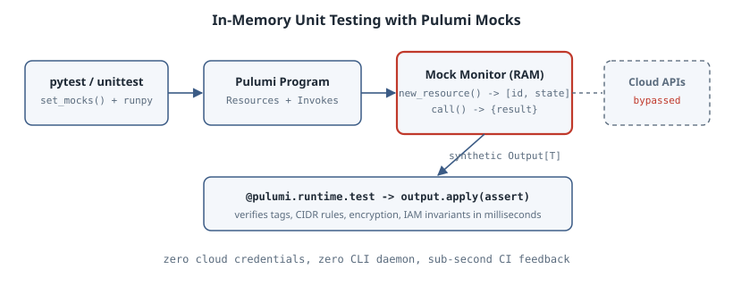

# Unit Testing Pulumi Programs with Mocks

Waiting three minutes for a sandbox deployment just to discover a missing cost-allocation tag or an accidentally public SSH port slows down every pull request. Because Pulumi programs are ordinary Python, you can run fast, deterministic unit tests in memory using `pulumi.runtime.Mocks` — verifying security invariants, naming conventions, encryption flags, and resource wiring in under a second with zero cloud credentials and no Pulumi CLI daemon.



> [!NOTE]
> **Verified environment**
>
> The examples and lab in this chapter run cleanly on Python 3.12–3.14, Pulumi Python SDK `3.273.0`, `pulumi-aws` `7.52.1`, and `pytest` `9.2.0` — no Pulumi CLI or cloud credentials required.

## Where unit tests fit in the testing pyramid

| Layer | Speed | Needs cloud creds? | What it catches |
| :--- | :--- | :---: | :--- |
| **Unit tests (`Mocks`)** | Milliseconds | No | Program logic, tags, CIDR rules, encryption flags, naming, conditional branches |
| **Policy as Code (CrossGuard)** | Seconds (on preview) | Optional | Org-wide guardrails enforced across every stack regardless of language |
| **Integration tests (ephemeral stack)** | Minutes | Yes | Real cloud IAM permissions, quota limits, live API schema rejections |

Unit tests verify that *your code* emits the right resource declarations; integration tests verify that *the cloud* accepts them. You want both, with unit tests gating every commit locally and in CI.

## Inside `pulumi.runtime.Mocks`

Registering a subclass of `pulumi.runtime.Mocks` replaces the gRPC resource monitor with an in-memory Python object. Every resource constructor routes to `new_resource`, and every provider lookup (`aws.ec2.get_ami`, `aws.get_caller_identity`) routes to `call`:

```python
import pulumi


class InfraMocks(pulumi.runtime.Mocks):
    def new_resource(self, args: pulumi.runtime.MockResourceArgs) -> tuple[str, dict]:
        # Echo inputs back as state and synthesize provider-computed attributes
        state = dict(args.inputs)
        if args.typ == "aws:s3/bucket:Bucket":
            state.setdefault("arn", f"arn:aws:s3:::{args.name}")
            state.setdefault("bucket", f"{args.name}-mocked")
        elif args.typ == "aws:ec2/instance:Instance":
            state.setdefault("arn", f"arn:aws:ec2:us-east-1:123456789012:instance/{args.name}")
            state.setdefault("publicIp", "203.0.113.10")
        return f"{args.name}_id", state

    def call(self, args: pulumi.runtime.MockCallArgs) -> dict:
        if args.token == "aws:ec2/getAmi:getAmi":
            return {"id": "ami-0123456789abcdef0", "architecture": "x86_64"}
        if args.token == "aws:index/getCallerIdentity:getCallerIdentity":
            return {"accountId": "123456789012", "arn": "arn:aws:iam::123456789012:role/ci"}
        return {}
```

### Critical setup rule: register mocks before importing resources

Pulumi registers resources at the moment the constructor executes. If your test file has `import __main__` at the top before `pulumi.runtime.set_mocks(...)`, the SDK tries to connect to a live engine RPC server and crashes immediately.

Use `unittest.IsolatedAsyncioTestCase` and load your infrastructure module inside `setUp()` via `runpy.run_path("__main__.py")` (or call a factory function like `build_stack()`):

```python
import runpy
import unittest
import pulumi


class BaseInfraTest(unittest.IsolatedAsyncioTestCase):
    def setUp(self):
        # preview=False makes mocked outputs resolve as known values
        pulumi.runtime.set_mocks(InfraMocks(), preview=False)
        self.program = runpy.run_path("__main__.py")
```

> [!IMPORTANT]
> **Python 3.14+ event loop behavior**
>
> Starting in Python 3.14, `asyncio.get_event_loop()` raises `RuntimeError` if no event loop is active on the main thread. `unittest.IsolatedAsyncioTestCase` manages a fresh event loop per test automatically. If you write plain `pytest` functions instead of a test class, call `asyncio.set_event_loop(asyncio.new_event_loop())` before `pulumi.runtime.set_mocks(...)`.

## Writing expressive assertions on `Output[T]`

Because every resource property is an asynchronous `Output`, every test method must:
1. Be decorated with `@pulumi.runtime.test`.
2. Perform assertions inside `.apply(...)` or `pulumi.Output.all(...).apply(...)`.
3. **Return** the resulting `Output` so the test runner awaits it before exiting!

### Combining multiple outputs in a single test

```python
@pulumi.runtime.test
def test_instance_wired_to_security_group(self):
    instance = self.program["instance"]
    web_sg = self.program["web_sg"]

    def check(vals):
        sg_id, attached_sgs, ami_id = vals
        self.assertIn(sg_id, attached_sgs, "EC2 instance must attach web-sg")
        self.assertEqual(ami_id, "ami-0123456789abcdef0")

    return pulumi.Output.all(
        web_sg.id,
        instance.vpc_security_group_ids,
        instance.ami,
    ).apply(check)
```

### Checking snake_case and camelCase keys safely

Provider schemas store nested object keys in camelCase internally (e.g., `cidrBlocks`, `fromPort`), while Python inputs often arrive in snake_case (`cidr_blocks`, `from_port`). Supporting both keys makes tests resilient across provider upgrades.

## Hands-on lab: catch and fix a security regression with TDD

In this lab you will test an AWS stack containing an intentional security flaw (port 22 SSH open to `0.0.0.0/0`), watch the unit test fail in under a second, fix the flaw, and confirm all assertions pass.

### Step 1: Create the isolated virtual environment

```bash
mkdir -p ~/pulumi-labs/06-unit-tests && cd ~/pulumi-labs/06-unit-tests
python3 -m venv .venv && source .venv/bin/activate
pip install "pulumi>=3.100,<4" "pulumi-aws>=6.0" pytest
```

### Step 2: Create the infrastructure program with a flaw (`__main__.py`)

```python
import pulumi
import pulumi_aws as aws

ami = aws.ec2.get_ami(
    most_recent=True,
    owners=["amazon"],
    filters=[aws.ec2.GetAmiFilterArgs(name="name", values=["al2023-ami-*-x86_64"])],
)

web_sg = aws.ec2.SecurityGroup(
    "web-sg",
    description="Web and admin access",
    ingress=[
        aws.ec2.SecurityGroupIngressArgs(
            protocol="tcp",
            from_port=80,
            to_port=80,
            cidr_blocks=["0.0.0.0/0"],
        ),
        aws.ec2.SecurityGroupIngressArgs(
            protocol="tcp",
            from_port=22,
            to_port=22,
            cidr_blocks=["0.0.0.0/0"],  # Intentional flaw: SSH open to the world
        ),
    ],
)

instance = aws.ec2.Instance(
    "web",
    instance_type="t3.micro",
    ami=ami.id,
    vpc_security_group_ids=[web_sg.id],
    tags={"Name": "web", "team": "platform"},
)

logs_bucket = aws.s3.Bucket("logs", tags={"team": "platform"})

pulumi.export("instance_id", instance.id)
pulumi.export("bucket_arn", logs_bucket.arn)
```

### Step 3: Write the mock test suite (`test_infra.py`)

```python
import runpy
import unittest
import pulumi


class InfraMocks(pulumi.runtime.Mocks):
    def new_resource(self, args: pulumi.runtime.MockResourceArgs):
        state = {**args.inputs, "arn": f"arn:aws:resource:::{args.name}"}
        return [f"{args.name}_id", state]

    def call(self, args: pulumi.runtime.MockCallArgs):
        if args.token == "aws:ec2/getAmi:getAmi":
            return {"id": "ami-0123456789abcdef0", "architecture": "x86_64"}
        return {}


class TestInfrastructure(unittest.IsolatedAsyncioTestCase):
    def setUp(self):
        pulumi.runtime.set_mocks(InfraMocks(), preview=False)
        self.program = runpy.run_path("__main__.py")

    @pulumi.runtime.test
    def test_required_team_tag_on_instance_and_bucket(self):
        instance = self.program["instance"]
        bucket = self.program["logs_bucket"]

        def check(tags_pair):
            inst_tags, bucket_tags = tags_pair
            self.assertEqual((inst_tags or {}).get("team"), "platform")
            self.assertEqual((bucket_tags or {}).get("team"), "platform")

        return pulumi.Output.all(instance.tags, bucket.tags).apply(check)

    @pulumi.runtime.test
    def test_ami_lookup_mocked(self):
        return self.program["instance"].ami.apply(
            lambda ami_id: self.assertEqual(ami_id, "ami-0123456789abcdef0")
        )

    @pulumi.runtime.test
    def test_ssh_not_open_to_world(self):
        def check(rules):
            for rule in rules or []:
                fp = rule.get("from_port") or rule.get("fromPort")
                tp = rule.get("to_port") or rule.get("toPort")
                cidrs = rule.get("cidr_blocks") or rule.get("cidrBlocks") or []
                if fp <= 22 <= tp:
                    self.assertNotIn(
                        "0.0.0.0/0",
                        cidrs,
                        "Port 22 (SSH) must not be open to 0.0.0.0/0",
                    )

        return self.program["web_sg"].ingress.apply(check)
```

### Step 4: Run pytest, observe the failure, and fix it

```bash
python -m pytest -q -p no:warnings --tb=line test_infra.py
```

Expected output (red):

```text
..F                                                                      [100%]
=================================== FAILURES ===================================
E   AssertionError: '0.0.0.0/0' unexpectedly found in ['0.0.0.0/0'] : Port 22 (SSH) must not be open to 0.0.0.0/0
1 failed, 2 passed in 0.91s
```

Now change the SSH rule in `__main__.py` from `["0.0.0.0/0"]` to `["10.0.0.0/8"]` and re-run:

```bash
python -m pytest -q -p no:warnings --tb=line test_infra.py
```

Expected output (green):

```text
...                                                                      [100%]
3 passed in 0.88s
```

## Common pitfalls

| Mistake | Symptom | Fix |
| :--- | :--- | :--- |
| Importing `__main__` before `set_mocks()` | RPC connection error at test collection time | Call `set_mocks()` in `setUp()` and load via `runpy.run_path()` |
| Forgetting `return` in `@pulumi.runtime.test` | Test passes silently without running `.apply()` assertions | Always `return output.apply(check)` |
| Missing attributes in `new_resource()` state | Asserting on `bucket.arn` sees `None` | Synthesize computed outputs (`arn`, `publicIp`) in `new_resource` |
| Expecting mocks to catch invalid AWS API args | Unit tests pass, `pulumi up` fails in AWS | Pair unit mocks with ephemeral-stack integration tests |

## Summary

- `pulumi.runtime.Mocks` intercepts `new_resource` and `call` in memory so tests run in milliseconds with zero cloud credentials.
- Register mocks before loading infrastructure modules, use `unittest.IsolatedAsyncioTestCase` for Python 3.14+ event-loop safety, and always `return` the `Output` from `@pulumi.runtime.test` methods.
- Combine unit mocks (fast logic & security guardrails) with CrossGuard policies and ephemeral integration tests for complete coverage.

## Sources

- [Unit Testing with Mocks](https://www.pulumi.com/docs/iac/guides/testing/unit/)
- [Testing Strategies](https://www.pulumi.com/docs/iac/guides/testing/)
- [Python `unittest.IsolatedAsyncioTestCase`](https://docs.python.org/3/library/unittest.html#unittest.IsolatedAsyncioTestCase)
