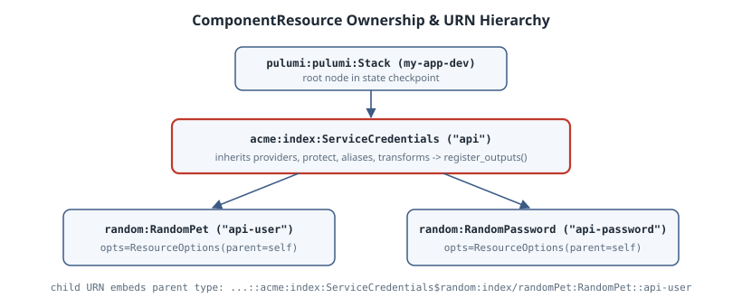

# Component Resources

As infrastructure codebases grow, teams inevitably wrap repeated resource patterns — an encrypted S3 bucket plus public-access block, a service's credentials, or a hardened EKS namespace. A plain Python helper function eliminates copy-paste, but Pulumi never sees the grouping: every resource lands flat under the stack root. Subclassing `pulumi.ComponentResource` turns that pattern into a first-class architectural unit with its own type token, parent-child ownership tree, inherited resource options, and clean refactor path via aliases.



## Helper functions vs. `ComponentResource`

| Dimension | Plain Python function | `pulumi.ComponentResource` |
| :--- | :--- | :--- |
| **State & CLI tree** | Flat list directly under `pulumi:pulumi:Stack` | Collapsible subtree under a typed parent node |
| **Option inheritance** | Must thread `opts` manually into every child | `providers`, `protect`, `retain_on_delete`, `aliases`, `transforms` propagate automatically |
| **Type identity** | None (returns a raw tuple/dict) | Custom type token (e.g., `acme:index:ServiceCredentials`) |
| **Cross-language sharing** | Python only | Can be packaged as a **Multi-Language Component (MLC)** for TS, Go, .NET, Java |

## Anatomy of a type token and child URN

Every component declares a type token in the form `<package>:index:<ComponentName>` (for example, `acme:index:ServiceCredentials`). When a child resource specifies `opts=pulumi.ResourceOptions(parent=self)`, Pulumi embeds the component's type token into the child's URN separated by `$`:

```text
urn:pulumi:dev::billing::acme:index:ServiceCredentials$random:index/randomPet:RandomPet::api-user
```

That `$` hierarchy is what lets `pulumi up` render a clean indented tree and lets `protect=True` on the component guard every child inside it.

## Building a production-grade `ComponentResource`

A well-designed component does five things consistently:
1. Validates inputs upfront in a typed `Args` dataclass before registering any resource.
2. Calls `super().__init__(type_token, name, None, opts)`.
3. Parents every child with `opts=pulumi.ResourceOptions(parent=self)` and prefixes every child's logical name with `f"{name}-..."` so multiple instances never collide.
4. Marks sensitive outputs explicitly with `pulumi.Output.secret(...)`.
5. Finishes the constructor with `self.register_outputs({...})` to signal completion and persist component outputs in state.

```python
"""credentials.py — Reusable ComponentResource for service credentials."""
from dataclasses import dataclass
import pulumi
import pulumi_random as random


@dataclass(frozen=True)
class ServiceCredentialsArgs:
    service: str
    password_length: int = 24
    prefix: str = ""

    def __post_init__(self) -> None:
        if not self.service.strip():
            raise ValueError("service must be a non-empty string")
        if self.password_length < 16:
            raise ValueError("password_length must be at least 16")


class ServiceCredentials(pulumi.ComponentResource):
    username: pulumi.Output[str]
    password: pulumi.Output[str]
    connection_uri: pulumi.Output[str]

    def __init__(
        self,
        name: str,
        args: ServiceCredentialsArgs,
        opts: pulumi.ResourceOptions | None = None,
    ) -> None:
        super().__init__("acme:index:ServiceCredentials", name, None, opts)

        child_opts = pulumi.ResourceOptions(parent=self)

        self.pet = random.RandomPet(
            f"{name}-user",
            length=2,
            separator="-",
            opts=child_opts,
        )
        self.raw_password = random.RandomPassword(
            f"{name}-password",
            length=args.password_length,
            special=False,
            opts=child_opts,
        )

        prefix = f"{args.prefix}-" if args.prefix else ""
        self.username = self.pet.id.apply(lambda pet: f"{prefix}{args.service}-{pet}")
        self.password = pulumi.Output.secret(self.raw_password.result)
        self.connection_uri = pulumi.Output.format(
            "https://{0}:{1}@{2}.svc.internal",
            self.username,
            self.password,
            args.service,
        )

        self.register_outputs({
            "username": self.username,
            "password": self.password,
            "connection_uri": self.connection_uri,
        })
```

> [!WARNING]
> **Never omit `self.register_outputs({...})`**
>
> Calling `register_outputs` at the end of `__init__` (even with `{}` when there are no outputs) tells the Pulumi engine that the component has finished registering its children and records its outputs in state. Leaving it out drops component-level outputs and can confuse visualization and stack inspection.

## Which `ResourceOptions` propagate to children?

Because a `ComponentResource` is a logical grouping rather than a cloud provider resource, only specific options pass down automatically to children:

| Option on Component | Inherited by children? | Notes |
| :--- | :---: | :--- |
| `providers` | Yes | Prefer `providers=[...]` over singular `provider=` on components |
| `protect`, `retain_on_delete` | Yes | Protects the entire subtree with a single flag |
| `aliases`, `deleted_with` | Yes | Component rename carries children automatically |
| `transforms` | Yes | Lets callers inject tags or `ignore_changes` across all children |
| `depends_on` | No | Set on specific children or pass through `Args` |
| `ignore_changes`, `custom_timeouts`, `replace_on_changes` | No | Apply via a component `transform` |

### Using `transforms` to apply non-inherited options across children

```python
import pulumi
from credentials import ServiceCredentials, ServiceCredentialsArgs


def ignore_password_length(args: pulumi.ResourceTransformArgs):
    if args.type_ == "random:index/randomPassword:RandomPassword":
        return pulumi.ResourceTransformResult(
            props=args.props,
            opts=pulumi.ResourceOptions.merge(
                args.opts,
                pulumi.ResourceOptions(ignore_changes=["length"]),
            ),
        )
    return None


billing_creds = ServiceCredentials(
    "billing",
    ServiceCredentialsArgs(service="billing", password_length=32),
    opts=pulumi.ResourceOptions(
        protect=True,
        transforms=[ignore_password_length],
    ),
)
```

## Refactoring components without downtime using `Alias`

Changing a component's type token or moving a child under a new parent changes its URN, which makes Pulumi plan a destructive replace (`+-`). Add `pulumi.Alias` to tell the engine that the new URN refers to the same existing resource:

```python
# Renaming acme:index:LegacyCreds -> acme:index:ServiceCredentials with zero replacements
merged_opts = pulumi.ResourceOptions.merge(
    opts,
    pulumi.ResourceOptions(
        aliases=[pulumi.Alias(type_="acme:index:LegacyCreds")]
    ),
)
super().__init__("acme:index:ServiceCredentials", name, None, merged_opts)
```

Because `aliases` inherit down to children, aliasing the component's old type token preserves every child resource's state automatically. Always run `pulumi preview --diff` and confirm `0 replaced` before applying.

## Multi-Language Components (MLCs)

If your platform team writes hardened components in Python or Go while product teams consume them in TypeScript or .NET, you can expose your `ComponentResource` over Pulumi's schema-driven gRPC plugin protocol as a **Multi-Language Component**. Consumers install a generated SDK package in their native language while your component logic runs in one canonical codebase.

## Hands-on lab: build and unit-test `ServiceCredentials`

In this lab you will create `credentials.py` above and run a `pytest` suite that verifies URN hierarchy, secret tainting on `connection_uri`, boundary validation, and Python 3.14 event-loop safety.

### Step 1: Set up the lab directory

```bash
mkdir -p ~/pulumi-labs/07-components && cd ~/pulumi-labs/07-components
python3 -m venv .venv && source .venv/bin/activate
pip install "pulumi>=3.100,<4" "pulumi-random>=4.16" pytest
```

Save the `ServiceCredentials` module above as `credentials.py`.

### Step 2: Create the unit test suite (`test_credentials.py`)

```python
import asyncio
import pulumi
import pytest

# Required on Python 3.14+ before set_mocks() when not using IsolatedAsyncioTestCase
asyncio.set_event_loop(asyncio.new_event_loop())


class ComponentMocks(pulumi.runtime.Mocks):
    recorded: list[tuple[str, str, bool]] = []

    def new_resource(self, args: pulumi.runtime.MockResourceArgs):
        ComponentMocks.recorded.append((args.typ, args.name, args.custom))
        outputs = dict(args.inputs)
        if args.typ == "random:index/randomPassword:RandomPassword":
            outputs["result"] = "s" * int(args.inputs["length"])
        return [f"{args.name}_id", outputs]

    def call(self, args: pulumi.runtime.MockCallArgs):
        return {}


pulumi.runtime.set_mocks(ComponentMocks(), preview=False)

from credentials import ServiceCredentials, ServiceCredentialsArgs  # noqa: E402


@pulumi.runtime.test
def test_urn_hierarchy_and_prefix():
    creds = ServiceCredentials(
        "api",
        ServiceCredentialsArgs(service="billing", prefix="prod"),
    )

    def check(vals):
        comp_urn, pet_urn, username = vals
        assert comp_urn.endswith("::acme:index:ServiceCredentials::api")
        assert "::acme:index:ServiceCredentials$random:index/randomPet:RandomPet::api-user" in pet_urn
        assert username == "prod-billing-api-user_id"

    # Wait on both component AND child outputs to avoid race conditions
    return pulumi.Output.all(creds.urn, creds.pet.urn, creds.username).apply(check)


@pulumi.runtime.test
def test_connection_uri_inherits_secretness():
    creds = ServiceCredentials(
        "db",
        ServiceCredentialsArgs(service="orders", password_length=16),
    )

    def check(vals):
        pwd, uri_is_secret = vals
        assert len(pwd) == 16
        assert uri_is_secret is True

    return pulumi.Output.all(
        creds.password,
        pulumi.Output.from_input(creds.connection_uri).is_secret(),
    ).apply(check)


def test_validation_rejects_short_passwords():
    with pytest.raises(ValueError, match="at least 16"):
        ServiceCredentialsArgs(service="orders", password_length=12)
```

### Step 3: Run the tests

```bash
python -m pytest -q -s test_credentials.py
```

All three tests pass in under a second, proving both parent-child URN nesting (`custom=False` for the component, `custom=True` for its children) and end-to-end secret propagation.

## Common pitfalls

| Mistake | Consequence | Fix |
| :--- | :--- | :--- |
| Omitting `parent=self` on children | Children register flat under stack; `protect` and `aliases` do not apply | Pass `opts=pulumi.ResourceOptions(parent=self)` to every child |
| Hard-coding child logical names (`"user"`) | Duplicate URN error when creating two instances | Prefix every child name with `f"{name}-..."` |
| Forgetting `self.register_outputs(...)` | Component outputs are never persisted in state | Call `self.register_outputs({...})` at end of `__init__` |
| Asserting on mock call logs after only `comp.urn` resolves | Race condition: children may not have registered yet | Await child outputs together in `Output.all(...)` |

## Summary

- `ComponentResource` turns recurring infrastructure patterns into typed, hierarchical units with automatic option inheritance.
- Always validate inputs upfront, parent children with `parent=self`, namespace child names with `name`, and call `self.register_outputs(...)`.
- Use `transforms` for non-inherited child options and `pulumi.Alias` for zero-downtime component renames.

## Sources

- [Component Resources](https://www.pulumi.com/docs/iac/concepts/components/)
- [Build a Component](https://www.pulumi.com/docs/iac/guides/building-extending/components/build-a-component/)
- [Resource Options for Components](https://www.pulumi.com/docs/iac/concepts/resources/options/#resource-options-and-component-resources)
- [Resource Aliases](https://www.pulumi.com/docs/iac/concepts/resources/options/aliases/)
- [Transforms](https://www.pulumi.com/docs/iac/concepts/resources/options/transforms/)
