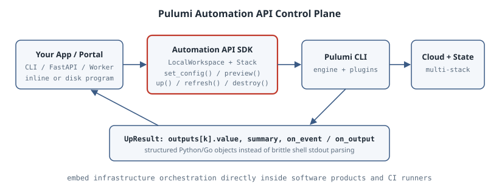

# Automation API: drive pulumi up from Python

Running `pulumi up` from a terminal or CI YAML works well when humans trigger deployments on a fixed set of stacks. It breaks down as soon as infrastructure becomes part of your software product: an internal developer portal that provisions ephemeral preview environments per pull request, a SaaS control plane that spins up isolated tenant clusters on sign-up, or a Python CLI that orchestrates five dependent stacks in sequence. The **Pulumi Automation API** turns the Pulumi deployment engine into a typed library inside your own application.



## CLI workflows vs. Automation API

| Dimension | Pulumi CLI | Automation API (`pulumi.automation`) |
| :--- | :--- | :--- |
| **Orchestrator** | Shell scripts and CI YAML steps | Native Python, Go, TypeScript, or .NET code |
| **Program source** | Static project files on disk | Disk projects *or* dynamic inline functions |
| **Configuration** | Manual `pulumi config set` / YAML edits | Programmatic `stack.set_config(...)` / `set_all_config(...)` |
| **Results & logs** | Parsing stdout text or `--json` output | Typed `UpResult`, `PreviewResult`, `OutputValue`, `on_event` callbacks |
| **Multi-stack orchestration** | Fragile bash chaining | Loops, retries, queues, HTTP endpoints, and structured error handling |

> [!NOTE]
> The Automation API still invokes the `pulumi` CLI binary under the hood. Ensure `pulumi` is installed on the host or container `PATH` (or configure `pulumi_command` on `LocalWorkspaceOptions`).

## Core abstractions: Workspace, Program, and Stack

1. **`LocalWorkspace`**: Controls the execution environment — backend URL, environment variables, plugin installation (`install_plugin`), and working directory.
2. **Program**: Either an **inline Python function** (`program=fn`) passed directly to `auto.create_or_select_stack(...)`, or a **disk-based Pulumi project** (`work_dir="./infra"`).
3. **`Stack`**: Binds a workspace, project, and stack name together and exposes typed lifecycle methods: `preview()`, `up()`, `refresh()`, `destroy()`, `outputs()`, and `workspace.remove_stack()`.

## Driving an inline program from Python

Notice the exact Python import path: `from pulumi import automation as auto`. Because an inline program is a regular Python closure, it can capture runtime parameters cleanly without writing temporary YAML files.

```python
"""deploy_env.py — Create, preview, update, and inspect an inline stack."""
import sys
import pulumi
from pulumi import automation as auto
import pulumi_random as random


def make_program(service_prefix: str, password_len: int):
    """Return an inline Pulumi program parameterized by runtime inputs."""
    def pulumi_program() -> None:
        pet = random.RandomPet("env-name", length=2, separator="-")
        secret = random.RandomPassword(
            "service-token",
            length=password_len,
            special=False,
        )
        pulumi.export("env_fqdn", pet.id.apply(lambda p: f"{service_prefix}-{p}.local"))
        pulumi.export("service_token", secret.result)

    return pulumi_program


def deploy(stack_name: str, service_prefix: str = "app") -> dict[str, auto.OutputValue]:
    stack = auto.create_or_select_stack(
        stack_name=stack_name,
        project_name="automation-demo",
        program=make_program(service_prefix, password_len=24),
    )

    stack.workspace.install_plugin("random", "v4.16.0")

    preview_res = stack.preview(on_output=sys.stdout.write)
    print("Planned changes:", preview_res.change_summary)

    up_res = stack.up(on_output=sys.stdout.write)
    print("Update result:", up_res.summary.result)
    return up_res.outputs


if __name__ == "__main__":
    outputs = deploy("dev", service_prefix="billing")
    for k, out in outputs.items():
        display = "[secret]" if out.secret else out.value
        print(f"  {k} = {display}")
```

## Streaming structured engine events (`on_event`)

Instead of scraping stdout strings, attach an `on_event` callback to observe every resource transition (`pre`, `outputs`, `diagnostic`, `summary`) as typed objects:

```python
from pulumi import automation as auto


def log_resource_events(event: auto.EngineEvent) -> None:
    if event.resource_outputs_event:
        meta = event.resource_outputs_event.metadata
        print(f"[EVENT] {meta.op.upper():8s} {meta.type} ({meta.urn.split('::')[-1]})")
    elif event.diagnostic_event and event.diagnostic_event.severity == "error":
        print(f"[ERROR] {event.diagnostic_event.message.strip()}")


up_res = stack.up(on_event=log_resource_events)
```

## Programmatic Destroy and Stack Teardown

Managing the lifecycle of short-lived environments (such as preview environments for pull requests or test fixtures) requires reliable teardown mechanisms. The Automation API exposes `stack.destroy()` and `stack.workspace.remove_stack()`.

The following script demonstrates automated destruction and removal of stack resources:

<!-- file: auto-destroy.py -->
```python
"""Tear down resources programmatically using Automation API."""
import sys
from pulumi import automation as auto


def destroy_environment(stack_name: str, project_name: str):
    """Destroy all stack resources and remove state registration."""
    stack = auto.select_stack(
        stack_name=stack_name,
        project_name=project_name,
        program=lambda: None,
    )

    print(f"Destroying resources in stack '{stack_name}'...")
    destroy_result = stack.destroy(on_output=sys.stdout.write)
    print(f"Destroy summary: {destroy_result.summary.result}")

    print(f"Removing stack registration for '{stack_name}'...")
    stack.workspace.remove_stack(stack_name)
    print("Stack removed successfully.")


if __name__ == "__main__":
    destroy_environment("dev", "automation-demo")
```

### Key Considerations for Teardown

- **`select_stack` vs `create_or_select_stack`**: Use `select_stack` when interacting with pre-existing stacks where program code is either loaded from disk or unnecessary during teardown.
- **`stack.destroy()`**: Runs Pulumi's deletion workflow, invoking resource provider deletion hooks in reverse dependency order.
- **`remove_stack()`**: Clears stack state entries from the backend after resources are destroyed. Attempting to call `remove_stack()` on a stack that still manages active resources raises an error.

## Working with Existing Disk-Based Projects

In addition to inline Python functions, `LocalWorkspace` can load standard Pulumi project directories containing existing `Pulumi.yaml` and source code files.

<!-- file: local-project.py -->
```python
"""Drive a file-based Pulumi project using LocalWorkspace."""
import sys
from pulumi import automation as auto


def run_disk_project(project_dir: str, stack_name: str):
    """Load and deploy a standard Pulumi project from disk."""
    stack = auto.create_or_select_stack(
        stack_name=stack_name,
        work_dir=project_dir,
    )
    stack.set_config("aws:region", auto.ConfigValue(value="us-west-2"))

    print(f"Refreshing state for stack '{stack_name}'...")
    stack.refresh(on_output=sys.stdout.write)

    print("Running update...")
    result = stack.up(on_output=sys.stdout.write)

    for key, out in result.outputs.items():
        display = "[secret]" if out.secret else out.value
        print(f"Output: {key} = {display}")


if __name__ == "__main__":
    run_disk_project("./infra-project", "staging")
```

Setting `work_dir` points `LocalWorkspace` to a directory containing a valid `Pulumi.yaml` file, executing the infrastructure code defined in that project's entrypoint.

## Hands-on lab: build a self-service ephemeral environment CLI

In this lab you will run a self-contained Python script (`envctl.py`) that provisions and tears down isolated ephemeral stacks (`pr-101`, `pr-102`) on a local backend while streaming structured resource events.

### Step 1: Set up the lab environment

```bash
pulumi login --local
mkdir -p ~/pulumi-labs/08-automation-api && cd ~/pulumi-labs/08-automation-api
python3 -m venv .venv && source .venv/bin/activate
pip install "pulumi>=3.100,<4" "pulumi-random>=4.16"
```

### Step 2: Run the inline provisioning and teardown workflow

Save the `deploy_env.py` and `auto-destroy.py` listings from earlier in this chapter into your lab directory and run:

```bash
python deploy_env.py
python deploy_env.py    # Confirm idempotency: 0 resources changed on second run
python auto-destroy.py  # Destroy live resources and remove stack registration
```

Verify that the first run creates two resources (`RandomPet` and `RandomPassword`), the second run reports zero changes, and the teardown removes both the resources and the stack metadata cleanly.

## Common Pitfalls

| Pitfall | Cause | Solution |
| :--- | :--- | :--- |
| **Wrong import path** | Importing `pulumi.auto` instead of `pulumi.automation` | Always use `from pulumi import automation as auto` |
| **Missing CLI Binary** | The Automation API invokes the underlying `pulumi` CLI binary | Ensure `pulumi` is installed on `PATH` or set `pulumi_command` |
| **Uninstalled Plugins** | Provider plugins are not auto-installed for inline programs | Call `stack.workspace.install_plugin(name, version)` before `stack.up()` |
| **Stale State on Removal** | Calling `remove_stack()` before `stack.destroy()` | Always destroy live resources first before unregistering the stack |
| **Uncaptured Secrets** | Logging `OutputValue.value` unconditionally | Check `out.secret` before logging or serializing outputs |

## Key takeaways

- The **Automation API** exposes the Pulumi engine as a standard software library, allowing infrastructure deployments to be driven programmatically from code.
- **`LocalWorkspace`** manages Pulumi project settings, plugin downloads, configuration values, and environment variables without shell scripts.
- **`InlineProgram`** functions allow defining Pulumi resources directly inside application Python functions, removing the need for separate project files on disk.
- **`Stack`** objects expose core lifecycle commands—`preview()`, `up()`, `refresh()`, and `destroy()`—and return strongly typed output objects.

## Sources

- [Pulumi Automation API Concept Guide](https://www.pulumi.com/docs/using-pulumi/automation-api/)
- [Getting Started with Automation API in Python](https://www.pulumi.com/docs/using-pulumi/automation-api/getting-started-automation-api/)
- [Pulumi Package Registry](https://www.pulumi.com/registry/packages/pulumi/)
