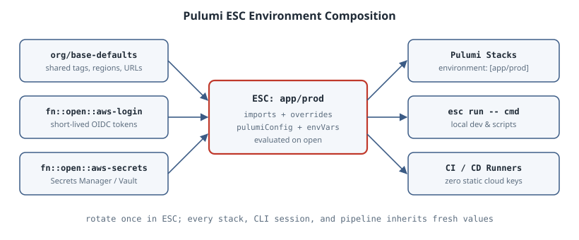

# Pulumi ESC: environments, secrets, and dynamic credentials

Per-stack configuration ([Configuration and Secrets](../01-foundations/03-configuration-and-secrets.md)) works well for values unique to one stack, such as replica counts or instance sizes. It breaks down when twenty stacks need the same Datadog API key, when every CI pipeline needs short-lived AWS credentials without long-lived static IAM keys, or when application containers and Pulumi deployments need to share the exact same secrets. **Pulumi ESC** (Environments, Secrets, and Configuration) solves this by introducing composable, versioned environment documents that mint dynamic credentials on demand and inject them into stacks, local shells, and CI runners.



## Where ESC fits alongside stack config

| Layer | Owns | Rotation blast radius |
| :--- | :--- | :--- |
| **Pulumi ESC environment** | Shared org defaults, dynamic OIDC cloud logins, centralized secrets (Vault / AWS Secrets Manager / GCP Secret Manager) | Rotate once in ESC — every importing stack and pipeline gets the new value on next open |
| **Stack configuration (`Pulumi.<stack>.yaml`)** | Per-stack overrides (`instanceType`, `replicaCount`, stack-local flags) | Local to that single stack |
| **Infrastructure program** | Resource topology and invariants | Versioned in Git |

When a stack imports an ESC environment, **explicit stack configuration overrides ESC values** on key collisions, giving you safe per-stack escape hatches.

## Anatomy of an ESC environment document

An ESC environment is a YAML document stored in Pulumi Cloud (or self-hosted Pulumi) with two top-level keys: `imports:` and `values:`. Three special projections under `values:` wire ESC directly into external tools:

- **`environmentVariables:`** — exported as POSIX environment variables during `pulumi up` and `esc run`.
- **`pulumiConfig:`** — injected directly into `pulumi.Config()` for any stack importing the environment.
- **`files:`** — materialized as temporary files on disk (for kubeconfigs or TLS certificates) and cleaned up automatically when the command exits.

### Base environment (`org/aws-prod-base`)

```yaml
values:
  aws:
    region: us-east-1
    login:
      fn::open::aws-login:
        oidc:
          duration: 1h
          roleArn: arn:aws:iam::123456789012:role/pulumi-esc-deploy
          sessionName: pulumi-esc-prod
  # Fetch existing secrets dynamically from AWS Secrets Manager using the OIDC login above
  secrets:
    fn::open::aws-secrets:
      region: ${aws.region}
      login: ${aws.login}
      get:
        dbPassword:
          secretId: prod/billing/db-password
        datadogKey:
          secretId: prod/observability/datadog-api-key
  # Project credentials into environment variables for providers and CLIs
  environmentVariables:
    AWS_ACCESS_KEY_ID: ${aws.login.accessKeyId}
    AWS_SECRET_ACCESS_KEY: ${aws.login.secretAccessKey}
    AWS_SESSION_TOKEN: ${aws.login.sessionToken}
    AWS_REGION: ${aws.region}
```

### Composed service environment (`billing/prod`)

A leaf environment imports the base environment, adds service-specific secrets, and projects keys into `pulumiConfig`:

```yaml
imports:
  - org/aws-prod-base

values:
  serviceName: billing-api
  webhookSigningKey:
    fn::secret: "<encrypted-by-esc>"
  pulumiConfig:
    aws:region: ${aws.region}
    billing-api:serviceName: ${serviceName}
    billing-api:dbPassword: ${secrets.dbPassword}
    billing-api:webhookSigningKey: ${webhookSigningKey}
  environmentVariables:
    SERVICE_NAME: ${serviceName}
    DD_API_KEY: ${secrets.datadogKey}
```

Notice what is **not** stored in either YAML file:
- Zero static AWS access keys (`AKIA...`) — `fn::open::aws-login` exchanges a short-lived OIDC token for a 1-hour STS session every time the environment opens.
- Zero plaintext database passwords — `fn::open::aws-secrets` pulls the latest value from AWS Secrets Manager at open time, and `fn::secret` encrypts ESC-native secrets at rest.

## Connecting ESC to stacks, local shells, and CI

### 1. Bind an environment to a Pulumi stack

```bash
pulumi config env add billing/prod
```

This adds a single reference block to `Pulumi.prod.yaml`:

```yaml
environment:
  - billing/prod
config:
  billing-api:replicaCount: "4"
```

Now `pulumi preview` and `pulumi up` automatically open `billing/prod`, obtain fresh 1-hour AWS OIDC credentials, and populate `pulumi.Config()` without storing any static keys on developer laptops or CI runners.

### 2. Run any command with `esc run`

ESC is not limited to Pulumi deployments. Developers and CI jobs can open the exact same environment for database migrations, `kubectl`, or `aws` CLI checks:

```bash
# Open OIDC creds + env vars for a single command; nothing persists on disk
esc run billing/prod -- aws sts get-caller-identity
esc run billing/prod -- python manage.py migrate
```

### 3. Inspect and audit with `esc env`

```bash
esc env get billing/prod                  # View static YAML definition (secrets masked)
esc env open billing/prod                 # Evaluate imports + dynamic providers (secrets masked)
esc env open billing/prod --format dotenv # Emit KEY=VALUE format (use with caution)
esc env version history billing/prod      # Inspect revision history and tag pinned versions
```

> [!TIP]
> **Pin production stacks to tagged ESC revisions**
>
> You can tag a tested environment revision (`esc env version tag billing/prod stable 4`) and reference `billing/prod@stable` in `Pulumi.prod.yaml` so an accidental edit to `latest` never breaks production deploys mid-rollout.

## Stack secrets vs. Pulumi ESC

| Requirement | Stack `--secret` | Pulumi ESC |
| :--- | :--- | :--- |
| One-off secret used by a single stack | Ideal | Overkill |
| Shared API key across 15 microservices | Error-prone duplication | Single source of truth via `imports:` |
| Short-lived OIDC credentials (AWS / GCP / Azure) | Manual external scripts | Native `fn::open::*-login` providers |
| Injecting secrets into non-Pulumi apps & local dev | Not supported | Native via `esc run` and ESC SDKs |
| Works on offline / DIY backends (`file://`, `s3://`) | **Yes** | Requires Pulumi Cloud or self-hosted ESC |

## Hands-on lab: compose layered ESC environments and bind them to a stack

> [!NOTE]
> This lab requires the `esc` CLI (`brew install pulumi/tap/esc` or `curl -fsSL https://get.pulumi.com/esc/install.sh | sh`) and a free Pulumi Cloud account (`esc login`). If you are working strictly offline on a local backend, you can still validate the YAML composition pattern and read through the expected outputs below.

### Step 1: Create a shared base environment

```bash
esc env init lab-base
esc env set lab-base region us-west-2
esc env set lab-base sharedToken --secret "shared-lab-token"
esc env get lab-base
```

### Step 2: Create a child environment that imports `lab-base`

```bash
esc env init lab-dev
esc env edit lab-dev
```

Set the definition of `lab-dev` to import `lab-base` and project values into both `environmentVariables` and `pulumiConfig`:

```yaml
imports:
  - lab-base

values:
  tier: development
  environmentVariables:
    APP_REGION: ${region}
    APP_TIER: ${tier}
  pulumiConfig:
    esc-lab:region: ${region}
    esc-lab:tier: ${tier}
    esc-lab:sharedToken: ${sharedToken}
```

### Step 3: Evaluate composition and run a command via `esc run`

```bash
# Confirm secrets are redacted by default
esc env open lab-dev

# Verify environment variable projection in a subprocess
esc run lab-dev -- sh -c 'echo "region=$APP_REGION tier=$APP_TIER"'
```

Expected output:

```text
region=us-west-2 tier=development
```

### Step 4: Bind to a Pulumi stack and verify precedence

Inside any Pulumi project named `esc-lab`:

```bash
pulumi config env add lab-dev
pulumi config                          # Shows values inherited from lab-dev
pulumi config set tier "dev-override"  # Stack-level override wins over ESC
pulumi config get tier                 # Prints: dev-override
```

### Step 5: Clean up

```bash
esc env rm lab-dev --yes
esc env rm lab-base --yes
```

## Common pitfalls

- **Printing opened secrets in CI logs**: ESC redacts values in `esc env open`, but if a shell script runs `echo "$DB_PASSWORD"` inside `esc run`, the CI runner still logs plaintext.
- **Over-broad OIDC IAM roles**: Short-lived credentials reduce theft windows, not blast radius. Scope each ESC `roleArn` to the least-privilege permissions that environment needs.
- **Duplicating `fn::secret` across leaf environments**: Put shared secrets in a base environment and `imports:` them so rotation happens in one place.

## Summary

- Pulumi ESC provides a composable, versioned layer for shared configuration, centralized secrets, and short-lived dynamic OIDC credentials.
- Use `imports:` to inherit shared defaults, `fn::open::*` providers to eliminate static cloud keys, and `pulumiConfig` / `environmentVariables` / `files` to project values into stacks and CLIs.
- Keep per-stack tuning knobs in `Pulumi.<stack>.yaml`; promote shared secrets and cloud logins to ESC.

## Sources

- [Pulumi ESC Documentation](https://www.pulumi.com/docs/esc/)
- [Getting Started with Pulumi ESC](https://www.pulumi.com/docs/esc/get-started/)
- [ESC Environments Syntax & Functions](https://www.pulumi.com/docs/esc/environments/syntax/)
- [Dynamic Login Providers (AWS / GCP / Azure OIDC)](https://www.pulumi.com/docs/esc/integrations/dynamic-login-credentials/)
