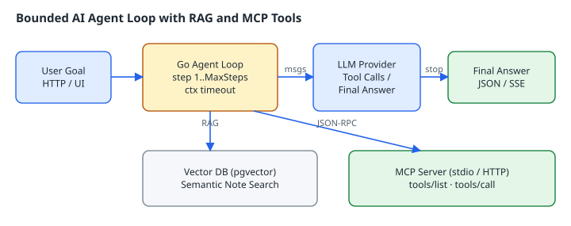

# Building AI Agents

Whereas a single LLM call or fixed workflow follows a hard-coded path, an **AI Agent** uses an LLM inside a reasoning-and-action loop to decide *which* tools to invoke, inspect their outputs, and iterate until it can answer the user's goal.

## Module Syllabus (9 Lessons)

1. Project Overview
2. AI Agents Overview
3. Let's build an AI agent
4. Integrating an AI agent into our app
5. Implementing the frontend
6. Refining our agent prompt + intro to tools
7. Building tools
8. Polish
9. Deploying to production

## The Agent Execution Loop



```text
User Goal
   |
   v
+----------------------------------------------------+
|  Agent Loop (step 1 .. MaxSteps)                   |
|    1. Send conversation + tool schemas to LLM      |
|    2. If LLM returns final answer -> return it     |
|    3. If LLM requests tool call(s):                |
|         - Execute each tool with context timeout   |
|         - Append tool outputs to message history   |
|         - Continue to next step                    |
+----------------------------------------------------+
   |
   v (if MaxSteps reached)
Return graceful fallback / partial summary
```

## Implementing a Bounded Agent in Go

Keep the agent loop small, explicit, and observable—avoid heavy magic frameworks until you need them.

```go
package agent

import (
	"context"
	"encoding/json"
	"errors"
	"fmt"
	"log/slog"
)

type Message struct {
	Role       string     `json:"role"`
	Content    string     `json:"content,omitempty"`
	ToolCallID string     `json:"tool_call_id,omitempty"`
	ToolCalls  []ToolCall `json:"tool_calls,omitempty"`
}

type ToolCall struct {
	ID        string          `json:"id"`
	Name      string          `json:"name"`
	Arguments json.RawMessage `json:"arguments"`
}

type LLM interface {
	Complete(ctx context.Context, msgs []Message, tools []string) (Message, error)
}

type ToolExecutor interface {
	Names() []string
	Execute(ctx context.Context, name string, args json.RawMessage) (string, error)
}

type Agent struct {
	llm          LLM
	tools        ToolExecutor
	systemPrompt string
	maxSteps     int
}

func (a *Agent) Run(ctx context.Context, userInput string) (string, error) {
	msgs := []Message{
		{Role: "system", Content: a.systemPrompt},
		{Role: "user", Content: userInput},
	}

	for step := 1; step <= a.maxSteps; step++ {
		reply, err := a.llm.Complete(ctx, msgs, a.tools.Names())
		if err != nil {
			return "", fmt.Errorf("agent step %d llm error: %w", step, err)
		}
		msgs = append(msgs, reply)

		if len(reply.ToolCalls) == 0 {
			return reply.Content, nil
		}

		for _, tc := range reply.ToolCalls {
			slog.Info("agent invoking tool", "step", step, "tool", tc.Name)
			out, err := a.tools.Execute(ctx, tc.Name, tc.Arguments)
			if err != nil {
				// Return the error to the model so it can recover or pick another tool.
				out = fmt.Sprintf(`{"error": %q}`, err.Error())
			}
			msgs = append(msgs, Message{
				Role:       "tool",
				ToolCallID: tc.ID,
				Content:    out,
			})
		}
	}

	return "", errors.New("agent exceeded maximum step budget")
}
```

## Refining Agent Prompts & Building Good Tools

- **Write tool descriptions for the model, not just humans:** State *when* to call the tool, what inputs it expects, and what it returns. Ambiguous descriptions cause wrong tool selection.
- **Make tools small and composable:** Prefer focused tools (`search_notes`, `get_flashcard_deck`, `create_quiz`) over one giant multi-purpose tool with 15 optional parameters.
- **Guard side-effecting tools:** Read-only tools can run automatically; destructive or external-action tools (deleting data, sending emails) should require explicit user confirmation in the frontend.
- **Instrument every step:** Log step count, tool latency, token usage, and error rates so you can diagnose loops and cost spikes in production.

## Related Chapters

- Previous: [03. Using Vector Databases](03-vector-databases.md)
- Next: [05. Model Context Protocol](05-model-context-protocol.md)
- Also see: [ADK Go Agents](../28-specialized/95-adk-go-agents.md)
