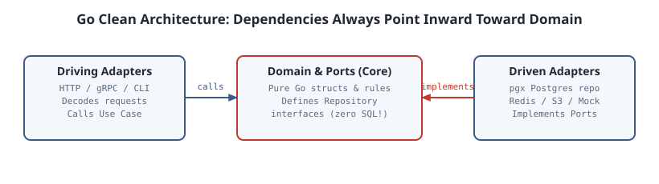

# Clean Architecture & Pragmatic DDD in Go

Go's implicit interfaces make Hexagonal (Ports & Adapters) architecture natural—as long as you avoid Java-style over-abstraction and keep interfaces **small and defined at the consumer**.

## Pragmatic Package Layout

```text
cmd/api/main.go             # Composition root: wires config, DB, HTTP, broker
internal/
  booking/                  # Feature/bounded-context package
    domain.go               # Entities, value objects, invariants (zero infra imports)
    service.go              # Use cases + small consumer-defined Repository interface
    postgres_repo.go        # PostgreSQL adapter implementing Repository
    http_handler.go         # HTTP transport adapter
```

## Key Principles in Go

1. **Define interfaces where they are used, not where they are implemented:** `booking.Service` declares `type BookingStore interface { Save(context.Context, Booking) error }`. `postgres_repo.go` satisfies it implicitly.
2. **Protect invariants in constructors and methods:** Expose `NewMoney(amount int64, currency string) (Money, error)` instead of letting callers mutate raw structs into invalid states.
3. **Avoid premature ceremony:** A simple CRUD endpoint does not need 5 layers of DTOs. Introduce domain aggregates and event buses when business invariants or cross-service workflows genuinely demand them.

## Related Chapters

- [29. EventDrivenDev](../29-event-driven-dev/index.md)
- [82. SOLID Design in Go](../21-security/82-solid-design.md)
## Dependency Inversion Diagram & Consumer-Defined Port Lab



In idiomatic Go, define small interfaces in the **consumer (domain/use-case) package** so business logic can be unit-tested in microseconds with an in-memory map:

```go
package billing

import (
	"context"
	"errors"
)

type Invoice struct {
	ID          string
	AmountCents int64
}

// Port defined by the consumer, not the database package
type InvoiceStore interface {
	Save(ctx context.Context, inv Invoice) error
}

type Service struct{ store InvoiceStore }

func (s *Service) Issue(ctx context.Context, inv Invoice) error {
	if inv.AmountCents <= 0 {
		return errors.New("amount must be positive")
	}
	return s.store.Save(ctx, inv)
}
```
