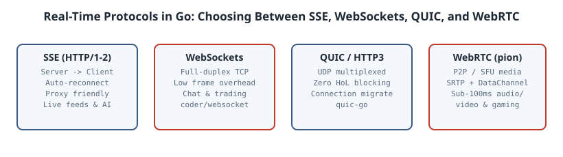

# Real-Time & Edge Protocols: SSE, HTTP/3 QUIC & WebRTC

Beyond standard HTTP/1.1 REST and WebSockets, modern Go services frequently use **Server-Sent Events (SSE)** for unidirectional live updates, **HTTP/3 (QUIC)** for lossy mobile/edge networks, and **WebRTC (`pion/webrtc`)** for low-latency peer-to-peer media and data channels.

## Choosing the Right Protocol

| Protocol | Direction | Transport | Best Fit |
|----------|-----------|-----------|----------|
| **SSE** | Server → Client | Standard HTTP/1.1 or HTTP/2 | AI token streaming, live dashboards, notifications (auto-reconnect built into browsers) |
| **WebSockets** | Bi-directional | TCP upgrade | Chat, collaborative editors, multiplayer state |
| **HTTP/3 (QUIC)** | Request/Response + Streams | UDP + TLS 1.3 | Eliminates TCP head-of-line blocking on mobile/high-loss networks (`quic-go`) |
| **WebRTC** | Peer-to-peer Bi-directional | UDP (ICE/STUN/TURN + DTLS) | Audio/video streaming, ultra-low-latency data channels (`pion/webrtc`) |

## Production SSE Checklist in Go

1. Set `Content-Type: text/event-stream`, `Cache-Control: no-cache`, and `X-Accel-Buffering: no` (for NGINX proxies).
2. Send periodic comment heartbeats (`: keepalive\n\n` every 15–30s) so intermediate proxies do not close idle connections.
3. Include monotonic `id:` fields on events so reconnecting browsers send `Last-Event-ID` and resume without missing updates.
4. Always select on `<-r.Context().Done()` so disconnected clients release goroutines immediately.
## Protocol Decision Diagram & Minimal Go SSE Handler Lab



Implement a clean, context-aware Server-Sent Events (SSE) stream using only Go's standard library (`net/http`):

```go
package main

import (
	"fmt"
	"net/http"
	"time"
)

func sseHandler(w http.ResponseWriter, r *http.Request) {
	flusher, ok := w.(http.Flusher)
	if !ok {
		http.Error(w, "streaming unsupported", http.StatusInternalServerError)
		return
	}
	w.Header().Set("Content-Type", "text/event-stream")
	w.Header().Set("Cache-Control", "no-cache")
	w.Header().Set("Connection", "keep-alive")

	ticker := time.NewTicker(1 * time.Second)
	defer ticker.Stop()

	for i := 1; i <= 5; i++ {
		select {
		case <-r.Context().Done():
			return // Client disconnected
		case t := <-ticker.C:
			fmt.Fprintf(w, "id: %d
data: tick %s

", i, t.Format(time.RFC3339))
			flusher.Flush()
		}
	}
}
```
