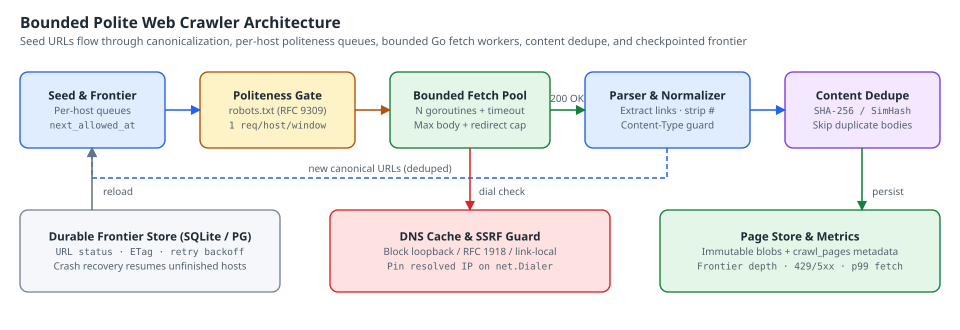

# Design Lab: A Bounded Web Crawler

Build a Go service that accepts a seed URL, traverses links on an explicitly allowed site, and stores fetch results. Start against an `httptest.Server` fixture with ten HTML pages, a redirect loop, repeated links, and one slow response so traversal, politeness, and failure behavior are completely reproducible.



## Architecture, contract, and durable state

Accept `POST /crawls` with a seed, allowlisted hosts, maximum page count, maximum depth, and byte budget. Return a job ID; `GET /crawls/{id}` reports progress, frontier depth, active fetches, status counts, and bytes consumed.

### Suggested Go module layout

```text
crawler/
├── cmd/crawler/main.go         # HTTP API + graceful shutdown
├── internal/
│   ├── frontier/               # Durable per-host queues + lease recovery
│   ├── robots/                 # RFC 9309 robots.txt parser + TTL cache
│   ├── fetcher/                # SSRF-safe dialer, bounded body reader, redirects
│   ├── parser/                 # golang.org/x/net/html link extractor + canonicalizer
│   └── store/                  # PostgreSQL/SQLite frontier & content-hash dedupe
└── migrations/001_crawler.sql
```

### Authoritative schema (`migrations/001_crawler.sql`)

Use a durable frontier table with `(crawl_id, canonical_url)` uniqueness, depth, status, attempt count, `next_allowed_at`, and lease expiry. Store response metadata and SHA-256 content hashes separately from raw bodies so duplicate pages across different URLs are never re-parsed or stored twice.

```sql
CREATE TABLE crawl_jobs (
    id             UUID PRIMARY KEY,
    seed_url       TEXT NOT NULL,
    allowed_hosts  TEXT[] NOT NULL,
    max_pages      INT NOT NULL CHECK (max_pages > 0),
    max_depth      INT NOT NULL CHECK (max_depth >= 0),
    byte_budget    BIGINT NOT NULL CHECK (byte_budget > 0),
    status         TEXT NOT NULL DEFAULT 'RUNNING',
    created_at     TIMESTAMPTZ NOT NULL DEFAULT now()
);

CREATE TABLE frontier_urls (
    id              BIGSERIAL PRIMARY KEY,
    crawl_id        UUID NOT NULL REFERENCES crawl_jobs(id),
    host            TEXT NOT NULL,
    canonical_url   TEXT NOT NULL,
    depth           INT NOT NULL,
    status          TEXT NOT NULL DEFAULT 'PENDING', -- PENDING | LEASED | DONE | FAILED
    attempts        INT NOT NULL DEFAULT 0,
    next_allowed_at TIMESTAMPTZ NOT NULL DEFAULT now(),
    lease_expires_at TIMESTAMPTZ,
    UNIQUE (crawl_id, canonical_url)
);

CREATE INDEX idx_frontier_claimable
    ON frontier_urls (crawl_id, next_allowed_at)
    WHERE status = 'PENDING';

CREATE TABLE crawled_pages (
    id            BIGSERIAL PRIMARY KEY,
    crawl_id      UUID NOT NULL REFERENCES crawl_jobs(id),
    canonical_url TEXT NOT NULL,
    status_code   INT NOT NULL,
    content_type  TEXT NOT NULL,
    content_sha256 CHAR(64) NOT NULL,
    etag          TEXT NOT NULL DEFAULT '',
    body_bytes    INT NOT NULL,
    fetched_at    TIMESTAMPTZ NOT NULL DEFAULT now(),
    UNIQUE (crawl_id, canonical_url)
);
```

### URL canonicalization rules

Canonicalize conservatively: resolve relative links against the final fetched URL, discard `#fragment`, lowercase scheme and host, and remove default ports (`:80`, `:443`). Do **not** blindly sort arbitrary query parameters or strip trailing slashes unless the target site's semantics permit it—canonicalization must never merge genuinely different resources.

## Go implementation path: Politeness, SSRF protection, and bounded fetching

Use one coordinator to own frontier admission and deduplication. Workers receive bounded fetch jobs and return discovered links through a bounded result channel. The coordinator stops only when **both** queued and in-flight work reach zero—a temporarily empty channel does not mean traversal is complete.

### Bounded body reader and SSRF-safe HTTP client

Use `http.NewRequestWithContext`, a reusable `http.Transport`, explicit response-header deadlines, and a hard maximum body size. For any public-facing crawler, validate resolved destination IPs inside `net.Dialer.Control` (not just the URL string) so DNS rebinding cannot pivot a public hostname to `127.0.0.1` or cloud metadata `169.254.169.254`. Revalidate every HTTP redirect against the host allowlist.

```go
package fetcher

import (
	"context"
	"crypto/sha256"
	"encoding/hex"
	"errors"
	"fmt"
	"io"
	"net"
	"net/http"
	"net/netip"
	"syscall"
	"time"
)

var (
	ErrPrivateIP      = errors.New("dial blocked: non-public IP address")
	ErrPageTooLarge   = errors.New("page exceeds configured byte limit")
	ErrHostDisallowed = errors.New("redirect target outside host allowlist")
)

func isBlockedAddr(addr netip.Addr) bool {
	addr = addr.Unmap()
	return !addr.IsGlobalUnicast() || addr.IsPrivate() || addr.IsLoopback() || addr.IsLinkLocalUnicast()
}

// NewSafeClient builds an HTTP client that blocks private/loopback/metadata IPs
// at socket connect time and revalidates every redirect against allowedHosts.
func NewSafeClient(allowedHosts map[string]bool, enforcePublicIP bool) *http.Client {
	dialer := &net.Dialer{
		Timeout:   5 * time.Second,
		KeepAlive: 30 * time.Second,
		Control: func(network, address string, c syscall.RawConn) error {
			if !enforcePublicIP {
				return nil // Local httptest fixture mode
			}
			host, _, err := net.SplitHostPort(address)
			if err != nil {
				return err
			}
			ip, err := netip.ParseAddr(host)
			if err != nil || isBlockedAddr(ip) {
				return fmt.Errorf("%w: %s", ErrPrivateIP, host)
			}
			return nil
		},
	}

	return &http.Client{
		Timeout: 15 * time.Second,
		Transport: &http.Transport{
			DialContext:           dialer.DialContext,
			MaxIdleConns:          100,
			MaxIdleConnsPerHost:   4,
			ResponseHeaderTimeout: 5 * time.Second,
		},
		CheckRedirect: func(req *http.Request, via []*http.Request) error {
			if len(via) >= 5 {
				return errors.New("stopped after 5 redirects")
			}
			if !allowedHosts[req.URL.Hostname()] {
				return fmt.Errorf("%w: %s", ErrHostDisallowed, req.URL.Hostname())
			}
			return nil
		},
	}
}

func ReadPageBounded(r io.Reader, limit int64) ([]byte, string, error) {
	if limit <= 0 || limit > 8<<20 {
		return nil, "", fmt.Errorf("invalid page limit: %d", limit)
	}
	b, err := io.ReadAll(io.LimitReader(r, limit+1))
	if err != nil {
		return nil, "", err
	}
	if int64(len(b)) > limit {
		return nil, "", ErrPageTooLarge
	}
	sum := sha256.Sum256(b)
	return b, hex.EncodeToString(sum[:]), nil
}
```

### Per-host politeness gate

Enforce per-origin concurrency and minimum delay spacing alongside the site's `robots.txt` rules ([RFC 9309](https://www.rfc-editor.org/info/rfc9309/)). Partitioning queues by host guarantees that scaling global workers from 8 to 256 never floods a single small origin:

```go
package frontier

import (
	"context"
	"sync"
	"time"
)

type HostGate struct {
	mu      sync.Mutex
	nextAt  map[string]time.Time
	minGap  time.Duration
}

func NewHostGate(minGap time.Duration) *HostGate {
	return &HostGate{nextAt: make(map[string]time.Time), minGap: minGap}
}

// Wait reserves the next polite slot for host and sleeps until that instant.
func (g *HostGate) Wait(ctx context.Context, host string) error {
	g.mu.Lock()
	now := time.Now()
	slot := g.nextAt[host]
	if slot.Before(now) {
		slot = now
	}
	g.nextAt[host] = slot.Add(g.minGap)
	wait := time.Until(slot)
	g.mu.Unlock()

	if wait <= 0 {
		return nil
	}
	t := time.NewTimer(wait)
	defer t.Stop()
	select {
	case <-ctx.Done():
		return ctx.Err()
	case <-t.C:
		return nil
	}
}
```

Parse HTML links with `golang.org/x/net/html` rather than regular expressions so malformed tags, comments, and `<base href>` elements do not corrupt discovered URLs.

## Failure modes, trade-offs, and capacity math

| Failure / trap | Mitigation |
|----------------|------------|
| **Crawler trap (infinite calendar / session-ID URLs)** | Enforce `max_depth`, per-host page cap, and path-pattern explosion alerts |
| **Worker crashes mid-fetch** | Lease frontier rows with `lease_expires_at`; expired leases return to `PENDING` cleanly |
| **Duplicate content at mirror URLs** | Compare `content_sha256` (exact) or 64-bit SimHash (near-duplicate) before indexing |
| **DNS rebinding / SSRF** | Validate resolved IP inside `net.Dialer.Control` and revalidate every redirect |
| **429 Too Many Requests / 503** | Honor `Retry-After` header and double per-host `minGap` with jitter |

### Illustrative capacity estimate

To crawl **1 billion pages/month** (`~385 pages/s` average, `~1,500 pages/s` peak at 4×) with an average uncompressed HTML page size of `100 KB`:

- **Ingress bandwidth**: `1,500 pages/s × 100 KB ≈ 150 MB/s` (`~1.2 Gbps` peak).
- **Storage (1 month raw HTML)**: `10^9 × 100 KB ≈ 100 TB` (`~25 TB` gzip-compressed in object storage).
- **URL frontier metadata**: `10^9 × 200 B ≈ 200 GB`—fits across sharded PostgreSQL/RocksDB partitions keyed by host hash.

## Restart, partitioning, and acceptance evidence

Run `go test -race ./...` against your local `httptest.Server` fixture and verify:

1. **Exactness & bounds**: Exact unique-page count, strict `max_depth` enforcement, oversized response rejection (`ErrPageTooLarge`), redirect-loop termination at 5 hops, and bounded memory under cyclic link graphs.
2. **Crash recovery**: Kill a worker after fetching a page but before checkpointing; verify lease expiry re-queues the URL and replay produces zero duplicate rows in `crawled_pages`.
3. **Politeness**: Assert consecutive requests to the same host are spaced by at least `minGap` even with 16 concurrent workers.
4. **Metrics**: Record frontier age, active fetches, HTTP status distribution, and bytes downloaded. Compare a broad site (high fan-out, depth 2) against a deep site (linear chain, depth 20) under the same page budget.

## Reference materials

- [RFC 9309 — Robots Exclusion Protocol](https://www.rfc-editor.org/info/rfc9309/)
- [Input validation and SSRF protection](../../22-security-hardening/175-input-validation-and-ssrf.md)
- [HTTP client and connection pooling](../../14-network-performance/02-http-client-and-connection-pooling.md)
- [Worker pools in Go](../../11-concurrency-parallelism/44b-worker-pools.md)
