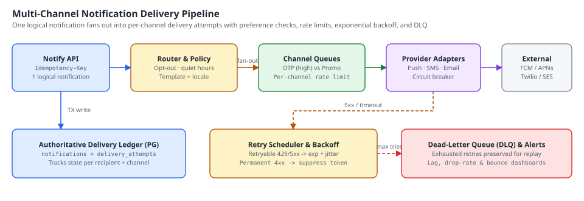

# Design Lab: Notification Delivery and Preferences

Build a Go notification API with email, SMS, and push adapters backed by deterministic fakes. A successful enqueue response (`202 Accepted`) promises **durable acceptance**, while a separate status endpoint reports per-channel delivery attempts. Never equate "provider accepted" with "user received."



## Model one logical notification

`POST /v1/notifications` accepts `recipient_id`, `category` (e.g., `otp`, `order_update`, `marketing`), `template_version`, requested channels, template variables, and a caller-supplied `Idempotency-Key`. Authenticate the caller, scope the idempotency key to its tenant, and store a SHA-256 `payload_hash`—reusing a key with a different payload must return `409 Conflict`.

### Authoritative schema (`migrations/001_notifications.sql`)

Separate logical intent, per-channel state, and immutable attempt history so retries never overwrite earlier failure evidence. Write the logical notification and its outbox row inside a single transaction using the [transactional outbox](../../18-distributed-infra/157-outbox-reliable-side-effects.md) pattern.

```sql
CREATE TABLE notifications (
    id              UUID PRIMARY KEY,
    tenant_id       UUID NOT NULL,
    idempotency_key TEXT NOT NULL,
    payload_hash    CHAR(64) NOT NULL,
    recipient_id    UUID NOT NULL,
    category        TEXT NOT NULL, -- otp | transactional | marketing
    template_id     TEXT NOT NULL,
    variables       JSONB NOT NULL,
    created_at      TIMESTAMPTZ NOT NULL DEFAULT now(),
    UNIQUE (tenant_id, idempotency_key)
);

CREATE TABLE channel_deliveries (
    id              UUID PRIMARY KEY,
    notification_id UUID NOT NULL REFERENCES notifications(id),
    channel         TEXT NOT NULL, -- push | email | sms
    priority        SMALLINT NOT NULL, -- 1 = OTP/high, 5 = bulk/low
    status          TEXT NOT NULL DEFAULT 'PENDING', -- PENDING | SENT | SUPPRESSED | DLQ
    attempt_count   INT NOT NULL DEFAULT 0,
    next_attempt_at TIMESTAMPTZ NOT NULL DEFAULT now(),
    provider_ref    TEXT NOT NULL DEFAULT '',
    updated_at      TIMESTAMPTZ NOT NULL DEFAULT now(),
    UNIQUE (notification_id, channel)
);

CREATE TABLE delivery_attempts (
    id            BIGSERIAL PRIMARY KEY,
    delivery_id   UUID NOT NULL REFERENCES channel_deliveries(id),
    attempt_no    INT NOT NULL,
    outcome       TEXT NOT NULL, -- OK | RETRYABLE | PERMANENT | AMBIGUOUS
    provider_ref  TEXT NOT NULL DEFAULT '',
    error_detail  TEXT NOT NULL DEFAULT '',
    attempted_at  TIMESTAMPTZ NOT NULL DEFAULT now()
);
```

## Provider adapter boundary and error classification

Keep provider SDKs behind a narrow Go interface and classify every adapter error into three explicit outcomes: **retryable** (`429`, `5xx`, network dial error), **permanent** (`400` invalid token, bounced address—suppress future sends), and **ambiguous** (timeout after request was written—provider may have sent it).

```go
package notify

import (
	"context"
	"errors"
	"math/rand/v2"
	"time"
)

type Outcome string

const (
	OutcomeOK        Outcome = "OK"
	OutcomeRetryable Outcome = "RETRYABLE"
	OutcomePermanent Outcome = "PERMANENT"
	OutcomeAmbiguous Outcome = "AMBIGUOUS"
)

type Envelope struct {
	DeliveryID     string // Forwarded as provider idempotency key when supported
	RecipientAddr  string
	Category       string
	TemplateID     string
	Variables      map[string]string
}

type Receipt struct {
	ProviderID string
}

type SendError struct {
	Outcome Outcome
	Cause   error
}

func (e *SendError) Error() string { return e.Cause.Error() }
func (e *SendError) Unwrap() error { return e.Cause }

type Sender interface {
	Send(ctx context.Context, env Envelope) (Receipt, error)
}

type PolicyChecker interface {
	CanSend(ctx context.Context, recipientID, category, channel string, now time.Time) (allowed bool, reason string, err error)
}

// NextBackoff returns bounded exponential backoff with full jitter so retries
// after a provider outage do not synchronize into a second thundering herd.
func NextBackoff(attempt int, base, maxDelay time.Duration) time.Duration {
	delay := base << min(attempt, 10)
	if delay > maxDelay || delay <= 0 {
		delay = maxDelay
	}
	return time.Duration(rand.Int64N(int64(delay)))
}

// Classify maps provider errors into dispatch decisions.
func Classify(err error) Outcome {
	if err == nil {
		return OutcomeOK
	}
	var se *SendError
	if errors.As(err, &se) {
		return se.Outcome
	}
	if errors.Is(err, context.DeadlineExceeded) {
		return OutcomeAmbiguous
	}
	return OutcomeRetryable
}
```

## Dispatch pipeline, priority isolation, and rate budgets

A dispatcher claims due `channel_deliveries` rows using `FOR UPDATE SKIP LOCKED`, routes high-priority notifications (OTPs, fraud alerts) to isolated worker pools so a 10-million-message marketing blast can never delay a login OTP, and enforces three invariants:

1. **Send-time preference & quiet-hours recheck**: Always re-evaluate opt-outs and local quiet hours immediately before calling `Sender.Send` (exempting critical `otp` / security categories), because a user may unsubscribe while a message sits in a retry queue.
2. **Global provider rate budget**: Enforce shared per-provider rate limits in Redis across all worker pods—not per-process limits that multiply when pods autoscale.
3. **Honest ambiguity handling**: An external send and your PostgreSQL commit are not one transaction. If a worker crashes between provider acceptance and checkpointing, retry may duplicate the message. Forward `DeliveryID` as the provider's idempotency key when supported; otherwise record `AMBIGUOUS`, alert on elevated ambiguity rates, and reconcile against provider delivery webhooks. Never mark a job `SENT` *before* calling the provider.

### Trade-offs and capacity math

- **Priority queues vs. single FIFO**: Separate Kafka topics or priority queues (`notif-high`, `notif-bulk`) prevent head-of-line blocking at the cost of extra consumer groups.
- **Capacity**: At **50M notifications/day** (`~580/s` avg, `~5,800/s` 10× campaign peak), each `channel_deliveries` + `delivery_attempts` row pair is ~600 B (`~30 GB/day`). Partition `delivery_attempts` by day and archive to cold storage after 30 days.

## Acceptance drill

Run `go test -race ./...` against a deterministic fake `Sender`:

1. **Four-outcome matrix**: Make the fake return success, permanent invalid-token rejection, timeout before acceptance, and timeout after acceptance. Verify bounded retries on `RETRYABLE`, immediate suppression on `PERMANENT`, and preserved attempt history.
2. **Crash-between-send-and-commit**: Crash a worker after the fake records a send but before the DB commits; assert replay produces one logical intent, bounded attempts, and explicit handling of the ambiguous send.
3. **Mid-queue opt-out**: Unsubscribe a recipient while a marketing notification is waiting in backoff and assert send-time policy marks it `SUPPRESSED` without calling the provider.
4. **Priority isolation**: Enqueue 10,000 bulk messages followed by 1 OTP and assert the OTP dispatches in `< 200 ms`.
5. **Observability**: Expose oldest pending age, attempts by outcome, DLQ count, and provider latency without placing recipient addresses or PII into Prometheus metric labels. Extend this lab into the [email service](13-distributed-email.md) where SMTP/IMAP transport adds mailbox storage states.

## Reference materials

- [IETF Draft — The `Idempotency-Key` HTTP Header Field](https://datatracker.ietf.org/doc/draft-ietf-httpapi-idempotency-key-header/)
- [Microservices.io — Transactional Outbox Pattern](https://microservices.io/patterns/data/transactional-outbox.html)
- [PostgreSQL `FOR UPDATE SKIP LOCKED` Queue Pattern](https://neon.com/guides/queue-system)
- [Idempotency keys](../../18-distributed-infra/155-idempotency-keys.md) and [Retry and circuit breaker patterns](../../18-distributed-infra/152-retry-circuit-breaker-patterns.md)
