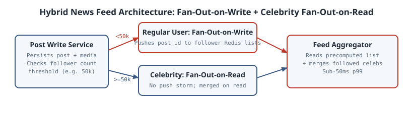

# Design Lab: A News Feed with Fan-Out and Cursors

Build a chronological Go news feed before adding ML ranking. The hardest part is keeping materialized timelines fast while follows, unfollows, post deletions, and privacy rules change continuously. A cached feed entry is only a candidate pointer—it **never** grants permission to read the underlying post.



## API and durable model

Implement `POST /v1/posts`, idempotent `PUT /v1/follows/{author}` (and `DELETE /v1/follows/{author}`), and `GET /v1/feed?cursor=...&limit=...`. Store posts, follow edges, materialized feed entries, and an outbox event in PostgreSQL.

### Authoritative schema (`migrations/001_newsfeed.sql`)

```sql
CREATE TABLE posts (
    id          BIGINT PRIMARY KEY, -- Snowflake / time-ordered ID
    author_id   UUID NOT NULL,
    visibility  TEXT NOT NULL DEFAULT 'PUBLIC', -- PUBLIC | FOLLOWERS | PRIVATE
    deleted_at  TIMESTAMPTZ,
    body        TEXT NOT NULL,
    created_at  TIMESTAMPTZ NOT NULL DEFAULT now()
);

CREATE INDEX idx_posts_author_time ON posts (author_id, created_at DESC, id DESC)
    WHERE deleted_at IS NULL;

CREATE TABLE follows (
    reader_id   UUID NOT NULL,
    author_id   UUID NOT NULL,
    created_at  TIMESTAMPTZ NOT NULL DEFAULT now(),
    PRIMARY KEY (reader_id, author_id)
);

CREATE INDEX idx_follows_author ON follows (author_id, reader_id);

CREATE TABLE feed_entries (
    reader_id   UUID NOT NULL,
    post_id     BIGINT NOT NULL,
    author_id   UUID NOT NULL,
    created_at  TIMESTAMPTZ NOT NULL,
    PRIMARY KEY (reader_id, created_at DESC, post_id DESC),
    UNIQUE (reader_id, post_id)
);
```

### Keyset cursor pagination (fan-out on read baseline)

Start with fan-out on read: query followed authors ordered by `(created_at DESC, id DESC)`. Encode the cursor as an opaque base64 JSON token containing `(created_at, post_id, reader_id)` signed with HMAC so callers cannot forge another user's cursor or trigger `OFFSET` full-table scans:

```sql
SELECT p.id, p.author_id, p.created_at, p.body
FROM posts p
JOIN follows f ON f.author_id = p.author_id
WHERE f.reader_id = $1
  AND p.deleted_at IS NULL
  AND p.visibility IN ('PUBLIC', 'FOLLOWERS')
  AND (p.created_at, p.id) < ($2, $3)
ORDER BY p.created_at DESC, p.id DESC
LIMIT $4;
```

Bound `limit` in Go (e.g., `1 <= limit <= 50`). Treat timestamps as deterministic ordering keys alongside `id`, not as proof of physical wall-clock causality across machines.

## Grow to hybrid fan-out (push + pull merge)

Pure fan-out-on-write pushes `(reader_id, post_id)` into every follower's Redis `ZSET` / `feed_entries` table via an outbox worker. Reads become a single `ZREVRANGE` (~1 ms). However, a celebrity author with 5 million followers creates 5 million writes per post, starving normal users' fan-out queues.

A **hybrid router** solves both extremes:
- **Normal authors (`followers < threshold`, e.g., 50,000)**: Fan-out-on-write in bounded batches (500 followers per transaction) with resumable checkpoints.
- **High-fan-out authors (`followers >= threshold`)**: Skip push entirely; at read time, merge the reader's precomputed timeline with recent posts from the small set of celebrities the reader follows using a k-way merge.

### Go implementation: Hybrid fan-out router and authorized hydration

Never issue one SQL query per feed entry (N+1) and never serve cached post bodies without rechecking current visibility and deletion state:

```go
package feed

import (
	"context"
	"sort"
	"time"
)

const CelebrityThreshold = 50_000

type PostRef struct {
	PostID    int64
	AuthorID  string
	CreatedAt time.Time
}

type Post struct {
	ID         int64
	AuthorID   string
	Visibility string // PUBLIC | FOLLOWERS | PRIVATE
	Deleted    bool
	Body       string
	CreatedAt  time.Time
}

type FanOutMode string

const (
	ModePush FanOutMode = "FANOUT_ON_WRITE"
	ModePull FanOutMode = "FANOUT_ON_READ"
)

func RoutePublish(followerCount int) FanOutMode {
	if followerCount >= CelebrityThreshold {
		return ModePull
	}
	return ModePush
}

type Store interface {
	GetPrecomputedRefs(ctx context.Context, readerID string, before time.Time, beforeID int64, limit int) ([]PostRef, error)
	GetFollowedCelebrities(ctx context.Context, readerID string) ([]string, error)
	GetRecentPostsByAuthors(ctx context.Context, authorIDs []string, before time.Time, beforeID int64, limit int) ([]PostRef, error)
	BatchLoadPosts(ctx context.Context, postIDs []int64) (map[int64]Post, error)
	StillFollows(ctx context.Context, readerID string, authorIDs []string) (map[string]bool, error)
}

// GetTimeline merges precomputed push candidates with celebrity pull candidates,
// deduplicates, batch-hydrates posts, and enforces live visibility/follow rules.
func GetTimeline(ctx context.Context, s Store, readerID string, before time.Time, beforeID int64, limit int) ([]Post, error) {
	if limit <= 0 || limit > 50 {
		limit = 20
	}
	// Over-fetch slightly to absorb deleted/unfollowed posts filtered at read time.
	fetchN := limit * 2

	pushRefs, err := s.GetPrecomputedRefs(ctx, readerID, before, beforeID, fetchN)
	if err != nil {
		return nil, err
	}
	celebs, err := s.GetFollowedCelebrities(ctx, readerID)
	if err != nil {
		return nil, err
	}
	var pullRefs []PostRef
	if len(celebs) > 0 {
		pullRefs, err = s.GetRecentPostsByAuthors(ctx, celebs, before, beforeID, fetchN)
		if err != nil {
			return nil, err
		}
	}

	// Merge, deduplicate by PostID, and sort descending by (CreatedAt, PostID).
	seen := make(map[int64]bool, len(pushRefs)+len(pullRefs))
	merged := make([]PostRef, 0, len(pushRefs)+len(pullRefs))
	for _, r := range append(pushRefs, pullRefs...) {
		if !seen[r.PostID] {
			seen[r.PostID] = true
			merged = append(merged, r)
		}
	}
	sort.Slice(merged, func(i, j int) bool {
		if !merged[i].CreatedAt.Equal(merged[j].CreatedAt) {
			return merged[i].CreatedAt.After(merged[j].CreatedAt)
		}
		return merged[i].PostID > merged[j].PostID
	})

	ids := make([]int64, 0, len(merged))
	authorSet := make(map[string]bool)
	for _, r := range merged {
		ids = append(ids, r.PostID)
		authorSet[r.AuthorID] = true
	}
	postsByID, err := s.BatchLoadPosts(ctx, ids)
	if err != nil {
		return nil, err
	}
	authors := make([]string, 0, len(authorSet))
	for a := range authorSet {
		authors = append(authors, a)
	}
	following, err := s.StillFollows(ctx, readerID, authors)
	if err != nil {
		return nil, err
	}

	out := make([]Post, 0, limit)
	for _, r := range merged {
		p, ok := postsByID[r.PostID]
		if !ok || p.Deleted || p.Visibility == "PRIVATE" || !following[p.AuthorID] {
			continue
		}
		out = append(out, p)
		if len(out) == limit {
			break
		}
	}
	return out, nil
}
```

## Capacity math and trade-offs

Assume **10M DAU**, **5 feed reads/user/day**, and **2M new posts/day** with an average of **200 followers**:
- **Feed reads**: `50M / 86,400 ≈ 580 req/s` avg (`~2,900 req/s` peak at 5×).
- **Fan-out writes**: `2M × 200 = 400M feed entries/day` (`~4,630 writes/s` avg, `~23,000 writes/s` peak).
- **Redis timeline memory**: Capping each active user's Redis `ZSET` to the latest 500 post IDs (`16 B/entry`) uses `10M × 500 × 16 B ≈ 80 GB` across a Redis Cluster; older pages fall back to PostgreSQL.

## Failure and pagination evidence

Run `go test -race ./...` and collect:

1. **Idempotent fan-out**: Publish once, replay the outbox event twice, and assert exactly one entry per reader (`UNIQUE(reader_id, post_id)`).
2. **Backlog catch-up**: Pause the fan-out worker while publishing 1,000 posts; resume and assert bounded heap usage and complete convergence.
3. **Authorization invariance**: Delete a post, switch another to `PRIVATE`, and unfollow an author while their IDs remain in Redis; assert `GetTimeline` returns zero unauthorized posts.
4. **Stable keyset pagination**: Insert new posts between page 1 and page 2 requests and assert zero duplicate items across pages. Measure p99 feed latency and rows read per page with and without a celebrity author.

## Reference materials

- [Redis Sorted Sets (`ZADD` / `ZRANGE`)](https://redis.io/docs/latest/develop/data-types/sorted-sets/)
- [Distributed ID generation (Snowflake / time-ordered IDs)](../../18-distributed-infra/150c-distributed-id-generation.md)
- [Outbox reliable side effects](../../18-distributed-infra/157-outbox-reliable-side-effects.md)
- [Enterprise workplace social network capstone](19-enterprise-workplace-social.md) (adds multi-tenant ACLs and org graphs)
