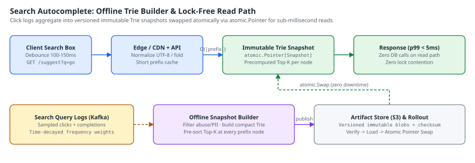

# Design Lab: Search Autocomplete with Immutable Snapshots

Build `GET /v1/suggest?q=...&limit=...` in Go with sub-5 ms p99 latency. The first milestone serves ranked suggestions from an immutable precomputed Trie snapshot; the second adds an offline aggregation pipeline that rebuilds, validates, and atomically swaps snapshots with zero read-path lock contention. This connects the [trie chapter](../../08-data-structures-and-algorithms/06-tries-and-prefix-trees.md) to a production concurrent service.



## Specify matching, normalization, and ranking

Start with explicit, testable contracts:
- **Normalization**: Trim whitespace, collapse internal spaces, lowercase ASCII (add Unicode NFC + locale-aware case folding as a dedicated milestone with identical test vectors on both ingestion and query paths).
- **Bounds**: Reject empty prefixes or prefixes longer than 64 bytes; cap `limit` to `1..10`.
- **Ranking**: Order by time-decayed frequency count descending, with lexicographical term ascending as a deterministic tie-breaker.
- **Precomputation**: Store the **Top-10 completed suggestions directly on every Trie node** during the offline build. Query time becomes $O(|\text{prefix}|)$ pointer hops with zero subtree traversal and zero database queries.

## Go implementation: Precomputed Top-K Trie + `atomic.Pointer` swap + denylist

Never mutate a live Trie while HTTP handlers are reading it. Build the entire next `Snapshot` off-line (or in a background goroutine), validate invariants, and publish it with [`atomic.Pointer[Snapshot].Store`](https://pkg.go.dev/sync/atomic). Keep a separate fast denylist map (also swapped atomically) so legal or trust-and-safety removals take effect in seconds without waiting for a full Trie rebuild.

```go
package suggest

import (
	"sort"
	"strings"
	"sync/atomic"
)

type Entry struct {
	Term  string
	Score uint64
}

type trieNode struct {
	children map[byte]*trieNode
	top      []Entry // Pre-sorted top-K completions for this prefix (immutable after build)
}

type Snapshot struct {
	Version uint64
	Root    *trieNode
	MaxK    int
}

// BuildSnapshot constructs a completely immutable Top-K Trie from aggregated terms.
func BuildSnapshot(version uint64, entries []Entry, maxK int) *Snapshot {
	if maxK <= 0 {
		maxK = 10
	}
	// Sort once globally: Score DESC, Term ASC. Every prefix node simply appends
	// the first maxK matching entries it sees — guaranteeing sorted top-K order.
	sorted := append([]Entry(nil), entries...)
	sort.Slice(sorted, func(i, j int) bool {
		if sorted[i].Score != sorted[j].Score {
			return sorted[i].Score > sorted[j].Score
		}
		return sorted[i].Term < sorted[j].Term
	})

	root := &trieNode{children: make(map[byte]*trieNode)}
	for _, e := range sorted {
		term := Normalize(e.Term)
		if term == "" || len(term) > 64 {
			continue
		}
		curr := root
		for i := 0; i < len(term); i++ {
			b := term[i]
			next, ok := curr.children[b]
			if !ok {
				next = &trieNode{children: make(map[byte]*trieNode)}
				curr.children[b] = next
			}
			curr = next
			if len(curr.top) < maxK {
				curr.top = append(curr.top, Entry{Term: term, Score: e.Score})
			}
		}
	}
	return &Snapshot{Version: version, Root: root, MaxK: maxK}
}

func Normalize(s string) string {
	return strings.ToLower(strings.Join(strings.Fields(s), " "))
}

type Service struct {
	current  atomic.Pointer[Snapshot]
	denylist atomic.Pointer[map[string]struct{}]
}

func (s *Service) SwapSnapshot(next *Snapshot) { s.current.Store(next) }

func (s *Service) SwapDenylist(blocked map[string]struct{}) {
	cp := make(map[string]struct{}, len(blocked))
	for k := range blocked {
		cp[Normalize(k)] = struct{}{}
	}
	s.denylist.Store(&cp)
}

// Suggest performs a lock-free O(|prefix|) lookup and returns a fresh slice copy.
func (s *Service) Suggest(rawPrefix string, limit int) (uint64, []Entry) {
	snap := s.current.Load()
	if snap == nil || snap.Root == nil {
		return 0, nil
	}
	prefix := Normalize(rawPrefix)
	if prefix == "" || len(prefix) > 64 {
		return snap.Version, nil
	}
	if limit <= 0 || limit > snap.MaxK {
		limit = snap.MaxK
	}

	curr := snap.Root
	for i := 0; i < len(prefix); i++ {
		next, ok := curr.children[prefix[i]]
		if !ok {
			return snap.Version, nil
		}
		curr = next
	}

	var blocked map[string]struct{}
	if p := s.denylist.Load(); p != nil {
		blocked = *p
	}

	out := make([]Entry, 0, min(limit, len(curr.top)))
	for _, e := range curr.top {
		if _, banned := blocked[e.Term]; banned {
			continue
		}
		out = append(out, e)
		if len(out) == limit {
			break
		}
	}
	return snap.Version, out
}
```

## Rebuild pipeline, privacy, and scaling

- **Offline aggregation**: Sample raw search logs via Kafka, apply exponential time decay so trending queries rise quickly (`score_new = 0.8 * score_prev + count_today`), drop queries below a minimum k-anonymity threshold (e.g., `< 20` distinct users) so rare PII never leaks into public suggestions, serialize the snapshot to S3 with a SHA-256 checksum, and roll out with canary validation.
- **Memory & overlap budget**: During `SwapSnapshot`, both the old and new Tries coexist in heap until in-flight HTTP handlers finish. If 5M unique terms average 20 bytes each with Top-10 pointers per node, one snapshot consumes ~400–800 MB RAM—size container memory limits for **2.5× snapshot size** to avoid OOM kills during reload.
- **Client & edge caching**: Debounce keystrokes on the client (100–150 ms) and cache popular 1–3 character prefixes at the CDN (`max-age=60`), which absorbs 60%+ of global autocomplete QPS before it reaches Go.
- **Sharding**: Shard by prefix (`a–g`, `h–p`, `q–z`) only after measuring RAM and skew; hot short prefixes still require replication or CDN caching regardless of shard count.

## Evidence and acceptance drills

Run `go test -race ./...`:

1. **Deterministic ranking**: Test equal-score tie-breaking (lexicographical ascending), missing prefixes, empty snapshots, and caller mutation of the returned slice.
2. **Concurrent lock-free swaps**: Spawn 32 reader goroutines querying continuously while a writer swaps 50 snapshot versions; assert zero data races and that every response belongs to a single consistent `Version`.
3. **Instant denylist override**: Block a high-scoring term via `SwapDenylist` and assert it disappears immediately without rebuilding the Trie.
4. **Memory benchmark**: Profile peak `HeapInuse` during concurrent snapshot overlap using `pprof` and compare a precomputed Trie against a sorted slice + binary search (`sort.Search`).

## Reference materials

- [Go `sync/atomic` (`atomic.Pointer`) Package](https://pkg.go.dev/sync/atomic)
- [Tries and prefix trees](../../08-data-structures-and-algorithms/06-tries-and-prefix-trees.md)
- [Memory allocations and GC](../../24-performance-engineering/182-memory-allocations-gc.md)
- [Benchmarking and profiling workflow](../../24-performance-engineering/181-benchmarking-profiling-workflow.md)
