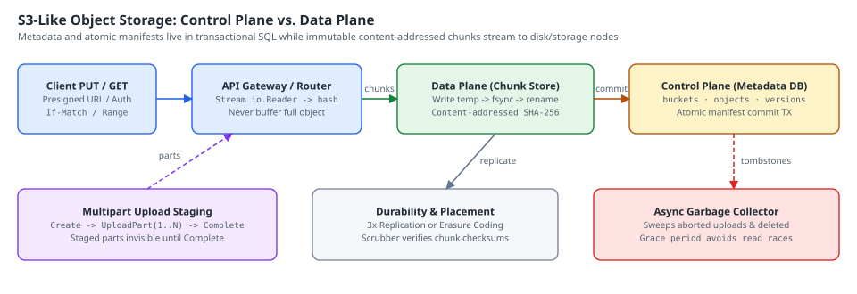

# Design Lab: S3-Like Object Storage

Build a Go object storage service with bucket/key addressing, immutable object versions, multipart uploads, and strict separation between **control-plane metadata** (transactional SQL) and **data-plane bytes** (content-addressed chunks on disk or storage nodes). "S3-like" describes the object model and publication semantics; the lab focuses on durability, atomicity, and concurrency rather than SigV4 wire compatibility.



## Control plane vs. data plane and atomic publication

Expose `PUT /buckets/{bucket}/objects/{key...}`, `GET`, `HEAD`, `DELETE`, and multipart session routes (`POST /uploads`, `PUT /uploads/{id}/parts/{n}`, `POST /uploads/{id}/complete`). Treat object keys as opaque strings—never concatenate user keys into filesystem paths (prevents path traversal; map every stored blob to a UUID or SHA-256 content address).

### Authoritative metadata schema (`migrations/001_objects.sql`)

```sql
CREATE TABLE buckets (
    name       TEXT PRIMARY KEY,
    owner_id   UUID NOT NULL,
    versioning BOOLEAN NOT NULL DEFAULT true,
    created_at TIMESTAMPTZ NOT NULL DEFAULT now()
);

CREATE TABLE object_versions (
    id          UUID PRIMARY KEY,
    bucket      TEXT NOT NULL REFERENCES buckets(name),
    obj_key     TEXT NOT NULL,
    version_num BIGINT NOT NULL,
    etag        TEXT NOT NULL,
    size_bytes  BIGINT NOT NULL CHECK (size_bytes >= 0),
    sha256_hex  CHAR(64) NOT NULL,
    is_current  BOOLEAN NOT NULL DEFAULT true,
    deleted     BOOLEAN NOT NULL DEFAULT false,
    created_at  TIMESTAMPTZ NOT NULL DEFAULT now(),
    UNIQUE (bucket, obj_key, version_num)
);

-- At most one current pointer per (bucket, obj_key).
CREATE UNIQUE INDEX idx_object_current
    ON object_versions (bucket, obj_key)
    WHERE is_current = true;

CREATE TABLE object_parts (
    version_id UUID NOT NULL REFERENCES object_versions(id),
    part_num   INT NOT NULL,
    blob_id    TEXT NOT NULL,
    size_bytes BIGINT NOT NULL,
    sha256_hex CHAR(64) NOT NULL,
    PRIMARY KEY (version_id, part_num)
);

CREATE TABLE multipart_uploads (
    upload_id  UUID PRIMARY KEY,
    bucket     TEXT NOT NULL REFERENCES buckets(name),
    obj_key    TEXT NOT NULL,
    status     TEXT NOT NULL DEFAULT 'OPEN', -- OPEN | COMPLETED | ABORTED
    expires_at TIMESTAMPTZ NOT NULL,
    created_at TIMESTAMPTZ NOT NULL DEFAULT now()
);
```

## Go implementation: Streaming checksum writer and atomic publication

Never buffer whole objects in RAM. Stream `io.Reader` directly through `io.MultiWriter` into a temporary file and SHA-256 hasher, `Sync()` the file to disk, atomically `os.Rename` it into the immutable blob directory, and only **then** commit metadata in PostgreSQL. If any step fails, remove the temp file so `GET` never observes partial bytes.

```go
package objstore

import (
	"crypto/sha256"
	"encoding/hex"
	"errors"
	"fmt"
	"io"
	"os"
	"path/filepath"
)

var ErrObjectTooLarge = errors.New("object exceeds maximum allowed bytes")

type WrittenBlob struct {
	BlobID    string
	SizeBytes int64
	SHA256Hex string
}

// WriteBlobAtomic streams body to a temp file, hashes on the fly, fsyncs, and
// atomically renames into rootDir/<prefix>/<sha256>. Readers never see partial files.
func WriteBlobAtomic(rootDir string, body io.Reader, maxBytes int64) (WrittenBlob, error) {
	if maxBytes <= 0 {
		return WrittenBlob{}, fmt.Errorf("invalid maxBytes: %d", maxBytes)
	}
	tmp, err := os.CreateTemp(rootDir, ".upload-*")
	if err != nil {
		return WrittenBlob{}, err
	}
	tmpPath := tmp.Name()
	cleanup := true
	defer func() {
		if cleanup {
			_ = tmp.Close()
			_ = os.Remove(tmpPath)
		}
	}()

	h := sha256.New()
	n, err := io.Copy(io.MultiWriter(tmp, h), io.LimitReader(body, maxBytes+1))
	if err != nil {
		return WrittenBlob{}, err
	}
	if n > maxBytes {
		return WrittenBlob{}, ErrObjectTooLarge
	}
	if err := tmp.Sync(); err != nil {
		return WrittenBlob{}, err
	}
	if err := tmp.Close(); err != nil {
		return WrittenBlob{}, err
	}

	sumHex := hex.EncodeToString(h.Sum(nil))
	subDir := filepath.Join(rootDir, sumHex[:2])
	if err := os.MkdirAll(subDir, 0o750); err != nil {
		return WrittenBlob{}, err
	}
	finalPath := filepath.Join(subDir, sumHex)
	if err := os.Rename(tmpPath, finalPath); err != nil {
		return WrittenBlob{}, err
	}
	cleanup = false

	return WrittenBlob{
		BlobID:    sumHex,
		SizeBytes: n,
		SHA256Hex: sumHex,
	}, nil
}
```

## Multipart uploads, conditional writes, and garbage collection

- **Multipart lifecycle**: Follow the [Amazon S3 Multipart Upload](https://docs.aws.amazon.com/AmazonS3/latest/userguide/mpuoverview.html) model—`CreateMultipartUpload` creates a session with an `expires_at` deadline; `UploadPart` streams independent parts (5 MB–5 GB) in parallel; `CompleteMultipartUpload` validates the exact ordered part list and checksums, flips the `is_current` pointer inside one SQL transaction, and marks the upload `COMPLETED` idempotently.
- **Conditional writes (`If-Match` / `If-None-Match`)**: Guard concurrent overwrites using `WHERE bucket = $1 AND obj_key = $2 AND is_current = true AND etag = $3` so two writers cannot silently clobber each other.
- **Reference-counted garbage collection with grace period**: `DELETE` writes a tombstone or flips `is_current = false`; it does not immediately unlink blobs. A background GC sweeps unreferenced blobs and expired `OPEN` multipart parts only after a grace period (e.g., 24 hours) so in-flight uploads and active `GET` streams are never broken.
- **Durability trade-off**: 3× replication costs 3× raw storage with fast recovery; Reed-Solomon erasure coding (e.g., 8+4) cuts overhead to 1.5× at the cost of CPU and rebuild network traffic.

## Distribution and recovery evidence

Run `go test -race ./...` and verify:

1. **Crash before metadata commit**: Kill the process after `WriteBlobAtomic` succeeds but before PostgreSQL commits; assert `GET` returns `404` (never partial bytes) and GC reclaims the orphan blob after the grace window.
2. **Idempotent multipart completion**: Call `CompleteMultipartUpload` twice concurrently with the same part manifest and assert both return the same version and ETag.
3. **Conditional write race**: Race 20 goroutines issuing `PUT` with the same `If-Match` ETag and assert exactly 1 succeeds and 19 receive `412 Precondition Failed`.
4. **Bit-rot detection**: Flip one byte in a stored chunk on disk and verify the background scrubber flags a SHA-256 mismatch.

The [video platform](06-video-platform.md) and [file-sync](07-file-sync.md) labs build directly on this atomic publication boundary.

## Reference materials

- [Amazon S3 — Uploading and Copying Objects Using Multipart Upload](https://docs.aws.amazon.com/AmazonS3/latest/userguide/mpuoverview.html)
- [Path traversal-resistant file handling (`os.Root`)](../../22-security-hardening/175b-os-root-traversal-resistant-files.md)
- [Write-ahead log and fsync durability](../../17-systems-programming/142b-write-ahead-log.md)
