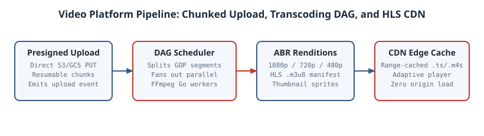

# Design Lab: A Video Upload and Streaming Platform

Build the Go control service around a small media pipeline: upload a source, queue transcodes, publish a playback manifest, and serve segments. Use your own tiny test clips. The Go service orchestrates encoding tools; it does not implement video codecs.

## State and endpoints

Create `POST /videos`, upload-session creation, `POST /videos/{id}/complete`, `GET /videos/{id}`, and an authorized playback endpoint. Store a video row with owner, source object version, processing generation, status, and active manifest version.

Use explicit transitions:

```text
created -> uploaded -> processing -> ready
                         |
                         +-> failed -> processing (new attempt)
```

Only a complete upload can create the transcode outbox event. A worker claims a job, retrieves the source, and produces two small renditions plus segments in a versioned output prefix. Build a manifest referring only to completed segments, then atomically publish its metadata pointer. Readers continue to see the prior complete version during reprocessing.

## Go worker boundary

Launch the media tool using `exec.CommandContext` with fixed executable and argument positions, generated file paths, and no shell interpolation. Limit concurrent jobs, elapsed runtime, output bytes, temporary disk space, and captured stderr. Closing a context is only one part of cleanup: reap children and remove temporary directories on failure.

Key a rendition by `(video_id, source_version, profile_version)`. A uniqueness constraint makes repeated queue delivery reuse the same logical output. Update readiness only if the processing generation still matches; an older worker must not overwrite a newer result.

[HTTP Live Streaming](https://www.rfc-editor.org/rfc/rfc8216.html) describes playlists and segment relationships. Use a known media tool to produce valid HLS rather than inventing manifest syntax. Give private playback manifests and segments an authorization policy consistent with each other, including cache expiry and revocation behavior.

## Capacity and delivery

Estimate storage as source bytes plus rendition bytes times retention and replica policy. Estimate egress from concurrent viewers and selected bitrate. A content delivery network reduces repeated origin reads, but an origin cache miss still needs a bounded response path. Go handlers should stream objects instead of buffering whole videos in RAM.

## Failure evidence

Kill the worker halfway through a rendition, redeliver the job, and confirm no manifest refers to missing segments. Run old and new processing generations concurrently and assert only the new one can publish. Test source deletion during processing, unsupported media, encoder timeout, and a private video requested through a stale cached URL.

Record time-to-ready, transcode queue age, bytes per rendition, playback startup latency, and origin bandwidth. Extend with resumable uploads and adaptive renditions only after the publication and retry invariants pass.
## Transcoding DAG Diagram & Bounded Go Worker-Pool Lab



Fan out adaptive bitrate renditions across a bounded Go worker pool using `sync.WaitGroup`:

```go
package main

import (
	"fmt"
	"sync"
)

func main() {
	renditions := []string{"1080p", "720p", "480p", "360p"}
	jobs := make(chan string, len(renditions))
	for _, r := range renditions {
		jobs <- r
	}
	close(jobs)

	var wg sync.WaitGroup
	for w := 1; w <= 2; w++ {
		wg.Add(1)
		go func(id int) {
			defer wg.Done()
			for profile := range jobs {
				fmt.Printf("worker-%d transcoded %s HLS segment
", id, profile)
			}
		}(w)
	}
	wg.Wait()
}
```
