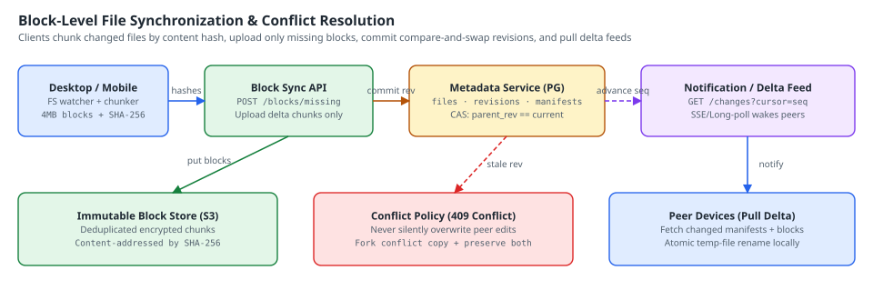

# Design Lab: Drive-Style File Synchronization

Build a Go sync server and CLI daemon that keep two local client directories synchronized across offline edits, renames, deletes, and interrupted uploads. The core invariant is **zero silent data loss**: concurrent offline edits fork an explicit conflict copy rather than silently overwriting a peer's work.



## Separate namespace from content

Give every file a stable `file_id`, `parent_id`, display `name`, `current_rev`, and `deleted` tombstone. Renaming or moving a file updates only namespace metadata—it never re-uploads unchanged bytes. File contents are represented as an ordered manifest of fixed (4 MB) or content-defined (Rabin/FastCDC) chunk SHA-256 hashes stored in the [object-storage lab](05-object-storage.md).

### Authoritative schema (`migrations/001_filesync.sql`)

```sql
CREATE TABLE files (
    id          UUID PRIMARY KEY,
    owner_id    UUID NOT NULL,
    parent_id   UUID,
    name        TEXT NOT NULL,
    current_rev BIGINT NOT NULL DEFAULT 0,
    deleted     BOOLEAN NOT NULL DEFAULT false,
    updated_at  TIMESTAMPTZ NOT NULL DEFAULT now()
);

CREATE TABLE file_revisions (
    file_id      UUID NOT NULL REFERENCES files(id),
    rev          BIGINT NOT NULL,
    parent_rev   BIGINT NOT NULL,
    chunk_hashes TEXT[] NOT NULL,
    size_bytes   BIGINT NOT NULL,
    request_id   TEXT NOT NULL,
    created_at   TIMESTAMPTZ NOT NULL DEFAULT now(),
    PRIMARY KEY (file_id, rev),
    UNIQUE (file_id, request_id)
);

-- Monotonic per-owner change feed for GET /v1/changes?cursor=<seq>
CREATE TABLE change_log (
    seq       BIGSERIAL PRIMARY KEY,
    owner_id  UUID NOT NULL,
    file_id   UUID NOT NULL REFERENCES files(id),
    rev       BIGINT NOT NULL,
    op        TEXT NOT NULL, -- UPSERT | RENAME | DELETE
    created_at TIMESTAMPTZ NOT NULL DEFAULT now()
);

CREATE INDEX idx_changelog_owner_seq ON change_log (owner_id, seq);
```

## Sync protocol and Go implementation

A client sync cycle runs in three steps:
1. **Delta upload**: Split modified local file into 4 MB chunks, compute SHA-256 per chunk, call `POST /v1/blocks/missing` with the hash list, and upload **only** chunks the server lacks.
2. **CAS revision commit**: Call `POST /v1/files/{id}/commit` with `base_rev`, `chunk_hashes`, and an `Idempotency-Key` (`request_id`). The server atomically verifies `current_rev == base_rev`, inserts the immutable revision, updates `files.current_rev`, and appends a `change_log` row in one PostgreSQL transaction.
3. **Pull delta feed**: Peers receive a wake-up signal (SSE / long-poll), call `GET /v1/changes?cursor=<last_seq>`, download missing chunks, write to a temp file, verify SHA-256, atomically rename into place, and advance their local cursor **only after** the rename succeeds.

```go
package filesync

import (
	"context"
	"database/sql"
	"errors"
	"fmt"
)

var (
	ErrRevConflict   = errors.New("revision conflict: base_rev does not match current_rev")
	ErrMissingChunks = errors.New("one or more referenced chunks are not uploaded")
)

type CommitReq struct {
	OwnerID     string
	FileID      string
	BaseRev     int64
	RequestID   string
	ChunkHashes []string
	SizeBytes   int64
}

type BlockChecker interface {
	AllExist(ctx context.Context, ownerID string, hashes []string) (bool, error)
}

// CommitRevision atomically advances a file's revision using optimistic CAS
// and appends an ordered change-log entry inside one SQL transaction.
func CommitRevision(ctx context.Context, db *sql.DB, blocks BlockChecker, req CommitReq) (int64, error) {
	ok, err := blocks.AllExist(ctx, req.OwnerID, req.ChunkHashes)
	if err != nil {
		return 0, err
	}
	if !ok {
		return 0, ErrMissingChunks
	}

	tx, err := db.BeginTx(ctx, nil)
	if err != nil {
		return 0, err
	}
	defer tx.Rollback()

	// Idempotent retry check: if this request_id already committed, return its rev.
	var existingRev int64
	err = tx.QueryRowContext(ctx,
		`SELECT rev FROM file_revisions WHERE file_id = $1 AND request_id = $2`,
		req.FileID, req.RequestID,
	).Scan(&existingRev)
	if err == nil {
		return existingRev, nil
	}
	if !errors.Is(err, sql.ErrNoRows) {
		return 0, err
	}

	// Optimistic CAS: fail with 409 Conflict if another device committed first.
	nextRev := req.BaseRev + 1
	res, err := tx.ExecContext(ctx, `
		UPDATE files
		SET current_rev = $1, deleted = false, updated_at = now()
		WHERE id = $2 AND owner_id = $3 AND current_rev = $4`,
		nextRev, req.FileID, req.OwnerID, req.BaseRev,
	)
	if err != nil {
		return 0, err
	}
	n, _ := res.RowsAffected()
	if n == 0 {
		return 0, fmt.Errorf("%w: file=%s base=%d", ErrRevConflict, req.FileID, req.BaseRev)
	}

	if _, err := tx.ExecContext(ctx, `
		INSERT INTO file_revisions (file_id, rev, parent_rev, chunk_hashes, size_bytes, request_id)
		VALUES ($1, $2, $3, $4, $5, $6)`,
		req.FileID, nextRev, req.BaseRev, req.ChunkHashes, req.SizeBytes, req.RequestID,
	); err != nil {
		return 0, err
	}

	if _, err := tx.ExecContext(ctx, `
		INSERT INTO change_log (owner_id, file_id, rev, op)
		VALUES ($1, $2, $3, 'UPSERT')`,
		req.OwnerID, req.FileID, nextRev,
	); err != nil {
		return 0, err
	}

	if err := tx.Commit(); err != nil {
		return 0, err
	}
	return nextRev, nil
}
```

> [!IMPORTANT]
> **Security trap with cross-user deduplication:** A content hash identifies bytes—it never proves ownership. Scope deduplication per account (or require proof-of-possession challenges) so an attacker cannot probe whether another user owns a sensitive file by testing chunk hashes. Reject `..` path segments and symlink escapes when materializing remote filenames on local disk.

## Offline conflicts, tombstones, and acceptance evidence

- **Offline conflict policy**: When Client A and Client B both edit revision 7 offline, the first to commit wins revision 8; the second receives `ErrRevConflict`, pulls revision 8, and saves its local edits as `report (conflict copy from laptop-B).md` before uploading it as a new file.
- **Tombstones**: Deleting a file writes a `deleted = true` tombstone and change-log entry so a returning offline client deletes its stale local copy rather than resurrecting it.
- **Filesystem watcher fallback**: OS watchers (`fsnotify`) drop events under heavy I/O; always pair them with startup scans and periodic reconciliation.

### Acceptance drills (`go test -race ./...`)

1. **Divergent offline edits**: Disconnect Client B, edit the same file on A and B, reconnect, and verify both versions are preserved with zero silent overwrite.
2. **Crash mid-apply**: Kill a client after writing the temp file and renaming it, but *before* persisting its local cursor; restart and verify idempotent replay.
3. **Delta efficiency**: Edit 10 KB in the middle of a 20 MB file and assert only the modified 4 MB chunk(s) are uploaded.
4. **GC safety**: Run chunk garbage collection while an older revision still references a block and assert zero dangling chunk references.

## Reference materials

- [S3-like object storage lab](05-object-storage.md)
- [Filesystem watching in Go](../../17-systems-programming/151-filesystem-watching.md)
- [Path traversal-resistant files (`os.Root`)](../../22-security-hardening/175b-os-root-traversal-resistant-files.md)
- [Go executing transactions guide](https://go.dev/doc/database/execute-transactions)
