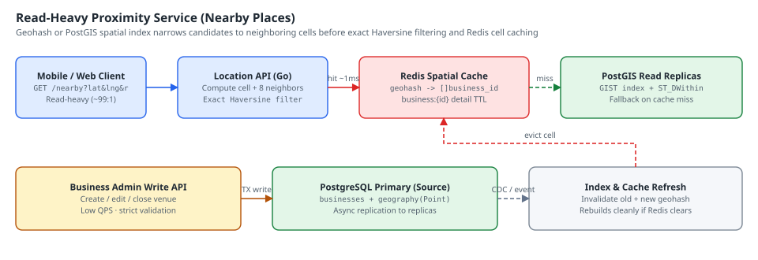

# Design Lab: A Geospatial Proximity Service

Implement `GET /v1/places/nearby?lat=...&lon=...&radius_m=...&limit=...` in Go for a read-heavy local discovery service (Yelp / Google Maps Places style, ~99:1 read-to-write ratio). Start with an exact in-memory Haversine oracle, then back it with PostGIS `ST_DWithin` and a geohash cell cache in Redis. Remember the fundamental rule: **a spatial grid cell is a candidate filter, never a precise distance result.**



## Data model and query contract

Validate finite latitude in `[-90, 90]`, longitude in `[-180, 180]`, positive bounded radius (e.g., `100 m .. 20,000 m`), and capped `limit` (`1..100`). Use degrees at the API boundary and meters for distance.

### Authoritative PostGIS schema (`migrations/001_places.sql`)

```sql
CREATE EXTENSION IF NOT EXISTS postgis;

CREATE TABLE places (
    id          UUID PRIMARY KEY,
    name        TEXT NOT NULL,
    category    TEXT NOT NULL,
    position    geography(Point, 4326) NOT NULL,
    geohash6    TEXT NOT NULL,
    version     BIGINT NOT NULL DEFAULT 1,
    updated_at  TIMESTAMPTZ NOT NULL DEFAULT now()
);

CREATE INDEX idx_places_position_gist ON places USING GIST (position);
CREATE INDEX idx_places_geohash6 ON places (geohash6);
```

`ST_MakePoint` takes **longitude first, latitude second**. For `geography(Point, 4326)`, PostGIS [`ST_DWithin`](https://postgis.net/docs/ST_DWithin.html) uses the GiST index for fast bounding-box pruning and computes exact meters on the WGS84 spheroid:

```sql
SELECT id, name, category, ST_Distance(position, q.p) AS meters
FROM places
CROSS JOIN (
    SELECT ST_SetSRID(ST_MakePoint($1, $2), 4326)::geography AS p
) q
WHERE ST_DWithin(position, q.p, $3)
ORDER BY meters ASC, id ASC
LIMIT $4;
```

## Go implementation: Haversine oracle + Geohash 9-cell candidate filter

If you cache spatial cells in Redis (`geohash:{precision}:{cell} -> []place_id`), searching only the center cell misses nearby places sitting just across the cell boundary! Always query the **center cell plus its 8 neighbors** (at a geohash precision matching the requested radius: precision 6 ≈ `1.2 km × 0.6 km`, precision 5 ≈ `4.9 km × 4.9 km`), batch-fetch place coordinates, and run exact Haversine filtering in Go:

```go
package proximity

import (
	"math"
	"sort"
)

type Place struct {
	ID       string
	Name     string
	Category string
	Lat      float64
	Lon      float64
}

type Match struct {
	Place
	DistanceM float64
}

// DistanceM computes great-circle distance in meters using the Haversine formula.
func DistanceM(lat1, lon1, lat2, lon2 float64) float64 {
	const earthRadiusM = 6371008.8
	rad := math.Pi / 180
	p1, p2 := lat1*rad, lat2*rad
	dp, dl := (lat2-lat1)*rad, (lon2-lon1)*rad
	a := math.Sin(dp/2)*math.Sin(dp/2) +
		math.Cos(p1)*math.Cos(p2)*math.Sin(dl/2)*math.Sin(dl/2)
	a = math.Max(0, math.Min(1, a))
	return 2 * earthRadiusM * math.Asin(math.Sqrt(a))
}

// PrecisionForRadius picks a geohash length whose cell width roughly matches radiusM.
func PrecisionForRadius(radiusM float64) int {
	switch {
	case radiusM <= 600:
		return 6
	case radiusM <= 2500:
		return 5
	default:
		return 4
	}
}

// FilterAndSort applies exact Haversine distance pruning to spatial candidates
// and sorts deterministically by (DistanceM ASC, ID ASC).
func FilterAndSort(lat, lon, radiusM float64, candidates []Place, limit int) []Match {
	out := make([]Match, 0, min(limit, len(candidates)))
	for _, p := range candidates {
		d := DistanceM(lat, lon, p.Lat, p.Lon)
		if d <= radiusM {
			out = append(out, Match{Place: p, DistanceM: d})
		}
	}
	sort.Slice(out, func(i, j int) bool {
		if out[i].DistanceM != out[j].DistanceM {
			return out[i].DistanceM < out[j].DistanceM
		}
		return out[i].ID < out[j].ID
	})
	if len(out) > limit {
		out = out[:limit]
	}
	return out
}
```

## Scaling, trade-offs, and capacity math

- **Read/write split**: Business locations change rarely (~10 writes/s), while searches run at **5,000–50,000 QPS**. Replicate PostgreSQL/PostGIS to read replicas in multiple regions and cache `geohash -> []place_id` plus `place:{id}` details in Redis (with invalidation of both old and new geohash cells on address edits).
- **Storage footprint**: 200M global places × ~1 KB metadata = **~200 GB** in PostgreSQL; the hot Redis geohash index (`200M × 32 B ≈ 6.4 GB`) fits comfortably in a small Redis cluster.
- **Dense downtown hot spots**: Static geohash cells can hold thousands of venues in Manhattan and zero in rural areas. Use adaptive quadtrees or PostGIS GiST (R-tree) when cell density skews by 1,000×.

## Acceptance evidence

1. **Oracle parity**: Compare PostGIS `ST_DWithin` and 9-cell geohash results against the brute-force `FilterAndSort` oracle across cell boundaries, the antimeridian (`±180°` longitude), and high latitudes (`±80°`).
2. **Edge cases**: Test exact radius equality (`d == radiusM`), tie-breaking on equal distances, invalid `NaN`/`Inf` coordinates, and a dense downtown fixture (10,000 places in 1 km²).
3. **Query plan verification**: Run `EXPLAIN (ANALYZE, BUFFERS)` and assert PostgreSQL uses `Index Scan using idx_places_position_gist` rather than a sequential scan.

The [nearby-friends lab](09-nearby-friends.md) extends spatial queries to continuously moving users and social-graph authorization.

## Reference materials

- [PostGIS `ST_DWithin` Reference](https://postgis.net/docs/ST_DWithin.html)
- [Redis Geospatial Data Type & `GEOSEARCH`](https://redis.io/docs/latest/develop/data-types/geospatial/)
- [Caching patterns in Go](../../18-distributed-infra/154-caching-patterns.md)
