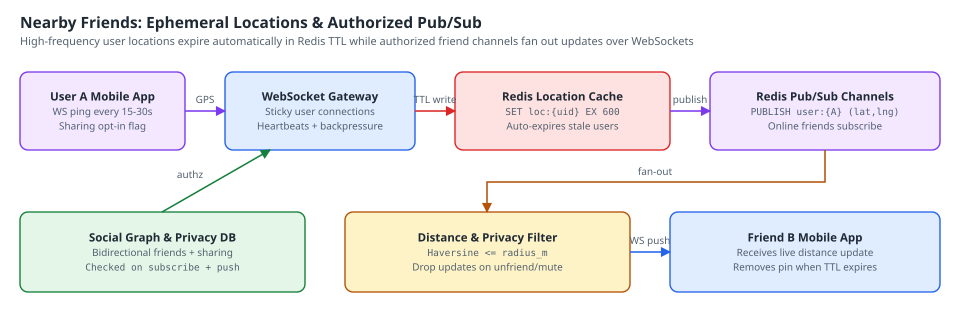

# Design Lab: Nearby Friends with Expiring Location State

Extend the [proximity service](08-proximity-service.md) from static places to consenting friends with continuously moving locations. The core engineering challenges shift from read-heavy spatial indexing to **high-frequency ephemeral writes, monotonic sequence fencing, server-side TTL expiry, and real-time bidirectional authorization**. A coordinate sitting in Redis is never permission to reveal it.



## Contract, session epochs, and data model

Expose authenticated `PUT /v1/me/location`, `GET /v1/me/nearby-friends`, and a WebSocket stream `GET /v1/ws/nearby` for live friend updates.

- **Session epochs & monotonic sequences**: Allocate a monotonic `session_epoch` when a user enables location sharing (invalidating earlier devices/sessions). Reject any update whose `(session_epoch, seq)` is less than or equal to the currently stored value so delayed mobile packets never teleport a user backward.
- **Server-clock TTL**: Always compute `expires_at = serverNow + 10m` (e.g., `SET loc:{uid} ... EX 600`) using server receipt time—never trust a mobile client's wall clock to keep a location alive indefinitely.
- **Authoritative social graph (`migrations/001_friends.sql`)**:

```sql
CREATE TABLE friendships (
    user_id    UUID NOT NULL,
    friend_id  UUID NOT NULL,
    status     TEXT NOT NULL DEFAULT 'ACCEPTED', -- ACCEPTED | BLOCKED
    updated_at TIMESTAMPTZ NOT NULL DEFAULT now(),
    PRIMARY KEY (user_id, friend_id)
);

CREATE TABLE sharing_sessions (
    user_id       UUID PRIMARY KEY,
    session_epoch BIGINT NOT NULL DEFAULT 1,
    sharing_on    BOOLEAN NOT NULL DEFAULT false,
    revoked_at    TIMESTAMPTZ,
    updated_at    TIMESTAMPTZ NOT NULL DEFAULT now()
);
```

## Go implementation: Monotonic location guard and bounded-queue Pub/Sub fan-out

A Go mutex only protects a single process; in multi-instance deployments, execute the `(session_epoch, seq)` compare-and-update atomically via a Redis Lua script or PostgreSQL `WHERE (epoch, seq) < ($1, $2)`. On the WebSocket fan-out path, coalesce updates and give each connected subscriber a **bounded outbound channel**—drop/disconnect a slow subscriber rather than letting one stalled mobile client exhaust server RAM.

```go
package nearby

import (
	"context"
	"sync"
	"time"
)

type LocationUpdate struct {
	UserID   string
	Epoch    uint64
	Seq      uint64
	Lat, Lon float64
}

type StoredLocation struct {
	LocationUpdate
	ExpiresAt time.Time
}

type MemoryLocationStore struct {
	mu   sync.RWMutex
	locs map[string]StoredLocation
	ttl  time.Duration
}

func NewMemoryLocationStore(ttl time.Duration) *MemoryLocationStore {
	return &MemoryLocationStore{locs: make(map[string]StoredLocation), ttl: ttl}
}

// ApplyIfNewer atomically rejects stale epochs/sequences and sets server-clock TTL.
func (s *MemoryLocationStore) ApplyIfNewer(_ context.Context, u LocationUpdate, now time.Time) bool {
	s.mu.Lock()
	defer s.mu.Unlock()

	cur, ok := s.locs[u.UserID]
	if ok && (u.Epoch < cur.Epoch || (u.Epoch == cur.Epoch && u.Seq <= cur.Seq)) {
		return false
	}
	s.locs[u.UserID] = StoredLocation{
		LocationUpdate: u,
		ExpiresAt:      now.Add(s.ttl),
	}
	return true
}

// ReadAuthorized returns non-expired friend locations only if consent is active.
func (s *MemoryLocationStore) ReadAuthorized(friendIDs []string, canSee func(string) bool, now time.Time) []StoredLocation {
	s.mu.RLock()
	defer s.mu.RUnlock()

	out := make([]StoredLocation, 0, len(friendIDs))
	for _, id := range friendIDs {
		if !canSee(id) {
			continue
		}
		loc, ok := s.locs[id]
		if !ok || !now.Before(loc.ExpiresAt) {
			continue // Enforce expiry on read even if background TTL sweeper lags.
		}
		out = append(out, loc)
	}
	return out
}

// FanOutNonBlocking pushes a location update to a subscriber's bounded queue.
// If the subscriber is stalled, it drops the oldest/current frame rather than blocking.
func FanOutNonBlocking(subCh chan LocationUpdate, u LocationUpdate) (delivered bool) {
	select {
	case subCh <- u:
		return true
	default:
		return false
	}
}
```

## Scaling, privacy, and capacity math

Assume **10M active sharing users** pinging every **30 seconds** (`~333,000 writes/s` peak) with an average of **40 online friends** per user:
- **Redis location cache**: `10M × ~100 B ≈ 1 GB` RAM—tiny and trivially sharded by `user_id`.
- **Pub/Sub fan-out**: `333,000 pings/s × 40 online friends ≈ 13.3M` fan-out evaluations/sec across a sharded Redis Pub/Sub cluster (each WebSocket gateway subscribes only to the friend channels of users currently connected to *that* gateway).
- **Privacy minimization**: When the UI only displays "0.5 km away", quantize or return distance bands rather than raw 6-decimal GPS coordinates. Keep revocation tombstones longer than maximum packet delay so an in-flight packet cannot resurrect a revoked session.

## Failure evidence

Run `go test -race ./...`:

1. **Out-of-order rejection**: Deliver sequence 8 before sequence 7 (and epoch 1 after epoch 2) and assert stored coordinates remain at `(epoch=2, seq=8)`.
2. **Read-time expiry**: Advance a fake clock past `ExpiresAt` without running background cleanup and assert `ReadAuthorized` returns empty.
3. **Mid-flight revocation**: Revoke friendship or sharing consent while a location update is in flight; assert the friend's WebSocket receives zero subsequent updates.
4. **Slow subscriber isolation**: Attach one blocked WebSocket consumer alongside 50 healthy consumers and verify zero head-of-line blocking and bounded heap growth.

## Reference materials

- [RFC 6455 — The WebSocket Protocol](https://www.rfc-editor.org/info/rfc6455/)
- [Redis Geospatial & TTL Commands](https://redis.io/docs/latest/develop/data-types/geospatial/)
- [Geospatial proximity service lab](08-proximity-service.md)
- [WebSocket chat and multi-instance extension](../99u-websocket-chat.md)
