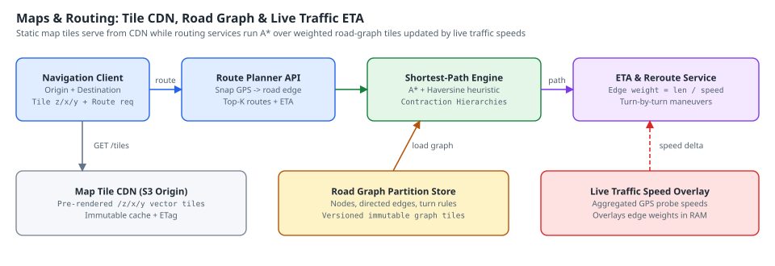

# Design Lab: A Maps and Route-Planning Service

Build a Go route-planning API over a synthetic directed road graph paired with an immutable static tile catalogue. A maps platform separates three distinct systems: **static map tile delivery** (CDN + S3), **geocoding/snapping** (address/GPS to road edge), and **shortest-path routing** (A* / Dijkstra over versioned graph + live traffic snapshots). A road graph and a raster/vector map tile solve completely different problems.



## Route contract and immutable graph snapshots

Accept `POST /v1/routes` with `from_node`, `to_node`, and `mode` (`drive | bike | walk`). Return ordered `edge_ids`, total `distance_m`, expected `seconds`, `graph_version`, and `traffic_version`.

Keep road graph snapshots **immutable** and publish traffic weight updates by atomically swapping a `*TrafficSnapshot` via [`atomic.Pointer`](https://pkg.go.dev/sync/atomic). One route calculation must read a single coherent `(graph_version, traffic_version)` pair so it never mixes pre-closure and post-closure edge weights.

### Go implementation: Context-aware A* shortest path with `container/heap`

A* accelerates [Dijkstra's algorithm](../../08-data-structures-and-algorithms/10-shortest-paths-dijkstra.md) using an **admissible heuristic** $h(u) = \text{haversine}(u, \text{goal}) / v_{\max}$, where $v_{\max}$ is the maximum legal road speed (e.g., `36 m/s ≈ 130 km/h`). Because $h(u)$ never overestimates true travel time, A* guarantees an optimal shortest path while expanding far fewer nodes. Always enforce both `ctx.Err()` cancellation and a hard `maxExpanded` node budget inside the search loop.

```go
package routing

import (
	"container/heap"
	"context"
	"errors"
	"math"
)

var (
	ErrUnreachable     = errors.New("destination unreachable")
	ErrBudgetExhausted = errors.New("search node expansion budget exhausted")
)

type ModeMask uint8

const (
	ModeDrive ModeMask = 1 << iota
	ModeBike
	ModeWalk
)

type Node struct {
	ID       uint64
	Lat, Lon float64
}

type Edge struct {
	ID         uint64
	To         uint64
	DistanceM  float64
	BaseSpeed  float64 // m/s
	Allowed    ModeMask
}

type GraphSnapshot struct {
	Version string
	Nodes   map[uint64]Node
	Adj     map[uint64][]Edge
}

type Route struct {
	Edges        []uint64
	DistanceM    float64
	Seconds      float64
	GraphVersion string
	Expanded     int
}

type pqItem struct {
	nodeID uint64
	fScore float64 // g + h
	gScore float64 // exact seconds from start
}

type minHeap []pqItem

func (h minHeap) Len() int           { return len(h) }
func (h minHeap) Less(i, j int) bool { return h[i].fScore < h[j].fScore }
func (h minHeap) Swap(i, j int)      { h[i], h[j] = h[j], h[i] }
func (h *minHeap) Push(x any)        { *h = append(*h, x.(pqItem)) }
func (h *minHeap) Pop() any          { old := *h; n := len(old); it := old[n-1]; *h = old[:n-1]; return it }

func haversineM(a, b Node) float64 {
	const R = 6371008.8
	rad := math.Pi / 180
	dp, dl := (b.Lat-a.Lat)*rad, (b.Lon-a.Lon)*rad
	x := math.Sin(dp/2)*math.Sin(dp/2) + math.Cos(a.Lat*rad)*math.Cos(b.Lat*rad)*math.Sin(dl/2)*math.Sin(dl/2)
	return 2 * R * math.Asin(math.Sqrt(math.Min(1, math.Max(0, x))))
}

// FindAStar computes the fastest route with an admissible speed heuristic,
// live traffic speed overrides, context cancellation, and an expansion cap.
func FindAStar(ctx context.Context, g *GraphSnapshot, liveSpeed map[uint64]float64, from, to uint64, mode ModeMask, maxExpanded int) (Route, error) {
	goal, ok := g.Nodes[to]
	if !ok {
		return Route{}, ErrUnreachable
	}
	const maxSpeedMPS = 36.0 // ~130 km/h upper bound keeps heuristic admissible

	gScore := map[uint64]float64{from: 0}
	prevEdge := make(map[uint64]Edge)
	prevNode := make(map[uint64]uint64)

	h := &minHeap{{nodeID: from, gScore: 0, fScore: haversineM(g.Nodes[from], goal) / maxSpeedMPS}}
	heap.Init(h)
	expanded := 0

	for h.Len() > 0 {
		if err := ctx.Err(); err != nil {
			return Route{}, err
		}
		cur := heap.Pop(h).(pqItem)
		if cur.gScore > gScore[cur.nodeID] {
			continue // Stale duplicate entry in heap
		}
		if cur.nodeID == to {
			return reconstruct(g.Version, from, to, prevNode, prevEdge, cur.gScore, expanded), nil
		}
		expanded++
		if expanded > maxExpanded {
			return Route{}, ErrBudgetExhausted
		}

		for _, e := range g.Adj[cur.nodeID] {
			if e.Allowed&mode == 0 {
				continue
			}
			speed := e.BaseSpeed
			if s, ok := liveSpeed[e.ID]; ok {
				speed = s
			}
			if speed <= 0 {
				continue // Road closed
			}
			tentative := cur.gScore + e.DistanceM/speed
			if old, seen := gScore[e.To]; !seen || tentative < old {
				gScore[e.To] = tentative
				prevNode[e.To] = cur.nodeID
				prevEdge[e.To] = e
				est := tentative + haversineM(g.Nodes[e.To], goal)/maxSpeedMPS
				heap.Push(h, pqItem{nodeID: e.To, gScore: tentative, fScore: est})
			}
		}
	}
	return Route{}, ErrUnreachable
}

func reconstruct(ver string, from, to uint64, prevNode map[uint64]uint64, prevEdge map[uint64]Edge, secs float64, expanded int) Route {
	var edges []uint64
	var dist float64
	for cur := to; cur != from; cur = prevNode[cur] {
		e := prevEdge[cur]
		edges = append(edges, e.ID)
		dist += e.DistanceM
	}
	for i, j := 0, len(edges)-1; i < j; i, j = i+1, j-1 {
		edges[i], edges[j] = edges[j], edges[i]
	}
	return Route{Edges: edges, DistanceM: dist, Seconds: secs, GraphVersion: ver, Expanded: expanded}
}
```

## Tiles, traffic overlays, and scaling to continental graphs

- **Static tiles (`GET /tiles/{map_ver}/{z}/{x}/{y}.mvt`)**: Pre-render vector tiles into S3 and serve through a CDN with immutable cache headers. Never render map tiles inside the route-planning service.
- **Route cache keys**: Key cached routes by `(graph_version, traffic_version, mode, from, to)`. Omitting `traffic_version` risks routing drivers onto a newly closed highway.
- **Scaling beyond plain A***: Continental road networks have ~100M nodes. Plain A* takes seconds across a continent; production engines precompute **Contraction Hierarchies (CH)** or **Customizable Route Planning (CRP)** over partitioned graph tiles so cross-country queries finish in `< 10 ms` while live traffic overlays refresh in seconds.

## Acceptance evidence

1. **Graph correctness**: Build a fixture with one-way streets, a disconnected island (`ErrUnreachable`), a shorter slow street, and a longer fast highway; verify `FindAStar` selects the fastest path and respects `ModeMask`.
2. **Road closure & coherent snapshots**: Set `liveSpeed[highwayEdge] = 0` in a new snapshot while 16 goroutines query concurrently; verify every response reports one coherent version and reroutes cleanly.
3. **Cancellation & budget**: Cancel `ctx` mid-search and test `maxExpanded` exhaustion; verify prompt return with zero leaked goroutines.

## Reference materials

- [Go `container/heap` Package](https://pkg.go.dev/container/heap)
- [Go `sync/atomic` Package](https://pkg.go.dev/sync/atomic)
- [Shortest paths and Dijkstra's algorithm](../../08-data-structures-and-algorithms/10-shortest-paths-dijkstra.md)
- [Geospatial proximity service lab](08-proximity-service.md)
