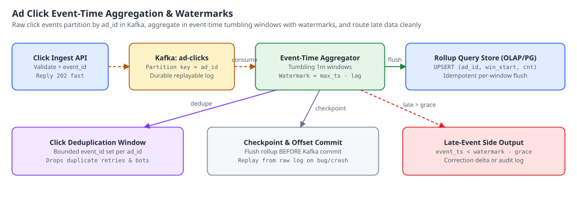

# Design Lab: Ad Click Event Aggregation

Build a Go click-ingestion API and event-time minute-window aggregator using synthetic ad clicks. The central distinction in stream processing is **event time** (when the user clicked the ad) versus **processing time** (when your Go worker read the record from Kafka). Mobile offline buffers, retries, and partition lag guarantee the two will diverge.



## Ingestion, half-open windows, and authoritative schema

`POST /v1/clicks` accepts a bounded batch of `(event_id, ad_id, occurred_at)` events, validates timestamp bounds (rejecting far-future clock skew), and writes to a durable log (Kafka topic `ad-clicks`, partitioned by `ad_id`) before returning `202 Accepted`.

Bucket every click into UTC **half-open tumbling windows** `[start, start + 1m)` using `occurred_at.UTC().Truncate(time.Minute)`. A click at `12:01:00.000Z` belongs strictly to `[12:01, 12:02)`.

### Authoritative rollup & dedupe schema (`migrations/001_clicks.sql`)

Deduplicate `event_id` and increment the `(ad_id, window_start)` counter inside the **same PostgreSQL transaction**—never separate dedupe from aggregation, or a crash between them will double-count on replay.

```sql
CREATE TABLE processed_clicks (
    event_id    UUID PRIMARY KEY,
    ad_id       TEXT NOT NULL,
    window_start TIMESTAMPTZ NOT NULL,
    seen_at     TIMESTAMPTZ NOT NULL DEFAULT now()
);

CREATE TABLE ad_minute_rollups (
    ad_id        TEXT NOT NULL,
    window_start TIMESTAMPTZ NOT NULL,
    click_count  BIGINT NOT NULL DEFAULT 0,
    finalized    BOOLEAN NOT NULL DEFAULT false,
    updated_at   TIMESTAMPTZ NOT NULL DEFAULT now(),
    PRIMARY KEY (ad_id, window_start)
);

CREATE TABLE late_click_events (
    event_id     UUID PRIMARY KEY,
    ad_id        TEXT NOT NULL,
    occurred_at  TIMESTAMPTZ NOT NULL,
    watermark_at TIMESTAMPTZ NOT NULL,
    recorded_at  TIMESTAMPTZ NOT NULL DEFAULT now()
);
```

## Watermarks, late data, and Go implementation

A **watermark** $W(t)$ is a monotonically advancing assertion: *"we expect no more events with `occurred_at <= W(t)`."* Define $W = \max(\text{observed event\_time}) - \text{allowed\_lateness}$ (e.g., 5 minutes) per partition, taking the **minimum** across active partitions so one fast partition never prematurely closes a slow partition's window.

When an event arrives with `occurred_at < watermark`:
- Do **not** silently drop it—route it to `late_click_events` (a side output for billing adjustments or audit reconciliation).
- Commit Kafka consumer offsets **only after** the PostgreSQL rollup + dedupe transaction commits.

```go
package clicks

import (
	"context"
	"database/sql"
	"time"
)

type ClickEvent struct {
	EventID    string    `json:"event_id"`
	AdID       string    `json:"ad_id"`
	OccurredAt time.Time `json:"occurred_at"`
}

func MinuteStart(t time.Time) time.Time {
	return t.UTC().Truncate(time.Minute)
}

type WatermarkTracker struct {
	maxEventTime   time.Time
	allowedLateness time.Duration
}

func NewWatermarkTracker(lateness time.Duration) *WatermarkTracker {
	return &WatermarkTracker{allowedLateness: lateness}
}

// Observe updates the partition watermark and reports whether evt is late.
func (w *WatermarkTracker) Observe(evtTime time.Time) (watermark time.Time, isLate bool) {
	evtUTC := evtTime.UTC()
	if evtUTC.After(w.maxEventTime) {
		w.maxEventTime = evtUTC
	}
	wm := w.maxEventTime.Add(-w.allowedLateness)
	return wm, evtUTC.Before(wm)
}

// ApplyBatch deduplicates clicks and increments minute rollups atomically.
// Events older than the current watermark route to late_click_events.
func ApplyBatch(ctx context.Context, db *sql.DB, wm *WatermarkTracker, batch []ClickEvent) (applied, late int, err error) {
	tx, err := db.BeginTx(ctx, nil)
	if err != nil {
		return 0, 0, err
	}
	defer tx.Rollback()

	for _, e := range batch {
		curWM, isLate := wm.Observe(e.OccurredAt)
		if isLate {
			if _, err := tx.ExecContext(ctx, `
				INSERT INTO late_click_events (event_id, ad_id, occurred_at, watermark_at)
				VALUES ($1, $2, $3, $4)
				ON CONFLICT (event_id) DO NOTHING`,
				e.EventID, e.AdID, e.OccurredAt.UTC(), curWM,
			); err != nil {
				return 0, 0, err
			}
			late++
			continue
		}

		win := MinuteStart(e.OccurredAt)
		res, err := tx.ExecContext(ctx, `
			INSERT INTO processed_clicks (event_id, ad_id, window_start)
			VALUES ($1, $2, $3)
			ON CONFLICT (event_id) DO NOTHING`,
			e.EventID, e.AdID, win,
		)
		if err != nil {
			return 0, 0, err
		}
		n, _ := res.RowsAffected()
		if n == 0 {
			continue // Duplicate retry; do not increment rollup.
		}

		if _, err := tx.ExecContext(ctx, `
			INSERT INTO ad_minute_rollups (ad_id, window_start, click_count)
			VALUES ($1, $2, 1)
			ON CONFLICT (ad_id, window_start)
			DO UPDATE SET click_count = ad_minute_rollups.click_count + 1, updated_at = now()`,
			e.AdID, win,
		); err != nil {
			return 0, 0, err
		}
		applied++
	}

	if err := tx.Commit(); err != nil {
		return 0, 0, err
	}
	return applied, late, nil
}
```

## Hot ads, backfills, and capacity math

- **Hot-ad salting**: Partitioning by `ad_id` breaks down when a Super Bowl ad receives 100× normal traffic on one partition. Salt hot keys (`ad_id#0..N-1`) in stage 1 and run a lightweight stage-2 combiner that sums salted partials into the final `(ad_id, window_start)` row.
- **Deterministic backfills**: Retain raw click logs in S3/Kafka for 7–30 days. To fix an aggregation bug, replay raw logs into a new versioned rollup table and atomically swap the read view; ensure `processed_clicks` retention covers the replay horizon.
- **Capacity**: At **1B clicks/day** (`~11,500 clicks/s` avg, `~58,000/s` peak at 5×) with `150 B/click`, raw log volume is `~150 GB/day`. Batching 1,000 clicks per flush collapses `58,000` writes/s into `~58` batch SQL transactions/sec.

## Acceptance evidence

1. **Out-of-order & exact boundary**: Feed clicks at `12:00:59.999Z` and `12:01:00.000Z` out of order and assert exact window placement.
2. **Crash before offset commit**: Replay the same batch 5 times after committing PostgreSQL; assert `click_count` matches an offline exact computation with zero double-counting.
3. **Late-data routing**: Advance the watermark past `12:06:00Z`, inject a click from `12:00:15Z`, and verify it lands in `late_click_events` rather than mutating the closed window.

## Reference materials

- [Apache Beam — Event Time, Windows, and Watermarks](https://beam.apache.org/documentation/basics/)
- [Confluent / Apache Flink — Timely Stream Processing & Watermarks](https://docs.confluent.io/cloud/current/flink/concepts/timely-stream-processing.html)
- [Distributed message queue lab](../../18-distributed-infra/153b-distributed-message-queue.md)
