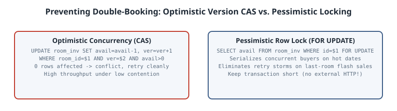

# Design Lab: Hotel Inventory and Reservations

Build a Go reservation API for hotels and room types where the central invariant is **zero overselling**: for every stay date in `[check_in, check_out)`, confirmed reservations plus active holds must never exceed room capacity (or an explicit overbooking cap). A cached "rooms available" banner is advisory only—it can never enforce this invariant.



## Model dates, holds, and authoritative schema

Use hotel-local calendar dates with a half-open stay interval `[check_in, check_out)` (a 2-night stay checking in Friday and out Sunday locks Friday and Saturday nights). Separate **holds** (short-lived 10-minute locks while the guest pays) from **confirmed** reservations.

### Authoritative schema (`migrations/001_hotels.sql`)

```sql
CREATE TABLE room_inventory (
    hotel_id   UUID NOT NULL,
    room_type  TEXT NOT NULL,
    stay_date  DATE NOT NULL,
    capacity   INT NOT NULL CHECK (capacity >= 0),
    allocated  INT NOT NULL DEFAULT 0 CHECK (allocated >= 0 AND allocated <= capacity),
    version    BIGINT NOT NULL DEFAULT 1,
    PRIMARY KEY (hotel_id, room_type, stay_date)
);

CREATE TABLE reservations (
    id              UUID PRIMARY KEY,
    hotel_id        UUID NOT NULL,
    room_type       TEXT NOT NULL,
    guest_id        UUID NOT NULL,
    check_in        DATE NOT NULL,
    check_out       DATE NOT NULL CHECK (check_out > check_in),
    quantity        INT NOT NULL CHECK (quantity > 0),
    status          TEXT NOT NULL, -- HELD | CONFIRMED | EXPIRED | CANCELLED
    idempotency_key TEXT NOT NULL,
    hold_expires_at TIMESTAMPTZ NOT NULL,
    created_at      TIMESTAMPTZ NOT NULL DEFAULT now(),
    UNIQUE (guest_id, idempotency_key)
);
```

For single-unit resources (e.g., unique villas or meeting rooms where room number is fixed), PostgreSQL's [`btree_gist`](https://www.postgresql.org/docs/current/btree-gist.html) extension lets the database enforce non-overlapping bookings directly via `EXCLUDE USING GIST (room_id WITH =, daterange(check_in, check_out, '[)') WITH &&)`. For fungible room-type pools (e.g., 40 "Deluxe King" rooms), per-night inventory rows with sorted row locks or version CAS are the right fit.

## Go implementation: Deadlock-free multi-night hold transaction

Always lock multi-night inventory rows in **strictly ascending `stay_date` order** (`ORDER BY stay_date ASC FOR UPDATE`) so two overlapping stays (`Fri–Sun` and `Sat–Mon`) never acquire locks in opposite orders and deadlock. Never hold a PostgreSQL transaction open while calling an external payment gateway—commit the `HELD` reservation first, take payment via the [payment design lab](15-payment-system.md), then confirm.

```go
package hotel

import (
	"context"
	"database/sql"
	"errors"
	"time"
)

var (
	ErrSoldOut          = errors.New("insufficient inventory for one or more stay dates")
	ErrHoldExpired      = errors.New("reservation hold already expired or transitioned")
)

type HoldRequest struct {
	ReservationID  string
	HotelID        string
	RoomType       string
	GuestID        string
	CheckIn        time.Time // UTC date truncated to midnight
	CheckOut       time.Time
	Quantity       int
	IdempotencyKey string
	HoldTTL        time.Duration
}

// CreateHold atomically reserves room_inventory for every night in [CheckIn, CheckOut)
// using ascending date lock order and an idempotency guard.
func CreateHold(ctx context.Context, db *sql.DB, req HoldRequest) (string, error) {
	tx, err := db.BeginTx(ctx, &sql.TxOptions{Isolation: sql.LevelReadCommitted})
	if err != nil {
		return "", err
	}
	defer tx.Rollback()

	// 1. Idempotent retry check.
	var existingID string
	err = tx.QueryRowContext(ctx,
		`SELECT id FROM reservations WHERE guest_id = $1 AND idempotency_key = $2`,
		req.GuestID, req.IdempotencyKey,
	).Scan(&existingID)
	if err == nil {
		return existingID, nil
	}
	if !errors.Is(err, sql.ErrNoRows) {
		return "", err
	}

	// 2. Lock every night in ascending stay_date order to prevent deadlocks.
	nights := int(req.CheckOut.Sub(req.CheckIn).Hours() / 24)
	rows, err := tx.QueryContext(ctx, `
		SELECT stay_date, capacity, allocated
		FROM room_inventory
		WHERE hotel_id = $1 AND room_type = $2
		  AND stay_date >= $3 AND stay_date < $4
		ORDER BY stay_date ASC
		FOR UPDATE`,
		req.HotelID, req.RoomType, req.CheckIn, req.CheckOut,
	)
	if err != nil {
		return "", err
	}
	var lockedNights int
	for rows.Next() {
		var d time.Time
		var capN, alloc int
		if err := rows.Scan(&d, &capN, &alloc); err != nil {
			rows.Close()
			return "", err
		}
		if alloc+req.Quantity > capN {
			rows.Close()
			return "", ErrSoldOut
		}
		lockedNights++
	}
	rows.Close()
	if err := rows.Err(); err != nil {
		return "", err
	}
	if lockedNights != nights {
		return "", ErrSoldOut // Missing inventory row for at least one date
	}

	// 3. Increment allocated across the entire stay atomically.
	res, err := tx.ExecContext(ctx, `
		UPDATE room_inventory
		SET allocated = allocated + $1, version = version + 1
		WHERE hotel_id = $2 AND room_type = $3
		  AND stay_date >= $4 AND stay_date < $5
		  AND allocated + $1 <= capacity`,
		req.Quantity, req.HotelID, req.RoomType, req.CheckIn, req.CheckOut,
	)
	if err != nil {
		return "", err
	}
	updated, _ := res.RowsAffected()
	if int(updated) != nights {
		return "", ErrSoldOut
	}

	// 4. Insert HELD reservation.
	if _, err := tx.ExecContext(ctx, `
		INSERT INTO reservations (id, hotel_id, room_type, guest_id, check_in, check_out, quantity, status, idempotency_key, hold_expires_at)
		VALUES ($1, $2, $3, $4, $5, $6, $7, 'HELD', $8, $9)`,
		req.ReservationID, req.HotelID, req.RoomType, req.GuestID,
		req.CheckIn, req.CheckOut, req.Quantity, req.IdempotencyKey,
		time.Now().UTC().Add(req.HoldTTL),
	); err != nil {
		return "", err
	}

	if err := tx.Commit(); err != nil {
		return "", err
	}
	return req.ReservationID, nil
}
```

## Hold expiry, confirmation races, and pessimistic vs. optimistic locking

- **Expiry vs. confirmation race**: Both `ConfirmHold` and the background `ExpireHolds` sweeper must lock the `reservations` row (`SELECT ... FOR UPDATE`) before transitioning `HELD -> CONFIRMED` or `HELD -> EXPIRED`. Only the transition out of `HELD` to `EXPIRED` or `CANCELLED` decrements `room_inventory.allocated`—ensuring inventory is released **at most once**. If a late payment capture arrives after `EXPIRED`, route to automatic refund rather than resurrecting inventory already sold to another guest.
- **Pessimistic (`FOR UPDATE`) vs. Optimistic (`version = version + 1` CAS)**: Optimistic CAS has zero lock waits under low contention, while pessimistic `FOR UPDATE` avoids retry storms when 500 fans try to book the last hotel room during a concert weekend.

## Acceptance evidence

1. **Last-room contention**: Race 100 Go goroutines booking 1 remaining room across 2 nights; assert exactly 1 succeeds, 99 return `ErrSoldOut`, and `allocated == capacity` on both nights.
2. **Overlapping deadlock drill**: Concurrently book `[Fri, Sun)` and `[Sat, Mon)` across 50 goroutines and assert zero PostgreSQL deadlocks.
3. **Expiry vs. confirm race**: Trigger `ConfirmHold` and `ExpireHolds` at the exact expiry millisecond; assert exactly one wins and `SUM(active reservations) == room_inventory.allocated`.
4. **Missing night rollback**: Leave Saturday missing from `room_inventory` and verify Friday is not partially allocated.

## Reference materials

- [PostgreSQL Explicit Locking (`FOR UPDATE`)](https://www.postgresql.org/docs/current/explicit-locking.html)
- [PostgreSQL `btree_gist` & Exclusion Constraints](https://www.postgresql.org/docs/current/btree-gist.html)
- [Go Executing Transactions Guide](https://go.dev/doc/database/execute-transactions)
- [Payment orchestration lab](15-payment-system.md)
