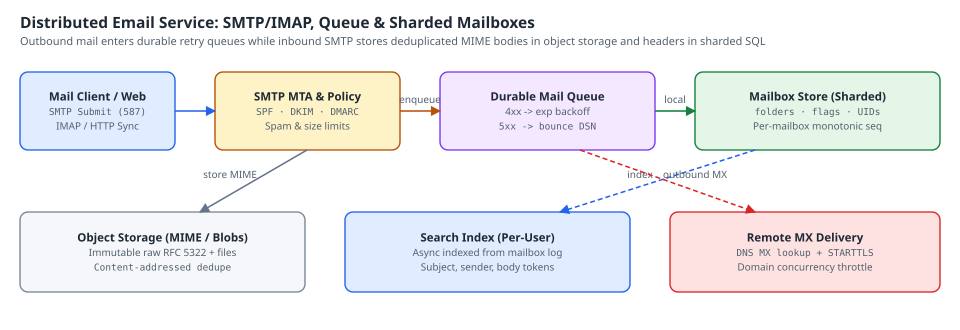

# Design Lab: A Distributed Email Service

Extend [notification delivery](02-notification-delivery.md) into a full Go mailbox and mail-transport architecture backed by a local fake SMTP server and synthetic messages. Separate **SMTP transport acceptance** ([RFC 5321](https://www.rfc-editor.org/info/rfc5321/)), **MIME blob persistence** ([RFC 5322](https://www.rfc-editor.org/info/rfc5322/)), **sharded mailbox metadata** ([IMAP4rev2 / RFC 9051](https://www.rfc-editor.org/info/rfc9051/)), and **asynchronous search indexing**.



## Components, workload axes, and authoritative schema

Mail systems have two orthogonal scaling axes:
- **Mailbox reads/sync**: Partitioned by `mailbox_id` (user account), serving folder listings, unread counts, and `(received_at, delivery_id)` cursor pagination.
- **Outbound MX delivery**: Partitioned by `destination_domain` (`gmail.com`, `outlook.com`), enforcing per-domain connection pools and exponential backoff on `4xx` transient codes so one slow receiver never blocks mail to other domains.

### Authoritative schema (`migrations/001_email.sql`)

Store immutable raw RFC 5322 MIME bodies and attachments in object storage (content-addressed by SHA-256) and keep small indexed metadata in PostgreSQL.

```sql
CREATE TABLE mail_blobs (
    blob_id     CHAR(64) PRIMARY KEY, -- SHA-256 of raw MIME message
    size_bytes  BIGINT NOT NULL CHECK (size_bytes > 0),
    created_at  TIMESTAMPTZ NOT NULL DEFAULT now()
);

CREATE TABLE mailbox_messages (
    delivery_id UUID PRIMARY KEY,
    mailbox_id  UUID NOT NULL,
    folder      TEXT NOT NULL DEFAULT 'INBOX', -- INBOX | SENT | ARCHIVE | TRASH
    uid         BIGINT NOT NULL, -- Monotonic per-(mailbox_id, folder) for IMAP sync
    blob_id     CHAR(64) NOT NULL REFERENCES mail_blobs(blob_id),
    from_addr   TEXT NOT NULL,
    subject     TEXT NOT NULL,
    flags       TEXT[] NOT NULL DEFAULT '{}', -- \Seen, \Flagged
    received_at TIMESTAMPTZ NOT NULL DEFAULT now(),
    deleted_at  TIMESTAMPTZ,
    UNIQUE (mailbox_id, folder, uid)
);

CREATE INDEX idx_mailbox_cursor
    ON mailbox_messages (mailbox_id, folder, received_at DESC, delivery_id DESC)
    WHERE deleted_at IS NULL;

CREATE TABLE outbound_queue (
    id                 UUID PRIMARY KEY,
    sender_mailbox_id  UUID NOT NULL,
    rcpt_domain        TEXT NOT NULL,
    rcpt_addr          TEXT NOT NULL,
    blob_id            CHAR(64) NOT NULL REFERENCES mail_blobs(blob_id),
    status             TEXT NOT NULL DEFAULT 'QUEUED', -- QUEUED | SENT | BOUNCED | UNCERTAIN
    attempts           INT NOT NULL DEFAULT 0,
    next_attempt_at    TIMESTAMPTZ NOT NULL DEFAULT now(),
    last_smtp_code     INT NOT NULL DEFAULT 0,
    last_error         TEXT NOT NULL DEFAULT ''
);
```

## Go implementation: Safe SMTP adapter, header-injection guard, and error classification

Keep transport behind a narrow `Submit(ctx, env, mimeReader)` interface. Never trust an RFC `Message-ID` header from external senders as a deduplication key; assign an internal `delivery_id`. Reject CR/LF characters in envelope addresses and header values to prevent SMTP header injection.

```go
package email

import (
	"context"
	"errors"
	"fmt"
	"io"
	"net/mail"
	"strings"
)

type Disposition string

const (
	DispAccepted  Disposition = "TRANSPORT_ACCEPTED" // 250 OK
	DispTransient Disposition = "RETRY_WAIT"         // 4xx tempfail
	DispPermanent Disposition = "PERMANENT_FAILURE"  // 5xx bounce DSN
	DispUncertain Disposition = "UNCERTAIN"          // Disconnect after DATA
)

type Envelope struct {
	DeliveryID string
	MailFrom   string
	RcptTo     string
}

type SMTPError struct {
	Code    int
	Message string
	AfterData bool
}

func (e *SMTPError) Error() string { return fmt.Sprintf("smtp %d: %s", e.Code, e.Message) }

type Transport interface {
	Submit(ctx context.Context, env Envelope, mime io.Reader) (queueRef string, err error)
}

// ValidateEnvelope parses RFC 5322 addresses and blocks CR/LF header injection.
func ValidateEnvelope(env Envelope) error {
	for _, raw := range []string{env.MailFrom, env.RcptTo} {
		if strings.ContainsAny(raw, "\r\n") {
			return errors.New("invalid address: contains CR/LF")
		}
		if _, err := mail.ParseAddress(raw); err != nil {
			return fmt.Errorf("invalid email address %q: %w", raw, err)
		}
	}
	return nil
}

// ClassifySMTP maps SMTP status codes and mid-DATA disconnects to retry states.
func ClassifySMTP(err error) Disposition {
	if err == nil {
		return DispAccepted
	}
	var se *SMTPError
	if errors.As(err, &se) {
		if se.AfterData {
			return DispUncertain
		}
		if se.Code >= 500 && se.Code < 600 {
			return DispPermanent
		}
		if se.Code >= 400 && se.Code < 500 {
			return DispTransient
		}
	}
	if errors.Is(err, context.DeadlineExceeded) {
		return DispUncertain
	}
	return DispTransient
}
```

## Distribution, security, and acceptance evidence

- **Ambiguous SMTP `DATA` disconnects**: If the TCP connection drops after sending the final `.` of `DATA` but before receiving `250 OK`, the remote server may have already accepted the message. Record `UNCERTAIN`, log clearly, and retry with bounded attempts—never claim exactly-once delivery across SMTP.
- **Authorization on blobs**: Even if MIME bodies are content-addressed in S3, every body or attachment download must verify the caller owns a non-deleted `mailbox_messages` row pointing to `blob_id`, and never use user-provided attachment filenames as local paths.
- **Search lag**: Index mailbox metadata asynchronously via outbox; deleting a message must immediately exclude it from authorized reads even while the search index catches up.

### Acceptance drills (`go test -race ./...`)

1. **Disconnect after `DATA`**: Configure the fake SMTP server to accept `DATA` and close TCP before `250 OK`; assert `ClassifySMTP` returns `DispUncertain` and the queue logs the attempt without losing the message.
2. **Header injection**: Submit `"victim@example.com\r\nBcc: attacker@evil.test"` and assert `ValidateEnvelope` rejects it before touching the queue.
3. **Domain isolation**: Stall `slow.example` with 421 tempfails while verifying mail to `fast.example` delivers immediately.
4. **Search outage resilience**: Pause the indexer and confirm `GET /mailboxes/{id}/messages` still returns newly received mail in exact `(received_at, delivery_id)` order.

## Reference materials

- [RFC 5321 — Simple Mail Transfer Protocol (SMTP)](https://www.rfc-editor.org/info/rfc5321/)
- [RFC 5322 — Internet Message Format](https://www.rfc-editor.org/info/rfc5322/)
- [RFC 9051 — Internet Message Access Protocol (IMAP4rev2)](https://www.rfc-editor.org/info/rfc9051/)
- [Go `net/smtp` Package](https://pkg.go.dev/net/smtp)
- [Notification delivery lab](02-notification-delivery.md)
