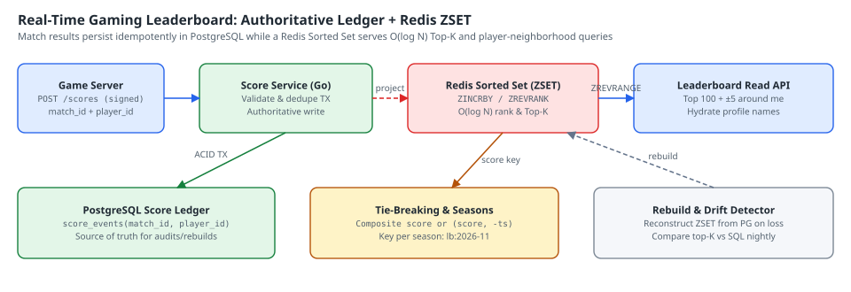

# Design Lab: A Real-Time Gaming Leaderboard

Build a Go ranking service for seasonal game matches that separates **authoritative score events** (PostgreSQL) from the **read-optimized ranking projection** (Redis Sorted Sets). The first contract decision is whether match results are **additive** (`+25` points per win) or **high-water mark** (`max(best, new)`), because replays behave completely differently under each model.



## Contract, authority, and schema

Expose authenticated `POST /v1/seasons/{season}/results` (trusted game servers only), `GET /v1/seasons/{season}/top?limit=100`, and `GET /v1/seasons/{season}/players/{id}/rank?window=5`.

### Authoritative PostgreSQL schema (`migrations/001_leaderboard.sql`)

Never treat Redis as the source of truth—if a Redis shard flushes or fails over with async replication, you must be able to rebuild every season's exact `ZSET` from PostgreSQL.

```sql
CREATE TABLE score_events (
    event_id    UUID PRIMARY KEY,
    season_id   TEXT NOT NULL,
    player_id   UUID NOT NULL,
    delta       BIGINT NOT NULL CHECK (delta >= -100000 AND delta <= 100000),
    created_at  TIMESTAMPTZ NOT NULL DEFAULT now()
);

CREATE TABLE player_scores (
    season_id   TEXT NOT NULL,
    player_id   UUID NOT NULL,
    score       BIGINT NOT NULL DEFAULT 0,
    version     BIGINT NOT NULL DEFAULT 1,
    updated_at  TIMESTAMPTZ NOT NULL DEFAULT now(),
    PRIMARY KEY (season_id, player_id)
);
```

## Go implementation: Idempotent score ledger + version-fenced Redis projection

Avoid firing a blind `ZINCRBY` on Kafka/outbox replay—replaying one message twice doubles the player's score! Instead:
1. Deduplicate `event_id` and update `player_scores(score, version)` inside **one PostgreSQL transaction**.
2. Publish `(season_id, player_id, absolute_score, version)` to the Redis projection.
3. Apply the Redis update using a version-fenced check (Lua script comparing `HGET ver:{season} {player}` before calling [`ZADD`](https://redis.io/docs/latest/commands/zadd/)) so an out-of-order stale message can never overwrite a newer score.

> [!NOTE]
> **IEEE-754 precision trap in Redis `ZSET`:** Redis stores sorted-set scores as 64-bit IEEE-754 floats, which represent integers exactly only up to $2^{53} \approx 9 \times 10^{15}$. Keep integer scores well within `[-2^50, 2^50]`, or encode deterministic timestamp tie-breaking inside the lower fractional bits only when the score range is explicitly bounded.

```go
package leaderboard

import (
	"context"
	"database/sql"
	"errors"
	"fmt"
	"math"
)

const MaxExactZSetScore int64 = 1 << 50

var ErrScoreOverflow = errors.New("score exceeds exact ZSET integer range")

type ScoreEvent struct {
	EventID  string
	SeasonID string
	PlayerID string
	Delta    int64
}

type PlayerSnapshot struct {
	SeasonID string
	PlayerID string
	Score    int64
	Version  int64
}

// ApplyEvent deduplicates event_id and updates player_scores atomically in PostgreSQL.
// Returns applied=false on duplicate replay without double-counting points.
func ApplyEvent(ctx context.Context, db *sql.DB, ev ScoreEvent) (snap PlayerSnapshot, applied bool, err error) {
	tx, err := db.BeginTx(ctx, nil)
	if err != nil {
		return PlayerSnapshot{}, false, err
	}
	defer tx.Rollback()

	res, err := tx.ExecContext(ctx, `
		INSERT INTO score_events (event_id, season_id, player_id, delta)
		VALUES ($1, $2, $3, $4)
		ON CONFLICT (event_id) DO NOTHING`,
		ev.EventID, ev.SeasonID, ev.PlayerID, ev.Delta,
	)
	if err != nil {
		return PlayerSnapshot{}, false, err
	}
	n, _ := res.RowsAffected()
	if n == 0 {
		// Duplicate event: return current authoritative score without mutating.
		err = tx.QueryRowContext(ctx,
			`SELECT score, version FROM player_scores WHERE season_id = $1 AND player_id = $2`,
			ev.SeasonID, ev.PlayerID,
		).Scan(&snap.Score, &snap.Version)
		snap.SeasonID, snap.PlayerID = ev.SeasonID, ev.PlayerID
		return snap, false, err
	}

	err = tx.QueryRowContext(ctx, `
		INSERT INTO player_scores (season_id, player_id, score, version)
		VALUES ($1, $2, $3, 1)
		ON CONFLICT (season_id, player_id)
		DO UPDATE SET
			score = player_scores.score + EXCLUDED.score,
			version = player_scores.version + 1,
			updated_at = now()
		RETURNING score, version`,
		ev.SeasonID, ev.PlayerID, ev.Delta,
	).Scan(&snap.Score, &snap.Version)
	if err != nil {
		return PlayerSnapshot{}, false, err
	}
	if snap.Score > MaxExactZSetScore || snap.Score < -MaxExactZSetScore {
		return PlayerSnapshot{}, false, fmt.Errorf("%w: %d", ErrScoreOverflow, snap.Score)
	}

	if err := tx.Commit(); err != nil {
		return PlayerSnapshot{}, false, err
	}
	snap.SeasonID, snap.PlayerID = ev.SeasonID, ev.PlayerID
	return snap, true, nil
}

// CompositeScore packs integer points + inverted timestamp into a float64
// so earlier achievers win ties (requires points <= 1e9 and unixSec <= 1e10).
func CompositeScore(points int64, achievedUnix int64) float64 {
	const maxTs = 10_000_000_000.0
	tieFrac := (maxTs - float64(achievedUnix)) / (maxTs * 10.0)
	return float64(points) + math.Max(0, math.Min(0.099999, tieFrac))
}
```

## Scaling, sharding trade-offs, and capacity math

- **Single `ZSET` headroom**: A Redis sorted set with **5 million players** (`~64 B/entry`) uses **~320 MB RAM** and executes `ZADD`, `ZREVRANK`, and `ZREVRANGE 0 99` in $O(\log N)$ (~0.2–0.5 ms).
- **When sharding hurts**: Hashing players across 16 Redis shards lets you compute global Top-100 via a 16-way merge, but **cannot** answer a mid-table player's exact global rank ("#482,193") without scattering across every shard or bucketing by score range (histogram shards). Do not shard prematurely before a single `ZSET` hits memory or CPU limits.

## Acceptance evidence

1. **Duplicate & out-of-order replay**: Submit the same `event_id` 5 times and deliver `version=4` before `version=3` to the projection; assert exact score and monotonic version.
2. **Season isolation & ties**: Tie 3 players across 2 seasons and verify deterministic ordering and zero cross-season leakage.
3. **Disaster rebuild**: `FLUSHDB` Redis, run the rebuild job from `player_scores`, and assert 100% parity between Redis ranks and PostgreSQL `ORDER BY score DESC`.

## Reference materials

- [Redis Sorted Sets Guide](https://redis.io/docs/latest/develop/data-types/sorted-sets/) and [Redis `ZADD` Reference](https://redis.io/docs/latest/commands/zadd/)
- [Go Executing Transactions Guide](https://go.dev/doc/database/execute-transactions)
- [Outbox reliable side effects](../../18-distributed-infra/157-outbox-reliable-side-effects.md)
