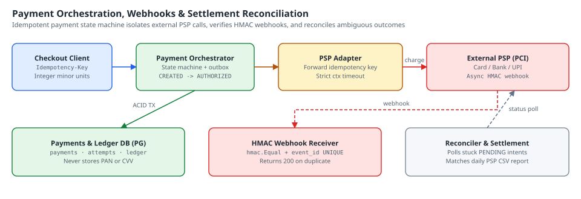

# Design Lab: Payment Orchestration and Reconciliation

Build a Go payment orchestrator against a deterministic fake Payment Service Provider (PSP). The core problem is **distributed state convergence**: one checkout spans your PostgreSQL database and an external PSP that cannot join your transaction. Use integer minor units (`int64` paise/cents), never `float64`, and never store raw card PANs or CVVs.



## Contract, state machine, and authoritative schema

`POST /v1/payments` accepts `order_id`, `amount_minor`, `currency`, and a tenant-scoped `Idempotency-Key`. Store a SHA-256 `payload_hash` so reusing a key with a different amount returns `409 Conflict`.

```text
CREATED -> SUBMITTED -> SUCCEEDED (terminal)
               |    \-> FAILED (terminal)
               +------> UNKNOWN (timeout) -> Reconciler -> SUCCEEDED | FAILED
```

### Authoritative schema (`migrations/001_payments.sql`)

```sql
CREATE TABLE payment_intents (
    id              UUID PRIMARY KEY,
    tenant_id       UUID NOT NULL,
    order_id        UUID NOT NULL,
    idempotency_key TEXT NOT NULL,
    payload_hash    CHAR(64) NOT NULL,
    amount_minor    BIGINT NOT NULL CHECK (amount_minor > 0),
    currency        CHAR(3) NOT NULL,
    status          TEXT NOT NULL, -- CREATED | SUBMITTED | SUCCEEDED | FAILED | UNKNOWN
    provider_ref    TEXT NOT NULL DEFAULT '',
    version         BIGINT NOT NULL DEFAULT 1,
    created_at      TIMESTAMPTZ NOT NULL DEFAULT now(),
    updated_at      TIMESTAMPTZ NOT NULL DEFAULT now(),
    UNIQUE (tenant_id, idempotency_key)
);

CREATE TABLE webhook_events (
    provider_event_id TEXT PRIMARY KEY,
    intent_id         UUID NOT NULL,
    event_type        TEXT NOT NULL,
    raw_body          BYTEA NOT NULL,
    received_at       TIMESTAMPTZ NOT NULL DEFAULT now()
);
```

## Go implementation: Idempotent PSP adapter, monotonic transitions, and reconciler

Never create a new PSP operation ID when an HTTP call times out—forward the exact same `OperationID` on retry, and mark local state `UNKNOWN` so the Reconciler polls `Provider.Lookup` until the PSP confirms a terminal state. Never hold a database lock while making an external HTTP call!

```go
package payorch

import (
	"context"
	"crypto/hmac"
	"crypto/sha256"
	"database/sql"
	"encoding/hex"
	"errors"
	"time"
)

type State string

const (
	StateCreated   State = "CREATED"
	StateSubmitted State = "SUBMITTED"
	StateUnknown   State = "UNKNOWN"
	StateSucceeded State = "SUCCEEDED"
	StateFailed    State = "FAILED"
)

// allowed prevents stale webhooks (e.g. "pending") from regressing terminal states.
var allowed = map[State]map[State]bool{
	StateCreated:   {StateSubmitted: true, StateFailed: true},
	StateSubmitted: {StateSucceeded: true, StateFailed: true, StateUnknown: true},
	StateUnknown:   {StateSucceeded: true, StateFailed: true},
}

type Provider interface {
	Submit(ctx context.Context, opID string, amountMinor int64, currency string) (providerRef string, state State, err error)
	Lookup(ctx context.Context, opID string) (providerRef string, state State, err error)
}

func VerifyWebhookHMAC(rawBody []byte, headerSigHex string, secret []byte) bool {
	got, err := hex.DecodeString(headerSigHex)
	if err != nil {
		return false
	}
	mac := hmac.New(sha256.New, secret)
	mac.Write(rawBody)
	return hmac.Equal(got, mac.Sum(nil))
}

// ReconcileStuck polls the PSP for UNKNOWN or stale SUBMITTED intents outside
// any DB lock, then applies a guarded CAS transition locally.
func ReconcileStuck(ctx context.Context, db *sql.DB, psp Provider, olderThan time.Duration) (int, error) {
	cutoff := time.Now().UTC().Add(-olderThan)
	rows, err := db.QueryContext(ctx, `
		SELECT id, status, version FROM payment_intents
		WHERE status IN ('UNKNOWN', 'SUBMITTED') AND updated_at < $1
		LIMIT 100`, cutoff,
	)
	if err != nil {
		return 0, err
	}
	type item struct {
		id  string
		st  State
		ver int64
	}
	var stuck []item
	for rows.Next() {
		var it item
		if err := rows.Scan(&it.id, &it.st, &it.ver); err != nil {
			rows.Close()
			return 0, err
		}
		stuck = append(stuck, it)
	}
	rows.Close()

	resolved := 0
	for _, it := range stuck {
		ref, remoteState, err := psp.Lookup(ctx, it.id)
		if err != nil || !allowed[it.st][remoteState] {
			continue
		}
		res, err := db.ExecContext(ctx, `
			UPDATE payment_intents
			SET status = $1, provider_ref = $2, version = version + 1, updated_at = now()
			WHERE id = $3 AND status = $4 AND version = $5`,
			string(remoteState), ref, it.id, string(it.st), it.ver,
		)
		if err == nil {
			if n, _ := res.RowsAffected(); n == 1 {
				resolved++
			}
		}
	}
	return resolved, nil
}

var ErrIllegalRegression = errors.New("stale event cannot regress payment state")
```

## Webhooks, settlement files, and wallet boundary

- **Webhook discipline**: Verify HMAC-SHA256 on raw body bytes (`hmac.Equal`), deduplicate `provider_event_id` via `ON CONFLICT DO NOTHING`, return `200 OK` on duplicates, and reject state regressions (a delayed `pending` webhook can never overwrite `SUCCEEDED`).
- **Two-tier reconciliation**: (1) Near-real-time poller (`ReconcileStuck` every 2–5 minutes) resolves network timeouts; (2) Daily settlement CSV/T+1 matcher catches fee discrepancies, chargebacks, and silently missed webhooks.
- **Link to internal ledger**: This orchestrator tracks the external PSP lifecycle; internal account balances belong to the [double-entry digital wallet](16-digital-wallet.md) connected via outbox events.

## Acceptance evidence

Script and run `go test -race ./...` across:
1. Duplicate `POST /v1/payments` with identical key (returns same intent) vs. changed amount (`409 Conflict`).
2. Fake PSP accepts charge and drops TCP before returning response -> local state moves to `UNKNOWN` -> `ReconcileStuck` converges to `SUCCEEDED` with exactly 1 PSP operation.
3. Webhook arrives *before* `Submit` returns, followed by duplicate webhooks and a stale `pending` event -> state stays monotonically `SUCCEEDED`.
4. Invalid HMAC signature -> `401 Unauthorized` with zero DB writes.

## Reference materials

- [RFC 2104 — HMAC: Keyed-Hashing for Message Authentication](https://www.rfc-editor.org/info/rfc2104/)
- [IETF Draft — The `Idempotency-Key` HTTP Header Field](https://datatracker.ietf.org/doc/draft-ietf-httpapi-idempotency-key-header/)
- [Stripe Webhooks Documentation](https://docs.stripe.com/webhooks)
- [Digital wallet double-entry ledger](16-digital-wallet.md) and [Food delivery payment architecture](18-food-delivery-platform.md)
