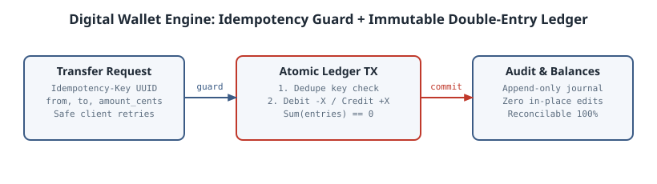

# Design Lab: A Digital Wallet and Double-Entry Ledger

Build a Go wallet and double-entry ledger with synthetic funds in one currency. The fundamental invariant is **conservation of money (zero-sum)**: every posted transfer creates balanced debit and credit entries summing to `0`, and available funds never become negative under a no-overdraft rule. Money must never appear or vanish from an unpaired balance edit.



## Model the double-entry ledger first

Store **accounts**, **transfers**, and **immutable ledger entries**. Every funding deposit credits a user's wallet and debits a designated `external_clearing` account. Reversals append new opposing entries under a new transfer ID—never `UPDATE` or `DELETE` posted history.

### Authoritative schema (`migrations/001_wallet.sql`)

```sql
CREATE TABLE accounts (
    id              UUID PRIMARY KEY,
    owner_id        UUID NOT NULL,
    currency        CHAR(3) NOT NULL,
    balance_minor   BIGINT NOT NULL DEFAULT 0 CHECK (balance_minor >= 0),
    held_minor      BIGINT NOT NULL DEFAULT 0 CHECK (held_minor >= 0 AND held_minor <= balance_minor),
    version         BIGINT NOT NULL DEFAULT 1,
    updated_at      TIMESTAMPTZ NOT NULL DEFAULT now()
);

CREATE TABLE transfers (
    id              UUID PRIMARY KEY,
    tenant_id       UUID NOT NULL,
    idempotency_key TEXT NOT NULL,
    payload_hash    CHAR(64) NOT NULL,
    from_account    UUID NOT NULL REFERENCES accounts(id),
    to_account      UUID NOT NULL REFERENCES accounts(id),
    amount_minor    BIGINT NOT NULL CHECK (amount_minor > 0),
    currency        CHAR(3) NOT NULL,
    created_at      TIMESTAMPTZ NOT NULL DEFAULT now(),
    CHECK (from_account <> to_account),
    UNIQUE (tenant_id, idempotency_key)
);

CREATE TABLE ledger_entries (
    id          BIGSERIAL PRIMARY KEY,
    transfer_id UUID NOT NULL REFERENCES transfers(id),
    account_id  UUID NOT NULL REFERENCES accounts(id),
    delta_minor BIGINT NOT NULL CHECK (delta_minor <> 0),
    created_at  TIMESTAMPTZ NOT NULL DEFAULT now()
);
```

## Go and SQL transaction: Lock ordering and overflow safety

When Alice transfers to Bob at the exact same instant Bob transfers to Alice, locking `from_account` then `to_account` causes a classic deadlock! Always lock both account rows in **stable ascending UUID order** (`ORDER BY id ASC FOR UPDATE`) inside one `sql.Tx` (see Go's [executing transactions guide](https://go.dev/doc/database/execute-transactions)).

```go
package wallet

import (
	"context"
	"database/sql"
	"errors"
	"math"
)

var (
	ErrInvalidTransfer    = errors.New("invalid transfer parameters")
	ErrInsufficientFunds  = errors.New("insufficient available balance")
	ErrCurrencyMismatch   = errors.New("account currency mismatch")
	ErrPayloadConflict    = errors.New("idempotency key reused with different payload")
)

type TransferReq struct {
	TransferID     string
	TenantID       string
	IdempotencyKey string
	PayloadHash    string
	FromAccount    string
	ToAccount      string
	AmountMinor    int64
	Currency       string
}

// Transfer executes a deadlock-free, idempotent, zero-sum double-entry posting.
func Transfer(ctx context.Context, db *sql.DB, req TransferReq) (string, error) {
	if req.AmountMinor <= 0 || req.FromAccount == req.ToAccount || len(req.Currency) != 3 {
		return "", ErrInvalidTransfer
	}

	tx, err := db.BeginTx(ctx, &sql.TxOptions{Isolation: sql.LevelReadCommitted})
	if err != nil {
		return "", err
	}
	defer tx.Rollback()

	// 1. Idempotency check with payload hash verification.
	var existingID, existingHash string
	err = tx.QueryRowContext(ctx,
		`SELECT id, payload_hash FROM transfers WHERE tenant_id = $1 AND idempotency_key = $2`,
		req.TenantID, req.IdempotencyKey,
	).Scan(&existingID, &existingHash)
	if err == nil {
		if existingHash != req.PayloadHash {
			return "", ErrPayloadConflict
		}
		return existingID, nil
	}
	if !errors.Is(err, sql.ErrNoRows) {
		return "", err
	}

	// 2. Lock both accounts in deterministic ascending ID order to avoid deadlocks.
	first, second := req.FromAccount, req.ToAccount
	if first > second {
		first, second = second, first
	}
	rows, err := tx.QueryContext(ctx, `
		SELECT id, currency, balance_minor, held_minor
		FROM accounts
		WHERE id IN ($1, $2)
		ORDER BY id ASC
		FOR UPDATE`, first, second,
	)
	if err != nil {
		return "", err
	}
	type acct struct {
		cur   string
		bal   int64
		held  int64
	}
	locked := make(map[string]acct, 2)
	for rows.Next() {
		var id string
		var a acct
		if err := rows.Scan(&id, &a.cur, &a.bal, &a.held); err != nil {
			rows.Close()
			return "", err
		}
		locked[id] = a
	}
	rows.Close()
	if len(locked) != 2 {
		return "", ErrInvalidTransfer
	}

	src, dst := locked[req.FromAccount], locked[req.ToAccount]
	if src.cur != req.Currency || dst.cur != req.Currency {
		return "", ErrCurrencyMismatch
	}
	if src.bal-src.held < req.AmountMinor {
		return "", ErrInsufficientFunds
	}
	if dst.bal > math.MaxInt64-req.AmountMinor {
		return "", ErrInvalidTransfer // Prevent int64 overflow
	}

	// 3. Insert transfer receipt + paired zero-sum ledger entries + update cached balances.
	if _, err := tx.ExecContext(ctx, `
		INSERT INTO transfers (id, tenant_id, idempotency_key, payload_hash, from_account, to_account, amount_minor, currency)
		VALUES ($1, $2, $3, $4, $5, $6, $7, $8)`,
		req.TransferID, req.TenantID, req.IdempotencyKey, req.PayloadHash,
		req.FromAccount, req.ToAccount, req.AmountMinor, req.Currency,
	); err != nil {
		return "", err
	}

	if _, err := tx.ExecContext(ctx, `
		INSERT INTO ledger_entries (transfer_id, account_id, delta_minor)
		VALUES ($1, $2, $3), ($1, $4, $5)`,
		req.TransferID, req.FromAccount, -req.AmountMinor, req.ToAccount, +req.AmountMinor,
	); err != nil {
		return "", err
	}

	if _, err := tx.ExecContext(ctx,
		`UPDATE accounts SET balance_minor = balance_minor - $1, version = version + 1, updated_at = now() WHERE id = $2`,
		req.AmountMinor, req.FromAccount,
	); err != nil {
		return "", err
	}
	if _, err := tx.ExecContext(ctx,
		`UPDATE accounts SET balance_minor = balance_minor + $1, version = version + 1, updated_at = now() WHERE id = $2`,
		req.AmountMinor, req.ToAccount,
	); err != nil {
		return "", err
	}

	if err := tx.Commit(); err != nil {
		return "", err
	}
	return req.TransferID, nil
}
```

## Holds, sharding boundaries, and acceptance evidence

- **Available vs. posted holds**: Model holds as a separate `holds` table incrementing `accounts.held_minor`; available funds equal `balance_minor - held_minor`. Capturing a hold decrements `held_minor` and posts a zero-sum transfer atomically.
- **Sharding boundary**: Single-shard ACID transactions work cleanly up to thousands of transfers/sec. Sharding accounts across separate databases invalidates single-TX transfers and requires a multi-step Saga with intermediate transit/clearing accounts and automated reconciliation.

### Acceptance drills (`go test -race ./...`)

1. **No-overdraft concurrency**: Seed Account A with `100` units and B with `0`. Fire 100 concurrent transfers of `3` units each with unique keys. Assert **exactly 33** succeed, A ends at `1`, B ends at `99`, and `SUM(ledger_entries.delta_minor) == 0`.
2. **Opposing deadlock drill**: Concurrently transfer A -> B and B -> A across 50 goroutines; assert zero PostgreSQL deadlocks.
3. **Idempotent replay & conflict**: Replay all 100 requests and assert zero balance change; reuse a key with a changed amount and assert `ErrPayloadConflict`.
4. **Ledger-to-balance audit**: Assert for every account that `accounts.balance_minor == SUM(ledger_entries.delta_minor WHERE account_id = id)`.

## Reference materials

- [Go Executing Transactions Guide](https://go.dev/doc/database/execute-transactions)
- [Go `database/sql` Package](https://pkg.go.dev/database/sql)
- [PostgreSQL Explicit Locking](https://www.postgresql.org/docs/current/explicit-locking.html)
- [Payment orchestration lab](15-payment-system.md)
